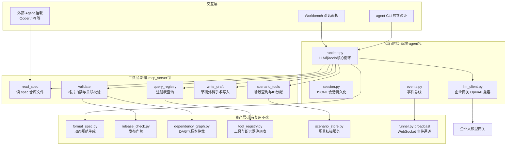

# SpecGuard Agent 架构设计：MCP 工具层 + 薄 Harness

> **版本**：v1.0 | **日期**：2026-07-24 | **状态**：待评审
> **读者**：实施开发、架构评审 | **前置阅读**：[完全体能力边界与交互流程](完全体SpecGuard能力边界与交互流程-测试人员指南.md)、[交互原型](SpecGuard完全体交互原型.html)
> **约束**：与现有引擎/工作台架构零冲突；最大化复用现有代码资产；所有智能能力为纯增量叠加

---

## 一、背景与目标

SpecGuard 完全体的智能层需要落地四项能力：场景智能生成、计划智能编排、失败智能归因、变更驱动自治回归。本文档定义其技术架构与开发方案，回答三个问题：

1. **Agent 以什么形态运行**——自建薄 harness（Python ~300 行核心循环），移植 PI 设计思想但不嵌入其代码；
2. **Agent 用什么工具**——5 个极简工具，全部薄封装现有校验器/注册表，以 MCP Server 协议暴露；
3. **正确性谁兜底**——确定性校验器（已有资产），LLM 只做「生成」与「读错后修复」，永不当裁判。

**非目标**：不做通用编码助手、不改动引擎冻结层（scenario_runner/dependency_graph 等）、不改变三道闸（人工评审 → 格式校验 → 发布门禁）。

---

## 二、架构决策（ADR 摘要）

| # | 决策 | 备选方案 | 理由 |
|---|------|----------|------|
| D1 | **自建薄 harness**（Python 核心循环 ~300 行） | 嵌入 PI/pi-mono | 技术栈统一（引擎+Workbench 全 Python），工具即进程内函数调用零 IPC；PI 价值在设计思想（极简工具/skill 注入/事件流）而非代码；通用编码 harness 对「受限域结构化生成」过重 |
| D2 | **工具层以 MCP Server 暴露** | 私有函数签名 / REST | harness 可换（未来可接 PI/OpenClaw）；外部 Agent（Qoder 等）可零开发挂载，POC 验证成本最低；工具资产与运行时解耦 |
| D3 | **skill = format_spec 动态规范** | 静态 prompt 文档 | [format_spec.py](../workbench/backend/services/format_spec.py) 由引擎注册表动态生成，规范与引擎永远同步，单一事实源，零维护 |
| D4 | **正确性由确定性校验器兜底** | LLM 自评 / 双模型互审 | 格式校验、发布门禁、covers 关联校验全部已有确定性实现；幻觉（编造 oracle/FR）即报错回灌修复，拦截率 100% |
| D5 | **写路径隔离 + 三道闸不变** | Agent 直接写场景库 | write_draft 仅能写 `drafts/` 草稿区；入库必经人工评审 → 格式校验 → 发布门禁，与现行治理一致 |
| D6 | **模型走企业大模型网关** | 直连外部 API | 数据不出内网（spec/场景均为内部资产）；token 计量可追溯，对接开发积分制 |

---

## 三、总体技术架构

### 3.1 分层架构图



### 3.2 目录结构（新增部分与现有并存，零冲突）

```
tests/specguard/
├── agent/                      # 【新增】薄 harness（PI 设计思想的 Python 实现）
│   ├── runtime.py              #   核心循环：LLM⇄工具⇄stop（~150 行）
│   ├── session.py              #   JSONL 会话持久化与恢复（PI 会话思想）
│   ├── events.py               #   事件总线（复用 runner broadcast 通道）
│   ├── llm_client.py           #   企业大模型网关客户端（OpenAI 兼容 + token 计量）
│   ├── prompts/
│   │   └── system.md.j2        #   system prompt 模板（运行时注入 format_spec）
│   └── cli.py                  #   独立验证入口（POC 阶段使用）
├── mcp_server/                 # 【新增】MCP 工具层（stdio + SSE 双模）
│   ├── server.py               #   MCP server 入口与工具注册
│   └── tools/
│       ├── spec_reader.py      #   read_spec / list_spec_files
│       ├── scenario_tools.py   #   list_scenarios / read_scenario / next_id
│       ├── registry_query.py   #   query_registry（oracle / step / tool）
│       ├── draft_writer.py     #   write_draft（文本外科手术 + 草稿区隔离）
│       └── validator.py        #   validate（格式 + 门禁 + covers 关联）
├── engine/                     # 【现有，冻结不改】
├── workbench/backend/
│   ├── routers/agent.py        # 【新增】/agent/* 路由（WebSocket 对话 + 会话管理）
│   └── ...                     # 【现有，不改】
└── drafts/                     # 【新增】Agent 草稿区（评审通过才移入 scenarios/）
```

### 3.3 一次生成的完整数据流

```
用户指令「为 FR-009 生成场景」
  → runtime 组装 system prompt（角色 + format_spec 动态文档 + 工具 schema + 硬约束）
  → LLM 循环（≤12 轮）：
      read_spec(AGENTS.md) → read_spec(spec.md/api.yaml) → list_scenarios(module)
      → query_registry(oracle) → write_draft(yaml) → validate(draft)
      → [若 ERROR] 读错误 → write_draft(patch) → validate 直至 PASS
  → 草稿落 drafts/ → 推送 Workbench 评审面板（事件流）
  → 测试人员评审 doc 层 → 通过：release_check 复核 → 移入 scenarios/ → DAG 画布刷新
```

---

## 四、薄 harness 设计

### 4.1 核心循环（PI 思想：极简、工具少而精、循环即全部）

```python
# agent/runtime.py —— 核心骨架（约 150 行主体）
class AgentRuntime:
    def __init__(self, llm: LlmClient, tools: McpToolClient, max_turns: int = 12):
        self.llm, self.tools, self.max_turns = llm, tools, max_turns

    async def run(self, session: Session, user_msg: str) -> str:
        session.append({"role": "user", "content": user_msg})
        for _ in range(self.max_turns):
            resp = await self.llm.chat(session.messages, tools=self.tools.schemas())
            session.append(resp.message)                       # JSONL 持久化
            await emit("assistant", resp.message)              # 事件流 → Workbench
            if not resp.tool_calls:
                return resp.message["content"]                 # stop：无工具调用即完成
            for call in resp.tool_calls:
                result = await self.tools.invoke(call)         # MCP 工具执行
                session.append({"role": "tool", "name": call.name, "content": result})
                await emit("tool_result", {"name": call.name, "ok": result.ok})
        raise AgentTurnLimitError("超过最大轮次，转人工处理")
```

### 4.2 会话与事件

- **session.py**：每会话一个 JSONL 文件（`agent/sessions/{uuid}.jsonl`），每行一条消息（user/assistant/tool），支持崩溃恢复与事后审计——直接移植 PI 的会话文件思想；
- **events.py**：三类事件 `assistant`（文本增量）、`tool_call` / `tool_result`（工具调用可视化）、`state`（草稿就绪/校验通过），复用 [runner.py](../workbench/backend/services/runner.py) 的 WebSocket broadcast 通道，前端对话面板逐条渲染（即原型中的工具调用卡片）。

### 4.3 system prompt 组装（skill 注入，D3）

```
system.md.j2 =
  角色定义（SpecGuard 测试场景生成专家）
  + {{ generate_format_spec_md() }}        ← 动态注入：格式规范 v1.4.1+（引擎注册表驱动）
  + {{ tool_schemas }}                      ← 5 个 MCP 工具签名
  + 硬约束（见 §七）
```

引擎升级（新增 oracle/tool）→ 注册表变化 → format_spec 自动更新 → 下一次会话的 system prompt 自动同步。**维护成本为零**，这是 D3 的核心收益。

---

## 五、MCP 工具层契约

| 工具 | 参数 | 返回 | 错误结构 | 复用资产（薄封装） |
|------|------|------|----------|---------------------|
| `read_spec` | `{path}`（spec 仓库相对路径） | 文件全文 + 所在 commit | `OUT_OF_SCOPE`（越出白名单根） | 新增：spec 仓库本地快照只读接口 |
| `list_spec_files` | `{module?}` | spec 文件树（含 delta 标记） | — | 新增：目录扫描 |
| `list_scenarios` | `{module?}` | 场景元信息（id/version/covers/oracle 引用/depends_on） | — | [scenario_store.py](../workbench/backend/services/scenario_store.py) `_scan_scenarios()` |
| `read_scenario` | `{id}` | 单场景 YAML 全文（风格模仿样本） | `NOT_FOUND` | 同上 |
| `next_scenario_id` | `{prefix, type}` | 下一可用 ID | — | [reference.py](../workbench/backend/routers/reference.py) `get_next_scenario_id` |
| `query_registry` | `{kind: oracle\|step\|tool}` | 注册表清单（名称 + 签名 + 说明） | — | [tool_registry.py](../engine/tool_registry.py) + systems/tdm/oracles.py 注册快照 |
| `write_draft` | `{path}`（限 drafts/）或 `{patch, draft_id}` | 写入结果 + diff 摘要 | `PATH_FORBIDDEN` / `OVERWRITE_DENIED` | 参考 deps_editor.py 文本外科手术 |
| `validate` | `{draft_id}` | 结构化校验报告（见下） | 永远返回 200，错误在报告内 | [release_check.py](../engine/release_check.py) + [dependency_graph.py](../engine/dependency_graph.py) |

**validate 结构化报告**（Agent 自修复的依据，D4）：

```json
{
  "ok": false,
  "errors": [
    {"rule": "REGISTRY", "msg": "oracle \"grid_matches_db\" 未注册", "hint": "相近候选: grid_placement_matches_db"},
    {"rule": "COVERS",   "msg": "covers FR-099 在 spec 快照 a3f8c21 中不存在", "hint": "spec.md §4 现有 FR-001~017"}
  ],
  "passed": ["SCHEMA", "ID_UNIQUE", "NO_CYCLE", "GATE"]
}
```

---

## 六、现有资产复用映射（不重复造轮子）

| 新组件 | 复用资产 | 复用方式 | 新增代码量 |
|--------|----------|----------|------------|
| system prompt | format_spec.py `generate_format_spec_md()` | import 直接拼接 | ~10 行 |
| validator 工具 | release_check.py + dependency_graph.py + scenario_loader.py | 进程内函数调用 | ~120 行（编排+报告结构化） |
| registry_query 工具 | tool_registry.py + oracles 注册表 | 读注册表快照 | ~40 行 |
| scenario 工具 | scenario_store.py + reference.py next-id | import 复用 | ~60 行 |
| 事件流 | runner.py broadcast WebSocket | 同一通道发事件 | ~30 行 |
| draft_writer | deps_editor.py 外科手术思路 | 参考实现新写 | ~150 行（含路径守卫） |
| llm_client | 无（企业网关为 OpenAI 兼容） | httpx + 重试 + 计量 | ~100 行 |

**新增总代码量约 900-1200 行，其中 harness 核心循环仅 ~300 行**——其余全部是薄封装与守卫。

---

## 七、安全与合规约束（写进 system prompt + 工具层硬编码双重落实）

1. **路径白名单**：read_spec 仅限已注册的 spec 仓库根；write_draft 仅限 `drafts/`；`scenarios/` 对 Agent 只读；
2. **禁覆盖**：write_draft 对已存在文件返回 `OVERWRITE_DENIED`，修改只能 patch 草稿；
3. **只读校验**：validate 不产生任何写副作用；
4. **数据边界**：LLM 请求仅含 spec 文本、场景 YAML、校验报告——无生产数据、无凭据；模型走企业网关（D6），token 计量入会话 JSONL；
5. **三道闸不变**：草稿 → 人工评审 → 格式校验 → 发布门禁，缺一不入库；
6. **轮次熔断**：max_turns=12 超限即转人工，防死循环烧 token。

---

## 八、模型接入与成本估算

| 项 | 估算 | 说明 |
|----|------|------|
| 单场景生成 token | 15k~25k | system prompt 8k（规范，可缓存）+ spec 摘录 6k + 对话/修复 5k |
| 单场景成本 | 按企业网关计价 | 优化点：system prompt 缓存命中后边际成本降 ~40% |
| 月预估（30 场景 + 20 次归因） | 约 120 万 token | 在开发积分额度内可控 |
| 上下文策略 | 按需摘录非全文 | read_spec 支持按 §章节摘录，避免整文档灌入 |

---

## 九、开发方案（5 个里程碑，约 23 人日）

### M1 · MCP 工具层（5 人日）——先行，POC 即可用

| 任务 | 产出 | 验收标准 |
|------|------|----------|
| server.py 骨架（stdio + SSE） | MCP server 可启动 | Qoder 挂载后 `list_tools` 可见 5 工具 |
| spec_reader / scenario_tools / registry_query | 3 个只读工具 | 单测覆盖；越界路径正确报 `OUT_OF_SCOPE` |
| draft_writer + 路径守卫 | 写工具 | 禁覆盖/禁越界单测全过 |
| validator 工具 | 结构化校验报告 | 对存量 24 场景校验结果与 release_check 一致 |
| **POC 验证** | 用 Qoder 挂载生成 3 个真实场景 | 3 场景全部通过发布门禁（这是资源申请的演示弹药） |

### M2 · 薄 harness + CLI（5 人日）

| 任务 | 产出 | 验收标准 |
|------|------|----------|
| llm_client（网关 + 计量 + 缓存） | 客户端 | 计量数据落 JSONL；缓存命中可观测 |
| runtime 核心循环 + session | harness | 断点恢复：kill 后重跑可从 JSONL 续会话 |
| system.md.j2 + format_spec 注入 | skill 组装 | 新增测试 oracle 后，下次会话 prompt 自动包含 |
| cli.py 端到端 | CLI | 一条命令生成 IS-GRID-007 并过门禁；幻觉注入用例（故意让模型编造 oracle）被 validate 拦截并自修复 |

### M3 · Workbench 集成（5 人日）

| 任务 | 产出 | 验收标准 |
|------|------|----------|
| routers/agent.py（WebSocket 对话 + 会话列表） | 后端 | 事件流三类型齐全（assistant/tool/state） |
| 前端对话面板（工具调用卡片 + YAML 预览） | 前端 | 与交互原型视觉一致 |
| 三道闸 UI（评审 → 校验 → 门禁 → 入库） | 入库流 | 入库后 DAG 画布与覆盖矩阵自动刷新 |
| drafts 区管理（列表/对比/废弃） | 草稿管理 | 未评审草稿永不进入执行队列 |

### M4 · 循环 B 工具（5 人日）

| 任务 | 产出 | 验收标准 |
|------|------|----------|
| read_run_report / db_evidence 归因工具 | 2 个工具 | 对历史 FAIL run 可复现原型中的归因证据链 |
| 内容签名检测（spec 主体签名 + api 出入参签名） | signature.py + 工具 | 签名基线落盘；变更命中 covers 反查正确 |
| 用例同步建议（patch 草稿） | Agent 流 | 签名变化场景生成修复草稿并入评审流 |

### M5 · 反哺闭环 + 飞书通知（3 人日）

| 任务 | 产出 | 验收标准 |
|------|------|----------|
| 反馈路径注册表（系统 × 场景 × webhook） | 配置 + 管理页 | webhook 掩码存储；测试消息可送达 |
| 循环 A/B 事件推送（报告/监控/缺陷三类卡片） | 通知集成 | 各触发点消息送达率 100%，含回执记录 |

---

## 十、风险与对策

| 风险 | 对策 |
|------|------|
| LLM 幻觉（编造 oracle/FR/接口路径） | query_registry 前置约束 + validate 后置拦截，幻觉即 ERROR 回灌修复；拦截率指标 100% |
| token 成本失控 | system prompt 缓存、spec 按 §摘录、max_turns 熔断、会话计量报表 |
| 格式规范升级导致 Agent 失配 | skill 动态生成天然同步（D3）；MCP 工具 schema 版本化 |
| 生成质量不达标（评审通过率低） | 指标监控；低分时降级为「Agent 出骨架 + 人工补全」模式，仍省 50% 工时 |
| 企业网关不稳定 | llm_client 指数退避重试 + 会话可恢复，不丢进度 |

---

## 十一、验收指标（完全体智能层整体）

| 指标 | 目标 | 度量方式 |
|------|------|----------|
| 生成场景一次过门禁率 | ≥ 70% | validate 首次 PASS / 总生成数 |
| 幻觉拦截率 | 100% | 未注册引用入库数（应为 0） |
| 人工评审通过率 | ≥ 85% | 评审通过 / 提交评审数 |
| 单场景平均 token | ≤ 25k | 会话计量报表 |
| 场景编写效率 | 人天级 → 分钟级 | 对比手工基线（~0.5 人天/场景） |
| harness 可替换性 | 工具零改动 | 外部 Agent 挂载 MCP 完成同质量生成 |

---

## 附录 A · 与 PI 设计思想的对应关系

| PI 思想 | SpecGuard 落地 |
|---------|----------------|
| 4 工具极简策略（read/write/edit/bash） | 5 工具受限域极简集（read_spec/scenario/registry/draft/validate） |
| SKILL.md 知识注入 | format_spec 动态规范入 system prompt（D3） |
| 会话 JSONL 持久化 | session.py 同构实现 |
| 三层事件系统 | events.py 复用 runner broadcast，Workbench 可视化 |
| 「无需即不构建」 | 不嵌 PI 代码、不引外部框架，harness 核心 ~300 行 |
| Harness 可换 | 工具层 MCP 化，运行时与工具资产解耦（D2） |
