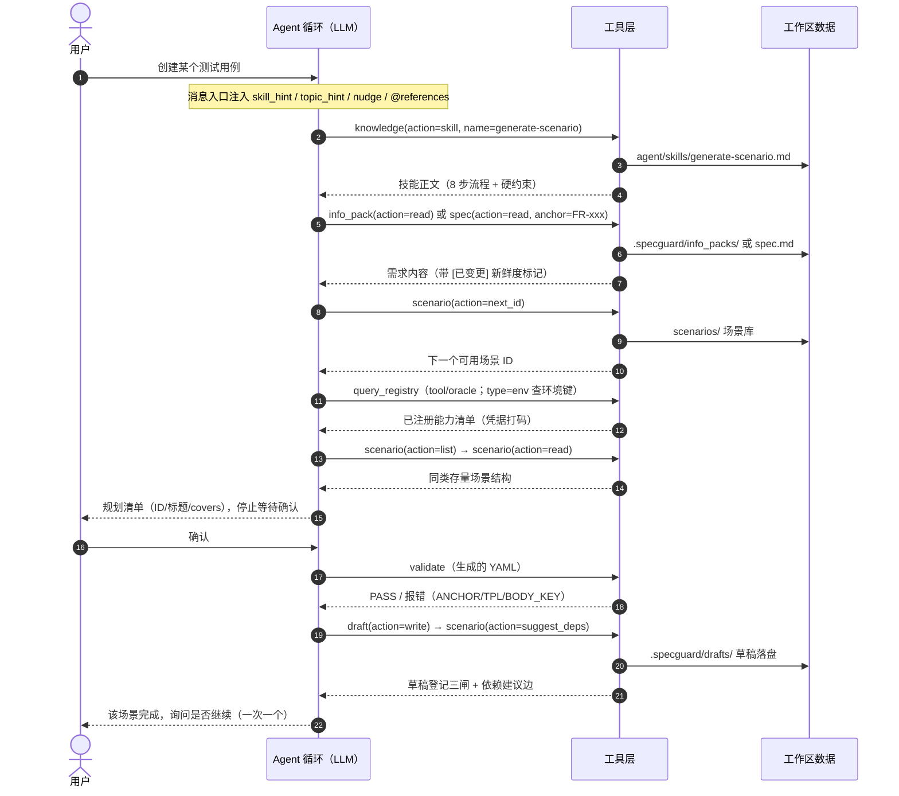

# SpecGuard Agent 现状基线（评测体系建设输入）

> 目的：为搭建 **SpecGuard Agent 评测体系** 提供现状梳理。重点覆盖 **Agent 对话链路**（运行时循环、system prompt、工具层、会话数据、前端交互），并列出可直接用作评测数据源的既有资产与挂钩点。
> 基准日期：2026-08-26（工具/技能数量为当日实测口径）。
> 架构背景文档：`docs/SpecGuard-Agent架构设计-MCP工具层与薄Harness.md`（含 6 项 ADR）。

---

## 一、总体架构：薄 Harness + MCP 工具层

Agent 智能层是「薄 Harness」设计——运行时只做 LLM⇄工具⇄停止的循环，所有能力以 MCP 风格工具形式挂在工具层，规则知识注入 system prompt，不在代码里写死工作流。

```
入口三形态（共用同一套 runtime + 工具层）
├── 工作台 AgentChat    WebSocket /api/agent/ws（主入口，多用户 RBAC）
├── CLI                 python -m agent.cli "..."（POC 独立验证，--mock 离线）
└── MCP stdio server    python -m mcp_server.server（供 Qoder 等外部宿主挂载）

agent/                   薄 Harness（运行时）
├── runtime.py           核心循环 + system prompt 构建 + 三层交集工具白名单
├── session.py           JSONL 会话持久化（emp/工作区隔离）
├── llm_client.py        OpenAI 兼容 LLM 客户端（DB 配置热加载 + 计量 + mock）
├── compactor.py         长对话压缩（只压 LLM 工作副本）
├── purpose_loader.py    用途（purpose）定义加载
├── skill_loader.py      技能加载（转发 sg_core，30s TTL 热加载）
├── inspect.py           会话排查 CLI（python -m agent.inspect <sid>）
└── prompts/system.md.j2 system prompt 模板（唯一事实源）

mcp_server/tools/        工具层（tool_meta.py 是元数据单一事实源）
sg_core/                 共享内核（user_store/ledger_store/audit_store/experience_store…）
specstd/                 工作区门面（contextvar 工作区/emp 透传、AGENTS.md 读取）
```

角色边界（重要）：agent 对话中的 AI 是「SpecGuard 测试助手」（使用角色），规则知识来自 system prompt + 被测系统工作区 AGENTS.md，而不是本仓库根的 AGENTS.md（那是开发角色宪法）。

---

## 二、核心对话循环（agent/runtime.py）

`AgentRuntime.run(system_prompt, user_message, session, session_id, user_refs)`：

1. 组装消息链：`[system, (topic_hint/skill_hint system 消息), user]`；续会话时加载历史 JSONL、**用本轮重建的 system prompt 替换历史首条**（场景/信息包清单实时感知），再追加本轮 user 消息。
2. 循环（`max_turns` 默认 12，工作台前端传 50）：
   - 每轮 LLM 调用前检查 **cancellation 检查点**（`POST /agent/cancel/{sid}` 真打断；打断后不推进轮次、不写会话）。
   - 超阈值触发**压缩**（只压 LLM 工作副本 `llm_messages`，完整 `messages` 保留用于持久化/展示——K-019）。
   - LLM 调用：非 mock 走 SSE 流式（`assistant_delta` 逐 delta 转发前端；流式失败自动回退非流式）；异常兜底写 `[ERROR]` system 消息并落盘。
   - assistant 消息清洗后追加（剥 `reasoning_content`、清 tool_calls 非标字段、null content 补空串）。
   - 逐个执行 tool_calls：执行前发 `tool_call_start`；结果追加为 `role:"tool"` 消息；成功后按工具类型补发 `doc_read`/`doc_write` 足迹事件；工具结果尾部可附知识 nudge。
   - 每轮增量保存会话（kill 后重跑可从 JSONL 续）。
3. 终止：LLM 返回无 tool_calls 的最终回复 → break；达到 max_turns → 追加 `[FUSE]` 熔断 system 消息。
4. 最终保存（cancelled 时**不写**会话，不保留不完整产物）。

事件总线（`agent/events.py`，WS 侧经 asyncio 队列桥接实时推送）：`state`（turn 进度/熔断/取消/resumed）、`assistant_delta`、`assistant`（含 usage）、`tool_call_start`、`tool_call`、`doc_read`、`doc_write`、`compaction`、`todo_update`、`error`。

关键护栏（都在 runtime/tool 层硬编码，不依赖 LLM 自觉）：

| 护栏 | 机制 |
|------|------|
| 工具白名单 | 三层交集（见 §五）；越权调用确定性拒绝并落审计，回附可用清单自愈 |
| 纯读校验 | `side_effect=none` 工具执行前后对关键目录+台账 DB 做 mtime/size 指纹比对，变化即 `[SIDE_EFFECT_VIOLATION]` 拦截 |
| 外部写红线 | `external-write` 级工具直接拒绝（当前红线为空集） |
| 工具结果截断 | 单结果 >50000 字符截断，完整结果落盘 `{sessions}/_truncated/{tool}_{ts}.txt` 回喂引用 |
| 会话互斥 | 同 session_id 只允许一个活跃 run（session.save 全量覆盖写，防互相冲掉） |
| 消息格式清洗 | 剥 reasoning_content/references 等非标字段再回传 API |

---

## 三、System Prompt 组装与动态注入

模板唯一事实源：`agent/prompts/system.md.j2`（缺失时回退内联兜底）。静态大块在前、易变内容在后，保 prompt cache 前缀命中。LLMClient 侧对 system prompt 做 sha256 短指纹统计 cache hit/miss。

静态段（组装顺序）：

1. **通用硬约束**：禁造 FR ID/tool/oracle 名；covers 必须存在于 spec；tool/oracle 必须已注册；改 YAML 必跑 validate；校验一律走确定性工具。
2. **格式规范 format_spec**：T-507 激进档——骨架常驻 + `read_format_spec` 按需取细节。`requirement_interview` 用产品友好变体（隐藏执行层细节），其余用全量骨架。来源 `sg_core/format_spec.py`（引擎注册表动态生成）。
3. **工作区规则**：被测系统工作区 AGENTS.md **全量原文**注入（P1 决策：规则层知识不允许有损压缩）。
4. **技能 skills**：全量注入 `<skills>` XML 块（14 个技能，见 §七）；product 用途裁剪为产品相关子集。
5. **飞书话题摘要**：工作区群聊话题库 digest（时效分级 + 30s TTL；无话题诚实空态）。

动态段（每条消息重建）：

6. **基础信息包**（关联场景时）：场景名/模块/信息包文件清单 + 新鲜度标记（已变更/已删除/远程已更新）+ 过期提醒。
7. **工作区同步状态**：远程仓库新鲜度提示（ls-remote 60s TTL 缓存，非阻塞）。

**每轮消息级注入通道**（评测时构造 prompt 需全部纳入变量）：

| 通道 | 时机 | 内容 |
|------|------|------|
| `topic_hint` | user 消息前 system 消息 | 用户消息命中近期飞书话题 keywords → 话题卡（前端不显示） |
| `skill_hint` | 同上 | 消息关键词命中技能 frontmatter keywords → 技能提示（确定性触发） |
| 知识 nudge（用户入口） | 追加到 user 消息尾部 | 词典 nudge（每篇每会话一次、≤4KB）+ 纠正关键词命中的经验飞轮检索（≤2KB，`<experience_refs>` 块） |
| 知识 nudge（工具出口） | 追加到 tool 结果尾部 | 结构化上下文（scenario_id/错误文本）触发词典 nudge |
| `<references>` 块 | user 消息前缀 | @引用内容注入（见 §十） |
| `<parent_context>` 块 | 辅助会话 user 消息前缀 | 父会话最新快照（见 §九） |

---

## 四、工具层（对话 Agent 的行动面）

### 4.1 工具清单（2026-08-26 实测枚举，41 个；工作台面含 info_pack，stdio 面刻意排除）

合并工具（action 参数化，`consolidate()` 构建，原声明逐字保留为 legacy 逻辑 id）：

| 工具 | 域 | side_effect | actions |
|------|----|-------------|---------|
| spec | spec | none | read / list / sync / dismiss |
| spec_search | spec | none | search / parse_fr |
| scenario | scenario | none | read / list / run / next_id / edit / check_dag / suggest_deps |
| info_pack | scenario | none | read / list / add |
| draft | draft | draft | write / undo / promote / promote_batch / reset |
| delta | draft | draft | write / commit / push |
| validate | spec | none | （单工具） |
| query_registry | spec | none | （单工具） |
| attribution | run | none | failures / log / report / case / executions / db / assemble |
| audit | quality | draft | write_report / report_vulnerability |
| scan_compliance | quality | none | （单工具） |
| query_coverage_gaps | quality | none | （单工具） |
| knowledge | knowledge | none | read / skill / format_spec |
| interview | specflow | none | open / ask / next / record / append / p0_check / read_baseline |
| ledger | specflow | none | list / read_gate / check_p0 / propose / suggest_scores |
| pack | specflow | none | read_section / assemble / freshness / extract_topics / parse_status / read_material |
| refs | specflow | none | list / register / suggest_story / zentao_job |
| feishu_read | feishu | none | doc / base / calendar / link / notes |
| lark_auth | feishu | draft | login / logout / status |
| lark_execute | feishu | draft | （单工具） |
| graph | graph | none | query / backlink / diff / rebuild / snapshot |
| lineage | graph | none | check / trace |
| fabricate_data | scenario | draft | （单工具） |
| todo_write | meta | draft | （meta 工具，常驻所有会话，runtime 内拦截不入模块表） |
| gate_dock_status | meta | none | （单工具，通用能力常驻槽） |
| topic | meta | none | list / read / messages / search |

open 契约面（对外只读，14 个，域=open）：`get_frozen_spec` `get_proposal` `query_decisions` `get_interview_status` `get_delta_contract` `get_coverage_gaps` `get_test_debt` `get_plan_status` `trace_forward` `trace_backward` `query_graph` `lookup_external_ref` `dev_context_by_zt_ref` `dev_context_by_anchor`

### 4.2 元数据单一事实源（mcp_server/tools/tool_meta.py）

每个工具登记：`side_effect`（none 纯读默认 / draft 写内部存储 / external-write 红线空集）、`rbac`（缺省派生：纯读 product 可见、写 staff 限定）、`domain`（领域分组）、`doc_track`（read/write 上足迹）、`legacy`（合并工具 action ↔ 收敛前工具名锚点）。下游（白名单/审计/足迹/压缩摘要/前端分组）全部派生，消灭手工登记缺口。

### 4.3 三层交集工具白名单（T-011 铁律 2）

```
resolve_tools = TOOL_REGISTRY ∩ purpose(tools ∪ domains) ∩ rbac_visible_tools(user_roles)
```

- 全部确定性过滤；LLM 请求白名单外工具/action → 直接拒绝不执行（合并工具按 `name.action` 单元粒度判定）。
- 下发 LLM 的工具 schema 与执行层白名单**同源**（部分可见时裁剪 action 枚举）。
- RBAC：`admin/tester` 全量；`product` 派生可见单元（纯读 + 声明 product 的受限写）；`viewer` 空集（不可用 Agent）；未注册角色 fail-closed 视为空集。
- purpose 收窄时 meta 域工具无条件并入（通用能力常驻槽）；`todo_write` 在 runtime 拦截，不参与过滤。
- 白名单每次工具执行前从 purpose 文件刷新（定义热更新即时生效，不锁死会话创建时刻）；但会话 meta 里存有创建期 `tool_whitelist` 快照（M5：已建会话展示用快照）。

### 4.4 工具审计（T-082）

每次工具调用（含 todo_write/未知工具/越权）落 SQLite `sf_mcp_call_audit`（`workbench/backend/data/workbench.db`）：
`emp_no / session_id / purpose / workspace / tool_name / side_effect / args_digest / result_digest / verdict(ok|denied-whitelist|denied-side-effect|warn) / created_at`。

---

## 五、用途（purpose）体系

定义文件 `agent/purposes/*.md`（YAML frontmatter + 正文行为指引），创建会话时**一次性锁定**（中途不可变；PATCH 带 purpose → 409）：

| purpose | 标题 | 面向 | domains | panels 页签 | 特性 |
|---------|------|------|---------|-------------|------|
| `test_workbench` | 测试工作台 | admin/tester/viewer | spec/scenario/run/draft/knowledge/quality/meta | deps, history, sql_aux | 全角色可用（首页免权） |
| `requirement_interview` | 产品工作台 | admin/product/dev | specflow/feishu/run/draft/knowledge + 域外补 spec/validate/query_registry/info_pack | pack, focus, materials | 产品友好 prompt 变体（隐藏执行层细节） |
| `sql_assistant` | SQL 助手 | 全角色 | run/spec/scenario/draft | — | **spawn_only**：辅助会话，只能从主会话派生，不可直接创建 |

---

## 六、会话持久化（评测最主要的数据源）

### 6.1 文件布局

```
agent/sessions/{emp_no}/{workspace}/
├── {sid}.jsonl            会话主体（append-only 语义，save 为全量覆盖写）
├── {sid}_meta.json        首行 meta 的独立投影（列表/校验快速读取）
├── {sid}_metrics.jsonl    逐轮 LLM 计量（每次调用一行，最后一行最新）
└── _truncated/            超限工具结果全文落盘
```

- `sid = YYYYMMDD_HHMMSS_<uuid8>`；session_id 白名单正则防路径穿越。
- emp_no 净化规则与 specstd `_emp_subdir` 对齐（允许 `.` `-`）。

### 6.2 JSONL 行类型

| 行类型 | 内容 |
|--------|------|
| `session_meta`（首行） | session_id / emp_no / workspace / created_at / title / purpose(锁定) / tool_whitelist 快照 / panels / archived / kind(aux) / parent_session_id / last_parent_fp |
| 消息行 | OpenAI 格式消息链：system / user(含 `references` 结构化引用) / assistant(含 tool_calls) / tool；system 消息还承载 `[ERROR]`、`[FUSE]`、`[CANCEL]`、skill_hint/topic_hint、压缩摘要 |
| `metrics` | 汇总计量（save 时写入） |
| `todo_list` | H-4 待办（最新一份生效，load 取最后一条） |
| `error` | 运行异常记录（load 时跳过，export 可见） |
| `compaction_summary` | 压缩摘要（load 时转 system 消息保留） |

### 6.3 metrics 字段（每轮一行）

`timestamp / model / prompt_tokens / completion_tokens / total_tokens / cache_hits / cache_misses`；会话级汇总另有 `elapsed_time / tps / is_mock`。

### 6.4 导出与排查

- `GET /api/agent/sessions/{id}/export`：完整导出（meta + messages + metrics + metrics_history + errors + todos + summary 统计）。
- `python -m agent.inspect <sid> [--workspace tdm] [--json|--full]`：错误汇总优先 + 工具调用链 + 截断消息链（system prompt 只显示长度）。
- 会话元数据投影 SQLite 台账（`sg_core/ledger_store` / workbench `agent_session_store`，agent 可脱离工作台独立跑，投影失败静默）。

---

## 七、技能体系（agent/skills/，14 个实测）

`---` YAML frontmatter（name/description/trigger/keywords）+ Markdown 正文。loader 实体在 `sg_core/skill_loader.py`，30s 内存缓存热加载，**新增文件无需重启**。两种消费方式：全量正文注入 system prompt `<skills>` 块；用户消息关键词命中 keywords 时以 system 消息附加提示（match_skills_hint，确定性触发）。

当前技能：`analyze-workspace`（工作区分析）、`generate-scenario`（场景生成）、`update-scenario`（场景更新迁移）、`validate-conformance`（合规校验）、`dag-orchestration`（DAG 编排）、`debug-failure`（失败归因）、`fabricate-test-data`（数据制造）、`audit-spec`（spec 审计）、`spec-chat`（用法答疑）、`renumber-fr`（FR 重编号）、`feishu-chat` / `feishu-topic`（飞书读取/话题召回）、`gate-dock-guide`（闸门操作台引导）、`zentao-story-point`（禅道故事点）。

治理测试：`test_specstd/test_skill_governance.py`、`test_skill_trigger.py`。

---

## 八、LLM 接入（agent/llm_client.py）

- **OpenAI 兼容** chat/completions；配置优先级：`model_id` 指定 → 显式传参 → DB `model_configs` 默认模型 → 旧 `llm_config` 表 → 环境变量（`SG_LLM_BASE_URL/API_KEY/MODEL`）。DB 驱动 + `reload()` 热加载（换模型不重启进程）。
- 模型能力参数：`max_context_tokens / max_output_tokens / thinking_enabled / reasoning_effort`（DeepSeek-R1/o1 类思考选项）。
- **mock 模式**：未配置 base_url 即 mock（回显式响应）——离线测试 runtime 与**离线评测回放**的基础。
- 韧性：429/5xx/连接类错误指数退避重试（最多 3 次，尊重 Retry-After）；SSE 流式失败两段式回退（未产出 delta / 中途断）。
- 清洗：`<think>` 标签剔除（MiniMax-M3 类 thinking 输出兜底）；回传前剥 `reasoning_content` / `references`。
- 计量：逐轮 token/耗时/缓存命中率写 `{sid}_metrics.jsonl`。

---

## 九、辅助会话：SQL 助手（主辅双会话）

设计 2026-08-25《DB证据面板与辅助会话》（`docs/superpowers/specs/2026-08-25-DB证据面板与辅助会话-design.md`）：

- **派生**：`POST /agent/sessions/spawn {parent_session_id, purpose:'sql_assistant'}`——幂等（同父同 purpose 未归档 aux 直接复用）；meta 标 `kind=aux` + `parent_session_id`；独立 WS 连接（同 `/api/agent/ws`，按 session_id 隔离）。
- **主→辅单向通道**：辅助会话每轮 user 消息前注入 `<parent_context>` 父会话快照（父 meta 概要 + 最新草稿足迹 + 最近 assistant 摘要 500 字符，8KB 截断）；指纹去重（无变更一行提示省 token）；「清空上下文」端点重置指纹，下轮重注完整快照。
- **辅→主回流**：SQL 定稿经 `write_draft` 落盘 `.sql` 草稿，用户在面板点「引用到主会话」→ 前端预填 @draft 引用（chat 输入框 pendingRef）。辅助会话对主会话**无任何写能力**。
- **DB 证据面板**（前端 DbPanel，与独立页 `/db-console` 共享 `useDbConsole`）：只读查询（仅 SELECT/SHOW/DESCRIBE/EXPLAIN）。「交给 SQL 助手」直发辅助会话；SQL 探索模式下主会话最小化、辅助会话与 DB 面板左右分栏。
- **试跑（trial run）**：草稿卡链路 评审通过→校验→试跑→入库；试跑分配 `EX-` 任务号，报告与正式执行同一落盘面（`{ws}/.specguard/reports/{EX-xxx}/`），`TrialRunDetailModal` 展示步骤轨迹/DB 校对/断言明细/失败归类。

---

## 十、前端 AgentChat（对话 UX 与可采集信号）

入口 `src/pages/AgentChat.tsx`（路由 `/agent`，旧功能页已收编为对话页签），组件在 `src/pages/agentChat/`。三栏：会话树 / 消息区 / 右侧页签面板。

- **消息分组**（`groupMessages.ts`）：扁平消息折叠为 user / assistant-text（含工具前置思考）/ tool-group（assistant+tool_calls+tool 结果合并一块，结果由后往前回填）/ step-complete / artifact（write_draft 产物卡）五类；工具按 `TOOL_TO_STEP` 映射挂到 12 步任务骨架（读信息包→…→试执行→DB 证据）作分组锚点。
- **流式**：WS `assistant_delta` 累积渲染临时气泡，整块 `assistant` 到达后替换。
- **足迹页签**：📖 阅读足迹（doc_read 事件汇聚，读型工具依据透明，点击打开 file: 页签行区间定位）/ ✏️ 更新足迹（doc_write，含 verdict 徽标 PASS/REJECT/ERROR/SKIP、findings、`.bak` LCS diff、「让 Agent 修复」把失败原因注入对话）。
- **@引用**（`_process_references`）：📦 信息包（上传即关联场景 + 文件内容直接注入 `<references>`，办公文档转文本）/ 📄 工作区文件 / 📝 草稿（内容注入，单文件 20KB、总量 60KB、单消息 ≤10 个，附 sha 与远程新鲜度标记）/ 🧾 材料（只注入标识状态，正文走 `read_material` 按需分页）。结构化清单挂 user 消息 `references` 字段持久化（右侧引用面板比对新鲜度）。
- **会话韧性**（`sessionStore.ts` 模块级单例）：断连不打断后端 run（WS detach 化跑完落盘）；重连后 2.5s 增量补拉；指数退避重连 + 心跳半开防护；组件卸载不关 WS（跨导航保活 + 事件缓冲回放）。
- **REST/WS 端点清单**：purposes 列表 / sessions CRUD（创建锁 purpose、PATCH 409、批量归档）/ spawn / clear / cancel / export / `GET sessions/{id}`（含 reading_feed + writing_feed 重建）；WS 上行 `{message, session_id, max_turns:50, workspace, scenario_id, model_id, purpose, references, context}` + ping，下行事件见 §二。

---

## 十一、长对话压缩（agent/compactor.py）

- 触发：估算 token ≥ `max_context_tokens × 70%`（无窗口配置回退消息数阈值 16 条，最低 8 条保底）。
- 策略：保留 system 首条 + 已有摘要合并为单一历史段（软上限 2000 字符防嵌套膨胀）+ **启发式摘要**（无需 LLM：文件读写记录、校验操作、工具错误、用户意图、助手关键回复）+ 按 token 预算（25% 窗口）动态保留最近消息。
- 安全边界：分割点避开 assistant(tool_calls)→tool 配对；压缩后做配对完整性后验证（孤立 tool 转 system 摘要、缺结果的 tool_calls 剥除）。
- **只压 LLM 工作副本**，会话 JSONL 永远保留完整历史（K-019 生产取证修复）。

---

## 十二、知识/经验注入（对话内的「记忆」）

- **知识词典 nudge**（T-508）：工作区知识索引（`specstd/knowledge_index`），通道一=工具结果尾部（结构化字段触发）、通道二=用户消息入口（关键词触发）；每篇每会话一次、总量 ≤4KB；无词典静默降级。
- **经验飞轮**（T-510，`sg_core/experience_store`）：run 终局 FAIL/BLOCKED/ERROR 自动落五段式经验草稿（`{ws}/.specguard/experience/`）；用户纠正关键词（"不对/错了/应该是…"）检测 → 该轮标 corrected；recency×hit_count 检索注入 ≤2KB；👍/👎 反馈；反复命中可人工提炼进 `docs/经验包/`。

---

## 十三、既有可观测数据资产 → 评测挂钩点总表

评测体系最值钱的部分：**大量结构化信号已经落盘，评测器无需重新埋点**。

| 数据源 | 位置 | 可推导的评测信号 |
|--------|------|------------------|
| 会话 JSONL | `agent/sessions/{emp}/{ws}/{sid}.jsonl` | 完整对话轨迹：轮次数、工具调用序列（名称+参数+结果）、白名单拒绝、熔断 `[FUSE]`、错误 `[ERROR]`、压缩摘要、@引用内容、辅助会话父快照 |
| 逐轮 metrics | `{sid}_metrics.jsonl` | per-turn token、时延、缓存命中率、模型名（成本/效率维度） |
| 导出端点 | `GET /api/agent/sessions/{id}/export` | 一键拿到 meta+messages+metrics+errors+todos+summary（抽样评测的批量入口） |
| 工具审计 | SQLite `sf_mcp_call_audit` | 每次工具调用的 verdict 分布（denied-whitelist 率=越权尝试率）、按 purpose/角色/工具维度聚合 |
| 会话台账 | SQLite ledger_store / agent_session_store 投影 | 会话量、消息数、工具调用数按人/工作区统计 |
| 执行报告 | `{ws}/.specguard/reports/{EX-xxx}/`（run.json/cases/output.log）+ `failures/index.jsonl` | **任务终局质量**：场景 verdict 分布、失败 category、断言差异；试跑与正式执行同一落盘面（TrialRunDetailModal 读同一面） |
| doc_write 足迹 | 会话恢复时后端重建 `writing_feed` | 确定性校验结果（verdict/findings）——产物质量的机器可读信号 |
| 经验飞轮 | `{ws}/.specguard/experience/` | 纠正事件（corrected）、失败经验命中率、👍/👎 用户反馈 |
| product_activity | SQLite `product_activity`（by_session） | 会话产物活动流水（write_draft 版本序列） |
| agent.inspect | `python -m agent.inspect <sid> --json` | 机器可读的错误汇总 + 工具调用链（评测样本预处理现成工具） |
| mock 模式 + CLI | `LLMClient.is_mock` / `python -m agent.cli --mock` | **离线回放评测基础**：固定输入跑 runtime，不花 token |
| WS 事件流 | `/api/agent/ws` 下行事件 | 在线评测探针挂点（turn 进度、todo_update 结构化待办、流式中断） |

---

## 十四、既有测试资产（评测的地基，非从零起步）

`test_specstd/` 下（离线可跑，不依赖网络/DB）：

- `test_agent.py`：runtime 全家桶——MockLLM、Session、Events、SystemPrompt 构建、Prompt 优化、emp 隔离、工具分发、LLM reload、工具错误粒度、会话元数据/导出、@引用、取消、结果截断、429 重试、材料 E2E。
- `test_aux_session.py`：辅助会话 meta（kind/parent/指纹 roundtrip）、sql_assistant draft 域。
- `test_purpose.py`：用途定义与角色可见性。
- `test_session_inspect.py`：inspect 排查视图。
- `test_skill_governance.py` / `test_skill_trigger.py`：技能文件治理与关键词触发。

另有引擎侧 `test_suites/test_engine_modes.py` + `test_engine/`（离线自测），场景侧全量 `python -m pytest`（联网）。

---

## 十五、评测体系切入点建议（基于以上现状）

1. **评测对象分层**：①单轮工具选择（给定上下文→期望调用的工具/action 与参数）；②多轮任务轨迹（会话级：步骤序列、白名单遵从、终止行为）；③任务终局质量（产物过闸率——评审/校验/发布门禁三闸的确定性结果，天然免 judge）；④效率成本（metrics 的 token/轮次/时延）；⑤安全护栏（越权尝试率、纯读副作用拦截、external-write 拒绝）。
2. **Judge 策略**：SpecGuard 的优势是大量**确定性校验器**（validate / scan_compliance / release_check / 三闸 / doc_write verdict）——优先用它们做自动评分，LLM-as-judge 只补对话质量类（回复诚实性、SKIP 语义、解释质量）主观维度。
3. **数据集来源**：生产会话抽样（export 端点 + sf_mcp_call_audit 关联）→ 去敏后构成回归集；`failures/index.jsonl` + 经验飞轮的 corrected 事件天然是负例集；14 技能 + 3 purpose 构成能力矩阵的行。
4. **离线评测通道**：mock LLM 可回放会话结构但无法评测生成质量——建议评测器直连 `AgentRuntime`（注入被测 LLM），或对生产 JSONL 做「轨迹重放判定」（不重跑，只对已有轨迹打分，成本最低）。
5. **基线指标建议先行**：工具调用成功率、denied-whitelist 率、max_turns 熔断率、产物三闸通过率、validate 一次通过率、纠正关键词触发率（经验飞轮已有数据）、每任务 token 成本。

---

## 十六、创建测试用例会话流程图（generate-scenario 轨迹基线）

> 用户说「创建某个测试用例」时会话的预期行为全景（2026-08-30，依 `agent/skills/generate-scenario.md` + `agent/prompts/system.md.j2` 绘制）。单场景评测的最小期望轨迹 = §16.1 取数链 + 两个交互门（规划确认 / 一次只生成一个）+ validate→draft→suggest_deps 产物链。

### 16.1 主流程（flowchart）

```mermaid
flowchart TD
    subgraph P0["① 会话创建（一次性锁定）"]
        A1["创建会话：purpose 锁定<br/>tool_whitelist 快照落 meta"] --> A2["system prompt 常驻注入<br/>硬约束 + format_spec 骨架<br/>工作区 AGENTS.md 全量 + 技能目录 + 飞书话题摘要"]
    end

    subgraph P1["② 消息入口（每条消息动态注入）"]
        B1["用户：创建某个测试用例"] --> B2["skill_hint（生成类 keywords 命中）<br/>topic_hint / 知识 nudge / 经验飞轮 / @references"]
    end

    A2 --> B1
    B2 --> C1

    subgraph P2["③ 取数链（generate-scenario 核心流程）"]
        C1["knowledge(action=skill) 取技能正文"] --> C2["读需求：info_pack(action=read)<br/>或 spec(action=read, anchor=FR-xxx)"]
        C2 --> C3["scenario(action=next_id) 取可用 ID"]
        C3 --> C4["query_registry 查 tool / oracle<br/>（涉及环境键时 type=env 实时查）"]
        C4 --> C5["scenario(action=list) 定位同类<br/>→ scenario(action=read) 读 1~2 个参照"]
    end

    C5 --> D1["输出规划清单：场景 ID / 标题 / covers FR"]
    D1 --> D2{"用户确认规划？"}
    D2 -->|补充或修改| C2
    D2 -->|确认| E0{"生成多个场景？"}
    E0 -->|是| E1["DAG 拓扑设计：prep / consumes、depends_on、<br/>变量契约，scenario(action=check_dag) 预演"]
    E1 --> E2{"用户确认拓扑？"}
    E2 -->|否| E1
    E2 -->|是| F0{"涉及权限 / 写操作？"}
    E0 -->|单场景| F0
    F0 -->|是| F1["precheck_permission 预检<br/>resolve_account 动态解析账号"]
    F1 --> G1["生成场景 YAML（dimensions 维度搭配）<br/>一次只生成一个"]
    F0 -->|否| G1
    G1 --> G2["validate 校验"]
    G2 --> G3{"通过？"}
    G3 -->|可修复告警| G1
    G3 -->|ANCHOR 误报等硬伤| G4["停止并报告用户（K-020 禁绕过式自愈）"]
    G3 -->|通过| H1["draft(action=write) 写草稿（自动登记三闸）"]
    H1 --> H2["scenario(action=suggest_deps) 依赖建议"]
    H2 --> H3{"采纳建议边？"}
    H3 -->|是| H4["写入 depends_on → 重新 validate"]
    H4 --> I1["告知完成，询问是否继续下一个"]
    H3 -->|否，说明原因| I1
    I1 --> I2{"继续？"}
    I2 -->|是，下一个| C3
    I2 -->|全部完成| J1["输出 Markdown 总结报告"]
    J1 --> J2{"用户要试跑？"}
    J2 -->|是| J3["scenario(action=check_dag) → scenario(action=run)<br/>真实调用 SIT 环境"]
    J3 --> J4{"PASS？"}
    J4 -->|FAIL| J5["attribution(action=report/db) 归因修复"]
    J5 --> J3
    J5 -->|连续 2 次修不好| G4
    J4 -->|PASS| J6{"用户确认入库？"}
    J2 -->|否| J6
    J6 -->|确认| K1["draft(action=promote / promote_batch)<br/>三闸：人工评审 → 格式校验 → 发布门禁"]
    K1 --> K2["入库 scenarios/，结束"]
    J6 -->|暂不入库| K3["草稿留档，结束"]
```



### 16.2 单场景取数时序（sequence，即评测期望工具轨迹）



### 16.3 会话轨迹 → 评测断言点对照

| 阶段 | 落盘信号（位置见 §六/§十三） | 可断言点 |
|------|------------------------------|----------|
| 消息入口 | JSONL user 行 `references` / system 行 skill_hint / topic_hint | 技能触发确定性（keywords 命中）、@引用采信不重读 |
| 取数链 | JSONL tool 行（tool_calls 参数 + 结果全文） | 工具序列覆盖基线、参数质量（spec 是否用 anchor= 省 token） |
| 交互门 | 规划清单后无工具调用的 assistant 行 | 强制交互遵从率（连续生成多场景 = 违规） |
| 产物 | doc_write 足迹 verdict / validate 结果 | validate 一次通过率、UNKNOWN_TPL / BODY_KEY 修复轮次 |
| 异常 | `[ERROR]` / `[FUSE]` / `[CANCEL]` system 行、白名单拒绝 | 熔断率、denied-whitelist 率、K-020 绕过式自愈检出 |
| 成本 | `{sid}_metrics.jsonl` | 每任务 token / 轮次 / 缓存命中率 |

---

## 附：关键文件速查

| 主题 | 路径 |
|------|------|
| 核心循环/白名单/system prompt | `agent/runtime.py` |
| 会话持久化 | `agent/session.py` |
| LLM 客户端 | `agent/llm_client.py` |
| 压缩器 | `agent/compactor.py` |
| 用途定义 | `agent/purposes/*.md`（loader: `agent/purpose_loader.py`） |
| 技能 | `agent/skills/*.md`（loader: `sg_core/skill_loader.py`） |
| prompt 模板 | `agent/prompts/system.md.j2` |
| 会话排查 | `agent/inspect.py` |
| 工具元数据单一事实源 | `mcp_server/tools/tool_meta.py` |
| 工具装配 | `mcp_server/server.py::build_tool_modules` |
| 工具审计 | `sg_core/audit_store.py` |
| 经验飞轮 | `sg_core/experience_store.py` |
| WS 对话路由（含辅助会话/引用注入） | `workbench/backend/routers/agent.py` |
| 前端对话页 | `workbench/frontend/src/pages/AgentChat.tsx` + `src/pages/agentChat/` |
| 前端 API 封装 | `workbench/frontend/src/api/agent.ts` |
| 架构设计文档 | `docs/SpecGuard-Agent架构设计-MCP工具层与薄Harness.md` |
| DB 面板与辅助会话设计 | `docs/superpowers/specs/2026-08-25-DB证据面板与辅助会话-design.md` |
