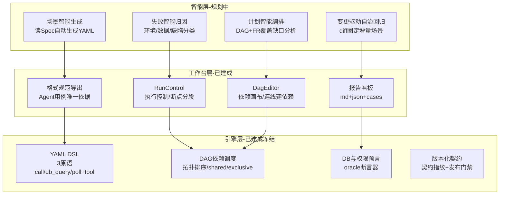
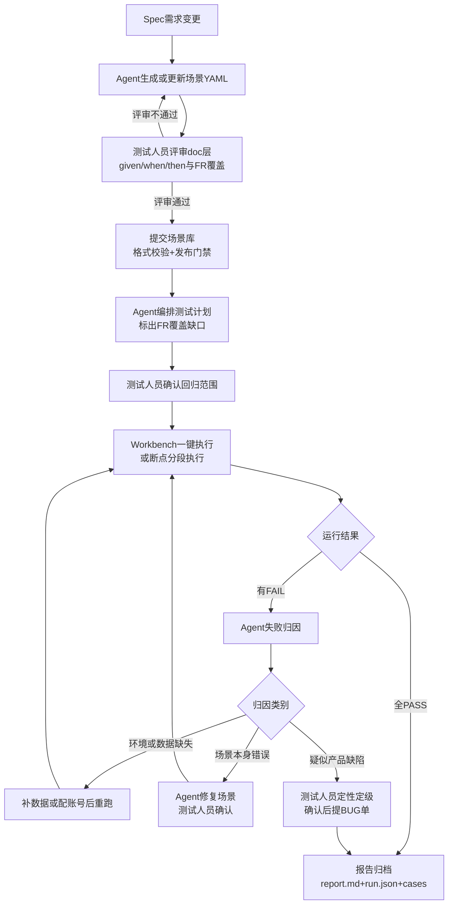
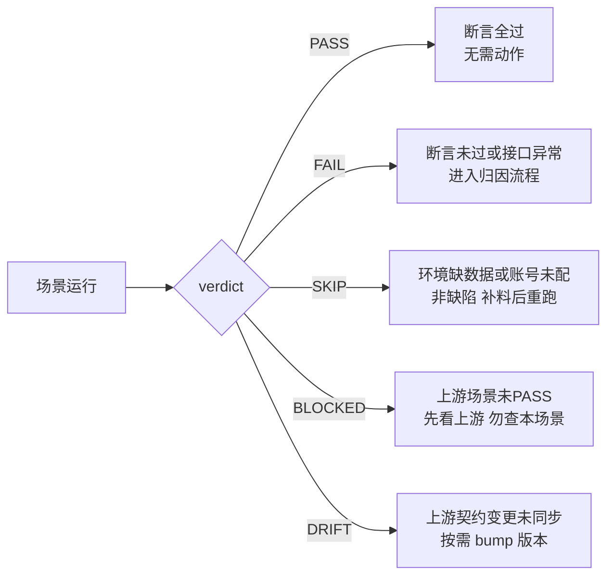

# 完全体 SpecGuard 能力边界与交互流程（测试人员指南）

> **定位一句话**：SpecGuard 是契约驱动的后端场景测试体系——测试人员用 YAML 描述「given/when/then」，引擎负责执行、校对、归档；完全体形态引入 PI Agent 设计思想后，场景编写、计划编排、失败归因由 Agent 承担，测试人员升级为「评审者 + 缺陷判断者 + 策略制定者」。
>
> **阅读对象**：测试人员（QA）。**版本**：2026-07-24 | **状态标注**：✅ 已建成可用 / 🟡 规划中（PI 智能化，待资源投入）

---

## 一、能力全景：三层架构

---

## 二、能力边界：能做什么

### ✅ 已建成（现在就能用）

| 能力 | 说明 | 测试人员获得什么 |
|------|------|------------------|
| API 级 E2E 场景测试 | HTTP 调用 + JSON 路径断言 + 状态码断言 + DB 校对 + 权限预言 | 不写代码，只写 YAML |
| 双层 YAML 用例 | doc 层（given/when/then/covers FR 编号）= 人读测试文档；flow/verify 层 = 机器执行 | 用例即文档，评审无翻译成本 |
| 依赖 DAG 调度 | `depends_on` 声明上下游，自动拓扑排序、闭包回溯、跨模块引用；上游失败下游 BLOCKED | 准备类用例自动前置，不手工排序 |
| 写型场景状态管理 | shared（只读复用）/ exclusive（独占新实例）双模式 + teardown LIFO 清理 | 写流程测试不污染环境 |
| DB 校对断言器 | 快照冻结比对、时点过滤、DHR 降级、三维权限过滤等 8+ 预置 oracle | 接口返回与数据库一致性自动核对 |
| 权限预言 | 从 hr-center 实时抓取账号权限，ALL/PART/无权限 fail-secure 全链路验证 | 权限测试不再靠人工构造账号矩阵 |
| 断点分段执行 | Workbench 按断点切批次，批间暂停看上下文再决定继续 | 长链路场景可中途人工介入 |
| 计划驱动执行 | 测试计划由 delta 导入生成，报告按 plan_id 归档，历史可追溯 | 回归范围与迭代需求一一对应 |
| 诚实的结果语义 | 测试数据缺失/账号未配置 → **SKIP**；上游失败 → **BLOCKED**；绝不把环境问题报成 FAIL | 报告无噪音，FAIL 即可疑缺陷 |
| 发布门禁 | 契约版本校验（指纹变更未 bump 版本 → ERROR）、环检测、无 teardown 告警 | 用例库质量有自动化守门 |

### 🟡 规划中（完全体新增，引入 PI Agent 设计思想）

| 能力 | 说明 | 测试人员角色变化 |
|------|------|------------------|
| 场景智能生成 | Agent 读 spec.md + api.yaml + 格式规范，自动生成合规 YAML（含 FR 覆盖标注） | 从「写用例」变为「审用例」 |
| 计划智能编排 | Agent 基于 DAG 契约指纹与 FR 覆盖矩阵，自动编排测试计划、标出覆盖缺口 | 从「排计划」变为「定策略」 |
| 失败智能归因 | 自动分类：环境/数据缺失、场景本身错误、疑似产品缺陷；场景错误自动修复，缺陷产出 BUG 单草稿 | 从「翻日志」变为「做判断」 |
| 变更驱动自治回归 | 代码 diff → 自动圈定受影响场景 → 增量回归 → 报告推送 | 每次提交自动守门 |

---

## 三、能力边界：不能做什么（长期明确不做）

| 边界 | 原因 | 替代方案 |
|------|------|----------|
| ❌ 前端 UI 测试 | 无浏览器自动化层，纯后端 API + DB 视角 | UI 链路仍靠手工或专门 UI 自动化工具 |
| ❌ 性能/压测/并发 | 引擎按依赖串行调度，无负载模型（并行化属 V3 未实施项） | 压测走 JMeter/专用平台 |
| ❌ 探索性/易用性测试 | 依赖人的主观判断与业务直觉 | 保留手工探索测试 |
| ❌ 写生产数据库 | DB 客户端硬守卫 SELECT-only；写操作只能走 API 且必须配 teardown | 制度+引擎双重保证 |
| ❌ 缺数据时造假数据 | SKIP 语义是底线：环境缺失绝不伪造数据凑 PASS | 补测试数据后重跑 |
| ❌ Agent 产物直接执行 | 所有 Agent 生成的场景必须过三道闸：人工评审 → 格式校验 → 发布门禁 | 人是最终质量责任人 |
| ❌ 替代缺陷定性 | Agent 只做归因建议，「是否缺陷、定级多少」永远由测试人员拍板 | BUG 单人工确认后提交 |

---

## 四、测试人员交互流程（完全体）

### 4.1 主流程：从需求到归档

### 4.2 结果语义判读（测试人员每日高频）

### 4.3 人机分工总览

| 环节 | Agent | 测试人员 | 引擎 |
|------|-------|----------|------|
| 场景编写 | 生成初稿 | 评审 doc 层、拍板入库 | 格式校验 |
| 计划编排 | 推荐范围、标缺口 | 确认回归策略 | DAG 拓扑调度 |
| 执行 | 触发与监控 | 断点处介入判断 | 执行+证据落盘 |
| 失败处理 | 归因建议、修复草稿 | 缺陷定性、BUG 单确认 | 重跑与清理 |
| 质量守门 | 覆盖缺口提醒 | 最终放行决策 | 发布门禁拦截 |

---

## 五、落地节奏

1. **现在**：✅ 层全部可用——测试人员可立即用 Workbench 编写/执行/归档场景（参考 [YAML 格式规范](specguard-yaml-format-spec.md) 与 [README](../README.md)）；
2. **完全体**：🟡 层需专项资源（开发 token 积分 + 人力投入），按「场景生成 → 编排 → 归因 → 自治回归」四阶段滚动交付，每阶段独立产出价值，引擎冻结层不受影响。
