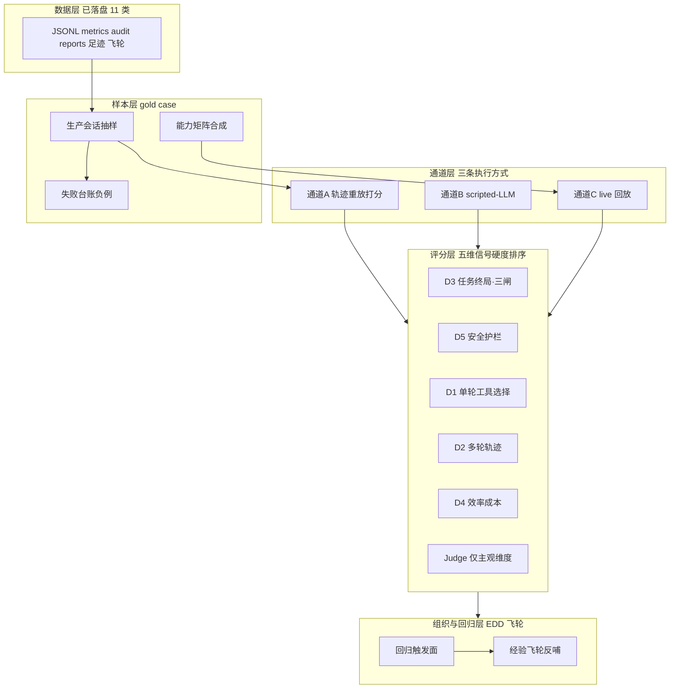

> **repo 副本说明（2026-08-30，sess-agent-eval）**：本文复制自用户知识库
> `stu_llm_wiki/wiki/queries/2026-08-26-2037-specguard-agent评估架构体系设计.md`
> （基于《SpecGuard-Agent评测体系-现状基线》产出的评估架构五层设计），为 T-1042
> 验收自足性入库；知识库侧为原发事实源，repo 侧只读副本，更新以知识库为准。
> 实施进度：Phase 0/通道 A/通道 B/路径重放/🧭 面板已随 T-1042 二期落地（25d64b7、04b70cd）；
> Phase 1 轨迹重放评分器即通道 A（已含），Phase 2 gold case 扩量与 Phase 3 judge 未启动。

---
type: query
topic: SpecGuard Agent 评估架构体系设计（基于 2026-08-26 现状基线）
date: 2026-08-26 20:37:28
environment: "[Local]"
status: archived
sources:
  - "[[raw/study/09_Agent 开发/SpecGuard-Agent评测体系-现状基线|SpecGuard-Agent评测体系-现状基线]]（67dc783 入库，335 行）"
  - "[[2026-08-26-2008-specguard相关概念与垂直智能体基准测试体系建设]]（前序方案 v0~v3）"
  - "[[2026-08-20-2151-agent执行结果评测基础知识]]（方法论地基）"
  - "[[2026-08-26-2002-agent执行效果评测方法论文盘点]]（SWE-bench 方法论借用）"
tags: [query, specguard, agent, evaluation, architecture, benchmark, edd]
---

# Q：基于现状基线，SpecGuard Agent 的评估架构体系应该怎么建

> 结论先行：基线文档证实了最值钱的判断——**大量结构化信号已落盘，评测器无需重新埋点**（§十三 11 类数据源）。因此架构主线不是「建观测」，而是「**把已落盘的确定性信号组织成五维评分，用三条评测通道覆盖回归，gold case 从生产会话与失败台账反哺**」。不建新埋点、不先上 judge、不重跑起步。

## 一、基线带来的认知更新（相对 8-20 查询）

| 项 | 8-20 口径 | 08-26 基线口径 | 影响 |
|----|----------|---------------|------|
| 工具数 | 94 个 Tool() 构造（超 ≤30 红线 3 倍） | **41 个合并工具**（action 参数化，原声明留 legacy 锚点） | 工具过载已大幅缓解；41 仍略超阈，但单会话可见数被三层交集再收窄——**评测记录单会话可见工具数作条件变量** |
| 技能/用途 | 27 个 SKILL.md（飞书 lark 运行资产） | **14 个技能 + 3 purpose**（test_workbench / requirement_interview / sql_assistant） | 能力矩阵行 = 14 技能 × 3 purpose |
| mock 定位 | 离线测试工具 | 官方明示「**离线评测回放的基础**」 | mock 通道升格为一等评测通道 |
| 评分链路污染 | clarity=62.0 占位常量（specflow_ledger.py:179） | 基线未提及 | **开工前核验是否已修**——未修则终局质量维从第一天失真 |
| 测试地基 | test_agent.py MockLLM 可编程序列 | 明确六套离线测试资产清单（§十四） | scripted-LLM 基建确认为现成 |

## 二、评估架构五层设计



### L0 数据层（现状即资产，零新基建）

基线 §十三 11 类挂钩点按评测用途归并：**轨迹类**（会话 JSONL / export 端点 / inspect --json）、**计量类**（逐轮 metrics）、**审计类**（sf_mcp_call_audit verdict 分布）、**终局类**（EX- 报告 run.json / failures/index.jsonl）、**产物类**（doc_write 足迹 verdict/findings）、**反馈类**（经验飞轮 corrected + 👍👎）。

### L1 样本层：gold case 集与三类样本源

**gold case 格式**（关键设计——上下文必须全量快照）：

```yaml
case_id: GC-<域>-<序号>
created_at: 2026-08-26          # 时间戳防「为过拟合改旧 case」
purpose / role / workspace:      # 三层交集的输入变量
context_snapshot:                # §三动态注入通道全部冻结
  references: [...]              # @引用内容
  parent_context_fp: ...         # 辅助会话父快照指纹
  topic_hint: 禁用或冻结          # 30s TTL 时效内容不可复现, 评测期必须关
  skill_hint: 记录命中集
  nudge_state: 词典/飞轮检索冻结
task: 用户消息原文
expected:
  tool_sequence: [scenario.read, validate, ...]   # 或子集无序匹配
  forbidden_tools: [...]                          # 越权即 fail
  artifacts:                                      # 产物断言 → 走 validator/三闸
    - path: ... ; assert: fail-to-pass
  termination: natural | max_turns 上限           # 终止行为
metrics_baseline: {tokens, turns}                 # 成本回归参照
```

**三类样本源**：① 生产会话抽样（export 端点 + audit 关联，去敏）→ 回归集；② failures/index.jsonl + 飞轮 corrected 事件 → **负例集**（天然知道错在哪）；③ 14 技能 × 3 purpose 能力矩阵合成 → 覆盖度补齐。SWE-bench 移植：任务实例化流水线 = interview/场景产物 × 期望断言；case 只增不改（时间切分防泄漏）。

### L2 通道层：三条评测通道（按成本递增，各司其职）

| 通道 | 机制 | 测什么 | 成本 | 时机 |
|------|------|--------|------|------|
| **A 轨迹重放打分** | 对生产/回放 JSONL **不重跑只打分**（export → 评分器） | 五维指标 retrospective | 最低 | **起步首选**，每份会话即评测样本 |
| **B scripted-LLM** | MockLLM 可编程序列驱动 runtime（test_agent.py 扩展） | runtime 确定性行为：白名单拒绝/护栏拦截/清洗/压缩配对/熔断 | 零 token | CI 每次跑，保 harness 不坏 |
| **C live 回放** | 评测器直连 `AgentRuntime` 注入被测模型，重跑 gold case | 生成质量 + 真实轨迹 | 真实 token | prompt 模板/技能/工具/模型变更的**回归判定** |

通道 B 的边界基线已自知：mock 能回放会话结构，**不能评测生成质量**——生成质量归通道 C。

### L3 评分层：五维指标按信号硬度排序

| 维 | 指标 | 信号源 | 判定方式 |
|----|------|--------|---------|
| **D3 任务终局**（最硬，先做） | 产物三闸通过率（评审/校验/发布门禁）、validate 一次通过率、verdict 分布 | reports + doc_write 足迹 | 纯确定性，**免 judge** |
| **D5 安全护栏** | denied-whitelist 率、纯读副作用拦截数、external-write 拒绝数、熔断率 | sf_mcp_call_audit + JSONL 系统消息 | 纯确定性（护栏本就硬编码） |
| **D2 多轮轨迹** | 步骤序列 precision/recall、禁用工具触碰、终止行为正确率、循环/重试检测 | JSONL tool_calls 链 | 序列匹配，确定性为主 |
| **D1 单轮工具选择** | 工具/action/参数准确率（从轨迹切单轮） | JSONL 切片 | 参考匹配 |
| **D4 效率成本** | per-task token、轮次、时延、缓存命中率 | metrics.jsonl（已有字段） | 计量 |
| 主观补充 | 回复诚实性、SKIP 语义解释质量、产品友好度 | 对话文本 | LLM-as-Judge，**最后做** |

原则：D3+D5 全确定性先立住，Judge 只补对话质量类主观维度（基线 §十五.2 同判断）。

### L4 组织层：回归触发面与飞轮

**变更触发面**（基线列出的热更新点 = 回归必须覆盖面）：`system.md.j2` 模板 / 技能文件（30s TTL 热加载）/ tool_meta 工具合并与 action / DB model_configs 换模型 / runtime 逻辑（压缩策略、护栏）。任一变更 → 通道 C 全量 gold case 重跑，对比 fail-to-pass（新修好）与 pass-to-pass（不回退）。

**飞轮闭环**：经验飞轮 corrected 事件 + failures 负例 → 自动转新 gold case（问题驱动）；👍👎 作主观维参考。EDD 三要素齐：Eval Set（L1）× Eval Function（L3）× Regression（L4）。

## 三、实施路线（四阶段，每阶段有独立交付物）

1. **Phase 0 基线仪表盘**（1~2 天，零新基建）：聚合既有 JSONL/metrics/audit → 基线 §十五.5 七指标首份报告（工具调用成功率 / denied-whitelist 率 / 熔断率 / 三闸通过率 / validate 一次通过率 / 纠正触发率 / 每任务 token）。交付：现状数字基线，后续一切改进的对照原点。
2. **Phase 1 轨迹重放评分器**（通道 A）：export 端点批量取样 → 五维评分函数 → 评测报告落盘 `reports` 同构面。交付：首份五维评测报告 + 评分器脚本。
3. **Phase 2 gold case + live 回归**（通道 C）：3 个 gold case 起步（最高频 purpose × 场景），接入回归触发面。交付：回归判定（fail-to-pass / pass-to-pass 双绿，SWE-bench 口径）。
4. **Phase 3 Judge 校准 + 能力矩阵**：14 技能 × 3 purpose 矩阵补齐；主观维度 Judge 先与人工抽样对账（一致率/κ 达标才上量）。

## 四、防坑清单（LLM 输出评估六陷阱 × 基线特有新坑）

1. **时效内容污染 prompt（基线读出的新坑）**：飞书话题 digest 时效分级 / topic_hint 30s TTL / 工作区同步 60s TTL——这些动态内容重放时**必须冻结或禁用**，否则 case 不可复现。gold case 的 context_snapshot 设计即为此。
2. **假分数**：clarity=62.0 教训——评分器代码禁止占位常量；开工前核验 specflow_ledger 是否已修。
3. **非确定性**：同一 case 跑 k 次报 pass@k/成功率，评估期固定 temperature；区分能力失败与随机波动。
4. **mock 边界**：通道 B 只保 runtime，不碰生成质量（基线已自知）。
5. **自评分偏差**：Judge 与被测模型分离；位置/冗长偏差用 pairwise + rubric 操作化抑制。
6. **工具过载条件变量**：记录单会话可见工具数（41 全池仍略超 ≤30 红线，confidence 0.6 单源）；purpose 收窄后的实际可见数才是行为相关口径。

## 五、与 Wiki 概念的回填约定（维持 8-20 决策）

Phase 1~2 落地后回填：[[Execution-based-Evaluation]] practiced_in += specguard (agent-eval)；[[EDD 评估驱动开发]] practiced_in 同；新概念页 [[Trajectory-Evaluation]] [[LLM-as-Judge]] 随实践建，不建空页。
