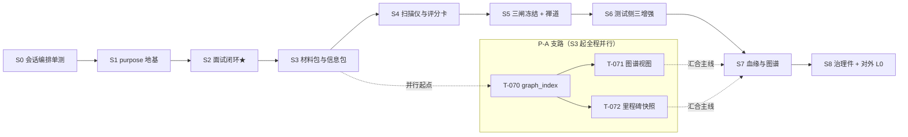

# SpecGuard Vision · 开发总控文档

> **本文档是所有开发会话的唯一协调中心。任何开发会话开工前必须完整阅读 §1-§4，并按 §3 协议注册会话、认领任务、登记文件变更。**
> 版本：v1.1 · 2026-08-02 ｜ 配套：`sg-hash.py`（文件指纹工具）｜ 上游依据：《研发顺序与里程碑验收》、13 份模块设计（M01-M13）、00 统一约定
>
> **v1.1 决策（2026-08-02）**：**先把当前系统功能打磨好再升级**——新增「当前打磨期」（§2.0/§4.1，DAG 编排 + 测试执行两条链路），远期 S0-S8 整体后置为「升级期」（§2.1/§4.2，打磨期结束由总控人宣布恢复认领）。

---

## 1. 开发会话工作协议（强制，六步）

```
① 读   —— 读本总控文档 + 你任务对应的模块设计文档（Mx §0-§9）+ 00 统一约定
② 注册 —— 在 §5 会话注册表登记：会话ID / 角色 / 认领任务ID / 开工时间
③ 认领 —— 把 §4 任务总表中目标任务的「状态」改为 进行中、填入你的会话ID
④ 登记 —— 改任何文件前，先在 §6 文件变更登记表登记：路径 + 修改前hash
           hash 命令：python3 sg-hash.py <文件路径>
⑤ 开发 —— 按模块设计文档 §6 关键流程与 §9 验收标准开发
⑥ 收口 —— 改完更新 §6 登记的「修改后hash」，任务达验收标准后 §4 状态改 已完成
```

**三条铁规：**

1. **未登记不动手**：要修改的文件没有出现在 §6 登记表（且状态=登记中、会话ID=你），不得写盘。
2. **开工先对 hash**：认领任务后，对将要修改的每个文件执行 `python3 sg-hash.py --check <文件> <登记表中的修改后hash>`。DIFF = 有人改过你不知道的版本——**停手**，去 §6 找到最后登记会话，对齐后再开工；禁止直接覆盖。
3. **一任务一会话**：状态=进行中的任务不得被第二会话认领；需要协作时在 §5 注册表「备注」列协商拆分。

---

## 2. 阶段地图：方向与目标效果

### 2.0 当前阶段：系统打磨期（P0，2026-08-02 起）

> **v1.1 决策**：先把当前系统功能打磨好再升级。打磨范围 = DAG 编排 + 测试执行两条链路（任务见 §4.1），是 K-046~K-056 执行侧迭代的延续。打磨期任务同样遵守 §1 六步协议与 §7 冲突处理。

| 链路 | 方向（往哪里走） | 达成效果（验收门面） | 任务 |
|---|---|---|---|
| DAG 编排 | 编排健壮性与体验打磨 | 坏图不瘫痪执行链路（环预检前置）；环检测实现收口；画布边信息完整、支持 exclusive 连线与批量编排 | T-101~T-105 |
| 测试执行 | 执行稳定性与产物一致性打磨 | 断点/abort/队列无死锁无丢失；两执行路径产物一致；历史可读、日志连续 | T-111~T-123 |
| 基线收口 | 契约基线一致性 | contracts_baseline 未提交 diff 收口 + 同指纹场景抽查 | T-131 |

### 2.1 远期升级期（S0-S8，后置）

> 以下为远期升级路线（**v1.1 起整体后置，打磨期结束由总控人宣布恢复认领**）：
> 关键路径串行：S0→S1→S2→S3→S4→S5→S6→S7→S8；P-A 支路（T-070/071/072）从 S3 起可全程并行。
> 每阶段详细验收标准见《研发顺序与里程碑验收》§3，此处给方向与目标效果。

| 阶段 | 方向（往哪里走） | 达成效果（验收门面） | 对应模块 |
|---|---|---|---|
| **S0** 会话编排单测 | agent 编排层测试先行，套件可离线复跑 | 单测全绿 + `--mock` CI 可挂；后续所有阶段的回归底座 | agent/（runtime/session/compactor） |
| **S1** purpose 地基 | 会话创建期锁定 + 工具白名单运行时强制 | 越权工具调用被确定性拒绝；purpose 不可变 | M01 / M12 / M13(P1骨架) |
| **S2** F1 面试闭环 ★价值拐点 | specflow/interview 从零到端到端 | 产品在 AgentChat 完成面试→台账→P0 清零→归档，可演示 | M02 / M04 |
| **S3** 材料包与信息包 | 多源文档解析入包，挂载补票 | 三类文档→议题候选→人拍板入包；list_tools 回归 | M03 |
| **S4** 扫描仪与评分卡 | 草案机打校验 + 五维半自动 | 机打维度走 specstd；LLM 预打分 QA 确认才生效 | M05 / M04 |
| **S5** 三闸冻结 + 禅道 | 产物规格化 + 跨系统挂链 | 三闸冻结；zentao-cli 幂等建故事/提 BUG；external_refs 登记 | M05 / M06 |
| **S6** 测试侧三增强 | 闸门保护下启用 Agent | 缺口泳道真实一致；数据制造/归因产物全过闸 | M07 / M08 / M09 |
| **S7** 血缘与图谱 | 图谱派生 + 血缘投影（汇合 P-A） | Q1/Q2 双向 trace 不断链；演化 diff 可重建 | M10 / M11 |
| **S8** 治理件 + 对外 L0 | skill 体系化 + open/ 只读面 + 研发侧消费通道 | 旗舰 e2e：外部编码 Agent 经 MCP 读冻结 spec；研发侧 dev_context 三入口（接需求/开发接口/修BUG）从 ZT-STORY 号拿到带指纹的 dev-context-pack | M13 / M12 |

下图把上表画成关键路径：S0→S8 硬串行为主轴，P-A 支路（T-070/071/072 图谱索引/视图/快照）自 S3 起全程并行、在 S7 汇合主线：



---

## 3. 串行 / 并行规则

### 3.1 硬串行（前置未完成不得开工，认领无效）

| 先行任务 | 后续任务 | 原因 |
|---|---|---|
| S0 全部 | S1 全部 | 编排层测试是地基回归保障 |
| T-010 purpose 模型 | S2 全部 | 面试会话挂在 purpose 上 |
| T-023 台账 schema + T-024 P0 清零 | T-042 评分门禁 → S5 全部 | 冻结三闸的③闸依赖台账与清零校验 |
| T-050 delta manifest | T-051 三闸冻结 → T-053/054/055/056 | 禅道侧一切动作消费冻结产物（铁律 6） |
| S5 全部 | S6 全部 | 数据制造/归因 Agent 需要三闸与 delta 通道在位 |
| T-070 graph_index | T-071/072/073 | 视图与血缘都是索引的投影 |
| T-056 sf_external_refs | T-073 血缘外部锚点 / T-083 refs_query / T-085 dev_context 场景A/C | 同表同源，owner 先行 |
| T-070 graph_index | T-085 dev_context 场景B/C | 锚点反查与血缘投影的算力来源 |

### 3.2 可并行（认领即可开工，互不阻塞）

- **P-A 支路**：T-070 / T-071 / T-072（图谱索引、视图、快照）——S3 起与主线全程并行
- **S5 内**：T-053 / T-054 / T-055 / T-056 四者在 T-050+T-051 完成后互相并行
- **S6 内**：T-060 / T-061 并行；T-062 / T-063 在 T-061 后并行
- **S8 内**：T-080 / T-081 / T-082 三者互相并行，均完成后才开 T-083 / T-085；T-085 另需 T-056 与 T-070（通常早于 S8 完成）
- **跨阶段**：T-032（info_pack 补票）不依赖 S2，可提前至 S1 后任意时间

### 3.3 储备项（不认领，触发条件由总控人宣布）

- T-084 外部 skill 审查管线完整化 / 对外 L1 / MCP Registry 生态开放

---

## 4. 任务总表（认领在这里改状态）

> 状态值：`未认领` / `进行中` / `已完成` / `阻塞`（阻塞须在备注写原因）
> 表行格式固定，只允许更新「状态/会话ID/备注」三列；新增任务由总控人追加。
> 分区：**§4.1 当前打磨期**（可认领）｜**§4.2 远期升级期**（v1.1 起后置，不认领）。

### 4.1 当前打磨期（P0，进行中）

| 任务ID | 阶段 | 任务 | 模块 | 产出/验收要点 | 依赖 | 状态 | 会话ID | 备注 |
|---|---|---|---|---|---|---|---|---|
| T-101 | 打磨-DAG | 场景保存环预检 | scenario_store | 表单/YAML 双路径保存前环预检（环→422 而非建图 500）；建图 CycleError 降级不崩执行链路 | — | 已完成 | sess-master | P0 ✅ 2026-08-02（后端环预检+降级图+前端环清单，test_scenario_store 7 测试） |
| T-102 | 打磨-DAG | 环检测实现收口 | dependency_graph/scenario_store | 删除 scenario_store 重复 DFS，统一走引擎返回环清单 | T-101 | 已完成 | sess-master | P2 ✅ 2026-08-02（engine.detect_cycles 单一事实源，test_cycle_detect 5 测试） |
| T-103 | 打磨-DAG | 画布边版本展示+exclusive 连线 | DagEditor | 边 label/tooltip 显示期望/实际版本；画布可连 exclusive 边 | — | 已完成 | sess-master | P2 ✅ 2026-08-02（漂移边标 v期望→v实际；Shift 拖拽=exclusive） |
| T-104 | 打磨-DAG | dep_suggest 显式降级+来源标注 | dep_suggest/deps_editor | 环预检失败显式提示不静默；采纳建议 YAML 注释标注 confidence/kind | — | 已完成 | sess-master | P2 ✅ 2026-08-02（graph_error 字段+前端提示；采纳经 /deps note 尾注释留痕） |
| T-105 | 打磨-DAG | 多选批量编排操作 | DagEditor/RunControl | 批量设断点/批量采纳建议/孤节点补全建议 | T-119 | 已完成 | sess-master | P2 ✅ 2026-08-02（批量设断点 ?bps= 预置 + 批量采纳建议按钮） |
| T-111 | 打磨-执行 | 断点暂停 abort 死锁修复 | runner | abort 置位 resume 事件+批次循环检查，队表不再卡 running | — | 已完成 | sess-master | P0 ✅ 2026-08-02（_abort_finish 收尾，test_runner 5 测试） |
| T-112 | 打磨-执行 | 批次 abort 短路+状态修正 | runner | 每批 drain 后检查 abort 标志；_stream_output 非零退出置 failed/aborted | T-111 | 已完成 | sess-master | P1 ✅ 2026-08-02（与 T-111 同批实施） |
| T-113 | 打磨-执行 | 断点批次通知补扫 -bN | runner | _push_run_notifications 与 _record_failures 对齐扫 -b* 目录 | — | 已完成 | sess-master | P1 ✅ 2026-08-02（test_runner 批次通知测试） |
| T-114 | 打磨-执行 | run_queue 持久化轻量选项 | user_store/runner | prep_only/skip_upstream_verify/account_override 入库，队列重放不丢 | — | 已完成 | sess-master | P1 ✅ 2026-08-02（幂等迁移+重放透传，test_run_queue 3 测试） |
| T-115 | 打磨-执行 | spawn 失败终态广播 | runner/useRunStream | started 移至 Popen 成功后；失败补发 aborted/error | — | 已完成 | sess-master | P1 ✅ 2026-08-02（test_runner spawn 失败测试） |
| T-116 | 打磨-执行 | 执行路径统一 | plan_executor/runner | plan_executor 补 EX- 任务号/output.log/trigger.json/失败索引；run_id 防重 | — | 已完成 | sess-master | P1 ✅ 2026-08-02（报告改 reports/{plan_id}/{EX-xxx}/ 修历史页读取，test_plan_executor 3 测试） |
| T-117 | 打磨-执行 | 调度互斥+任务超时 | scheduler/runner | scheduler 感知队列互斥；任务级超时 | T-116 | 已完成 | sess-master | P1 ✅ 2026-08-02 互斥部分（忙时跳过 skipped_busy；超时见 T-118）；test_scheduler 3 测试 |
| T-118 | 打磨-执行 | 执行看门狗 | runner | run 级超时+心跳+自动 abort 标 failed；Windows 进程组防僵尸 | — | 已完成 | sess-master | P1 ✅ 2026-08-02（SG_RUN_TIMEOUT 总超时+自动终止标 timeout+进程组；test_runner 2 测试） |
| T-119 | 打磨-执行 | 断点 UI 接线 | RunControl/DagEditor | RunControl 断点集合有写入路径（DAG 页/确认弹窗设置断点） | — | 已完成 | sess-master | P1 ✅ 2026-08-02（确认弹窗断点设置区+列表🔴标记+?bps 预置） |
| T-120 | 打磨-执行 | -bN 历史归组 | scenario_store/History | History 批次目录归并到主任务展示 | — | 已完成 | sess-master | P2 ✅ 2026-08-02（list_reports 过滤 -bN；test_scenario_store 1 测试） |
| T-121 | 打磨-执行 | History 失败索引+重试 | History/failure_index | 前端接 failure_index 查询，一键重试失败场景 | — | 已完成 | sess-master | P2 ✅ 2026-08-02（GET /api/runs/failures 端点+History 失败台账面板+↻重试） |
| T-122 | 打磨-执行 | WS 重连日志连续性 | runner/useRunStream | 回放行数与前端 500 对齐或序号增量同步 | — | 已完成 | sess-master | P2 ✅ 2026-08-02（回放 100→500 与前端上限对齐） |
| T-123 | 打磨-执行 | WS token 首帧认证 | useRunStream/runs | token 不再走 query 明文 | — | 已完成 | sess-master | P2 ✅ 2026-08-02（首帧 {"type":"auth"}；multiuser WS 测试更新） |
| T-131 | 打磨-基线 | contracts_baseline 收口+同指纹抽查 | 基线 | 未提交 23 场景基线提交或回退；抽查 TL-RC-006/007、009~014/017/019 同指纹组 | — | 已完成 | sess-master | P2 ✅ 2026-08-02 抽查结论：同指纹系契约相同（错误分支 save 同名，非 bug）；用户决策——TL 系列为 agent 对话测试产物不入库，基线已回退（场景目录 smart-tag/system-settings 本就 .gitignore 隔离） |

### 4.2 远期升级期（S0-S8，v1.1 起后置，不认领）

> 2026-08-02 v1.1 决策：整体后置为「升级期」，打磨期（§4.1）结束由总控人宣布恢复认领，恢复前认领无效。

| 任务ID | 阶段 | 任务 | 模块 | 产出/验收要点 | 依赖 | 状态 | 会话ID | 备注 |
|---|---|---|---|---|---|---|---|---|
| T-001 | S0 | 会话编排单测套件收口 | agent/ | 套件全绿+mock可复跑+关键用例覆盖 | — | 阻塞 | | 升级期后置：先打磨 DAG/执行（总控 v1.1 决策），打磨期结束恢复 |
| T-010 | S1 | purpose 会话模型持久化+不可变 | M01 | 改purpose请求被拒测试 | T-001 | 未认领 | | |
| T-011 | S1 | 三层交集白名单运行时强制 | M12 | 越权调用确定性拒绝+WARNING审计 | T-001 | 未认领 | | |
| T-012 | S1 | agent/purposes/ 热加载注册表 | M01 | 30s可见不重启不改runtime | T-010 | 未认领 | | |
| T-013 | S1 | RBAC 用途过滤+归属留痕 | M01/M12 | product角色清单过滤 | T-010 | 未认领 | | |
| T-020 | S2 | specflow/interview 包+IV生命周期 | M02 | 开标→提问→清零→归档状态机 | T-010 | 未认领 | | |
| T-021 | S2 | 议题卡 topic.yaml 装配 | M02 | 来源PRD+SPQ反哺可载入 | T-020 | 未认领 | | |
| T-022 | S2 | sf_interviews/sf_questions 表 | M02 | P0/P1/P2分级落库 | T-020 | 未认领 | | |
| T-023 | S2 | D-xxx台账schema+amendment增补链 | M04 | 落锤不可推翻；写操作不进MCP | T-020 | 未认领 | | |
| T-024 | S2 | gate.py P0清零确定性纯函数 | M04 | 未清零冻结硬拒 | T-023 | 未认领 | | |
| T-030 | S3 | 材料解析管线 sniff/extract/chunk | M03 | .md/.docx/.pdf三类可用 | T-020 | 未认领 | | |
| T-031 | S3 | 议题候选提取+确认闸门 | M03 | 候选confirmed=0不进上下文 | T-030 | 未认领 | | |
| T-032 | S3 | info_pack.py挂载补票+specflow_pack.py | M03/M13 | list_tools计数回归一致 | T-011 | 未认领 | | 可提前至S1后 |
| T-033 | S3 | info_pack.yaml六分区装配器 | M03 | 面试会话可消费 | T-030 | 未认领 | | |
| T-034 | S3 | coverage_map覆盖率机打依据 | M03 | 供T-041消费接口联调 | T-030 | 未认领 | | |
| T-040 | S4 | 草案扫描仪（11章/SHALL/AC） | M05 | 调specstd conformance纯读 | T-020 | 未认领 | | |
| T-041 | S4 | 五维评分卡（机打+QA确认） | M04 | 未确认不生效测试 | T-023/T-034 | 未认领 | | |
| T-042 | S4 | 评分门禁入冻结链路 | M04/M05 | 未达标阻断冻结 | T-041/T-024 | 未认领 | | |
| T-050 | S5 | delta manifest+verify-delta V1-V6 | M05 | 三段式+manifest一致 | T-040 | 未认领 | | |
| T-051 | S5 | 需求侧三闸冻结 | M05 | ①确认②合规③清零全过才冻结 | T-050/T-042 | 未认领 | | |
| T-052 | S5 | proposal/spec导出归档 | M05 | 四段式+锚点完整 | T-051 | 未认领 | | |
| T-053 | S5 | zentao-cli封装（幂等/凭据/回滚） | M06 | 幂等键防重；回滚不删禅道资产 | T-051 | 未认领 | | ∥T-054/055/056 |
| T-054 | S5 | 故事点评估skill | M06 | estimate恒suggested确认才回写 | T-051 | 未认领 | | ∥ |
| T-055 | S5 | 提BUG双入口 | M06 | SKIP/BLOCKED提单被拒 | T-051 | 未认领 | | ∥ |
| T-056 | S5 | sf_external_refs外部锚点表 | M06 | 建故事/提BUG均登记 | T-051 | 未认领 | | ∥ |
| T-060 | S6 | 覆盖缺口三态聚合 | M07 | 与真实基线一致；草稿不计覆盖 | S5 | 未认领 | | ∥T-061 |
| T-061 | S6 | sg_draft_gates三闸状态机 | M07 | promote硬前置；只产草稿不产计划 | S5 | 未认领 | | ∥T-060 |
| T-062 | S6 | 测试数据制造Agent | M08 | 产物过三闸；数据校验器硬拒；引擎零改动 | T-061 | 未认领 | | ∥T-063 |
| T-063 | S6 | 失败归因Agent | M09 | suggestion不自动转decided；诚实性复核 | T-061 | 未认领 | | ∥T-062 |
| T-064 | S6 | SPQ→面试信息包loop-back | M09/M02 | SPQ自动入下轮信息包 | T-063/T-033 | 未认领 | | |
| T-070 | P-A | graph_index确定性派生服务 | M11 | 指纹失效即重建；删重建同图 | 无（S3起并行） | 未认领 | | P-A支路 |
| T-071 | P-A | L0/L1/L2视图+三镜头 | M11 | elkjs渲染；图谱不回写spec | T-070 | 未认领 | | P-A支路 |
| T-072 | P-A | 里程碑快照+演化diff | M11 | 三触发点；可凭指纹重建校验 | T-070 | 未认领 | | P-A支路 |
| T-073 | S7 | 血缘链投影+Q1/Q2 trace API | M10 | 双向不断链；外部锚点虚线 | T-070/T-056/S5 | 未认领 | | |
| T-074 | S7 | 断链规则集BL（WARNING级） | M10 | 断链检测确定性校验 | T-073 | 未认领 | | |
| T-080 | S8 | skill格式对齐+注册表/api/agent/skills | M13 | 悬空引用加载期报错 | S2 | 未认领 | | ∥T-081/082 |
| T-081 | S8 | side_effect分级+纯读运行时强制 | M13/M12 | 写伪装读被硬拒测试 | T-011 | 未认领 | | ∥ |
| T-082 | S8 | 调用审计（工号/会话/工具/入参摘要） | M13 | sf_mcp_call_audit可查 | T-011 | 未认领 | | ∥ |
| T-083 | S8 | open/对外L0五模块+旗舰e2e | M13 | 编码Agent读冻结spec全链路 | T-080/081/082/T-052 | 未认领 | | |
| T-085 | S8 | open/dev_context研发侧三入口+旗舰场景群e2e | M13/M06/M11 | 三入口（by_zt_ref/by_anchor/by_fr）+六分区pack+指纹校验；e2e从ZT-STORY拿到pack，草稿零泄漏 | T-080/081/082/T-056/T-070 | 未认领 | | 研发提效卖点 |
| T-084 | P3 | 审查管线完整化/对外L1/生态Registry | M13 | 储备项，触发制 | T-083 | 储备 | | 不得认领 |

---

## 5. 会话注册表（开工必填）

> 表行格式：`| 会话ID | 角色/方向 | 认领任务ID | 开工时间 | 备注 |`

| 会话ID | 角色/方向 | 认领任务ID | 开工时间 | 备注 |
|---|---|---|---|---|
| （示例）sess-dev01 | specflow面试引擎 | T-020 | 2026-08-01 10:00 | 示例行，首个注册会话可删除 |
| | | | | |

---

## 6. 文件变更登记表（改文件前必填）

> 协议：
> ① 改文件**前**登记一行：路径 + 你的会话ID + 登记时间 + **修改前hash**（`python3 sg-hash.py <路径>`），状态=登记中，修改后hash留空；
> ② 改完**立刻**回填修改后hash，状态=已完成；
> ③ 同一文件已有「登记中」行且会话ID不是你 → **停手**，该文件正被别的会话修改；
> ④ 你要改的文件实际hash ≠ 登记表最新「修改后hash」 → **停手**，存在未登记变更，先对齐；
> ⑤ 新文件：修改前hash填 `NEW`；删除文件：修改后hash填 `DELETED`。

| 文件路径 | 会话ID | 登记时间 | 修改前hash | 修改后hash | 状态 | 备注 |
|---|---|---|---|---|---|---|
| docs/远期设计/SpecGuard-总控文档.md | 总控人 | 2026-08-02 | 7cd4a9b7e515 | 15ae345f277f | 已完成 | 自身登记：v1.1 打磨期决策（§2.0/§4.1 新增、远期后置、T-001 阻塞）；T-101~105/111~123 完成；T-131 完成（用户决策：TL 系 agent 测试产物不入库，基线回退） |
| | | | | | | |

---

## 7. 冲突与异常处理

| 情况 | 处理 |
|---|---|
| --check 报 DIFF | 停手 → 查 §6 该文件最后登记行 → 联系该会话（§5 备注）→ 确认是「已完成的合法变更」则以新hash重新登记开工；确认是「未登记的脏变更」则上报总控人 |
| 发现别的会话正在改同一文件（登记中） | 等待或改认领 §3.2 的并行任务；禁止抢改 |
| 任务做不下去（依赖未就绪/设计有洞） | §4 状态改 阻塞 + 备注原因 + 上报总控人；不得绕开依赖另起炉灶 |
| 需要新增文件/新表/新任务 | 文件直接 §6 登记（hash=NEW）；新任务一律由总控人追加进 §4，会话不得自行添加任务行 |
| 触及红线 | 立即停手上报：engine/ 冻结层改动、specstd 规则扩展（Ask First）、绕闸生效、外部写入MCP |

## 8. 阶段完成判定

- 单任务完成 = 该任务「产出/验收要点」全部达成 + §6 相关登记行全部回填；
- 阶段完成 = 阶段内任务全 已完成 + 《研发顺序与里程碑验收》§3 对应阶段验收清单逐项通过 + 回归门禁全绿（引擎改动 `pytest -k engine_modes` + `pytest test_engine`；specstd 改动 `pytest test_specstd`；入库前 `release_check.py`）；
- **打磨期完成（v1.1）** = §4.1 任务按优先级（P0→P1→P2）全部达成 + 回归门禁全绿 + 总控人在 §2.0 标注 ✅ 并宣布恢复 §4.2 远期认领；
- 阶段完成后由总控人在 §2 对应行标注 ✅ 及日期。

---

*本文件本身被修改时，同样需要在 §6 登记（第一行登记者是总控人）。hash 工具：`sg-hash.py`（sha256-12，与 specstd 契约指纹同口径）。*
