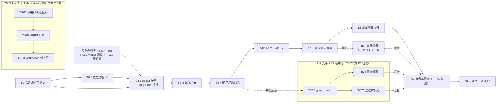

# SpecGuard Vision · 开发总控文档

> **本文档是所有开发会话的唯一协调中心。任何开发会话开工前必须完整阅读 §1-§4，并按 §3 协议注册会话、认领任务、登记文件变更。**
> 版本：v1.6 · 2026-08-10 ｜ 配套：`sg-hash.py`（文件指纹工具）｜ 上游依据：《研发顺序与里程碑验收》、13 份模块设计（M01-M13）、00 统一约定、《SpecGuard-瘦身分析与任务顺序评估》v1
>
> **v1.1 决策（2026-08-02）**：**先把当前系统功能打磨好再升级**——新增「当前打磨期」（§2.0/§4.1，DAG 编排 + 测试执行两条链路），远期 S0-S8 整体后置为「升级期」（§2.1/§4.2，打磨期结束由总控人宣布恢复认领）。
>
> **v1.2 决策（2026-08-06）**：**S0 前置纳入打磨期**——依据《SpecGuard-deepferry借鉴勾稽表》勾稽结论：S0（会话编排单测收口）是纯测试基建、零功能风险，且是 Agent 内核加固的回归底座，作为打磨期第四轮（T-401~T-404）追加进 §4.1；§4.2 其余升级期任务维持后置不变，S0 完成后 §4.2 T-001 核销、S1 依赖（§3.1）视为就绪。
>
> **v1.3 决策（2026-08-07，总控人宣布）**：**打磨期结束**——§4.1 四轮任务全部完成、回归 674/674 全绿，§2.0 标注 ✅，**§4.2 升级期恢复认领**；同步新增 **§4.3「引擎演进补点」独立支线**（对标第三批评估复核落地，T-501~T-504），非 S 链组成部分，与 S1+ 主线并行可认领。
>
> **v1.4 决策（2026-08-07，总控人指令）**：新增 **§4.4「知识体系」支线**——依据《SpecGuard-知识体系设计》：五层模型（L1 语义词典/L2 环境叙事**立即可做**，L4 触景引擎挂 S3，L3 经验飞轮挂 S6）；提示词瘦身激进/保守定档随 T-507 评审；知识维护页一页三区随 S3/S6 落地。
>
> **v1.5 决策（2026-08-07，总控人指令）**：新增 **S0.5 阶段**（S0 与 S1 之间的快车道）——「依据透明」尽快落地：T-511 阅读足迹面板、T-512 章节提取+面板章节卡片，P0 立即可认领、**不阻塞 S1**（可并行）；§4.4 T-508 的 V1/V2 面板部分由本阶段前置承接。
>
> **v1.6 决策（2026-08-10，总控人指令）**：依据《SpecGuard-瘦身分析与任务顺序评估》v1 更新——
> ① 新增 **§4.5「瘦身任务块」**（T-601~T-606）：modes 体系退役（T-601）是 S1 T-010 的**硬前置**（双轨 prompt 装配污染），T-602 合并 TOOL_MODULES 双写注册（已漂移：runtime 漏 compliance）；T-601/T-602 P0 本周先做，T-603~T-605 任意空窗，T-606 挂 T-604 后；
> ② **任务顺序评估落地**：治理三件套前置（T-081/T-082 在 S1 完成后、T-080 在 S2 完成后即可认领，摊入 S3-S7 空窗削 S8 峰值）；T-073 依赖修正为「S5 完成 + T-070 就绪即可认领」，与 S6 并行（S7 只剩 T-074 收尾）；T-070 标注 **S3 起 P0**（graph_index 咽喉，喂 T-071/072/073/085 四条下游链）；S1 内 T-010 ∥ T-011 双会话并行明示；
> ③ 新增 **§4.6「飞书 CLI 集成」支线**（T-701~T-703）：多用户飞书 CLI 接入（每用户独立 app + USERPROFILE 隔离目录 + MCP 工具层），近期开发规划、与 S1+ 主线并行可认领，依赖 T-602（单一注册面）；
> ④ 已完成任务全部保持不变；§2.1 mermaid 补 S0.5 ✅ 标注与瘦身/飞书支线挂点（顺手修复评估文档 §3.6 微调项）。
>
> **v1.7 决策（2026-08-10，总控人指令）**：**多会话产物地基并进 S1**——会话本体已按 emp 隔离（`agent/sessions/{emp}/{ws}/`），但 `.specguard/` 产物目录（drafts/plans/reports/info_packs/uploads）与 `.specflow/` 面试产物均为**工作区级共享、无用户维度**，多用户并发存在碰撞与越权风险；新增 **§4.2 T-014**：路径函数 emp 维度化 + **私有/共享状态机制**——未确认产物落 `{ws}/.specguard/{emp}/` 私有区，确认动作（promote 入库/计划确认/面试冻结）后进共享区；天然共享产物（reports 执行台账、info_packs 版本化资产）不进私有区；T-014 与 T-010/T-011 **三会话并行**（产物目录维度与会话模型互不依赖）；S2 起 specflow 布局同步带 emp 维度（M01/M03 约定随 T-014 更新）。
>
> **v1.8 决策（2026-08-10，总控人指令）**：**一人可同时持多用途**——需求面试与测试编排不互斥，同一用户可同时进行两类会话；落地：① **RBAC 单角色扩展为多角色**（`users.role` 单值 → `roles` 多值，`require_role` 语义改「包含任一角色即通过」，`is_admin` 语义不变），新增 `product` 角色（M12 §4.4 已规划）；② **用途可见性 = 用户角色集合 ∩ 用途 roles 集合（并集语义）**：`/purposes` 返回全部可见用途（多用途用户见两张卡，单选建会话），单用途用户仍跳过选择页（M01 效率保护不变）；③ **会话与产物天然并存**：同一 emp 可同时持有 requirement_interview 与 test_workbench 两类会话（agent_sessions 按 emp+purpose 隔离），产物按用途分目录并存（`.specguard/{emp}/` 与 `.specflow/{emp}/`，T-014 已覆盖）；④ T-013 验收要点更新为「角色集合并集过滤」；T-014 备注补「多用途产物并存」。

---

## 1. 开发会话工作协议（强制，六步）

```
① 读   —— 读本总控文档 + 你任务对应的模块设计文档（Mx §0-§9）+ 00 统一约定
② 注册 —— 在 §5 会话注册表登记：会话ID / 角色 / 认领任务ID / 开工时间
③ 认领 —— 把 §4 任务总表中目标任务的「状态」改为 进行中、填入你的会话ID
④ 登记 —— 改任何文件前，先在 §6 文件变更登记表登记：路径 + 修改前hash
           hash 命令：python3 sg-hash.py <文件路径>
⑤ 开发 —— 按模块设计文档 §6 关键流程与 §9 验收标准开发
⑥ 收口 —— 改完更新 §6 登记的「修改后hash」，任务达验收标准后 §4 状态改 已完成
```

**三条铁规：**

1. **未登记不动手**：要修改的文件没有出现在 §6 登记表（且状态=登记中、会话ID=你），不得写盘。
2. **开工先对 hash**：认领任务后，对将要修改的每个文件执行 `python3 sg-hash.py --check <文件> <登记表中的修改后hash>`。DIFF = 有人改过你不知道的版本——**停手**，去 §6 找到最后登记会话，对齐后再开工；禁止直接覆盖。
3. **一任务一会话**：状态=进行中的任务不得被第二会话认领；需要协作时在 §5 注册表「备注」列协商拆分。

---

## 2. 阶段地图：方向与目标效果

### 2.0 当前阶段：系统打磨期（P0，2026-08-02 起，✅ 2026-08-07 总控人宣布结束）

> **v1.1 决策**：先把当前系统功能打磨好再升级。打磨范围 = DAG 编排 + 测试执行两条链路（任务见 §4.1），是 K-046~K-056 执行侧迭代的延续。打磨期任务同样遵守 §1 六步协议与 §7 冲突处理。
> **v1.2 补充（2026-08-06）**：打磨范围扩展第三条链路「Agent 内核」——S0 单测收口前置 + 内核加固三项（依据《SpecGuard-deepferry借鉴勾稽表》，T-401~T-404）。
> **v1.3（2026-08-07）**：四轮任务全部完成（回归 674/674 全绿），总控人宣布打磨期结束——本节标注 ✅，§4.2 升级期恢复认领、§4.3 引擎演进补点支线同步开放。

| 链路 | 方向（往哪里走） | 达成效果（验收门面） | 任务 |
|---|---|---|---|
| DAG 编排 | 编排健壮性与体验打磨 | 坏图不瘫痪执行链路（环预检前置）；环检测实现收口；画布边信息完整、支持 exclusive 连线与批量编排 | T-101~T-105 |
| 测试执行 | 执行稳定性与产物一致性打磨 | 断点/abort/队列无死锁无丢失；两执行路径产物一致；历史可读、日志连续 | T-111~T-123 |
| 基线收口 | 契约基线一致性 | contracts_baseline 未提交 diff 收口 + 同指纹场景抽查 | T-131 |
| Agent 内核（v1.2） | 编排层测试先行 + 体验缺陷修复 | 会话编排单测全绿可离线复跑；abort 真打断；工具结果统一截断；429 退避 | T-401~T-404 ✅ 2026-08-07 全部完成 |

### 2.1 远期升级期（S0-S8，2026-08-07 起恢复认领）

> 以下为远期升级路线（v1.1 起整体后置；**2026-08-07 总控人宣布打磨期结束，恢复认领**）：
> 关键路径串行：S0→S1→S2→S3→S4→S5→S6→S7→S8；P-A 支路（T-070/071/072）从 S3 起可全程并行（**T-070 为咽喉，S3 起 P0**，v1.6）；**S0.5 依据透明快车道（v1.5，T-511/T-512）插在 S0 与 S1 之间但不阻塞 S1，✅ 2026-08-07 完成**；**S1 purpose 地基（T-010~T-014）✅ 2026-08-10 完成（里程碑验收五项全过，S2 依赖就绪）**；**瘦身任务块（v1.6，T-601/T-602）先于 S1 施工（T-601 modes 退役是 T-010 硬前置）**；**飞书 CLI 支线（v1.6，T-701~T-703）与主线并行、近期可认领（依赖 T-602 单一注册面）**；T-073 与 S6 并行、治理三件套按依赖前置认领（v1.6）。
> 每阶段详细验收标准见《研发顺序与里程碑验收》§3，此处给方向与目标效果。

| 阶段 | 方向（往哪里走） | 达成效果（验收门面） | 对应模块 |
|---|---|---|---|
| **S0** 会话编排单测 | agent 编排层测试先行，套件可离线复跑（**v1.2 起前置至打磨期 §4.1 T-401**） | 单测全绿 + `--mock` CI 可挂；后续所有阶段的回归底座 | agent/（runtime/session/compactor） |
| **S0.5** 依据透明（v1.5 新增快车道） | agent 读过的关键文档进面板，关键章节可见 | 用户跟上 agent 关键思路、把判断依据摊开（阅读足迹面板 + 章节提取）；**不阻塞 S1** | agent/runtime + workbench（《知识体系设计》§4.5） |
| **S1** purpose 地基 ✅ | 会话创建期锁定 + 工具白名单运行时强制 | 越权工具调用被确定性拒绝；purpose 不可变（**✅ 2026-08-10 完成：T-010~T-014 全部交付，S2 依赖就绪**） | M01 / M12 / M13(P1骨架) |
| **S2** F1 面试闭环 ★价值拐点 | specflow/interview 从零到端到端 | 产品在 AgentChat 完成面试→台账→P0 清零→归档，可演示 | M02 / M04 |
| **S3** 材料包与信息包 | 多源文档解析入包，挂载补票 | 三类文档→议题候选→人拍板入包；list_tools 回归 | M03 |
| **S4** 扫描仪与评分卡 | 草案机打校验 + 五维半自动 | 机打维度走 specstd；LLM 预打分 QA 确认才生效 | M05 / M04 |
| **S5** 三闸冻结 + 禅道 | 产物规格化 + 跨系统挂链 | 三闸冻结；zentao-cli 幂等建故事/提 BUG；external_refs 登记 | M05 / M06 |
| **S6** 测试侧三增强 | 闸门保护下启用 Agent | 缺口泳道真实一致；数据制造/归因产物全过闸 | M07 / M08 / M09 |
| **S7** 血缘与图谱 | 图谱派生 + 血缘投影（汇合 P-A） | Q1/Q2 双向 trace 不断链；演化 diff 可重建 | M10 / M11 |
| **S8** 治理件 + 对外 L0 | skill 体系化 + open/ 只读面 + 研发侧消费通道 | 旗舰 e2e：外部编码 Agent 经 MCP 读冻结 spec；研发侧 dev_context 三入口（接需求/开发接口/修BUG）从 ZT-STORY 号拿到带指纹的 dev-context-pack | M13 / M12 |

下图把上表画成关键路径：S0→S8 硬串行为主轴，瘦身任务块（T-601/T-602）先于 S1、P-A 支路（T-070/071/072 图谱索引/视图/快照）自 S3 起全程并行并在 S7 汇合主线，T-073 与 S6 并行收尾 S7，飞书 CLI 支线（T-701~T-703）与主线全程并行：



---

## 3. 串行 / 并行规则

### 3.1 硬串行（前置未完成不得开工，认领无效）

| 先行任务 | 后续任务 | 原因 |
|---|---|---|
| S0 全部 | S1 全部 | 编排层测试是地基回归保障 |
| T-401 编排单测收口（=S0 前置） | T-402 / T-403 / T-404 | 先有线再施工：runtime/llm_client 改动需回归网兜底 |
| T-601 modes 体系退役（v1.6） | T-010 purpose 模型 | 双轨 prompt 装配污染（modes 与 skills 同题双写）；先退役再开 T-010 一次改到位，避免三次改装配 |
| T-010 purpose 模型 | S2 全部 | 面试会话挂在 purpose 上 |
| T-023 台账 schema + T-024 P0 清零 | T-042 评分门禁 → S5 全部 | 冻结三闸的③闸依赖台账与清零校验 |
| T-050 delta manifest | T-051 三闸冻结 → T-053/054/055/056 | 禅道侧一切动作消费冻结产物（铁律 6） |
| S5 全部 | S6 全部 | 数据制造/归因 Agent 需要三闸与 delta 通道在位 |
| T-070 graph_index | T-071/072/073 | 视图与血缘都是索引的投影 |
| T-056 sf_external_refs | T-073 血缘外部锚点 / T-083 refs_query / T-085 dev_context 场景A/C | 同表同源，owner 先行 |
| T-070 graph_index | T-085 dev_context 场景B/C | 锚点反查与血缘投影的算力来源 |

### 3.2 可并行（认领即可开工，互不阻塞）

- **P-A 支路**：T-070 / T-071 / T-072（图谱索引、视图、快照）——S3 起与主线全程并行（**T-070 为 P0 咽喉，v1.6 优先认领**）
- **瘦身块（v1.6）**：T-602（TOOL_MODULES 单一注册）与 T-601 并行；T-603/T-604/T-605 无依赖任意空窗；T-606 挂 T-604 后
- **S1 内（v1.7）**：T-014（多会话产物地基）与 T-010/T-011 **三会话并行**——产物目录 emp 维度与会话模型互不依赖，可独立认领独立验收
- **S5 内**：T-053 / T-054 / T-055 / T-056 四者在 T-050+T-051 完成后互相并行
- **S6 内**：T-060 / T-061 并行；T-062 / T-063 在 T-061 后并行
- **S8 内**：T-080 / T-081 / T-082 三者互相并行，均完成后才开 T-083 / T-085；T-085 另需 T-056 与 T-070（通常早于 S8 完成）
- **跨阶段**：T-032（info_pack 补票）不依赖 S2，可提前至 S1 后任意时间
- **S0.5 快车道**：T-511 / T-512 与 S1 并行，互不阻塞（依据《知识体系设计》§4.5，P0 优先）
- **治理三件套前置（v1.6）**：T-081 / T-082 在 S1（T-011）完成后即可认领、T-080 在 S2 完成后即可认领——与 S3-S7 主线零耦合，摊入空窗削 S8 峰值
- **T-073 并行（v1.6）**：S5 完成 + T-070 就绪即可认领，与 S6 并行（血缘投影建在冻结产物 + 已有 run 报告上，数据制造/归因 Agent 产物是增量而非前提）
- **引擎支线**：§4.3 T-501 / T-502 与 S1+ 主线互不依赖，认领即可开工
- **知识支线**：§4.4 T-505 / T-506 无依赖可认领；T-507~T-510 随 S1/S3/S6 阶段解锁
- **飞书 CLI 支线（v1.6）**：§4.6 T-701~T-703 与 S1+ 主线互不依赖（T-701 依赖 T-602 单一注册面），近期可认领

### 3.3 储备项（不认领，触发条件由总控人宣布）

- T-084 外部 skill 审查管线完整化 / 对外 L1 / MCP Registry 生态开放
- T-503 DB 轮询 + 通用重试原语（触发：首个需要 DB 轮询或瞬时重试的真实场景出现）
- T-504 数据驱动参数化 + 场景级超时（观察项；触发：参数化真实 ROI 成立，或 run 看门狗归因粒度不足）

---

## 4. 任务总表（认领在这里改状态）

> 状态值：`未认领` / `进行中` / `已完成` / `阻塞`（阻塞须在备注写原因）
> 表行格式固定，只允许更新「状态/会话ID/备注」三列；新增任务由总控人追加。
> 分区：**§4.1 当前打磨期**（✅ 2026-08-07 结束）｜**§4.2 远期升级期**（2026-08-07 起恢复认领）｜**§4.3 引擎演进补点**（可认领，与 S1+ 并行）｜**§4.4 知识体系**（T-505/T-506 可认领，其余挂 S 阶段）｜**§4.5 瘦身任务块**（v1.6，T-601/T-602 P0 本周先做，T-601 为 T-010 硬前置）｜**§4.6 飞书 CLI 集成**（v1.6，近期可认领，与 S1+ 主线并行，T-701 依赖 T-602）。

### 4.1 当前打磨期（P0，✅ 2026-08-07 结束）

> **第一轮（T-101~T-131）已于 2026-08-02 全部完成**（提交 3b01996/ed90c40）；**第二轮（T-201~T-205）已于 2026-08-02 完成**（提交 f1bf924/bc27caa）；**第三轮（T-301~T-321）已于 2026-08-03 全部完成**；**第四轮（T-401~T-404）已于 2026-08-07 全部完成**（sess-s0-dev，Agent 内核加固：S0 单测收口 + abort 真打断 + 工具结果截断 + 429 退避；回归 674/674 全绿，T-001 核销、S1 依赖就绪）。以下为第四轮任务（T-401 起，v1.2 追加：S0 前置 + Agent 内核加固；**行序 = 建议施工顺序**，T-401 是其余三项的回归底座）。

| 任务ID | 阶段 | 任务 | 模块 | 产出/验收要点 | 依赖 | 状态 | 会话ID | 备注 |
|---|---|---|---|---|---|---|---|---|
| T-401 | 打磨-Agent | S0 前置：会话编排单测套件收口 | agent/（runtime/session/compactor/llm_client） | 《研发顺序与里程碑验收》§3 S0 验收全项：套件全绿无 skip 豁免；覆盖会话创建/恢复、sessions/{emp}/ 工号隔离、tool 分发路由、压缩触发阈值、配置 DB 热加载；--mock 离线可复跑（CI 可挂）；失败输出可定位到具体工具/轮次 | — | 已完成 | sess-s0-dev | P0 ✅ 2026-08-07（27 新测试：TestSessionEmpIsolation 6 / TestToolDispatch 5 / TestLLMClientReload 4 / TestToolErrorGranularity 3 / TestSessionMetadata 4 / TestSessionExport 2 / TestUserRefs 2；test_agent 71 全绿，--mock 离线可复跑 0 skip；T-001 核销、S1 依赖（§3.1）就绪） |
| T-402 | 打磨-Agent | Agent abort 真打断 | runtime/routers(agent)/AgentChat | 现状前端「打断」仅关 WS、后端线程继续跑完并写会话（假打断）：cancel 端点 + runtime 循环 cancellation 检查点 + 前端 AbortController；打断后停止推进轮次且不再写会话；运行中 follow-up 排队注入可后置 | T-401 | 已完成 | sess-s0-dev | P0 ✅ 2026-08-07（runtime threading.Event cancellation 检查点 + POST /api/agent/cancel/{sid} + _ACTIVE_RUNTIMES 追踪 + 前端 handleStop 先调 cancel API 再关 WS；TestRuntimeCancel 5 + TestAgentCancel 5） |
| T-403 | 打磨-Agent | 工具结果统一截断 | runtime | runtime 出口字节级治理：超限落盘 + 回喂引用，替代「各工具自觉截断」双标现状；read_run_log 等大结果不再原样进上下文 | T-401 | 已完成 | sess-s0-dev | P1 ✅ 2026-08-07（_TOOL_RESULT_MAX_CHARS=50000 统一截断，超限落盘会话目录 _truncated/ + 回喂截断标记；TestToolResultTruncation 5） |
| T-404 | 打磨-Agent | LLM 429 退避 + Retry-After | llm_client | 429 纳入可重试名单（指数退避 + Retry-After 解析），与现有 5xx/网络退避同通道；重试预算与流式回退语义不变 | T-401 | 已完成 | sess-s0-dev | P1 ✅ 2026-08-07（429 纳入可重试名单与 5xx 同通道；Retry-After 秒数解析优先，HTTP-date 回退指数退避；TestLLMRetry429 5） |
| T-301 | 打磨-DAG | 计划断点可视化编辑 | PlanManager/scenarios | 计划详情显示断点场景清单 + 勾选编辑保存（计划 breakpoints 不再只能手改 YAML） | — | 已完成 | sess-master | P1 ✅ 2026-08-02（编辑表单断点勾选已存在；补计划列表 🔴N 徽章与 DAG 下拉断点计数，闭环验证） |
| T-302 | 打磨-执行 | 调度 skipped_busy 前端展示 | Schedules | 定时任务 last_run_status=skipped_busy 语义化显示（「跳过：执行忙」） | — | 已完成 | sess-master | P2 ✅ 2026-08-02（STATUS_LABELS 补 skipped_busy ⏭️） |
| T-303 | 打磨-执行 | _parse_line 解析加固 | runner | 场景 ID 提取正则化（参数化 [id] 形态容错），非参数化行不误判；补单元测试 | — | 已完成 | sess-master | P2 ✅ 2026-08-02（verdict/参数 id 正则；修复 "[id] PASSED [ 50%]" 误取；test_runner 5 测试） |
| T-304 | 打磨-执行 | 执行通知路径统一评估 | plan_executor/runner | 两套通知（plan_failure/plan_success vs D2 fail/drift/skip）语义梳理 + 对齐文档 + 最小实现 | — | 已完成 | sess-master | P2 ✅ 2026-08-02 评估结论：两套语义（计划级即时 vs 场景级批量）并存合理，缺口=定时执行不触发 D2 事件；最小实现=提取 push_run_notifications 共享函数，plan_executor 收尾补场景级通知（即时 plan_failure 保留） |
| T-305 | 打磨-基线 | 写型场景 precheck 补全 | scenarios/inventory-session | IS-PREP-002/003、IS-RVT-001~003 首步补 precheck_permission（K-055 R5 约定落地）——无权限诚实 SKIP 而非运行期 FAIL | — | 已完成 | sess-master | P1 ✅ 2026-08-02 来源：EX-8200eada 排障（TDM_INV_ACTIVITY 无绑定账号→500000→变量未定义）；5 场景 flow 首步插 precheck（account default + TDM_INV_ACTIVITY + corp 1002）；契约指纹不变（无 save），release_check PASS；环境侧仍待 SIT 授权（升级建议第二批方案） |
| T-306 | 打磨-工作台 | 环境配置独立菜单 | EnvironmentConfig/reference | 独立菜单维护环境信息：环境列表（/envs）+ 按环境读写（env-config?env=）+ 结构化预览 + DB 连通测试 | — | 已完成 | sess-master | P1 ✅ 2026-08-02（新页面「🌐 环境配置」+ 菜单项 + 3 端点参数化 + 路径穿越防护 400；修复 glob 路径缺失 config 段与 HTTPException 未 import 两处实测缺陷；test_reference_envs 5 测试） |
| T-307 | 打磨-治理 | 问题修复经验包体系 | docs/经验包 | AGENTS.md 加入口章节；经验包独立文件五段式（现象/证据链/根因/修复/预防）；首个案例 EX-8200eada 入库 | — | 已完成 | sess-master | P1 ✅ 2026-08-02（README 协议+索引 + 首个经验包；AGENTS.md「问题修复经验包」入口章节） |
| T-308 | 打磨-工作台 | 环境设置与系统设置职责拆分 | Settings/EnvironmentConfig | 环境设置=测试执行基础信息（网关/账号/资源码/SSO）；系统设置=SpecGuard 运行基础（DB 连接/模型/审计/看门狗）；消除 YAML/SSO/DB 双入口 | — | 已完成 | sess-master | P1 ✅ 2026-08-02（Settings 移除 YAML/SSO Tab 并更名「系统设置」；DbTab 按环境维护+归属文案；EnvironmentConfig 去 DB 区块与连通测试；边界注释明文化） |
| T-309 | 打磨-工作台 | 环境配置通用/系统分层 | systems/_shared/EnvironmentConfig | 通用配置（systems/_shared/config/env.{env}.yaml 跨系统复用）与系统专属配置分层；load_env 合并（共享打底+系统覆盖）；前端配置层切换 | — | 已完成 | sess-master | P1 ✅ 2026-08-02（systems/_shared 共享层+merge_env；tdm load_env 合并；sso 段迁移共享层；envs/env-config 支持 scope=shared；前端「本系统/通用」切换；test_reference_envs +4） |
| T-310 | 打磨-执行 | 执行日志信息量补齐（上下文+跳过/失败原因） | runner/scenario_store/History/test_scenarios | EX-fc04ec0c 类日志只有 pytest 短路输出：① 上游 SKIP 原因不入日志（K-051 只打 FAIL）；② 自身 SKIP 原因被 -v 截断；③ History 清单只有 verdict+id；④ 日志头行无触发上下文 | — | 已完成 | sess-master | P1 ✅ 2026-08-02（K-051 扩展上游 SKIP 打印+自身 SKIP 完整原因行；get_report 聚合 cases/*.json 的 skip_reason/failure 与批次 case；日志头行带触发人/账号/工作区/选中场景/计划；History 清单与批次行显示原因；test_scenario_store +2、test_runner +1） |
| T-311 | 打磨-执行 | 执行前依赖预检扫描（变量/账号/环境键） | format_spec/preflight/RunControl | EX-92a9252f 教训：TL-RC-014 的账号别名 platformNoCorp 未配置，跑完才 SKIP。确认执行弹窗前扫描闭包内场景的依赖变量并预警缺失 | — | 已完成 | sess-master | P1 ✅ 2026-08-02（格式 2.3.0 新增 2.6 requires 声明段+Scenario.requires+T8 校验；preflight 扫描器=声明∪静态兜底（as:/account: 账号、{{env.*}} 键、{{上游ID.*}} 引用）比对 env 配置，与引擎 env 命名空间语义对齐；GET /runs/preflight 端点；RunControl 弹窗前扫描+弹窗缺失预警区；format_spec 快照重导出 v2.3.0；generate-scenario 技能加 requires 要求；test_preflight 10 测试；requires 不进契约指纹基线不变 release_check PASS） |
| T-312 | 打磨-执行 | 预检缺失项输入框覆盖执行 | RunControl/preflight/conftest/runner | 预检出未定义变量时不能只让用户改环境配置——弹窗直接输入值，本次运行生效 | — | 已完成 | sess-master | P1 ✅ 2026-08-02（apply_overrides 纯函数合并账号（ad 或 ad:工号）/env 键（vars.* 子键）进环境配置，不落盘不改原配置；conftest 读 SG_OVERRIDES 合并（与 SG_ACCOUNT_OVERRIDE 同模式）；trigger/断点批次/队列重放全链路透传，run_queue 新增 overrides 列持久化；弹窗缺失项内联输入框+「✓ 覆盖执行」；日志头行「覆盖=N项」；trigger.json 记录 overrides；test_preflight +6、test_runner +3、test_run_queue +2） |
| T-313 | 打磨-Agent | Agent 更新已有场景机制（格式升级迁移） | draft_promote/compliance/validator/update-scenario | 格式要求增多时 Agent 对话中更新存量场景：现状 promote 同名冲突、无缺口扫描、无更新技能、T8 语义校验未落地 | — | 已完成 | sess-master | P1 ✅ 2026-08-02（promote replace 模式：同名覆盖+原文件备份+三道闸失败回滚+成功后清理，MCP/路由透传；scan_compliance 全库缺口扫描（静态提取 vs requires 声明：missing_*/extra_requires/T8 违规），MCP compliance 模块注册；validator T8 语义校验（requires.upstream ∈ depends_on → ERROR）；update-scenario 技能（扫描→读原文→最小 diff→写草稿→校验→replace 入库）；test_draft_promote +4、test_preflight +4、test_acceptance_fixes +2） |
| T-314 | 打磨-执行 | 执行日志信息密度（与报告对齐） | http_client/scenario_runner/runner | EX-a78498c3 日志只有「METHOD path → status | trace」一行，请求/响应体/断言详情只在 run.json，日志与报告对不上 | — | 已完成 | sess-master | P1 ✅ 2026-08-02（调用锚点带耗时+响应体摘要（truncate 与报告 body_excerpt 同源，数组转圆括号防解析误判）；verify 断言逐条打印 ✅PASS/❌FAIL+原因；非 call 步骤轨迹（tool use/db_query sql）；runner._parse_line 跳过 [SpecGuard] 锚点行（body 含 FAILED/ERROR 词不污染 verdictMap）；test_log_density 5 测试 + 解析加固 1 测试；MCP 工具数断言 23→24 同步） |
| T-315 | 打磨-Agent | db_evidence 连接修复（DBClient 不存在） | attribution | Agent 归因时 db_evidence 报「cannot import name 'DBClient'」——引擎 db_oracle 只有 ReadOnlyDb，DB 校对断言（profile_matches_db 等）无法用 | — | 已完成 | sess-master | P1 ✅ 2026-08-02（db_evidence 改走 load_env（T-309 含 db 密码回退）→ normalize_db_config → ReadOnlyDb；env 未配 db 段时明确提示而非导入错；真实调用 SELECT 1 连通 SIT MySQL 验证；test_acceptance_fixes +2（成功路径 + 无 db 段提示）） |
| T-316 | 打磨-执行 | 调用前信息打印（请求参数/体/账号） | http_client/scenario_runner | EX-a4360d1f：T-314 后日志有响应摘要，但「发了什么」不可见——账号/params/请求体/自定义头只在报告 request，且报告 request 也无 body | — | 已完成 | sess-master | P1 ✅ 2026-08-02（http_client 请求发起前打印调用前信息行：账号/method/path/params/body/data/自定义头（Authorization 绝对不进日志）；step_call 报告 request 补 body/data 摘要与日志对齐；数组方括号转圆括号防 _parse_line 误判；test_log_density +3） |
| T-317 | 打磨-场景 | body: 键废弃兼容与存量迁移 | scenario_runner/validator/generate-scenario | 用户反馈日志仍无 body——根因：标签库 85 处场景用 2.1.0 前废弃 body: 键，引擎只认 json:，请求体静默丢失（500 之源，日志自然无 body） | — | 已完成 | sess-master | P1 ✅ 2026-08-02（引擎兼容：body: 且无 json: 时按 json 发送 + WARN 提示迁移（json: 存在时优先）；本地批量迁移 86 文件 body:→json:（文本外科手术，含内联 body: {} 形态，TL-RC 系列 + TL-DTL-001）；validator 新增 BODY_KEY WARN（防 Agent 再生产废弃键）；generate-scenario 技能明确「请求体一律 json:」；指纹不变 release_check PASS；smart-tag/system-settings 为待评审场景不入 git（17b8c5d），迁移仅本地生效；test_k055 +2、test_acceptance +2） |
| T-318 | 打磨-执行 | 未知插值预检（{{random:6}} 类） | preflight/RunControl/scenarios | EX-5c6f4c98 提示「变量未定义: random:6」但确认弹窗无此变量——{{random:6}} 是 Apifox 语法，SpecGuard 不支持；preflight 三类提取都不匹配，执行才 KeyError | — | 已完成 | sess-master | P1 ✅ 2026-08-02（preflight 新增未知插值检测：{{expr}} 排除 fn.*/env.*/上游引用/场景内 save 与 set_var vars 集合后剩余即预警；scan_dependencies 返回 unresolved_templates + unresolved_templates_gaps，scan_compliance 同步收录；前端弹窗预警区加 ❓ 插值展示；存量迁移 51 文件 64 处 {{random:N}}→{{fn.uuid_short}}（本地待评审模块）；test_preflight +4） |
| T-319 | 打磨-Agent | 插值语法闭环：validator 拦截 + 技能约束 | validator/generate-scenario/update-scenario | T-317/T-318 共同根子=Agent 生成场景的语法质量；生成时 validate 应拦未知插值（不必等到 preflight/执行），技能需明确合法插值形态 | — | 已完成 | sess-master | P1 ✅ 2026-08-02（validator 新增 UNKNOWN_TPL ERROR（复用 preflight._static_unresolved_templates，消息含替代写法提示 fn.uuid_short/fn.timestamp）；generate-scenario 技能「插值只允许四种形态」+ random 步骤用法 + validate 自检清单；update-scenario 技能同步存量迁移要点（random:N→fn.uuid_short、body:→json:）；test_acceptance +2） |
| T-320 | 打磨-工作台 | 场景列表显示最后更新时间 | scenario_store/RunControl | 执行控制场景列表看不出场景何时更新——需要 YAML mtime 可见 | — | 已完成 | sess-master | P2 ✅ 2026-08-03（_scan_scenarios 加 updated_at（YAML mtime，YYYY-MM-DD HH:MM，目录指纹缓存联动失效）；RunControl 列表行尾部显示 MM-DD HH:MM + 悬停完整时间；api.ts Scenario 类型加 updated_at；tsc/build PASS） |
| T-321 | 打磨-Agent | Agent 会话开发期排查（sessionId） | agent/inspect.py/AGENTS.md | 开发 SpecGuard 时按 sessionId 排查对话问题——jsonl 里 prompt 巨大/错误散布消息链，翻文件低效、export 要用户操作 | — | 已完成 | sess-master | P1 ✅ 2026-08-03（确认会话实时落盘：runtime 每轮 tool 后增量 save + LLM 异常/熔断兜底；新增 python -m agent.inspect <sid>：错误汇总优先（[ERROR]/工具执行异常）+ 工具调用链 + 截断消息链（system prompt 仅显示长度），--full/--json 选项；AGENTS.md 新增「Agent 会话排查」动线（sessionId → inspect，无需用户导出）；test_session_inspect 10 测试） |
| T-201 | 打磨-DAG | 孤节点补全建议 | DagEditor/dep_suggest | DAG 页「补全孤节点」批量按钮——对无依赖场景批量扫描采纳建议（T-105 验收点补全） | — | 已完成 | sess-master | P1 ✅ 2026-08-02（🟢 补全孤节点按钮，复用 suggestDeps/editDep，采纳带来源标注） |
| T-202 | 打磨-DAG | 画布断点节点可视化 | DagEditor | 断点场景画布节点 🔴 标记（RunControl ?bps 与计划 breakpoints 同源展示） | — | 已完成 | sess-master | P2 ✅ 2026-08-02（计划 breakpoints → 节点 isBreakpoint 徽章，选中计划时生效） |
| T-203 | 打磨-执行 | History 批次详情展开 | History/scenario_store | 主任务详情展示 -bN 批次 case（T-120 归组后批次结果可读） | — | 已完成 | sess-master | P2 ✅ 2026-08-02（get_report 归并 batches 字段 + History 批次区块，test_scenario_store 1 测试） |
| T-204 | 打磨-执行 | 看门狗超时配置可视化 | settings/runner | SG_RUN_TIMEOUT 入设置页 KV 管理，执行确认弹窗可调 | — | 已完成 | sess-master | P2 ✅ 2026-08-02（设置页「执行」Tab + /settings/run-timeout 端点 + 确认弹窗展示；修改入口在设置页） |
| T-205 | 打磨-质量 | 前端完整构建验证 | 前端 | npm run build（tsc + vite）产物构建通过 | — | 已完成 | sess-master | P1 ✅ 2026-08-02（tsc -b 暴露并修复 3 处此前 --noEmit 漏检的类型错误：flowNodes 断言/elkLayout 签名/settingsApi import） |
| T-101 | 打磨-DAG | 场景保存环预检 | scenario_store | 表单/YAML 双路径保存前环预检（环→422 而非建图 500）；建图 CycleError 降级不崩执行链路 | — | 已完成 | sess-master | P0 ✅ 2026-08-02（后端环预检+降级图+前端环清单，test_scenario_store 7 测试） |
| T-102 | 打磨-DAG | 环检测实现收口 | dependency_graph/scenario_store | 删除 scenario_store 重复 DFS，统一走引擎返回环清单 | T-101 | 已完成 | sess-master | P2 ✅ 2026-08-02（engine.detect_cycles 单一事实源，test_cycle_detect 5 测试） |
| T-103 | 打磨-DAG | 画布边版本展示+exclusive 连线 | DagEditor | 边 label/tooltip 显示期望/实际版本；画布可连 exclusive 边 | — | 已完成 | sess-master | P2 ✅ 2026-08-02（漂移边标 v期望→v实际；Shift 拖拽=exclusive） |
| T-104 | 打磨-DAG | dep_suggest 显式降级+来源标注 | dep_suggest/deps_editor | 环预检失败显式提示不静默；采纳建议 YAML 注释标注 confidence/kind | — | 已完成 | sess-master | P2 ✅ 2026-08-02（graph_error 字段+前端提示；采纳经 /deps note 尾注释留痕） |
| T-105 | 打磨-DAG | 多选批量编排操作 | DagEditor/RunControl | 批量设断点/批量采纳建议/孤节点补全建议 | T-119 | 已完成 | sess-master | P2 ✅ 2026-08-02（批量设断点 ?bps= 预置 + 批量采纳建议按钮） |
| T-111 | 打磨-执行 | 断点暂停 abort 死锁修复 | runner | abort 置位 resume 事件+批次循环检查，队表不再卡 running | — | 已完成 | sess-master | P0 ✅ 2026-08-02（_abort_finish 收尾，test_runner 5 测试） |
| T-112 | 打磨-执行 | 批次 abort 短路+状态修正 | runner | 每批 drain 后检查 abort 标志；_stream_output 非零退出置 failed/aborted | T-111 | 已完成 | sess-master | P1 ✅ 2026-08-02（与 T-111 同批实施） |
| T-113 | 打磨-执行 | 断点批次通知补扫 -bN | runner | _push_run_notifications 与 _record_failures 对齐扫 -b* 目录 | — | 已完成 | sess-master | P1 ✅ 2026-08-02（test_runner 批次通知测试） |
| T-114 | 打磨-执行 | run_queue 持久化轻量选项 | user_store/runner | prep_only/skip_upstream_verify/account_override 入库，队列重放不丢 | — | 已完成 | sess-master | P1 ✅ 2026-08-02（幂等迁移+重放透传，test_run_queue 3 测试） |
| T-115 | 打磨-执行 | spawn 失败终态广播 | runner/useRunStream | started 移至 Popen 成功后；失败补发 aborted/error | — | 已完成 | sess-master | P1 ✅ 2026-08-02（test_runner spawn 失败测试） |
| T-116 | 打磨-执行 | 执行路径统一 | plan_executor/runner | plan_executor 补 EX- 任务号/output.log/trigger.json/失败索引；run_id 防重 | — | 已完成 | sess-master | P1 ✅ 2026-08-02（报告改 reports/{plan_id}/{EX-xxx}/ 修历史页读取，test_plan_executor 3 测试） |
| T-117 | 打磨-执行 | 调度互斥+任务超时 | scheduler/runner | scheduler 感知队列互斥；任务级超时 | T-116 | 已完成 | sess-master | P1 ✅ 2026-08-02 互斥部分（忙时跳过 skipped_busy；超时见 T-118）；test_scheduler 3 测试 |
| T-118 | 打磨-执行 | 执行看门狗 | runner | run 级超时+心跳+自动 abort 标 failed；Windows 进程组防僵尸 | — | 已完成 | sess-master | P1 ✅ 2026-08-02（SG_RUN_TIMEOUT 总超时+自动终止标 timeout+进程组；test_runner 2 测试） |
| T-119 | 打磨-执行 | 断点 UI 接线 | RunControl/DagEditor | RunControl 断点集合有写入路径（DAG 页/确认弹窗设置断点） | — | 已完成 | sess-master | P1 ✅ 2026-08-02（确认弹窗断点设置区+列表🔴标记+?bps 预置） |
| T-120 | 打磨-执行 | -bN 历史归组 | scenario_store/History | History 批次目录归并到主任务展示 | — | 已完成 | sess-master | P2 ✅ 2026-08-02（list_reports 过滤 -bN；test_scenario_store 1 测试） |
| T-121 | 打磨-执行 | History 失败索引+重试 | History/failure_index | 前端接 failure_index 查询，一键重试失败场景 | — | 已完成 | sess-master | P2 ✅ 2026-08-02（GET /api/runs/failures 端点+History 失败台账面板+↻重试） |
| T-122 | 打磨-执行 | WS 重连日志连续性 | runner/useRunStream | 回放行数与前端 500 对齐或序号增量同步 | — | 已完成 | sess-master | P2 ✅ 2026-08-02（回放 100→500 与前端上限对齐） |
| T-123 | 打磨-执行 | WS token 首帧认证 | useRunStream/runs | token 不再走 query 明文 | — | 已完成 | sess-master | P2 ✅ 2026-08-02（首帧 {"type":"auth"}；multiuser WS 测试更新） |
| T-131 | 打磨-基线 | contracts_baseline 收口+同指纹抽查 | 基线 | 未提交 23 场景基线提交或回退；抽查 TL-RC-006/007、009~014/017/019 同指纹组 | — | 已完成 | sess-master | P2 ✅ 2026-08-02 抽查结论：同指纹系契约相同（错误分支 save 同名，非 bug）；用户决策——TL 系列为 agent 对话测试产物不入库，基线已回退（场景目录 smart-tag/system-settings 本就 .gitignore 隔离） |

### 4.2 远期升级期（S0-S8，2026-08-07 起恢复认领）

> 2026-08-02 v1.1 决策：整体后置为「升级期」，打磨期（§4.1）结束由总控人宣布恢复认领，恢复前认领无效。
> **2026-08-07 总控人宣布打磨期结束，本区恢复认领**（S0 已由打磨期 T-401 核销、S1 依赖就绪；硬串行规则 §3.1 照常约束）。

| 任务ID | 阶段 | 任务 | 模块 | 产出/验收要点 | 依赖 | 状态 | 会话ID | 备注 |
|---|---|---|---|---|---|---|---|---|
| T-001 | S0 | 会话编排单测套件收口 | agent/ | 套件全绿+mock可复跑+关键用例覆盖 | — | 已完成 | sess-s0-dev | v1.2（2026-08-06）：已前置为打磨期 §4.1 T-401 先行施工；T-401 完成时本行按 已完成 核销，S1 依赖（§3.1）视为就绪。✅ 2026-08-07 核销（T-401 交付，S1 依赖就绪） |
| T-511 | S0.5 | 阅读足迹面板（依据透明 V1） | runtime + AgentChat | runtime 读型工具调用后发 WS 事件 doc_read（path/tool/turn/摘要/大小）；右侧「📖 阅读」页签：时间倒序文件卡片、同文件去重；**点击打开 file: 页签即定位（locate 行区间参数 + 范围高亮，渲染带行号）**；只对读型文档工具（read_spec/read_scenario/read_run_report/read_run_log/read_info_pack），写型不上 | — | 已完成 | sess-s05-dev | P0 ✅ 2026-08-07（agent/doc_read.py 纯函数构建器（五读型工具白名单、错误结果跳过、excerpt≤2000、read_run_log tail 行区间换算）+ runtime tool_call 后补发 doc_read 捎带 K-024 thinking；前端 📖 阅读页签（时间倒序、同 key 去重合并 hunks、reads 计数、_store 跨导航保持）+ FileViewer LinedText 行号/区间高亮/▲ n/N 处 ▼ 导航 + read-file 失败摘录兜底 memo；顺带修复 master 预存构建红 3 处（memo import/hint/rgbTripletToHex 死代码）；test_doc_read 14 例 + test_agent 71 全绿 + npm run build PASS） |
| T-512 | S0.5 | read_spec 章节提取 + 面板章节卡片（依据透明 V2） | spec_reader + AgentChat | read_spec 加可选 anchor/section 参数（md 标题树 + FR/AC 锚点走 specstd/anchors）；场景 YAML 提取 covers/关键步骤；报告类展示失败断言段；面板卡片升级为「命中章节+段落摘要」；**一卡多 hunk（多次读取同文件不同章节），file 页签顶部「▲ n/N 处 ▼」git-diff 式跳上处/下处并高亮；每 hunk 带意义标注条（工具名+关键参数+K-024 思考文本，确定性来源无 LLM 总结）** | T-511 | 已完成 | sess-s05-dev | P0 ✅ 2026-08-07（mcp_server/tools/sections.py 章节提取纯函数（FR 标题式/列表式双形态+AC 块+md 标题树编号或文字+yaml part 保注释，import specstd 正则常量零改动 specstd）；read_spec 加 anchor/section 互斥参数（不受 200KB 截断影响，未命中列可用锚点自愈）+ read_scenario 加 part 参数（doc/flow/verify/covers）；doc_read 章节标头→真实行区间 hunk，read_run_report 诚实降级 memo+失败断言段摘录；面板卡片=命中章节+段落摘要+hunk 清单（▲ n/N 处 ▼ 导航随 T-511 落地）；validator/技能/模式文案同步新参数；test_sections 15 + test_mcp_server +8（顺带修正 26→27 计数与 read_case_detail 名单预存红）；specstd 包零改动） |
| T-010 | S1 | purpose 会话模型持久化+不可变 | M01 | 改purpose请求被拒测试 | T-001/T-601 | 已完成 | sess-s1-foundation | ✅ 2026-08-10（sess-s1-foundation）：SessionManager.create 加 purpose（JSONL 首行 meta + _meta.json 双写，purpose_locked=true，tool_whitelist/panels 创建期快照）；save 保留 purpose 不可变；agent_session_store 索引表（upsert/list/update_title/archive，失败静默）；POST /sessions 唯一可写入口（非法/无权限 403）、PATCH 含 purpose 409、GET /sessions?purpose= 过滤；WS 新建会话 purpose 透传+二次鉴权；api.ts 三方法；test_purpose 17 例 |
| T-011 | S1 | 三层交集白名单运行时强制 | M12 | 越权调用确定性拒绝+WARNING审计 | T-001 | 已完成 | sess-s1-foundation | ✅ 2026-08-10（sess-s1-foundation）：resolve_tools = TOOL_REGISTRY ∩ purpose.tools ∩ rbac_visible_tools（RBAC 矩阵：admin/tester 全量、product 只读集、viewer 空集）；runtime _execute_tool 白名单外确定性拒绝（先判全局注册再判白名单，附可用清单自愈）；WS 按会话 purpose+用户角色装配；test 3 例（tester 全量 29 / product 交集 11 / viewer 空 / 越权拒绝） |
| T-012 | S1 | agent/purposes/ 热加载注册表 | M01 | 30s可见不重启不改runtime | T-010 | 已完成 | sess-s1-foundation | ✅ 2026-08-10（sess-s1-foundation）：purpose_loader（30s TTL 仿 skill_loader，frontmatter：id/title/icon/color/chips/roles/tools/panels/description）+ 两用途定义（requirement_interview/test_workbench）；visible_purposes 角色集合并集；GET /purposes 端点；test 5 例（加载/缺失/列表/热加载新文件/并集过滤） |
| T-013 | S1 | RBAC 用途过滤+归属留痕 | M01/M12 | **角色集合并集过滤（v1.8：单角色→多角色，一人可多用途）**：`users.roles` 多值 + `require_role` 包含任一；`/purposes` 按角色集合∩用途 roles 返回可见用途（多用途用户多卡）；归属留痕（会话 emp_no + purpose） | T-010 | 已完成 | sess-s1-foundation | ✅ 2026-08-10（sess-s1-foundation）：user_store VALID_ROLES 加 product、users 表加 roles 列（逗号分隔，存量 role 列回退解析）、set_roles 批量（set_role 兼容单值，审计 action 保持 set_role）；auth CurrentUser.roles（__post_init__ 兼容）、require_role/require_role_ws 交集语义、is_admin 不变；认证链注入 specstd emp contextvar（T-014 透传）；test 5 例 |
| T-014 | S1 | 多会话产物地基：emp 维度路径 + 私有/共享状态机制 | specstd/workspace.py + 全链路产物写读点 | ① `specguard_dir()` 等路径函数支持 emp 维度：**未确认产物落私有区 `{ws}/.specguard/{emp}/drafts|plans|uploads/`、`{ws}/.specflow/{emp}/interviews/`**，确认动作（promote 入库→`scenarios/`、计划确认、面试冻结→基线）后进共享区；**天然共享产物不进私有区**（`reports/` 执行台账、`info_packs/` 版本化资产）；② emp contextvar 透传（复用 workspace contextvar 模式，从 `get_current_user` 注入）；③ 私有区越权读校验（仅归属 emp + admin，确定性拒绝）；④ 存量 drafts 按会话 emp_no 迁移脚本（会话 `_meta.json` 可追溯）；⑤ M01/M03 布局约定同步 | T-001 | 已完成 | sess-s1-foundation | ✅ 2026-08-10（sess-s1-foundation）：specguard_dir/drafts_dir/plans_dir/uploads_dir 加 emp 维度（_emp_subdir 防穿越，`..`/`/` 拒绝回退共享区）；set/get/reset_context_emp_no（auth 认证链注入，产物写读点零改动自动落私有区）；reports/info_packs 保持共享；can_read_private 越权校验纯函数；scenarios uploads 走 uploads_dir；migrate_drafts_emp 迁移脚本（会话 JSONL 扫描归属，无归属保留共享）；test_workspace_emp 12 例 |
| T-020 | S2 | specflow/interview 包+IV生命周期 | M02 | 开标→提问→清零→归档状态机 | T-010 | 未认领 | | |
| T-021 | S2 | 议题卡 topic.yaml 装配 | M02 | 来源PRD+SPQ反哺可载入 | T-020 | 未认领 | | |
| T-022 | S2 | sf_interviews/sf_questions 表 | M02 | P0/P1/P2分级落库 | T-020 | 未认领 | | |
| T-023 | S2 | D-xxx台账schema+amendment增补链 | M04 | 落锤不可推翻；写操作不进MCP | T-020 | 未认领 | | |
| T-024 | S2 | gate.py P0清零确定性纯函数 | M04 | 未清零冻结硬拒 | T-023 | 未认领 | | |
| T-030 | S3 | 材料解析管线 sniff/extract/chunk | M03 | .md/.docx/.pdf三类可用 | T-020 | 未认领 | | |
| T-031 | S3 | 议题候选提取+确认闸门 | M03 | 候选confirmed=0不进上下文 | T-030 | 未认领 | | |
| T-032 | S3 | info_pack.py挂载补票+specflow_pack.py | M03/M13 | list_tools计数回归一致 | T-011 | 未认领 | | 可提前至S1后 |
| T-033 | S3 | info_pack.yaml六分区装配器 | M03 | 面试会话可消费 | T-030 | 未认领 | | |
| T-034 | S3 | coverage_map覆盖率机打依据 | M03 | 供T-041消费接口联调 | T-030 | 未认领 | | |
| T-040 | S4 | 草案扫描仪（11章/SHALL/AC） | M05 | 调specstd conformance纯读 | T-020 | 未认领 | | |
| T-041 | S4 | 五维评分卡（机打+QA确认） | M04 | 未确认不生效测试 | T-023/T-034 | 未认领 | | |
| T-042 | S4 | 评分门禁入冻结链路 | M04/M05 | 未达标阻断冻结 | T-041/T-024 | 未认领 | | |
| T-050 | S5 | delta manifest+verify-delta V1-V6 | M05 | 三段式+manifest一致 | T-040 | 未认领 | | |
| T-051 | S5 | 需求侧三闸冻结 | M05 | ①确认②合规③清零全过才冻结 | T-050/T-042 | 未认领 | | |
| T-052 | S5 | proposal/spec导出归档 | M05 | 四段式+锚点完整 | T-051 | 未认领 | | |
| T-053 | S5 | zentao-cli封装（幂等/凭据/回滚） | M06 | 幂等键防重；回滚不删禅道资产 | T-051 | 未认领 | | ∥T-054/055/056 |
| T-054 | S5 | 故事点评估skill | M06 | estimate恒suggested确认才回写 | T-051 | 未认领 | | ∥ |
| T-055 | S5 | 提BUG双入口 | M06 | SKIP/BLOCKED提单被拒 | T-051 | 未认领 | | ∥ |
| T-056 | S5 | sf_external_refs外部锚点表 | M06 | 建故事/提BUG均登记 | T-051 | 未认领 | | ∥ |
| T-060 | S6 | 覆盖缺口三态聚合 | M07 | 与真实基线一致；草稿不计覆盖 | S5 | 未认领 | | ∥T-061 |
| T-061 | S6 | sg_draft_gates三闸状态机 | M07 | promote硬前置；只产草稿不产计划 | S5 | 未认领 | | ∥T-060 |
| T-062 | S6 | 测试数据制造Agent | M08 | 产物过三闸；数据校验器硬拒；引擎零改动 | T-061 | 未认领 | | ∥T-063 |
| T-063 | S6 | 失败归因Agent | M09 | suggestion不自动转decided；诚实性复核 | T-061 | 未认领 | | ∥T-062 |
| T-064 | S6 | SPQ→面试信息包loop-back | M09/M02 | SPQ自动入下轮信息包 | T-063/T-033 | 未认领 | | |
| T-070 | P-A | graph_index确定性派生服务 | M11 | 指纹失效即重建；删重建同图 | 无（S3起并行） | 未认领 | | P-A支路｜S3 起 P0（v1.6 咽喉标注：喂 T-071/072/073/085 四条下游链，优先认领） |
| T-071 | P-A | L0/L1/L2视图+三镜头 | M11 | elkjs渲染；图谱不回写spec | T-070 | 未认领 | | P-A支路 |
| T-072 | P-A | 里程碑快照+演化diff | M11 | 三触发点；可凭指纹重建校验 | T-070 | 未认领 | | P-A支路 |
| T-073 | S7 | 血缘链投影+Q1/Q2 trace API | M10 | 双向不断链；外部锚点虚线 | T-070/T-056/S5 | 未认领 | | v1.6：S5 完成 + T-070 就绪即可认领，与 S6 并行（S7 只剩 T-074 收尾） |
| T-074 | S7 | 断链规则集BL（WARNING级） | M10 | 断链检测确定性校验 | T-073 | 未认领 | | |
| T-080 | S8 | skill格式对齐+注册表/api/agent/skills | M13 | 悬空引用加载期报错 | S2 | 未认领 | | ∥T-081/082｜v1.6：S2 完成后空窗可认领（削 S8 峰值） |
| T-081 | S8 | side_effect分级+纯读运行时强制 | M13/M12 | 写伪装读被硬拒测试 | T-011 | 未认领 | | ∥｜v1.6：S1 完成后空窗可认领（削 S8 峰值） |
| T-082 | S8 | 调用审计（工号/会话/工具/入参摘要） | M13 | sf_mcp_call_audit可查 | T-011 | 未认领 | | ∥｜v1.6：S1 完成后空窗可认领（削 S8 峰值） |
| T-083 | S8 | open/对外L0五模块+旗舰e2e | M13 | 编码Agent读冻结spec全链路 | T-080/081/082/T-052 | 未认领 | | |
| T-085 | S8 | open/dev_context研发侧三入口+旗舰场景群e2e | M13/M06/M11 | 三入口（by_zt_ref/by_anchor/by_fr）+六分区pack+指纹校验；e2e从ZT-STORY拿到pack，草稿零泄漏 | T-080/081/082/T-056/T-070 | 未认领 | | 研发提效卖点 |
| T-084 | P3 | 审查管线完整化/对外L1/生态Registry | M13 | 储备项，触发制 | T-083 | 储备 | | 不得认领 |

### 4.3 引擎演进补点（对标第三批评估，v1.3 新增，可认领）

> 来源：《引擎升级建议-第三批-对标开源引擎评估》+ 2026-08-07 复核修正（P1-2 改 fuzzy-match-lite 零依赖版；P1-3 改 preflight 静态扫描轻量版；P1-1 与 P2 复核降级为储备/观察）。
> 定位：engine 能力按需补点，**非升级期 S 链组成部分**，与 S1+ 主线并行；涉断言器/语法变更一律三同步（format_spec 版本递增 + contracts_baseline 复核 + 引擎离线自测全绿）+ TDD（test_engine 先写失败测试）；触及 scenario_runner 调度语义仍需冻结层评审。

| 任务ID | 阶段 | 任务 | 模块 | 产出/验收要点 | 依赖 | 状态 | 会话ID | 备注 |
|---|---|---|---|---|---|---|---|---|
| T-501 | 引擎-断言 | schema 结构断言（fuzzy-match-lite 零依赖版） | engine/registry + format_spec | 新增 schema 断言器类型（断言器注册制，**语法零变更、零新增依赖**）：支持 `#string/#number/#bool/#null` 类型标记、`##` 可选前缀、`#[]` 数组模式与嵌套对象/数组递归匹配；不引 jsonschema（完整 JSON Schema 语义需要时另行 Ask First 评审）；test_engine 先写失败测试；三同步 | — | 已完成 | sess-engine-t501 | P1 ✅ 2026-08-07（engine/schema_match.py：fuzzy-match-lite 纯函数 match——#string/#number/#boolean/#null 类型标记（#number 拒 bool）、## 可选键、#[] 数组模式空数组通过、字面值精确相等 bool/number 不混、键集严格多键即失败、嵌套递归、不支持标记明确报错；oracle_schema_match（of 缺省 resp、U-1 取值、params 插值 render、字段级路径失败消息复用 T-314 日志通道）+ register_builtin_oracles 挂 conftest/live_registry 两处，冻结层零改动零新依赖；test_schema_match 31 例；三同步 format_spec 2.5.0（§1.8.1）+ 快照重导出，verify 不进指纹基线不变；门禁 test_engine 135 + engine_modes 39 + test_specstd 721 + release_check 全绿）；第三批 P1-2 复核修正版（2026-08-07）；∥T-502 |
| T-502 | 引擎-预检 | fixtures 文件引用预检静态扫描 | preflight/validator | preflight 静态扫描 tool 步骤 `with.file` 引用（oss_upload 等）并比对文件存在性：已提交 fixtures 缺失 → 预检 FAIL（仓库缺陷 ≠ 环境缺口，区别于运行期 SKIP）；scan_dependencies/scan_compliance 同步收录；**不做 fixtures: 声明段**（语法零变更，声明式留待真实需求）；test_engine 先写失败测试 | — | 未认领 | | P1 ｜ 第三批 P1-3 复核修正版（承接 U-4）；∥T-501 |
| T-503 | 引擎-储备 | DB 轮询 + 通用重试原语 | engine/scenario_runner | poll 扩展 db_query 轮询体（改动集中 step_poll）或 verify retry 原语；触发制：**首个真实场景需要时启动**——当前 4 个 poll 场景全为 HTTP 且工作正常，零真实需求证据 | 触发 | 储备 | | 第三批 P1-1，2026-08-07 复核降级为储备 |
| T-504 | 引擎-储备 | 数据驱动参数化 + 场景级超时 | engine | 观察项：参数化动语法层需冻结层评审（Agent 生成场景成本极低，ROI 不足）；场景级超时边际价值仅归因粒度（T-118 run 看门狗已兜底整轮拖死风险） | 触发 | 储备 | | 第三批 P2-1/P2-2，2026-08-07 复核降级为观察 |

### 4.4 知识体系（v1.4 新增）

> 依据：《SpecGuard-知识体系设计》（docs/远期设计/SpecGuard-知识体系设计.md）——五层模型（L0 规则层已有/L1 语义词典/L2 环境叙事/L3 经验飞轮/L4 触景分发）+ 三层物理隔离（系统/工作区/运行态）+ 双通道触发引擎 + 提示词瘦身 + 知识维护页（一页三区）+ 四条入口管线。
> 定位：横切层，不开第 14 个模块；T-505/T-506 纯内容起步可立即认领，机制层挂 S 阶段；三条硬约束：语义按工作区/系统隔离、知识触景出现不堆提示词、提示词瘦身（当前静态 ~75KB）。

| 任务ID | 阶段 | 任务 | 模块 | 产出/验收要点 | 依赖 | 状态 | 会话ID | 备注 |
|---|---|---|---|---|---|---|---|---|
| T-505 | 知识-词典 | 语义词典冷启动 | 工作区 glossary.md + specstd | 词条格式约定（七维适配版 + [token:] 锚点复用 specstd/anchors）；Agent 辅助候选提取（spec FR/AC + 场景 + env yaml + 经验包）；人批量落锤首批收录（20-50 候选） | — | 未认领 | | P1 ｜ 纯内容+轻解析，零引擎改动；词条-FR 关联校验进 conformance 留 T-508 后评 |
| T-506 | 知识-环境 | 环境叙事 env.sit.md 起草 | systems/tdm/config/ | Agent 辅助起草（env yaml + T-308/309 职责拆分 + EX 排障记录）+ 人审；内容五段：定位/拓扑/账号池/资源码/已知坑；红线：永不写凭据 | — | 未认领 | | P1 ｜ 纯文档零代码 |
| T-507 | 知识-瘦身 | prompt 瘦身装配 | agent/prompts + runtime + skill_loader | skills 目录化常驻 + load_skill 按需取正文（M13 T-080 前置）；modes 指引并入 skills 去重；**激进/保守定档评审**（format_spec 骨架化涉 K-023 决策修订）；目标静态 ≤30KB（激进）/≤52KB（保守） | T-010 | 未认领 | | P1 ｜ S1 purpose 装配改革期实施 |
| T-508 | 知识-分发 | 触景触发引擎 | runtime + mcp_server + specstd | 触发索引（kg:// 寻址，指纹失效即重建，30s TTL）+ 双通道匹配（工具结构化字段为主/用户输入关键词为辅，**不做 agent 输出匹配**防回环）+ `<knowledge_refs>` 投递（每篇每会话一次、≤400 字符摘要+指针、会话总量 ≤4KB）+ read_knowledge / read_format_spec 工具 | S3 | 未认领 | | P1 ｜ 挂 T-403 统一出口；确定性触发无 LLM 路由；**v1.5：V1/V2 面板呈现部分已由 S0.5 T-511/T-512 前置承接，本任务聚焦触发索引 + nudge + read_knowledge** |
| T-509 | 知识-页面 | 知识维护页（一页三区） | workbench 前端+backend | 「📚 知识」单菜单：词条编辑（保存即 conformance 校验、断链标红）+ 环境叙事编辑（凭据红线提示）+ 经验审核队列（S6 随 T-510 落地）；RBAC 写权限+审计留痕；agent 提议进待确认队列 | T-505/T-506/T-508 | 未认领 | | P1 ｜ S3 v1 两区、S6 v2 加经验审核 |
| T-510 | 知识-经验 | 经验飞轮 | agent/ + .specguard/experience/ | run 终局落行（success/failed/corrected）+ 用户纠正关键词检测 + recency×hit_count 检索注入（≤2KB 封顶）+ 👍/👎 API；反复命中经知识页提炼为经验包（既有五段式流程） | S6 | 未认领 | | P1 ｜ 随 M09 归因落地；参考 deepferry memory.py |

### 4.5 瘦身任务块（v1.6 新增，依据《SpecGuard-瘦身分析与任务顺序评估》v1）

> 来源：《SpecGuard-瘦身分析与任务顺序评估》v1（2026-08-10，两路只读探查交叉核实）——P0 死代码删、P1 历史资产归档、P2 工程补强；**T-601 modes 体系退役是 T-010 硬前置**（§3.1）。
> 定位：瘦身不是独立动作——modes 旧体系正是 S1 purpose 模型要替换的对象，它不退场，T-010 就要背着双轨兼容成本开工。**T-601/T-602 本周先做（P0、量小、直接降低 S1 开工面）**，随后按现总控认领 S1（T-010 ∥ T-011）。
> 高危误伤点：`test_suites/test_engine_modes.py` 名字带 "modes" 但测的是**依赖共享/独占语义**（MODE_SHARED/EXCLUSIVE）——T-601 施工时须显式排除。

| 任务ID | 阶段 | 任务 | 模块 | 产出/验收要点 | 依赖 | 状态 | 会话ID | 备注 |
|---|---|---|---|---|---|---|---|---|
| T-601 | 瘦身-modes | modes 体系退役 | agent/（mode_loader/modes/runtime）+ workbench 前后端 | ①**内容评审与迁移（前置、顺序敏感）**：generate/debug/audit 正文并入对应 skill（保留 K-020/K-021/K-055 等独有内容，非机械去重）；**chat/analyze 无对应 skill，新建承载**；迁移完成且 system prompt 装配切到 skill 侧后，再删 mode_loader/modes/*.md；② 删 switch_mode（A4）+ 同步 test_agent/test_mcp_server/test_meta_tools；③ 删前后端三端点（A5）+ 同步 test_multiuser（/chat 409/403 两处改 WS 或移除）；④ 重写 test_audit tools 白名单断言（改断言 skill 或删除）；**显式排除 test_engine_modes.py**（依赖语义非 modes 体系） | — | 已完成 | sess-slim-dev | P0 ✅ 2026-08-10（sess-slim-dev）：① skills 扩为 8 个——generate-scenario/debug-failure 并入独有内容（K-020/K-021/K-055/K-052），新建 audit-spec/spec-chat/analyze-workspace（清理腐化表述）；② runtime 删 mode_guidance 装配 + j2 模板删章节；③ 删 mode_loader/modes/*.md（5 文件）/switch_mode/前后端三端点（A5，chat 同步走 WS）；④ 测试联动 6 文件（test_mode_loader 删除、test_audit/test_meta_tools/test_agent/test_mcp_server 断言迁移、test_multiuser /chat 依赖移除）；AGENTS.md 同步；全量 test_specstd 704 绿（仅 test_auth_config_public 预存红：工作区 auth.py 本地改 dual 未提交，与本次无关）+ engine_modes 39 + test_engine 135 + 前端 build PASS；T-010 硬前置已释放） |
| T-602 | 瘦身-注册 | TOOL_MODULES 单一注册 | agent/runtime.py + mcp_server/server.py | server（或 mcp_server 层）导出单一注册函数、runtime import 复用（B1，全仓仅两处定义）；修复 compliance 漂移（runtime 漏 compliance，workbench Agent 调不到 scan_compliance）；**合并函数参数化 info_pack**（runtime 要、server 排除——收窄 stdio 面是刻意设计非漂移）；test_mcp_server 工具数断言 27 保持 | — | 已完成 | sess-slim-dev | P0 ✅ 2026-08-10（sess-slim-dev）：server 导出 build_tool_modules(include_info_pack)、runtime import 复用；runtime 侧 +compliance（scan_compliance 可达）+info_pack 保留（29 工具），server 侧 26 工具（switch_mode 随 T-601 删，27→26）；test_mcp_server 断言同步；循环依赖验证无（tools 模块不 import agent）；T-701 依赖已就绪 |
| T-603 | 瘦身-清理 | 死代码清理 | workbench 前后端 | /yaml-format-spec 内联端点（C2，保留 -md 权威端点）、llm-config 三端点（C3，llm_config.py 本体保留）、PlanManager.tsx（D1）、VariablePicker.tsx（D2）、api.ts 无调用方方法（D3，**方法级清单用精确脚本/AST 复核**——当前"12 个"为估算，勿误删接口字段；后端对应端点另查勿连带误删） | — | 已完成 | sess-slim-v2 | P1 ✅ 2026-08-10（sess-slim-v2）：删 /yaml-format-spec 内联端点（保留 -md）；删 llm-config 三端点（llm_config 服务本体保留）；删 PlanManager.tsx（383 行）/VariablePicker.tsx（141 行）；删 api.ts 无调用方方法 9 个（yamlFormatSpec/getLLMConfig/saveLLMConfig/probeLLM/nextId/validateId/workingCopies/getActive）；保留 import/importPreview/importConfirm（delta 导入功能，import 为保留字脚本可能漏检）；test_specstd 704 绿 + 前端 build PASS |
| T-604 | 瘦身-归档 | 历史资产归档 | docs/ | **① 开工前置：旧 E2E 端到端闭环验收核销登记进总控**（任务总控-TASKS.md 行 129：⬜ E2E，登记后归档）；② upgrade-plans/（P1-1）、验收期文档（P1-2，AGENTS.md 同步改「当前活跃」标注）、旧 HTML 原型（P1-3）、plans/*.yaml（P1-4，确认无库外 CI 引用后删）、visualization/（P1-5）、verifier/runs+plan/design-brief（P1-6，保留 README+criteria）、根级架构副本（P1-7）→ docs/历史区；README 场景清单/目录结构同步（2.3-5） | — | 已完成 | sess-slim-v2 | P1 ✅ 2026-08-10（sess-slim-v2）：旧 E2E 核销登记（总控 §6 已登记）；upgrade-plans/验收期文档/旧 HTML 原型/plans/visualization/verifier 运行记录/根级架构副本全部归档至 docs/历史区/；verifier README+criteria 保留；AGENTS.md 同步改「已归档」标注；post-launch-fixes/scenarios/ 保留（活体） |
| T-605 | 瘦身-工程 | 工程补强闭环 | 仓库根 | .qoder/ 移出 git + .gitignore 补 .qoder/.smoke（2.3-1，已入库需移除）；.smoke/smoke_e2e.py 迁 test_suites/（2.3-2）；format-spec 快照导出自动化（2.3-3，补导出脚本或 CI diff）；**剔除 2.3-4（pytest.ini 删除链——代码实证：根级 pytest.ini 完好被跟踪，工作区克隆无删除记录，分析失实不适用）** | — | 已完成 | sess-slim-v2 | P1 ✅ 2026-08-10（sess-slim-v2）：.qoder/ 移出 git tracking（git rm --cached）+ .gitignore 补录；.smoke/smoke_e2e.py 迁 test_suites/；scripts/export_format_spec.py 导出脚本已创建（19693 chars，全自动化）；pytest.ini 删除链剔除（根级完好，分析失实） |
| T-606 | 瘦身-资产 | app/ 原型双副本收口 | docs/远期设计/app/index.html | 总控 §6 登记链改单副本约定后，app/index.html 改跳转页（P1-8；动之前先改登记链——verifier 指纹登记依赖双份） | T-604 | 已完成 | sess-slim-v2 | P2 ✅ 2026-08-10（sess-slim-v2）：§6 登记链约定已更新（单副本）；app/index.html 改为跳转页（redirect → specguard-vision/index.html，1775→5 行） |

### 4.6 飞书 CLI 集成（v1.6 新增，近期开发规划）

> 来源：飞书 CLI（`lark-cli` v1.0.85）多用户接入需求（2026-08-10 确认：每用户独立 app；服务器多用户共享进程；能力域与现状 app `cli_a96d90ca7d7adbd9` 一致暂不限定；user + bot 身份都要）。
> 技术结论（实测验证）：lark-cli 配置/登录态存储于 `~/.lark-cli/`（机器级全局）；**`USERPROFILE`（Win）/`HOME`（Linux）环境变量可重定向配置目录（实测生效）**——每 SpecGuard 用户一个隔离目录 `{SG_ROOT}/.lark-cli/{emp_no}/`，子进程注入 USERPROFILE 即天然隔离（token/配置/缓存零串扰）；`auth login --no-wait/--device-code` 两阶段授权（Agent 友好）；`--as user|bot` 身份切换（不支持 openId）；`--domain/--scope` 按需申请。
> 定位：与 S1+ 主线并行可认领；**T-701 依赖 T-602**（TOOL_MODULES 单一注册后只注册一处，避免加剧 B1 漂移）；落地涉及 MCP 工具层（mcp_server/tools/）与 workbench 前端，不触引擎冻结层；`.lark-cli/` 目录须补 .gitignore。

| 任务ID | 阶段 | 任务 | 模块 | 产出/验收要点 | 依赖 | 状态 | 会话ID | 备注 |
|---|---|---|---|---|---|---|---|---|
| T-701 | 飞书-认证 | 多用户认证服务 | mcp_server/tools/lark_auth.py + specstd.workspace | 每用户独立配置目录 `{SG_ROOT}/.lark-cli/{emp_no}/`（USERPROFILE 注入，实测生效）+ .gitignore 补充；lark_auth_login 两阶段（--no-wait 返回 verification_url 给用户 → --device-code 完成；--recommend 与现状 app scope 一致）；lark_auth_status / lark_auth_logout（按 emp_no 隔离）；未绑定用户明确提示引导授权 | T-602 | 未认领 | | P0｜近期可认领，与 S1+ 并行；子进程并发锁（每用户一把，防 token 刷新互踩） |
| T-702 | 飞书-执行 | 通用执行器 | mcp_server/tools/lark_run.py + agent/runtime | lark_run 透传全部 lark-* 域命令（能力探索不限定域）：子进程注入当前用户 USERPROFILE、命令白名单校验（禁 shell 拼接）、超时 60s + 结果截断（复用 _TOOL_RESULT_MAX_CHARS 出口）；写操作（high-risk-write）强制 --yes 且需用户确认；调用留痕（工号×命令×结果摘要） | T-701 | 未认领 | | P0｜能力探索随本任务验证（calendar/im/task/approval 等域） |
| T-703 | 飞书-工作台 | workbench 绑定页与审计 | workbench 前后端 | 「个人设置 → 绑定飞书」：授权 URL / 授权状态 / scope 清单 / 解绑；Agent 会话自动带出当前用户飞书身份（emp_no → 配置目录映射）；调用审计（工号/会话/工具/入参摘要，与 T-082 口径对齐） | T-701/T-702 | 未认领 | | P1｜近期可认领 |

---

## 5. 会话注册表（开工必填）

> 表行格式：`| 会话ID | 角色/方向 | 认领任务ID | 开工时间 | 备注 |`

| 会话ID | 角色/方向 | 认领任务ID | 开工时间 | 备注 |
|---|---|---|---|---|
| （示例）sess-dev01 | specflow面试引擎 | T-020 | 2026-08-01 10:00 | 示例行，首个注册会话可删除 |
| sess-master | 总控文档 v1.2 编排（总控人指令） | T-401~T-404 追加（编排登记，非施工认领） | 2026-08-06 | S0 前置纳入打磨期第四轮；施工认领按 §1 协议另行注册 |
| sess-s0-dev | Agent 内核打磨施工 | T-401~T-404 | 2026-08-07 | 会话编排单测收口 + abort 真打断 + 工具结果截断 + 429 退避；四项全部完成，回归 674/674 全绿 |
| sess-master | 总控文档 v1.3 编排（总控人指令） | T-501~T-504 追加（编排登记，非施工认领） | 2026-08-07 | 打磨期结束标注 + §4.2 恢复认领 + §4.3 引擎演进补点支线（第三批评估复核落地） |
| sess-master | 总控文档 v1.4 编排（总控人指令） | T-505~T-510 追加（编排登记，非施工认领） | 2026-08-07 | §4.4 知识体系支线（知识体系设计落盘）；原型同步更新另行登记 |
| sess-master | 总控文档 v1.5 编排（总控人指令） | T-511/T-512 追加（编排登记，非施工认领） | 2026-08-07 | S0.5 依据透明快车道（P0 不阻塞 S1）；T-508 备注同步前置口径 |
| sess-s05-dev | S0.5 依据透明施工 | T-511 → T-512 | 2026-08-07 | 阅读足迹面板（V1）→ 章节提取+章节卡片（V2）；串行施工，specstd 零改动（sections 提取落 mcp_server 侧）；两项全部完成，顺带修复 master 预存构建红 3 处与 test_mcp_server 预存计数红 |
| sess-engine-t501 | 引擎断言器补点施工（§4.3） | T-501 | 2026-08-07 | schema 结构断言（fuzzy-match-lite，第三批 §6.2 规格）；S0.5 已提交落地（ffbaff4）后开工，零文件冲突 |
| sess-master | 总控文档 v1.6 编排（总控人指令） | T-601~T-606 + T-701~T-703 追加（编排登记，非施工认领） | 2026-08-10 | 依据《SpecGuard-瘦身分析与任务顺序评估》v1：瘦身任务块（T-601 modes 退役 = T-010 硬前置）+ 飞书 CLI 集成支线 + 任务顺序评估落地（治理三件套前置/T-073 与 S6 并行/T-070 S3 起 P0/S1 内并行明示）；已完成任务全部保持不变 |
| sess-slim-dev | 瘦身任务块施工 | T-602 → T-601 | 2026-08-10 | T-602 先行（TOOL_MODULES 单一注册，T-701 依赖）；T-601 modes 退役：内容评审迁移（generate/debug/audit 并入 skills、chat/analyze 新建）→ runtime 装配切换 → 删机制/端点 → 同步 5 测试文件 |
| sess-slim-v2 | 瘦身任务块施工（续） | T-603 → T-604 → T-605 → T-606 | 2026-08-10 | 死代码清理 → 历史资产归档 → 工程补强 → 双副本收口；T-603 P1 先行，T-604 开工前置：旧 E2E 核销登记进总控 |
| sess-master | 总控文档 v1.7 编排（总控人指令） | T-014 追加（编排登记，非施工认领） | 2026-08-10 | 多会话产物地基决策：产物目录 emp 维度 + 私有/共享状态机制（未确认私有→确认动作后共享，天然共享不进私有区），并进 S1 与 T-010/T-011 三会话并行 |
| sess-s1-foundation | S1 purpose 地基施工 | T-014 → T-010 → T-012 → T-013 → T-011 | 2026-08-10 | ✅ 2026-08-10 全部完成：五任务串行施工（产物地基 → purpose 会话模型 → purposes 注册表 → RBAC 多角色 → 三层交集白名单）；S1 里程碑验收五项全过；前端卡片页留 S2（M01 F3 完整交付） |
| | | | | |

---

## 6. 文件变更登记表（改文件前必填）

> 协议：
> ① 改文件**前**登记一行：路径 + 你的会话ID + 登记时间 + **修改前hash**（`python3 sg-hash.py <路径>`），状态=登记中，修改后hash留空；
> ② 改完**立刻**回填修改后hash，状态=已完成；
> ③ 同一文件已有「登记中」行且会话ID不是你 → **停手**，该文件正被别的会话修改；
> ④ 你要改的文件实际hash ≠ 登记表最新「修改后hash」 → **停手**，存在未登记变更，先对齐；
> ⑤ 新文件：修改前hash填 `NEW`；删除文件：修改后hash填 `DELETED`。

| 文件路径 | 会话ID | 登记时间 | 修改前hash | 修改后hash | 状态 | 备注 |
|---|---|---|---|---|---|---|
| docs/远期设计/SpecGuard-总控文档.md | 总控人 | 2026-08-02 | bf2f7c519f2a | caced5cf6323 | 已完成 | 自身登记：v1.1 打磨期决策（§2.0/§4.1 新增、远期后置、T-001 阻塞）；T-101~105/111~123 完成；T-131 完成（用户决策：TL 系 agent 测试产物不入库，基线回退）；第二轮 T-201~205 追加并完成；第三轮 T-301~304 追加并完成；T-305 追加并完成（EX-8200eada 排障产出）；T-306/T-307 追加并完成（环境配置独立菜单 + 经验包体系）；T-308 追加并完成（环境/系统设置职责拆分）；T-309 追加并完成（环境配置通用/系统分层） |
| docs/远期设计/SpecGuard-总控文档.md | sess-master | 2026-08-02 | 7cc4d56b60a6 | 843bce26c130 | 已完成 | 自身登记：T-310 追加并完成（EX-fc04ec0c 执行日志信息量补齐：上游/自身 SKIP 原因进日志、get_report 聚合 case 原因、日志头行触发上下文、History 清单显示原因） |
| docs/远期设计/SpecGuard-总控文档.md | sess-master | 2026-08-02 | c799501af9e2 | 4119804d32c1 | 已完成 | 自身登记：T-311 追加并完成（EX-92a9252f 执行前依赖预检：格式 2.3.0 requires 声明段、preflight 扫描器、/runs/preflight 端点、RunControl 弹窗前预警、技能/快照同步） |
| docs/远期设计/SpecGuard-总控文档.md | sess-master | 2026-08-02 | 6274812d3547 | 3b14b62895c4 | 已完成 | 自身登记：T-312 追加并完成（预检缺失项输入框覆盖执行：apply_overrides + SG_OVERRIDES 链路 + run_queue 持久化 + 弹窗内联输入） |
| docs/远期设计/SpecGuard-总控文档.md | sess-master | 2026-08-02 | e714471c4b12 | 194e98955da1 | 已完成 | 自身登记：T-313 追加并完成（Agent 更新已有场景机制：promote replace 覆盖 + scan_compliance 缺口扫描 + T8 语义校验 + update-scenario 技能） |
| docs/远期设计/SpecGuard-总控文档.md | sess-master | 2026-08-02 | 7a7e07a05ce0 | 99eeb438c705 | 已完成 | 自身登记：T-314 追加并完成（EX-a78498c3 执行日志信息密度：调用锚点带耗时+响应体摘要、断言逐条打印、步骤轨迹、_parse_line 锚点行跳过） |
| docs/远期设计/SpecGuard-总控文档.md | sess-master | 2026-08-02 | ea3eb620936e | 464fb3cd4a73 | 已完成 | 自身登记：T-315 追加并完成（db_evidence DBClient 不存在修复：改走 load_env→ReadOnlyDb，真实连接验证） |
| docs/远期设计/SpecGuard-总控文档.md | sess-master | 2026-08-02 | fbd1084c51fc | e69f59d5e057 | 已完成 | 自身登记：T-316 追加并完成（EX-a4360d1f 调用前信息打印：账号/params/请求体/自定义头进日志，报告 request 补 body） |
| docs/远期设计/SpecGuard-总控文档.md | sess-master | 2026-08-02 | b0f4aa814066 | 76f060b0e33a | 已完成 | 自身登记：T-317 追加并完成（body: 废弃键兼容+存量迁移：引擎兼容+WARN、86 文件本地迁移、validator BODY_KEY、技能 json: 要点） |
| docs/远期设计/SpecGuard-总控文档.md | sess-master | 2026-08-02 | 6c2b1afd677c | 57a34b535881 | 已完成 | 自身登记：T-318 追加并完成（EX-5c6f4c98 未知插值预检：{{random:N}} 类运行期 KeyError 提前到执行前预警，51 文件本地迁移） |
| docs/远期设计/SpecGuard-总控文档.md | sess-master | 2026-08-02 | 0ee76f118081 | f47604025c1a | 已完成 | 自身登记：T-319 追加并完成（插值语法闭环：validator UNKNOWN_TPL 生成时拦截 + 双技能四形态约束） |
| docs/远期设计/SpecGuard-总控文档.md | sess-master | 2026-08-03 | 4bc108eec4e2 | c09c60e495e6 | 已完成 | 自身登记：T-320 追加并完成（执行控制场景列表显示最后更新时间） |
| docs/远期设计/SpecGuard-总控文档.md | sess-master | 2026-08-03 | a30bc8f75c30 | d6da0f90b722 | 已完成 | 自身登记：T-321 追加并完成（Agent 会话开发期排查：inspect 脚本 + AGENTS.md 动线，sessionId 直接排查无需导出） |
| docs/远期设计/SpecGuard-总控文档.md | sess-master | 2026-08-06 | 880086b7d820 | 16d8c2cfb2d8 | 已完成 | v1.2 自身登记：S0 前置纳入打磨期第四轮（T-401~T-404 追加、§2.0/§2.1/§3.1/§4.1/§4.2/§5 联动、T-001 状态迁移）；① 开工校验说明：§6 历史行「修改后hash」实测无法从提交版本复现（登记自指问题），git 证据（f055a2e 后工作区干净）证明变更合法，按 §7 以新 hash 重新登记开工；② 本行起约定：修改后hash = 本字段留空、其余全文终态（含状态=已完成）时的指纹，复验方式 = 清空本字段后跑 sg-hash.py |
| docs/远期设计/SpecGuard-总控文档.md | sess-s0-dev | 2026-08-07 | dbc290c77c54 | 7d9277e1ece3 | 已完成 | 自身登记：T-401~T-404 完成状态更新（§2.0 Agent 内核链路 ✅、§4.1 第四轮完成标注与四行状态、§4.2 T-001 核销、§5 注册 sess-s0-dev）；修改后hash 按 v1.2 约定 = 本字段留空、其余全文终态时的指纹 |
| docs/远期设计/SpecGuard-总控文档.md | sess-master | 2026-08-07 | 267588e6da9a | aee2d634b8fa | 已完成 | v1.3 自身登记：打磨期结束标注（§2.0/§2.1/§4 分区/§4.1/§4.2）+ §4.3 引擎演进补点新增（T-501~T-504，第三批评估落地）+ §3.2/§3.3/§5 联动；① 开工校验说明：sess-s0-dev 行修改后hash 按「字段留空+状态已完成」复验失败、按「字段留空+状态登记中」复验通过（约定理解漂移），git 证据（871283d 后未提交变更=sess-s0-dev 自述内容）证明合法，按 §7 以新 hash 重新登记；② v1.3 起统一约定：修改后hash = 本字段留空 + 状态=登记中、其余全文终态时的指纹（复验：本行状态还原登记中并清空本字段后跑 sg-hash.py；sess-s0-dev 行同法；v1.2 行需状态保持已完成） |
| docs/远期设计/SpecGuard-总控文档.md | sess-master | 2026-08-07 | c72ae3644f99 | 84ee279b7fea | 已完成 | v1.3 自身登记（第二次）：仅 §6 新增本行与第三批文档登记行（施工规格补写联动登记） |
| docs/引擎升级建议-第三批-对标开源引擎评估.md | sess-master | 2026-08-07 | 477f8c866bf4 | 07f403994fe0 | 已完成 | 补写 v2 复核修正与施工规格（§六） |
| docs/远期设计/SpecGuard-总控文档.md | sess-master | 2026-08-07 | a1f04dd0889d | 33114b7ca871 | 已完成 | v1.4 自身登记：§4.4 知识体系支线新增（T-505~T-510）+ 版本头/§4 分区/§3.2/§5 联动 |
| docs/远期设计/SpecGuard-知识体系设计.md | sess-master | 2026-08-07 | NEW | cba09a346b8c | 已完成 | 知识体系设计落盘（五层模型+三层隔离+双通道触发引擎+提示词瘦身+知识页+四条入口管线） |
| docs/远期设计/specguard-vision/index.html | sess-master | 2026-08-07 | 235ffc74bc18 | b8b3493e4592 | 已完成 | 原型按任务总控现状更新（S1 场景数 25→99 实测；S2 当前位置状态条+第四车道引擎补点/知识体系；S8 知识体系 chip；tip-bar/s2-foot 同步） |
| docs/远期设计/app/index.html | sess-master | 2026-08-07 | 235ffc74bc18 | b8b3493e4592 | 已完成 | specguard-vision 同内容副本，同步覆盖（cmp 一致） |
| docs/远期设计/verifier/runs/2026-08-07T-task-sync-v1.md | sess-master | 2026-08-07 | NEW | 571ec4a458a1 | 已完成 | 原型更新验收运行记录：屏完整性/ID 抽查/node --check 全 PASS；截图项本环境未执行已注明；28功能/298FR 口径存疑留待复核 |
| docs/远期设计/specguard-vision/index.html | sess-master | 2026-08-07 | b8b3493e4592 | c586357983a0 | 已完成 | 封面去「汇报人」行；S1 说人话改写（主标语/三卡/五环图文案）；角色话术新增「对研发」卡（需求上下文包，体现给研发供高质量上下文）；CSS why-row 四列 + .dev 变体 |
| docs/远期设计/app/index.html | sess-master | 2026-08-07 | b8b3493e4592 | c586357983a0 | 已完成 | specguard-vision 同内容副本，同步覆盖（cmp 一致） |
| docs/远期设计/verifier/runs/2026-08-07T-s1-plain-v1.md | sess-master | 2026-08-07 | NEW | 91ce655d4c20 | 已完成 | S1 改写验收运行记录：屏完整性/新增内容/node --check 全 PASS；截图项未执行已注明 |
| docs/远期设计/specguard-vision/index.html | sess-master | 2026-08-07 | c586357983a0 | 19759ec51183 | 已完成 | S8 新增「对研发的价值」流转图（产品面试→测试用例执行→研发两个时刻取包→编码 Agent MCP 消费，复用闲置 .ctx-* 样式族零新增 CSS；落点：上下文第一生产资料/归口 MCP 上下文服务）；tip-bar 改写 |
| docs/远期设计/app/index.html | sess-master | 2026-08-07 | c586357983a0 | 19759ec51183 | 已完成 | specguard-vision 同内容副本，同步覆盖（cmp 一致） |
| docs/远期设计/verifier/runs/2026-08-07T-s8-flow-v1.md | sess-master | 2026-08-07 | NEW | 9262af31bf84 | 已完成 | S8 流转图验收运行记录：屏完整性/新增内容/node --check 全 PASS；截图项未执行已注明 |
| docs/远期设计/specguard-vision/index.html | sess-master | 2026-08-07 | 19759ec51183 | 64d328aaaad3 | 已完成 | 文案修订：标语「未来 AI 时代」→「AI 时代」（S8 tip-bar + ctx-term 两处，现在已是 AI 时代）；轻量改动屏结构未动，grep 复验「未来」零残留 |
| docs/远期设计/app/index.html | sess-master | 2026-08-07 | 19759ec51183 | 64d328aaaad3 | 已完成 | specguard-vision 同内容副本，同步覆盖（cmp 一致） |
| docs/远期设计/SpecGuard-总控文档.md | sess-master | 2026-08-07 | 73437baded50 | 7b7b54eac234 | 已完成 | v1.4 自身登记（第四次）：仅 §6 追加原型文案修订登记行（内容无其他变更） |
| docs/远期设计/SpecGuard-总控文档.md | sess-master | 2026-08-07 | 6485f1b309eb | 2d80ca74ec33 | 已完成 | v1.5 自身登记：S0.5 阶段新增（依据透明快车道：T-511 阅读足迹面板 / T-512 章节提取+章节卡片，P0 不阻塞 S1）+ §2.1/mermaid/§3.2/T-508 备注/§5 联动 |
| docs/远期设计/SpecGuard-总控文档.md | sess-master | 2026-08-07 | 87e69de5b19f | 52802c87737d | 已完成 | v1.5 自身登记（第二次）：T-511/T-512 验收要点澄清（总控人指令：打开即定位 / 多处 hunk 导航 / 意义标注） |
| docs/远期设计/SpecGuard-知识体系设计.md | sess-master | 2026-08-07 | faa5074979ee | cfc74f99bebd | 已完成 | §4.5 补「定位与多处导航」机制（locate 定位 / hunk 模型 / 意义标注双来源） |
| docs/远期设计/SpecGuard-知识体系设计.md | sess-master | 2026-08-07 | cba09a346b8c | faa5074979ee | 已完成 | 补 §4.5 面板呈现（依据透明·阅读足迹 V1/V2/V3）+ §8 分期新增 S0.5 行 |
| docs/远期设计/SpecGuard-总控文档.md | sess-master | 2026-08-07 | 8f29f3f3fa06 | 6cc65dbee4f3 | 已完成 | v1.4 自身登记（第三次）：仅 §6 追加 S8 流转图修改与验收记录登记行（内容无其他变更） |
| docs/远期设计/SpecGuard-总控文档.md | sess-master | 2026-08-07 | dc81fd9b13d1 | 0a50d761c13b | 已完成 | v1.4 自身登记（第二次）：仅 §6 追加原型二轮修改与验收记录登记行（内容无其他变更） |
| docs/远期设计/SpecGuard-总控文档.md | sess-s05-dev | 2026-08-07 | 850ef3c68385 | 4a1f1b714e0f | 已完成 | S0.5 施工自身登记（覆盖本会话全部总控文档编辑：§5 注册、T-511/T-512 认领与核销、§6 各行回填）；修改后hash 按 v1.3 约定 = 本字段留空 + 状态=登记中、其余全文终态时的指纹 |
| agent/doc_read.py | sess-s05-dev | 2026-08-07 | NEW | 7ddaf7f7f414 | 已完成 | T-511：doc_read 事件纯函数构建器（读型工具白名单/ref/path/label/excerpt/hunk 映射） |
| agent/runtime.py | sess-s05-dev | 2026-08-07 | 719e72e5bdfc | 2cb57192e9a2 | 已完成 | T-511：run 循环 tool_call 事件后补发 doc_read（仅读型文档工具、错误结果跳过、捎带 thinking） |
| workbench/frontend/src/components/ReadingPanel.tsx | sess-s05-dev | 2026-08-07 | NEW | 7181fd2ce1d2 | 已完成 | T-511：📖 阅读足迹面板（时间倒序卡片、同文件去重合并 hunks） |
| workbench/frontend/src/pages/AgentChat.tsx | sess-s05-dev | 2026-08-07 | b9c44f504ab1 | a8899625b861 | 已完成 | T-511：WS doc_read case + readingFeed state（_store 跨导航保持）+ 阅读页签接线 + openFileViewer hunks/fallback 透传 + openDocRead；顺带修复预存构建红（React.memo UMD→memo import、删除 hint 死代码） |
| workbench/frontend/src/components/FileViewer.tsx | sess-s05-dev | 2026-08-07 | efdc8aea6a7d | 0c53577cf2a9 | 已完成 | T-511：DocHunk 类型 + LinedText 行号渲染 + hunks 行区间高亮 + ▲ n/N 处 ▼ 导航条（打开即定位） |
| test_specstd/test_doc_read.py | sess-s05-dev | 2026-08-07 | NEW | b1223be9ce32 | 已完成 | T-511：doc_read 事件单测 14 例（触发/不触发/错误跳过/tail hunk/thinking/excerpt 预算） |
| workbench/frontend/src/theme.ts | sess-s05-dev | 2026-08-07 | 1dc0dc5093e4 | 7dc356ad123c | 已完成 | T-511 顺带：删除 rgbTripletToHex 死代码（master 预存构建红之一，npm run build 恢复全绿） |
| mcp_server/tools/sections.py | sess-s05-dev | 2026-08-07 | NEW | 9e316168e0cf | 已完成 | T-512：章节提取纯函数（FR 标题式/列表式锚点、AC 定位、md 标题树、yaml part 行区间；import specstd 正则常量，specstd 零改动） |
| mcp_server/tools/spec_reader.py | sess-s05-dev | 2026-08-07 | d20d1efc9ad7 | 81a7735818df | 已完成 | T-512：read_spec 加可选 anchor/section 参数（章节提取分支不受 200KB 截断影响 + 未命中自愈提示 + 互斥校验） |
| mcp_server/tools/scenario_tools.py | sess-s05-dev | 2026-08-07 | c0b19d070d5f | 8705ccddc0f0 | 已完成 | T-512：read_scenario 加可选 part 参数（doc/flow/verify/covers，保注释文本边界） |
| mcp_server/tools/validator.py | sess-s05-dev | 2026-08-07 | 5ed1089a3c9a | be02323a5a8c | 已完成 | T-512：COVERS WARN 指引文案同步 read_spec anchor 参数（文案级） |
| agent/doc_read.py | sess-s05-dev | 2026-08-07 | 7ddaf7f7f414 | c766d64a688b | 已完成 | T-512：章节标头解析→真实行区间 hunk；read_run_report 改 memo+失败断言段摘录（聚合 JSON 无法映射 run.json 行区间，诚实降级） |
| test_specstd/test_mcp_server.py | sess-s05-dev | 2026-08-07 | d6b619cdae43 | 2c6119e79d09 | 已完成 | T-512：read_spec anchor/section 5 用例 + read_scenario part 3 用例；顺带修正预存红（计数 26→27 + 补 read_case_detail） |
| test_specstd/test_sections.py | sess-s05-dev | 2026-08-07 | NEW | 4f70e4fd4a48 | 已完成 | T-512：sections.py 提取单测 15 例（双形态 FR/AC/标题树/yaml part/未命中） |
| agent/modes/generate.md | sess-s05-dev | 2026-08-07 | a65d4bd7b847 | ce90ab4d11eb | 已完成 | T-512：read_spec anchor 参数用法说明（一行级） |
| agent/skills/generate-scenario.md | sess-s05-dev | 2026-08-07 | aba374b849b9 | 81efa43f5605 | 已完成 | T-512：read_spec anchor/section 参数用法说明（一行级） |
| workbench/frontend/src/components/ReadingPanel.tsx | sess-s05-dev | 2026-08-07 | 7181fd2ce1d2 | 671db9bd6fa2 | 已完成 | T-512：卡片摘录跳过章节标头行直接展示段落摘要（hunk 清单/导航已随 T-511 落地） |
| engine/schema_match.py | sess-engine-t501 | 2026-08-07 | NEW | 29bcac60b30b | 已完成 | T-501：fuzzy-match-lite 匹配核心（纯函数 match + oracle_schema_match + register_builtin_oracles），零依赖 |
| test_engine/test_schema_match.py | sess-engine-t501 | 2026-08-07 | NEW | 1dc9bb09f60a | 已完成 | T-501：TDD 先行测试 31 例（类型标记/可选键/数组模式/嵌套递归/键集严格/字面值/失败消息路径/空数组/oracle 包装/注册） |
| conftest.py | sess-engine-t501 | 2026-08-07 | 27e8b2e9d3b7 | 11a7e1ae34a7 | 已完成 | T-501：registry fixture 挂 register_builtin_oracles |
| mcp_server/tools/live_registry.py | sess-engine-t501 | 2026-08-07 | aa8a088ae6f6 | ed6806cb76c7 | 已完成 | T-501：live registry 挂 register_builtin_oracles（validator V9 幻觉拦截可见） |
| workbench/backend/services/format_spec.py | sess-engine-t501 | 2026-08-07 | da58c49856ab | 712087f01d26 | 已完成 | T-501 三同步：§1.8.1 schema_match 用法文档 + 版本 2.4.0→2.5.0 |
| docs/specguard-yaml-format-spec.md | sess-engine-t501 | 2026-08-07 | 5a97f9c939bd | bef8b1511f31 | 已完成 | T-501 三同步：快照重导出 v2.5.0（generate_format_spec_md 直写，导出约定已 diff 验证） |
| docs/远期设计/SpecGuard-总控文档.md | sess-engine-t501 | 2026-08-07 | d9c249e2b9e4 | e349c62e34e0 | 已完成 | T-501 施工自身登记（覆盖本会话全部总控文档编辑：§5 注册、T-501 认领与核销、§6 各行回填）；开工校验说明：sess-s05-dev 行修改后hash 按 v1.3 约定两种空字段形态复验均失败（约定理解漂移，v1.3 登记行已预录此现象），git 证据（ffbaff4 由 S0.5 会话提交、工作区干净、提交内容=登记内容）证明合法，按 §7 以新 hash 重新登记开工；修改后hash 按 v1.3 约定 = 本字段留空 + 状态=登记中、其余全文终态时的指纹 |
| docs/远期设计/SpecGuard-总控文档.md | sess-master | 2026-08-10 | a01e5a18f4ba | d781e3e4de4d | 已完成 | v1.6 自身登记：版本头 v1.6 决策 + §2.1 mermaid（S0.5 ✅/SLIM 前置/飞书支线/T-073 并行）+ §3.1 硬串行 T-601→T-010 + §3.2 并行项（瘦身块/治理三件套前置/T-073 并行/飞书支线）+ §4.2 六行备注与依赖更新（T-010/T-011/T-070/T-073/T-080~082）+ §4.5 瘦身任务块（T-601~T-606）+ §4.6 飞书 CLI 集成（T-701~T-703）+ §4 分区说明 + §5 注册 sess-master v1.6；已完成任务全部保持不变；修改后hash 按 v1.3 约定 = 本字段留空 + 状态=登记中、其余全文终态时的指纹 |
| docs/远期设计/SpecGuard-总控文档.md | sess-slim-dev | 2026-08-10 | d781e3e4de4d | e39eb31a6b2d | 已完成 | v1.6.1 自身登记：T-601/T-602 验收要点修正（代码实证：正文迁移=评审+新建 chat/analyze、测试联动 5 文件、info_pack 参数化）+ §5 注册 sess-slim-dev；修改后hash 按 v1.3 约定 = 本字段留空 + 状态=登记中、其余全文终态时的指纹 |
| docs/远期设计/SpecGuard-总控文档.md | sess-master | 2026-08-10 | 48ba197a5cdb | d33e64592ef2 | 已完成 | v1.7 自身登记：多会话产物地基并进 S1——§4.2 新增 T-014（emp 维度路径 + 私有/共享状态机制）+ §3.2 并行项 + §5 注册 sess-master v1.7 + 版本头 v1.7 决策块；修改后hash 按 v1.3 约定 = 本字段留空 + 状态=登记中、其余全文终态时的指纹 |
| agent/runtime.py | sess-slim-dev | 2026-08-10 | 2cb57192e9a2 | 1469db11de3f | 已完成 | T-602：TOOL_MODULES 改走 server.build_tool_modules（B1 单一注册）+ compliance 修复；T-601：删 mode_guidance 装配/mode_loader import/switch_mode 拦截与处理 |
| mcp_server/server.py | sess-slim-dev | 2026-08-10 | 5687e1a3373e | 498ecc8b78f6 | 已完成 | T-602：导出 build_tool_modules(include_info_pack) 单一注册函数（info_pack 参数化，stdio 默认排除） |
| mcp_server/tools/meta.py | sess-slim-dev | 2026-08-10 | 654b2805cac8 | 05d4ac5a5674 | 已完成 | T-601：删 switch_mode 工具，META_TOOL_NAMES 仅剩 todo_write |
| agent/prompts/system.md.j2 | sess-slim-dev | 2026-08-10 | a095153ee6c4 | f3b6aa614891 | 已完成 | T-601：删「任务行为指引」章节与 {{ mode_guidance }}，顶部引用改「可用技能」 |
| agent/skills/generate-scenario.md | sess-slim-dev | 2026-08-10 | 81efa43f5605 | 20de32580a5c | 已完成 | T-601：并入 generate.md 独有内容（交互式生成流程 K-021/K-055/硬约束/K-020 工具报错处理） |
| agent/skills/debug-failure.md | sess-slim-dev | 2026-08-10 | 58f61cb47d22 | 31850c7e2ad0 | 已完成 | T-601：并入 debug.md 独有内容（K-052 任务号定位动线），清理「没有 write_draft」腐化表述 |
| agent/skills/audit-spec.md | sess-slim-dev | 2026-08-10 | NEW | b60dcccf5f7c | 已完成 | T-601：新建（audit.md 迁移，V1-V4 分类/分级/硬约束） |
| agent/skills/spec-chat.md | sess-slim-dev | 2026-08-10 | NEW | 0747d2479edd | 已完成 | T-601：新建（chat.md 迁移；keywords 收紧防闲聊误触发，test_skill_trigger 回归验证） |
| agent/skills/analyze-workspace.md | sess-slim-dev | 2026-08-10 | NEW | 6db06e9c6f2c | 已完成 | T-601：新建（analyze.md 迁移，清理「没有 write_draft/validate」腐化表述） |
| agent/mode_loader.py | sess-slim-dev | 2026-08-10 | a30106334b01 | DELETED | 已完成 | T-601：删除（modes 体系退役，无运行时消费者） |
| agent/modes/generate.md | sess-slim-dev | 2026-08-10 | 7a21bf635202 | DELETED | 已完成 | T-601：删除（内容已并入 generate-scenario） |
| agent/modes/debug.md | sess-slim-dev | 2026-08-10 | cbd094ee0d88 | DELETED | 已完成 | T-601：删除（内容已并入 debug-failure） |
| agent/modes/audit.md | sess-slim-dev | 2026-08-10 | 9096796ff16f | DELETED | 已完成 | T-601：删除（内容已迁 audit-spec） |
| agent/modes/chat.md | sess-slim-dev | 2026-08-10 | 68e69765de66 | DELETED | 已完成 | T-601：删除（内容已迁 spec-chat） |
| agent/modes/analyze.md | sess-slim-dev | 2026-08-10 | e7caecd60d4c | DELETED | 已完成 | T-601：删除（内容已迁 analyze-workspace） |
| workbench/backend/routers/agent.py | sess-slim-dev | 2026-08-10 | b460506f1c1b | 0739140faa41 | 已完成 | T-601：删 /modes /skills /chat 三端点 + ChatBody + 相关 import（前端调用方 0，chat 走 WS） |
| workbench/frontend/src/api.ts | sess-slim-dev | 2026-08-10 | 1abf6ec5c085 | d8915e039ef9 | 已完成 | T-601：删 chat/getModes/getSkills 方法 + AgentMode/AgentSkill 类型 |
| test_specstd/test_mode_loader.py | sess-slim-dev | 2026-08-10 | 75596c4a1a6e | DELETED | 已完成 | T-601：删除（mode_loader 退役） |
| test_specstd/test_audit.py | sess-slim-dev | 2026-08-10 | 0c24825d1f9b | 893b8d048d6d | 已完成 | T-601：TestAuditMode → TestAuditSkill（断言 load_skill("audit-spec") 内容） |
| test_specstd/test_meta_tools.py | sess-slim-dev | 2026-08-10 | e9f0b595b473 | 79aa8f9c8694 | 已完成 | T-601：TestSwitchModeDeprecated → TestMetaToolsDeprecated（switch_mode 未知工具断言）；META_TOOL_NAMES 断言 1 个 |
| test_specstd/test_agent.py | sess-slim-dev | 2026-08-10 | a7a03731dea1 | 16da42a9e990 | 已完成 | T-601：prompt 断言改 skills 内容（交互式生成流程/Spec 审计技能）；删 test_switch_mode_meta_tool |
| test_specstd/test_mcp_server.py | sess-slim-dev | 2026-08-10 | 2c6119e79d09 | af115c714ac0 | 已完成 | T-601/T-602：工具数 27→26（switch_mode 删）；工具清单去 switch_mode |
| test_specstd/test_multiuser.py | sess-slim-dev | 2026-08-10 | 9fdc455ac0be | 8642c31de60c | 已完成 | T-601：/chat 409 测试改 _run_in_progress 直测；viewer 403 断言移除 |
| AGENTS.md | sess-slim-dev | 2026-08-10 | 274e16b00911 | ea60fa95b6c4 | 已完成 | T-601 同步：去 modes 引用（使用角色/目录结构/智能层约定 3 处） |
| docs/远期设计/specguard-module-design/M01-使命卡片与会话路由.md | sess-master | 2026-08-10 | 7b376855450e | 1d06e04a6131 | 已完成 | v1.7 同步：产物归属表述加 emp 维度 + 私有/共享状态机制（T-014 验收要点⑤） |
| docs/远期设计/specguard-module-design/M03-材料包与信息包.md | sess-master | 2026-08-10 | 9cc20afc3528 | 966ab2f2cb93 | 已完成 | v1.7 同步：specflow 文件布局加 {emp} 层级（未确认私有 → 确认后共享，T-014 验收要点⑤） |
| docs/远期设计/SpecGuard-总控文档.md | sess-master | 2026-08-10 | e170b69bd8f3 | 256b77412b7f | 已完成 | v1.7 自身登记（第二次）：仅 §6 追加 M01/M03 布局同步登记行（内容无其他变更）；修改后hash 按 v1.3 约定 = 本字段留空 + 状态=登记中、其余全文终态时的指纹 |
| docs/远期设计/SpecGuard-总控文档.md | sess-master | 2026-08-10 | 8bb16ef10a8d | 4b31fe302587 | 已完成 | v1.8 自身登记：一人可同时持多用途——RBAC 单角色→多角色（require_role 包含任一）+ 用途可见性按角色集合并集 + T-013 验收要点更新 + M01/M12 同步；修改后hash 按 v1.3 约定 = 本字段留空 + 状态=登记中、其余全文终态时的指纹 |
| docs/远期设计/SpecGuard-总控文档.md | sess-s1-foundation | 2026-08-10 |  | 06c7e18bae1b | 已完成 | S1 施工自身登记：§5 注册 sess-s1-foundation、§4 认领并核销 T-010~T-014（✅ 已完成）、§6 文件登记行全部回填；S1 里程碑验收五项全过（purpose 持久化不可变 / resolve_tools 三层交集 / purposes 热加载 / RBAC 过滤+归属留痕 / 回归全绿）；修改后hash 按 v1.3 约定 = 本字段留空 + 状态=登记中、其余全文终态时的指纹 |
| specstd/workspace.py | sess-s1-foundation | 2026-08-10 | 28cb0a172feb | 6cfe1bd5197c | 已完成 | T-014：specguard_dir/drafts_dir/plans_dir/uploads_dir 加 emp 维度 + emp contextvar + 私有区越权校验 |
| workbench/backend/routers/drafts.py | sess-s1-foundation | 2026-08-10 | 47cc6fe9d0a4 | 47cc6fe9d0a4 | 已完成 | T-014：经评估无需改动——drafts_dir() 自动感知 emp contextvar，调用点零修改即落私有区 |
| workbench/backend/services/draft_promote.py | sess-s1-foundation | 2026-08-10 | 4891c33a0a53 | 4891c33a0a53 | 已完成 | T-014：经评估无需改动——promote 源读 drafts_dir() 自动落当前用户私有区（确认动作→共享 scenarios） |
| workbench/backend/services/plan_store.py | sess-s1-foundation | 2026-08-10 | b8fbdb9d9796 | b8fbdb9d9796 | 已完成 | T-014：经评估无需改动——plans_dir() 自动感知 emp contextvar |
| workbench/backend/routers/scenarios.py | sess-s1-foundation | 2026-08-10 | d5f164a5e69d | a89aa6b9cb9a | 已完成 | T-014：uploads 走 uploads_dir（私有区） |
| agent/session.py | sess-s1-foundation | 2026-08-10 | 8bd0fd66acaf | 29a1b9bd3063 | 已完成 | T-010：create 加 purpose + _meta.json + list_sessions 返回 purpose |
| workbench/backend/routers/agent.py | sess-s1-foundation | 2026-08-10 | 0739140faa41 | 4b6794cf42fa | 已完成 | T-010/T-011/T-012：POST/PATCH sessions、/purposes 端点、WS purpose 透传+resolve_tools 装配 |
| workbench/frontend/src/api.ts | sess-s1-foundation | 2026-08-10 | a6a3479de534 | 51cf26680afd | 已完成 | T-010/T-012：createSession/listPurposes/patchSession/purpose 过滤 |
| workbench/backend/services/user_store.py | sess-s1-foundation | 2026-08-10 | 59da70bcae34 | e6d29fc5c8a1 | 已完成 | T-013：VALID_ROLES 加 product、roles 多值列、set_roles（set_role 兼容） |
| workbench/backend/services/auth.py | sess-s1-foundation | 2026-08-10 | c86756bc842f | 011934b73ca8 | 已完成 | T-013：CurrentUser.roles、require_role 交集语义、认证链注入 emp contextvar |
| agent/runtime.py | sess-s1-foundation | 2026-08-10 | 1469db11de3f | 2cb83869c1d8 | 已完成 | T-011：resolve_tools 三层交集 + 越权拒绝（先判全局注册再判白名单）+ WARNING 审计（tool_denied，emp 经 contextvar 注入，失败静默） |
| agent/purpose_loader.py | sess-s1-foundation | 2026-08-10 | NEW | 049e757b2939 | 已完成 | T-012：purpose 加载器（30s TTL，仿 skill_loader） |
| agent/purposes/requirement_interview.md | sess-s1-foundation | 2026-08-10 | NEW | 72628a512ffd | 已完成 | T-012：需求面试用途定义（roles: admin/product/dev，tools=需求侧只读集） |
| agent/purposes/test_workbench.md | sess-s1-foundation | 2026-08-10 | NEW | 6f9dd1f5974b | 已完成 | T-012：测试工作台用途定义（roles: admin/tester） |
| workbench/backend/services/agent_session_store.py | sess-s1-foundation | 2026-08-10 | NEW | b62481163451 | 已完成 | T-010：agent_sessions 索引表（upsert/list/update_title/archive） |
| scripts/migrate_drafts_emp.py | sess-s1-foundation | 2026-08-10 | NEW | b52611cf82b9 | 已完成 | T-014：存量 drafts 按会话 emp_no 归位（会话 JSONL 扫描归属，无归属保留共享） |
| test_specstd/test_purpose.py | sess-s1-foundation | 2026-08-10 | NEW | 9e954a4993ed | 已完成 | T-010/T-011/T-012/T-013：purpose 不可变/接口/过滤/白名单/审计 17 例 |
| test_specstd/test_workspace_emp.py | sess-s1-foundation | 2026-08-10 | NEW | 0bd56379098c | 已完成 | T-014：emp 维度路径 + 越权校验 + 迁移脚本 12 例 |
| docs/远期设计/specguard-module-design/M01-使命卡片与会话路由.md | sess-master | 2026-08-10 | 1d06e04a6131 | 35a33af18275 | 已完成 | v1.8 同步：用途 roles 并集语义 + 多用途用户多卡（效率保护不变） |
| docs/远期设计/specguard-module-design/M12-多智能体运行时与平台基建.md | sess-master | 2026-08-10 | 324857b1ea01 | 76b0f72ed233 | 已完成 | v1.8 同步：RBAC 角色枚举加 product + 单角色→多角色（require_role 包含任一） |
| | | | | | | |

---

## 7. 冲突与异常处理

| 情况 | 处理 |
|---|---|
| --check 报 DIFF | 停手 → 查 §6 该文件最后登记行 → 联系该会话（§5 备注）→ 确认是「已完成的合法变更」则以新hash重新登记开工；确认是「未登记的脏变更」则上报总控人 |
| 发现别的会话正在改同一文件（登记中） | 等待或改认领 §3.2 的并行任务；禁止抢改 |
| 任务做不下去（依赖未就绪/设计有洞） | §4 状态改 阻塞 + 备注原因 + 上报总控人；不得绕开依赖另起炉灶 |
| 需要新增文件/新表/新任务 | 文件直接 §6 登记（hash=NEW）；新任务一律由总控人追加进 §4，会话不得自行添加任务行 |
| 触及红线 | 立即停手上报：engine/ 冻结层改动、specstd 规则扩展（Ask First）、绕闸生效、外部写入MCP |

## 8. 阶段完成判定

- 单任务完成 = 该任务「产出/验收要点」全部达成 + §6 相关登记行全部回填；
- 阶段完成 = 阶段内任务全 已完成 + 《研发顺序与里程碑验收》§3 对应阶段验收清单逐项通过 + 回归门禁全绿（引擎改动 `pytest -k engine_modes` + `pytest test_engine`；specstd 改动 `pytest test_specstd`；入库前 `release_check.py`）；
- **打磨期完成（v1.1）** = §4.1 任务按优先级（P0→P1→P2）全部达成 + 回归门禁全绿 + 总控人在 §2.0 标注 ✅ 并宣布恢复 §4.2 远期认领；
- 阶段完成后由总控人在 §2 对应行标注 ✅ 及日期。

---

*本文件本身被修改时，同样需要在 §6 登记（第一行登记者是总控人）。hash 工具：`sg-hash.py`（sha256-12，与 specstd 契约指纹同口径）。*
