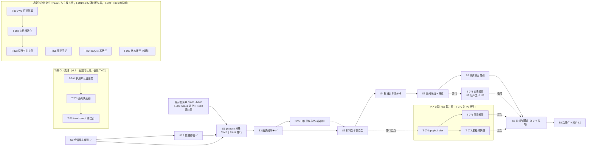

# SpecGuard Vision · 开发总控文档

> **本文档是所有开发会话的唯一协调中心。任何开发会话开工前必须完整阅读 §1-§4，并按 §3 协议注册会话、认领任务、登记文件变更。**
> 版本：v1.30 · 2026-08-21 ｜ 配套：`sg-hash.py`（文件指纹工具）｜ 上游依据：《研发顺序与里程碑验收》、13 份模块设计（M01-M13）、00 统一约定
>
> **v1.29 决策（2026-08-21，sess-arch-breakdown，总控人指令）**：新增 §4.11「架构反馈升级施工块」（T-960~T-999，依据《架构反馈升级/2026-08-21-模块化任务拆分.md》——08-20 架构体检+八点反馈判定归档 + 08-21 知识库核验翻案与总控人拍板）。六功能域六 worktree：M-A 多系统贯通（wt/multi-system，含 T-973 系统包动态注册——总控人拍板分级方案：配置型系统 UI 注册即时生效、代码型评审后热加载免重启）/ M-B 依赖翻正（wt/dep-inversion）/ M-C 智能层可信度（wt/agent-eval + wt/test-taxonomy + wt/tool-consolidation）/ M-D 材料池演进（wt/material-pool，吞并 T-933~T-935）/ M-E 前端 IA（wt/frontend-ia）/ M-F 收尾填料。P0 五项（T-960~T-964）主库小刀当天清，含 08-21 知识库翻案新增的 T-964 clarity 假分数清理。待拍板决策剩 3 项（话题 FR 锚点派生/闲聊默认过滤/管理菜单收低频区），认领 T-991/T-992/T-996 前先过。
>
> **v1.30 决策（2026-08-21，sess-arch-breakdown，总控人指令）**：第二轮归档瘦身——v1.23~v1.28 决策记录、§4.8 GateDock（T-900~T-902 ✅）、§4.9 飞书知识图谱（T-910~T-930 ✅）、§4.10 已完成任务（T-931/T-932/T-937~T-952/T-955 ✅）、已完成会话注册与 §6 非基准行，归档至《历史区/SpecGuard-总控文档-归档-2026-08-21.md》；总控仅留活跃任务（§4.6 进行中/§4.7 触发制/§4.10 未认领与储备行/§4.11 施工块）+ §6 登记中行与各文件最新基准行。
>
> **历史决策**：v1.1~v1.22 见《归档-2026-08-13》第一章；v1.23~v1.28 见《归档-2026-08-21》第一章；已完成任务验收备注见两份归档对应章节。

---

## 1. 开发会话工作协议（强制，六步）

```
① 读   —— 读本总控文档 + 你任务对应的模块设计文档（Mx §0-§9）+ 00 统一约定
② 注册 —— 在 §5 会话注册表登记：会话ID / 角色 / 认领任务ID / 开工时间
③ 认领 —— 把 §4 任务总表中目标任务的「状态」改为 进行中、填入你的会话ID
④ 登记 —— 改任何文件前，先在 §6 文件变更登记表登记：路径 + 修改前hash
           hash 命令：python3 sg-hash.py <文件路径>
⑤ 开发 —— 按模块设计文档 §6 关键流程与 §9 验收标准开发
⑥ 收口 —— 改完更新 §6 登记的「修改后hash」，任务达验收标准后 §4 状态改 已完成
```

**三条铁规：**

1. **未登记不动手**：要修改的文件没有出现在 §6 登记表（且状态=登记中、会话ID=你），不得写盘。
2. **开工先对 hash**：认领任务后，对将要修改的每个文件执行 `python3 sg-hash.py --check <文件> <登记表中的修改后hash>`。DIFF = 有人改过你不知道的版本——**停手**，去 §6 找到最后登记会话，对齐后再开工；禁止直接覆盖。
3. **一任务一会话**：状态=进行中的任务不得被第二会话认领；需要协作时在 §5 注册表「备注」列协商拆分。

---

## 2. 阶段地图：方向与目标效果

### 2.0 打磨期（P0，✅ 2026-08-07 总控人宣布结束，已归档）

四轮任务（T-101~T-131 / T-201~T-205 / T-301~T-321 / T-401~T-404）全部完成、回归 674/674 全绿，打磨期结束并恢复升级期认领。阶段小节与任务明细见归档文件第二、三章。

### 2.1 远期升级期（S0-S8，2026-08-07 起恢复认领）

> 以下为远期升级路线（v1.1 起整体后置；**2026-08-07 总控人宣布打磨期结束，恢复认领**）：
> 关键路径串行：S0→S1→S2✅→S3→S4→S5→S6→S7→S8；P-A 支路（T-070/071/072）从 S3 起可全程并行（**T-070 为咽喉，S3 起 P0**，v1.6）；**S0.5 依据透明快车道（v1.5，T-511/T-512）插在 S0 与 S1 之间但不阻塞 S1，✅ 2026-08-07 完成**；**S1 purpose 地基（T-010~T-014）✅ 2026-08-10 完成（里程碑验收五项全过，S2 依赖就绪）**；**S2 F1 面试闭环 ✅ 2026-08-10 完成（T-020~T-024 全部交付，S3 依赖就绪）**；**瘦身任务块（v1.6，T-601/T-602）先于 S1 施工（T-601 modes 退役是 T-010 硬前置）**；**飞书 CLI 支线（v1.6，T-701~T-703）与主线并行、近期可认领（依赖 T-602 单一注册面）**；T-073 与 S6 并行、治理三件套按依赖前置认领（v1.6）。
> 每阶段详细验收标准见《研发顺序与里程碑验收》§3，此处给方向与目标效果。

| 阶段 | 方向（往哪里走） | 达成效果（验收门面） | 对应模块 |
|---|---|---|---|
| **S0** 会话编排单测 | agent 编排层测试先行，套件可离线复跑（**v1.2 起前置至打磨期 §4.1 T-401**） | 单测全绿 + `--mock` CI 可挂；后续所有阶段的回归底座 | agent/（runtime/session/compactor） |
| **S0.5** 依据透明（v1.5 新增快车道） | agent 读过的关键文档进面板，关键章节可见 | 用户跟上 agent 关键思路、把判断依据摊开（阅读足迹面板 + 章节提取）；**不阻塞 S1** | agent/runtime + workbench（《知识体系设计》§4.5） |
| **S1** purpose 地基 ✅ | 会话创建期锁定 + 工具白名单运行时强制 | 越权工具调用被确定性拒绝；purpose 不可变（**✅ 2026-08-10 完成：T-010~T-014 全部交付，S2 依赖就绪**） ；[2026-08-10 修复] 全量代码审查修复 6 项安全漏洞（H1/H2/M1-M6），详见 §4.2 T-010~T-014 备注与 §5 sess-s1-fix | M01 / M12 / M13(P1骨架) |
| **S2** F1 面试闭环 ★价值拐点 ✅ | specflow/interview 从零到端到端 | 产品在 AgentChat 完成面试→台账→P0 清零→归档，可演示（**[2026-08-11 修复] 审查验收修复 12 项（H1-H3/M1-M8/低危），详见 §4.2 T-020~T-024 备注与 §5 sess-s2-fix**） | M02 / M04 |
| **S2.5** 日程获取与文档权限 ✅ | 日历+会议纪要链路封装 + 无权限文档结构化引导 | 面试官可从日程获取会议上下文/纪要素材；遇到无权限文档时展示提示+申请链接（`+apply-permission`），不静默降级（**✅ 2026-08-11 完成：feishu_fetch 模块 2 工具 + 真实链路冒烟打通，详见 §4.2 T-025/T-026 与 §5 sess-s2.5-dev**） | 飞书 CLI（calendar/vc/note/docs） |
| **S3** 材料包与信息包 ✅ | 多源文档解析入包，挂载补票 | 三类文档→议题候选→人拍板入包；list_tools 回归（**✅ 2026-08-11 完成：材料管线/候选闸门/六分区装配 + 5 MCP 工具 + 8 REST 端点，详见 §4.2 T-030~T-032 与 §5 sess-s3-dev**） | M03 |
| **S4** 扫描仪与评分卡 ✅ | 草案机打校验 + 五维半自动 | 机打维度走 specstd；LLM 预打分 QA 确认才生效（**✅ 2026-08-11 完成：specflow/anchor + delta 包 + 三闸冻结，详见 §4.2 T-040~T-042/T-050~T-052 与 §5 sess-s5-dev；漏洞修复闭环（纯读化/路径净化/fail-closed）同日完成**） | M05 / M04 |
| **S5** 三闸冻结 + 禅道 ✅ | 产物规格化 + 跨系统挂链 | 三闸冻结；zentao-cli 幂等建故事/提 BUG；external_refs 登记（**✅ 2026-08-11 完成：integrations/zentao 单包 + 幂等作业 + 双入口提单 + 故事点评估 + 三表，详见 §4.2 T-053~T-056 与 §5 sess-s5-dev**） | M05 / M06 |
| **S6** 测试侧三增强 ✅ | 闸门保护下启用 Agent | 缺口泳道真实一致；数据制造/归因产物全过闸（**✅ 2026-08-11 完成：覆盖缺口三态聚合 + sg_draft_gates 三闸状态机 + 数据校验器/制造编排 + 归因证据包/SPQ 挂链 + loop-back，详见 §4.2 T-060~T-064 与 §5 sess-s6-dev；测试 1076 全绿 / release_check PASS / 前端 build PASS**） | M07 / M08 / M09 |
| **S7** 血缘与图谱 | 图谱派生 + 血缘投影（汇合 P-A） | Q1/Q2 双向 trace 不断链；演化 diff 可重建 | M10 / M11 |
| **S8** 治理件 + 对外 L0 | skill 体系化 + open/ 只读面 + 研发侧消费通道 | 旗舰 e2e：外部编码 Agent 经 MCP 读冻结 spec；研发侧 dev_context 三入口（接需求/开发接口/修BUG）从 ZT-STORY 号拿到带指纹的 dev-context-pack | M13 / M12 |

下图把上表画成关键路径：S0→S8 硬串行为主轴，瘦身任务块（T-601/T-602）先于 S1、P-A 支路（T-070/071/072 图谱索引/视图/快照）自 S3 起全程并行并在 S7 汇合主线，T-073 与 S6 并行收尾 S7，飞书 CLI 支线（T-701~T-703）与主线全程并行：



---

## 3. 串行 / 并行规则

### 3.1 硬串行（前置未完成不得开工，认领无效）

| 先行任务 | 后续任务 | 原因 |
|---|---|---|
| S0 全部 | S1 全部 | 编排层测试是地基回归保障 |
| T-401 编排单测收口（=S0 前置） | T-402 / T-403 / T-404 | 先有线再施工：runtime/llm_client 改动需回归网兜底 |
| T-601 modes 体系退役（v1.6） | T-010 purpose 模型 | 双轨 prompt 装配污染（modes 与 skills 同题双写）；先退役再开 T-010 一次改到位，避免三次改装配 |
| T-010 purpose 模型 | S2 全部 | 面试会话挂在 purpose 上 |
| T-025/T-026 S2.5 链路工具 | S3 全部（S2.5 不阻塞 S3，虚线依赖） | 日程/纪要虽补充素材但非解析管线前提；原则上可并行 |
| T-023 台账 schema + T-024 P0 清零 | T-042 评分门禁 → S5 全部 | 冻结三闸的③闸依赖台账与清零校验 |
| T-050 delta manifest | T-051 三闸冻结 → T-053/054/055/056 | 禅道侧一切动作消费冻结产物（铁律 6） |
| S5 全部 | S6 全部 | 数据制造/归因 Agent 需要三闸与 delta 通道在位 |
| T-070 graph_index | T-071/072/073 | 视图与血缘都是索引的投影 |
| T-056 sf_external_refs | T-073 血缘外部锚点 / T-083 refs_query / T-085 dev_context 场景A/C | 同表同源，owner 先行 |
| T-070 graph_index | T-085 dev_context 场景B/C | 锚点反查与血缘投影的算力来源 |

### 3.2 可并行（认领即可开工，互不阻塞）

- **P-A 支路**：T-070 / T-071 / T-072（图谱索引、视图、快照）——S3 起与主线全程并行（**T-070 为 P0 咽喉，v1.6 优先认领**）
- **瘦身块（v1.6）**：T-602（TOOL_MODULES 单一注册）与 T-601 并行；T-603/T-604/T-605 无依赖任意空窗；T-606 挂 T-604 后
- **S1 内（v1.7）**：T-014（多会话产物地基）与 T-010/T-011 **三会话并行**——产物目录 emp 维度与会话模型互不依赖，可独立认领独立验收
- **S5 内**：T-053 / T-054 / T-055 / T-056 四者在 T-050+T-051 完成后互相并行
- **S6 内**：T-060 / T-061 并行；T-062 / T-063 在 T-061 后并行
- **S8 内**：T-080 / T-081 / T-082 三者互相并行，均完成后才开 T-083 / T-085；T-085 另需 T-056 与 T-070（通常早于 S8 完成）
- **跨阶段**：T-032（info_pack 补票）不依赖 S2，可提前至 S1 后任意时间
- **S0.5 快车道**：T-511 / T-512 与 S1 并行，互不阻塞（依据《知识体系设计》§4.5，P0 优先）
- **治理三件套前置（v1.6）**：T-081 / T-082 在 S1（T-011）完成后即可认领（✅ 2026-08-10 已满足）、T-080 在 S2 完成后即可认领（✅ 2026-08-10 已满足）——与 S3-S7 主线零耦合，摊入空窗削 S8 峰值
- **T-073 并行（v1.6）**：S5 完成 + T-070 就绪即可认领，与 S6 并行（血缘投影建在冻结产物 + 已有 run 报告上，数据制造/归因 Agent 产物是增量而非前提）
- **引擎支线**：§4.3 T-501 / T-502 与 S1+ 主线互不依赖，认领即可开工
- **知识支线**：§4.4 T-505 / T-506 无依赖可认领；T-507~T-510 随 S1/S3/S6 阶段解锁
- **飞书 CLI 支线（v1.6）**：§4.6 T-701~T-703 与 S1+ 主线互不依赖（T-701 依赖 T-602 单一注册面），近期可认领
- **S2.5（v1.11）**：T-025/T-026 随 S2 完成后可认领（S2 ✅ 2026-08-10 满足），与 S3 并行不阻塞（§3.1 虚线依赖）；**✅ 2026-08-11 完成（feishu_fetch 模块 2 工具，真实链路冒烟打通）**
- **规模化升级支线（v1.22）**：§4.7 **T-801 / T-805 无依赖、35 人起步即可认领**（广播订阅隔离 / 服务守护）；T-802~T-804 触发制（时机列见 §4.7）；T-806 储备不得认领

### 3.3 储备项（不认领，触发条件由总控人宣布）

- T-084 外部 skill 审查管线完整化 / 对外 L1 / MCP Registry 生态开放
- T-503 DB 轮询 + 通用重试原语（触发：首个需要 DB 轮询或瞬时重试的真实场景出现）
- T-504 数据驱动参数化 + 场景级超时（观察项；触发：参数化真实 ROI 成立，或 run 看门狗归因粒度不足）
- T-802 执行槽池化（触发：排队成为常态——连续一周队列长度>3 或等待>15 分钟；架构级需冻结层评审）
- T-803 调度忙时排队（挂 T-802 后；触发：定时任务 skipped_busy 用户反馈）
- T-804 SQLite 写路径演进（触发：database is locked 或写延迟>100ms；观测布点可提前）
- T-806 状态外迁/多机（触发：100+ 且 T-802/804 后仍不足，先评估报告再立项）

---

## 4. 任务总表（认领在这里改状态）

> 状态值：`未认领` / `进行中` / `已完成` / `阻塞`（阻塞须在备注写原因）
> 表行格式固定，只允许更新「状态/会话ID/备注」三列；新增任务由总控人追加。
> 分区：**§4.1 打磨期**（✅ 归档）｜**§4.2 远期升级期**（已完成归档，储备保留）｜**§4.3 引擎演进补点**（储备）｜**§4.4 知识体系**（✅ 归档）｜**§4.5 瘦身任务块**（✅ 归档）｜**§4.6 飞书 CLI 集成**（进行中）｜**§4.7 规模化升级**（触发制）｜**§4.8 对话操作台 GateDock**（✅ T-900~T-902 全完成）｜**§4.11 架构反馈升级施工块**（T-960~T-999，认领中）。
> **已完成任务明细（含验收备注/修复记录）统一见归档文件**：`docs/历史区/SpecGuard-总控文档-归档-2026-08-13.md`。

### 4.1 打磨期（P0，✅ 2026-08-07 结束，已归档）

四轮 41 项任务全部完成，明细见归档文件第三章。

### 4.2 远期升级期（S0-S8，主线任务全部完成）

> S0/S0.5/S1/S2/S2.5/S3/S4/S5/S6、P-A 支路（T-070~T-074）、S7（T-073/T-074）、S8（T-080/T-081/T-082/T-083/T-085）全部完成（2026-08-07~08-11），明细见归档文件第四章。

| 任务ID | 阶段 | 任务 | 模块 | 产出/验收要点 | 依赖 | 状态 | 会话ID | 备注 |
|---|---|---|---|---|---|---|---|---|
| T-084 | P3 | 审查管线完整化/对外L1/生态Registry | M13 | 储备项，触发制 | T-083 | 储备 | | 不得认领 |

### 4.3 引擎演进补点（对标第三批评估，v1.3 新增）

> 来源：《引擎升级建议-第三批-对标开源引擎评估》+ 2026-08-07 复核修正。定位：engine 能力按需补点，非 S 链组成部分；涉断言器/语法变更一律三同步 + TDD；触及 scenario_runner 调度语义仍需冻结层评审。
> T-501（schema 结构断言）/ T-502（fixtures 文件引用预检）✅ 已完成，明细见归档文件第五章。

| 任务ID | 阶段 | 任务 | 模块 | 产出/验收要点 | 依赖 | 状态 | 会话ID | 备注 |
|---|---|---|---|---|---|---|---|---|
| T-503 | 引擎-储备 | DB 轮询 + 通用重试原语 | engine/scenario_runner | poll 扩展 db_query 轮询体（改动集中 step_poll）或 verify retry 原语；触发制：**首个真实场景需要时启动**——当前 4 个 poll 场景全为 HTTP 且工作正常，零真实需求证据 | 触发 | 储备 | | 第三批 P1-1，2026-08-07 复核降级为储备 |
| T-504 | 引擎-储备 | 数据驱动参数化 + 场景级超时 | engine | 观察项：参数化动语法层需冻结层评审（Agent 生成场景成本极低，ROI 不足）；场景级超时边际价值仅归因粒度（T-118 run 看门狗已兜底整轮拖死风险） | 触发 | 储备 | | 第三批 P2-1/P2-2，2026-08-07 复核降级为观察 |

### 4.4 知识体系（v1.4 新增，✅ 全部完成，已归档）

T-505~T-510 全部完成（2026-08-11，sess-know-dev），明细见归档文件第六章。

### 4.5 瘦身任务块（v1.6 新增，✅ 全部完成，已归档）

T-601~T-606 全部完成（2026-08-10，sess-slim-dev / sess-slim-v2），明细见归档文件第七章。

### 4.6 飞书 CLI 集成（v1.6 新增，近期开发规划）

> 来源：飞书 CLI（`lark-cli` v1.0.85）多用户接入需求（2026-08-10 确认：每用户独立 app；服务器多用户共享进程；能力域与现状 app `cli_a96d90ca7d7adbd9` 一致暂不限定；user + bot 身份都要）。
> 技术结论（实测验证）：lark-cli 配置/登录态存储于 `~/.lark-cli/`（机器级全局）；**`USERPROFILE`（Win）/`HOME`（Linux）环境变量可重定向配置目录（实测生效）**——每 SpecGuard 用户一个隔离目录 `{SG_ROOT}/.lark-cli/{emp_no}/`，子进程注入 USERPROFILE 即天然隔离（token/配置/缓存零串扰）；`auth login --no-wait/--device-code` 两阶段授权（Agent 友好）；`--as user|bot` 身份切换（不支持 openId）；`--domain/--scope` 按需申请。
> 定位：与 S1+ 主线并行可认领；**T-701 依赖 T-602**（TOOL_MODULES 单一注册后只注册一处，避免加剧 B1 漂移）；落地涉及 MCP 工具层（mcp_server/tools/）与 workbench 前端，不触引擎冻结层；`.lark-cli/` 目录须补 .gitignore。

| 任务ID | 阶段 | 任务 | 模块 | 产出/验收要点 | 依赖 | 状态 | 会话ID | 备注 |
|---|---|---|---|---|---|---|---|---|
| T-701 | 飞书-认证 | 多用户认证服务 | mcp_server/tools/lark_auth.py + specstd.workspace | 每用户独立配置目录 `{SG_ROOT}/.lark-cli/{emp_no}/`（USERPROFILE 注入，实测生效）+ .gitignore 补充；lark_auth_login 两阶段（--no-wait 返回 verification_url 给用户 → --device-code 完成；--recommend 与现状 app scope 一致）；lark_auth_status / lark_auth_logout（按 emp_no 隔离）；未绑定用户明确提示引导授权 | T-602 | 进行中 | sess-lark-dev | P0｜近期可认领，与 S1+ 并行；子进程并发锁（每用户一把，防 token 刷新互踩） |
| T-702 | 飞书-执行 | 通用执行器 | mcp_server/tools/lark_run.py + agent/runtime | lark_run 透传全部 lark-* 域命令（能力探索不限定域）：子进程注入当前用户 USERPROFILE、命令白名单校验（禁 shell 拼接）、超时 60s + 结果截断（复用 _TOOL_RESULT_MAX_CHARS 出口）；写操作（high-risk-write）强制 --yes 且需用户确认；调用留痕（工号×命令×结果摘要） | T-701 | 进行中 | sess-lark-dev | P0｜能力探索随本任务验证（calendar/im/task/approval 等域） |
| T-703 | 飞书-工作台 | workbench 绑定页与审计 | workbench 前后端 | 「个人设置 → 绑定飞书」：授权 URL / 授权状态 / scope 清单 / 解绑；Agent 会话自动带出当前用户飞书身份（emp_no → 配置目录映射）；调用审计（工号/会话/工具/入参摘要，与 T-082 口径对齐） | T-701/T-702 | 进行中 | sess-lark-dev | P1｜近期可认领 |

### 4.7 规模化升级（v1.22 新增，触发制，与主线并行）

> 来源：《SpecGuard-多角色服务访问流转与规模化升级设计》（2026-08-11，代码实证）——当前 35 人量级架构完全支持；100+ 人 4 大阻塞点：① RunManager 单执行槽（runner.py:877 模块级单例）② 全局 WS 广播无过滤（runner.py:199-207）③ SQLite 单文件单写（user/audit/run_queue/draft_gates/scheduler/sf_*/audit_store 全写 workbench.db）④ 调度忙时跳过不入队（scheduler.py:166-181）。
> 定位：不依赖 S 链主线，与 S8 及之后并行；**T-801/T-805 无依赖、35 人起步即可认领**；T-802~T-804 按「规模信号触发制」由总控人宣布认领；T-806 储备不得认领。触发信号：排队成为常态（连续一周队列>3 或等待>15min）/ 写锁告警（database is locked 或写延迟>100ms）/ 调度 skipped_busy 用户反馈。

| 任务ID | 阶段 | 任务 | 模块 | 产出/验收要点 | 依赖 | 状态 | 会话ID | 备注 |
|---|---|---|---|---|---|---|---|---|
| T-801 | 规模-广播 | WebSocket 订阅隔离 | runner + runs + useRunStream | 订阅按 run_id/workspace 过滤；broadcast 只发订阅该流的连接（scope=all 兼容存量）；执行流页按 run 订阅、全局页只收系统级事件；单次执行广播量=订阅该 run 的连接数（打点验证） | — | 未认领 | | P1｜35 人起步可认领（低风险独立）；在线 WS 连接>30 时优先 |
| T-805 | 规模-守护 | 服务守护与自动拉起 | serve-prod.ps1 + scripts/watchdog.ps1 | Windows 服务化（NSSM/计划任务+Watchdog）：崩溃退出码非零自动重启+退避；复用 /api/health 探活；重启后 fail_stale_running 恢复队列项数 WARN 日志 | — | 未认领 | | P2｜35 人起步可认领（生产正式使用即做，第一位可用性保障） |
| T-802 | 规模-执行 | 执行槽池化（RunManager→RunPool） | runner + user_store + runs + scheduler + RunControl | N 槽并发（默认 2，可配）；互斥维度全局→(workspace,env)（同工作区同环境不并发，不同可并行）；run_queue 加 slot 列；队列 ETA（历史均值）+ 优先级（manual>定时>批量）；abort/超时/断点语义池化下不回归（复用 T-111/T-112/T-118 测试） | T-801 | 未认领 | | P0｜触发制：连续一周队列>3 或等待>15min；架构级，开工前须冻结层评审 |
| T-803 | 规模-调度 | 调度忙时排队（替代跳过） | scheduler + user_store | 忙时入队而非跳过（priority=定时 标记，T-802 多槽+优先级自然消化）；保留 skipped_busy 统计（调度被挤占比=执行槽不足观测指标）；可选错峰窗口 | T-802 | 未认领 | | P1｜挂 T-802 后；触发：定时任务 skipped_busy 用户反馈 |
| T-804 | 规模-存储 | SQLite 写路径演进 | user_store/audit_store + 新增 services/db_metrics.py | 三步渐进：① 观测（写 TPS/锁等待 busy_timeout 命中打点，一周报告）→ ② 审计类批量/异步落盘（攒批 100ms 或 50 条）+ 高频读缓存 → ③ 必要时拆高频表分库或迁 PostgreSQL；验收：峰值写延迟<100ms 无 locked | — | 未认领 | | P1｜触发：database is locked 或写延迟>100ms；观测布点可提前 |
| T-806 | 规模-储备 | 状态外迁与多机横向扩展 | runner/scheduler/存储层 | RunManager 状态 Redis 化或独立执行进程；SQLite→PostgreSQL（随 T-804 ③）；调度器独立进程化；Nginx 反代+多 worker+共享存储；验收：多 worker 队列不重复消费、滚动发布零停机 | T-802/T-804 | 储备 | | 触发制：100+ 且 T-802/804 后仍不足或 HA/多团队隔离硬需求；先评估报告再立项 |

### 4.8 对话操作台 GateDock（v1.23 新增，✅ 全部完成，已归档）

> T-900~T-902 全部完成（2026-08-13，sess-gatedock-dev），明细见《历史区/SpecGuard-总控文档-归档-2026-08-21.md》第二章。

### 4.9 飞书知识图谱（v1.25 新增，✅ 全部完成，已归档）

> T-910~T-930 全部完成（2026-08-14~08-17，sess-feishu-graph/sess-agentchat-material），明细见《历史区/SpecGuard-总控文档-归档-2026-08-21.md》第三章。

### 4.10 AgentChat 材料工作流与 purpose 面板装配（v1.28 新增，与全部主线并行）

> 依据：《远期设计/SpecGuard-AgentChat材料工作流与purpose面板装配专项设计.md》（2026-08-17 定稿）。
> 定位：材料池/材料管理 = agent 对话的背景信息源——①对话即工作台（需求面试对话内上传材料→解析登记→引用进面试上下文）；②面板随方向装配（purposes.panels 声明式消费：前端页签注册表通用/专用分层，通用恒显+专用∩注册表，新 purpose 零前端改动）；③防膨胀硬约束（专用页签只出现在声明它的 purpose 下）。
> 硬边界：不删 MaterialsPanel 不动 M03 入包闸门（瘦身为储备 T-936）；不实现储备页签（ledger/score/deliver/plan/report）；不改引擎冻结层/specstd。

| 任务ID | 阶段 | 任务 | 模块 | 产出/验收要点 | 依赖 | 状态 | 会话ID | 备注 |
|---|---|---|---|---|---|---|---|---|
| T-933 | 材料-上传 | 对话内材料上传 + 引用类型扩展 | AgentChat.tsx + api.ts | 📎 入口走 S3 既有上传端点；上传成功挂 reference 卡片（ChatReference 扩 'material'）随消息进 references；「材料」页签列会话引用材料（标题/状态/摘要）；build | T-932 | ✅ 08-21 主库验收 | sess-material-pool | 并入 T-990 施工（20075e1），随其验收（合并 2b0691a） |
| T-934 | 材料-读取 | read_material MCP 工具 + 白名单登记 | mcp_server/tools/specflow_pack.py + purposes md | summary/topics/raw 三视图 + raw 分页；requirement_interview tools 登记；MCP 用例 ≥3 | — | ✅ 08-21 主库验收 | sess-material-pool | 并入 T-990 施工（c0273de），用例 5 例；RBAC 只读集补登记见 a7a54df |
| T-935 | 收口 | e2e + 全量回归 | test_specstd + 前端 | 上传→引用→read_material 贯通（mock）；全量回归 + release_check + build | T-931~T-934 | ✅ 08-21 主库验收 | sess-material-pool | 并入 T-990 施工（a7a54df）：主库合并形态全量 1906 绿 + engine_modes 39 绿 + release_check PASS + build 成功 |
| T-936 | 储备 | MaterialsPanel 瘦身评估 | — | 对话链路验收后评估入包闸门/六区重组去向，总控人拍板 | T-935 验收 | 储备 | | 触发制，不认领 |


> §4.10 已完成任务（T-931/T-932/T-937~T-952/T-955）明细见《历史区/SpecGuard-总控文档-归档-2026-08-21.md》第四章。

### 4.11 架构反馈升级施工块（v1.29 新增，T-960~T-999）

> 依据：《架构反馈升级/2026-08-21-模块化任务拆分.md》（任务明细/验收要点/粒度/顺序约束全在该文档，此处只登记状态）。来源：08-20 架构体检+八点反馈判定归档 + 08-21 知识库核验与用户拍板（系统包分级注册）。
> 施工纪律：一功能域一棵 worktree（建树 `pwsh new-worktree.ps1 <域>`），主库只验收；提交即推 feature/<域>。

| 任务ID | 阶段 | 任务 | worktree | 依赖 | 状态 | 会话ID | 备注 |
|---|---|---|---|---|---|---|---|
| T-960 | P0 | 凭据出库（env.sit.yaml client_secret→环境变量回退） | 主库小刀 | — | 未认领 | | 0.5 天 |
| T-961 | P0 | 飞书池 API 绑定 RBAC + 三处错位绑定对齐 | 主库小刀 | — | 未认领 | | 0.5 天 |
| T-962 | P0 | /quality 死菜单清理 | 主库小刀 | — | 未认领 | | 0.5 小时 |
| T-963 | P0 | P0/P1 mark 断链修复（priority→mark 映射） | 主库小刀 | — | 未认领 | | 0.5 天 |
| T-964 | P0 | clarity 假分数清理（specflow_ledger.py:179 占位 62.0） | 主库小刀 | — | 未认领 | | 0.5 天；08-21 知识库翻案新增 |
| T-970 | M-A | 装配归一 bootstrap.py | wt/multi-system | — | ✅ 33682ba（08-21 主库验收） | sess-multi-system | 1 天；顺带修复plan_executor漏注册内置oracles漂移bug |
| T-971 | M-A | system 一等公民化（9 调用点归一+runner 断链+分键缓存） | wt/multi-system | T-970 | ✅ 0fbcd9e（08-21 主库验收） | sess-multi-system | 2-3 天；多用户多系统切换硬前置 |
| T-972 | M-A | 引擎 TDM 泄漏清理 | wt/multi-system | — | ✅ f52d3a9（08-21 主库验收） | sess-multi-system | 1 天；format_spec 2.12.0 三同步 |
| T-973 | M-A | 系统包动态注册（分级：配置型 UI 即时生效/代码型评审后热加载） | wt/multi-system | T-970/T-971 | ✅ 9d4bf6c（08-21 主库验收） | sess-multi-system | 2-3 天；08-21 用户拍板分级方案；sha256评审闸不可绕已测试锁定；前端管理页留M-E/T-996评估，API已全量落地 |
| T-974 | M-A | 多系统 e2e 收口（新系统注册到跑通不重启） | wt/multi-system | T-971~T-973 | ✅ ea2b6c0（08-21 主库验收） | sess-multi-system | 1 天；M-A 五任务全部完成，待主库验收合并 |
| T-975 | M-B | 依赖倒挂翻正（sg_core 下沉，消灭 sys.path.insert） | wt/dep-inversion | — | ✅ 7becec2~a8d2f6f（08-21 主库验收） | sess-dep-inversion | 三步：24 实体下沉+shim；全仓 insert ~200→2（main.py 组合根+backend 运维脚本）；pythonpath 归一；顺手修 audit_store 幽灵路径存量 bug |
| T-976 | M-B | 解环（agent↔mcp_server、graph_index↔specflow）+ 环检查进 release_check | wt/dep-inversion | T-975 | ✅ 2208b0c（08-21 主库验收） | sess-dep-inversion | skill_loader/feishu_paths 下沉解两环；check_import_cycles 进 release_check ④；模块级无环+函数级回边白名单；离线 1599+236 全绿 |
| T-980 | M-C | Agent 评测体系（轨迹断言 golden case + MockLLM 升基建 + metrics 工具维度） | wt/agent-eval | — | ✅ 2026-08-21 主库验收（a10105d：evals 3/3 + test_evals 36/36 + release_check PASS） | sess-agent-eval | 3-5 天；智能层后续一切的地基；T-982 解锁 |
| T-981 | M-C | 测试类型学（dimensions 受控词表+维度断言映射，format_spec 三同步） | wt/test-taxonomy | — | 未认领 | | 3-4 天；与 T-980 并行 |
| T-982 | M-C | 工具收敛（79→≤30，元数据派生 RBAC/写工具登记，eval 集验证收益） | wt/tool-consolidation | T-980 | 未认领 | | 5-8 天 |
| T-990 | M-D | 群类型标签 + 吞并 T-933/T-934/T-935（对话内上传/read_material/e2e） | wt/material-pool | — | ✅ 08-21 主库验收（合并 2b0691a） | sess-material-pool | 2-3 天；2026-08-21 认领，当日完工（c0273de/60a1874/ea6d094/20075e1/a7a54df） |
| T-991 | M-D | 话题 category/priority（schema v3，闲聊保留默认过滤） | wt/material-pool | T-990 | ✅ 08-21 主库验收（合并 2b0691a） | sess-material-pool | 2-3 天；拍板③已过（08-21）；当日完工（fd7747e） |
| T-992 | M-D | link 死链修复 + 话题模块 FR 锚点派生 | wt/material-pool | T-991 | ✅ 08-21 主库验收（ff 合并 af4a1cf） | sess-material-pool | 1-2 天；拍板②已过（08-21：FR 锚点派生+留空后补）；当日完工（6ec3989） |
| T-993 | M-D | 跨群话题关联（先设计文档） | wt/material-pool | T-992 | ✅ 08-21 主库验收（合并 3e6ae5b） | sess-material-pool | 3-5 天；设计稿《远期设计/SpecGuard-跨群话题关联设计-T993.md》08-21 总控人评审通过；当日完工（871f2a3） |
| T-995 | M-E | 拆 AgentChat.tsx（行为零变化纯重构） | wt/frontend-ia | T-990 | 未认领 | | 2-3 天；或与 M-D 排他约定 |
| T-996 | M-E | 菜单收缩 29→15 + SEED_MENUS 迁移 + lifespan 换 on_event | wt/frontend-ia | T-995 | 未认领 | | 3-5 天；拍板④前置 |
| T-997 | M-E | api.ts 按域拆分 + 前端关键路径 vitest | wt/frontend-ia | — | 未认领 | | 2 天 |
| T-998 | M-F | 文档滞后批量修 + 总控状态对账（T-701~703） | 任意树空窗 | — | 未认领 | | 0.5 天 |
| T-999 | M-F | workspace.py 拆分 / scenario_runner 抽插值器 / print→logging / user_store 治理 | 任意树空窗 | — | 未认领 | | 各 1-2 天分次 |

---

## 5. 会话注册表（开工必填）
> 表行格式：`| 会话ID | 角色/方向 | 认领任务ID | 开工时间 | 备注 |`
| 会话ID | 角色/方向 | 认领任务ID | 开工时间 | 备注 |
|---|---|---|---|---|
| sess-multi-system | M-A 多系统贯通施工 | T-970（✅33682ba）→ T-971（✅0fbcd9e）→ T-972（✅f52d3a9）→ T-973（✅9d4bf6c）→ T-974（✅ea2b6c0） | 2026-08-21 | M-A 全部完成待验收。要点：bootstrap组合根（顺带修复plan_executor漏注册oracles）、resolve_system唯一口径+runner断链修复（SPEC_GUARD_SYSTEM/SG_SCENARIOS_ROOT按工作区注入）、引擎grep零tdm（format_spec 2.12.0/2.13.0三同步）、系统包分级动态注册（sha256评审闸不可绕）；离线全绿227+39+1622+release_check PASS |
| sess-lark-dev | 飞书 CLI 集成施工 | T-701 → T-702 → T-703 | 2026-08-11 | T-701→T-702→T-703 顺序施工，与 S8 主线全程并行；依赖 T-602 ✅ |
| sess-agentchat-material | AgentChat 材料工作流 + purpose 面板装配施工 | T-930（✅）→ T-931/T-932（✅）→ T-937~T-942（✅）→ T-933 ~ T-935（✅ 由 sess-material-pool 并入 T-990 施工，08-21 主库验收） | 2026-08-17 | T-930 监听选择器+可读层（aefd802/e4633a2/b1d15ff）；T-931/T-932 面板装配（42c851a）；T-937 同步设置体验（b002749）；T-938 群聊后台预热（cdf8d6e）；T-939 材料原文+图片直出（f66330b+1c90b83）；T-940 监听用户视图+按人切换+飞书直链（4a7f656）；T-941 同步设置去重+错误人话化+搜索解耦（871d64c）；T-942 授权闭环入弹层（006c5c2）；T-933~T-935 已随 T-990 吞并完成并验收，T-936 储备 |
| sess-material-pool | M-D 材料池演进施工（wt/material-pool 树） | T-990（✅ 08-21 验收合并 2b0691a）→ T-991（✅ 同批验收）→ T-992（✅ 6ec3989 待验收）→ T-993（✅ 871f2a3 待验收，M-D 链全部完工） | 2026-08-21 | T-990 五提交+T-991 fd7747e+T-992 6ec3989+T-993 871f2a3（设计稿《跨群话题关联设计》评审通过后落地：relates 边/两段式推荐/关联抽屉）；决策②③已拍板入库；本会话文件读写一律用树路径，只跑离线测试与前端 build，提交即推 |
| | | | | |

---

## 6. 文件变更登记表（改文件前必填）
> 协议：
> ① 改文件**前**登记一行：路径 + 你的会话ID + 登记时间 + **修改前hash**（`python3 sg-hash.py <路径>`），状态=登记中，修改后hash留空；
> ② 改完**立刻**回填修改后hash，状态=已完成；
> ③ 同一文件已有「登记中」行且会话ID不是你 → **停手**，该文件正被别的会话修改；
> ④ 你要改的文件实际hash ≠ 登记表最新「修改后hash」 → **停手**，存在未登记变更，先对齐；
> ⑤ 新文件：修改前hash填 `NEW`；删除文件：修改后hash填 `DELETED`。

| 文件路径 | 会话ID | 登记时间 | 修改前hash | 修改后hash | 状态 | 备注 |
|---|---|---|---|---|---|---|
| specflow/feishu_pool/cross_chat.py | sess-material-pool | 2026-08-21 | NEW | | 6817c23c773e | 已完成 | T-993 F1：跨群关联推荐引擎（确定性预筛零LLM + LLM精筛可选降级） |
| workbench/backend/routers/feishu_pool.py | sess-material-pool | 2026-08-21 | 82d150372549 | | 9901c72cb301 | 已完成 | T-993 F2：relate/relations/cross-refine 三端点 |
| workbench/backend/services/specflow/feishu_sync_service.py | sess-material-pool | 2026-08-21 | eeeec105a941 | | e5d6e83591a4 | 已完成 | T-993 D5：list_pool_topics 附确定性预筛 cross_suggestions |
| graph_index/builder.py | sess-material-pool | 2026-08-21 | a79cb643f5dd | | cf3dbc61cbe6 | 已完成 | T-993 D6：links 按 edge 分派边类型（mentions/relates 复用预留类型仅 tp↔tp）——现状不分会全建成 mentions |
| workbench/frontend/src/api.ts | sess-material-pool | 2026-08-21 | 9002b3a6cbee | | a9d0966a5501 | 已完成 | T-993：TopicRelation/CrossChatCandidate 类型 + relate/relations/crossRefine API |
| workbench/frontend/src/components/TopicCard.tsx | sess-material-pool | 2026-08-21 | a8fb2c696369 | | 4df8474ddb93 | 已完成 | T-993 D7：「🔗 N 群」徽标 + onOpenRelations 回调 |
| workbench/frontend/src/components/TopicWorkspace.tsx | sess-material-pool | 2026-08-21 | c756b53474fe | | 3223e898263e | 已完成 | T-993 D7：关联抽屉（并排卡+跳原文）+ 跨群推荐位（预筛清单+精筛按钮+关联/忽略） |
| workbench/frontend/src/pages/FeishuPool.tsx | sess-material-pool | 2026-08-21 | 5c528aea0760 | | 8c1a8138a1df | 已完成 | T-993：loadTopics 透传 cross_suggestions 给工作台 |
| test_specstd/test_cross_chat.py | sess-material-pool | 2026-08-21 | NEW | | 19732d04bde7 | 已完成 | T-993 F1：预筛条件矩阵/连通分量/LLM精筛降级 |
| test_specstd/test_feishu_t948_router.py | sess-material-pool | 2026-08-21 | d3e6ec7a19ab | | 0af0ba15ed19 | 已完成 | T-993 F2：relate 确认/忽略/404 端点用例 |
| test_specstd/test_feishu_pool_page.py | sess-material-pool | 2026-08-21 | 12ca6ee8ccfa | | 8eca7566a1d3 | 已完成 | T-993：list_pool_topics 附 cross_suggestions 用例 |
| test_specstd/test_graph_index.py | sess-material-pool | 2026-08-21 | bb24301c21f1 | | 32aee1d7707b | 已完成 | T-993：relates 边派生 + 非 tp 端防御 + 存量无 edge 字段兼容 |
| workbench/backend/services/specflow/feishu_sync_service.py | sess-material-pool | 2026-08-21 | aa90cb398c61 | eeeec105a941 | 已完成 | T-992：_cluster_once 尾部挂 _suggest_links_for_pool（死链修复：话题/docs/minutes 逐对象建议入队，anchors 空诚实跳过）+ list_pool_topics 模块 FR 锚点派生 |
| workbench/frontend/src/api.ts | sess-material-pool | 2026-08-21 | b0c9c83ec94b | 9002b3a6cbee | 已完成 | T-992：FeishuTopic 加 modules（派生字段，响应时计算不落库） |
| workbench/frontend/src/components/TopicCard.tsx | sess-material-pool | 2026-08-21 | 43b43adecefe | a8fb2c696369 | 已完成 | T-992：模块 chips 展示（关联不到 FR 留空不显示） |
| test_specstd/test_feishu_pool_page.py | sess-material-pool | 2026-08-21 | ad93a8a62aba | 12ca6ee8ccfa | 已完成 | T-992：建议入队/anchors 空跳过/docs+minutes 对象/模块派生 3 用例 |
| specflow/feishu_pool/topic_cluster.py | sess-material-pool | 2026-08-21 | 3c092804048b | ed300417f3d7 | 已完成 | T-991 schema v3：category/priority 枚举 + 三 prompt rubric/few-shot + _PROMPT_VERSION pv3 + derive_priority + normalize/edit/regen + chat_kinds 参数 |
| specflow/feishu_pool/facts.py | sess-material-pool | 2026-08-21 | c272f7e22852 | 7284fc5b74c8 | 已完成 | T-991：_TOPIC_KEY_FIELDS 加 category/priority（confirm 提升不丢） |
| workbench/backend/services/specflow/feishu_sync_service.py | sess-material-pool | 2026-08-21 | 64b1c0dcdad6 | aa90cb398c61 | 已完成 | T-991：_cluster_once 建 chat_kinds（watch kind）传聚类 |
| workbench/backend/services/specflow/feishu_review_service.py | sess-material-pool | 2026-08-21 | 3fd320c6a146 | 40d33f73da98 | 已完成 | T-991：复核队列共享可选（base 参数化语义说明） |
| workbench/backend/routers/feishu_pool.py | sess-material-pool | 2026-08-21 | cbb1f284201d | 82d150372549 | 已完成 | T-991：CardUpdate 加 category/priority + draft 端点传 chat_kind + review 三端点 scope 参数 |
| workbench/frontend/src/api.ts | sess-material-pool | 2026-08-21 | cca8e0525a4d | b0c9c83ec94b | 已完成 | T-991：FeishuTopic 加 category/priority 类型 + editTopicCard 参数 + review scope |
| workbench/frontend/src/components/TopicCard.tsx | sess-material-pool | 2026-08-21 | c758631988c6 | 43b43adecefe | 已完成 | T-991：分类/优先级徽标 + 编辑表单两下拉 |
| workbench/frontend/src/components/TopicWorkspace.tsx | sess-material-pool | 2026-08-21 | 2f968442a1e3 | c756b53474fe | 已完成 | T-991：分类筛选 + 闲聊默认过滤开关（localStorage）+ 泳道优先级排序 |
| workbench/frontend/src/components/FeishuReviewPanel.tsx | sess-material-pool | 2026-08-21 | 2c2c408508bb | 46d0d12545d5 | 已完成 | T-991：复核队列「我的/共享」切换（useCallback 修 exhaustive-deps） |
| test_specstd/test_feishu_topic_cluster.py | sess-material-pool | 2026-08-21 | 3e951b846c5b | ad57c201c8f1 | 已完成 | T-991：TestSchemaV3 8 用例（推导/聚类产出/闲聊保留/修订保留/normalize/edit/draft/regen） |
| test_specstd/test_feishu_t948_router.py | sess-material-pool | 2026-08-21 | 69658b0a31da | 48ca673614ab | 已完成 | T-991：PUT card category/priority 成功 + 非法枚举 400 |
| test_specstd/test_feishu_review.py | sess-material-pool | 2026-08-21 | bbab61374d7f | 18bc3b5f8de7 | 已完成 | T-991：共享队列跨用户可见 + 路由 scope 路由 2 用例 |
| test_specstd/test_feishu_pool_page.py | sess-material-pool | 2026-08-21 | 20b0abaf2d33 | 6861071765a3 | 已完成 | T-991：_cluster_once mock 签名适配 chat_kinds + kinds 断言（补登记：动它时才发现未列） |
| workbench/backend/services/specflow/feishu_sync_service.py | sess-material-pool | 2026-08-21 | da519c270d54 | 64b1c0dcdad6 | 已完成 | T-990 群类型标签：_CHAT_KINDS 枚举 + _clean_chats 归一化（镜像 users 模式） |
| workbench/frontend/src/api.ts | sess-material-pool | 2026-08-21 | 88b5bebaad67 | cca8e0525a4d | 已完成 | T-990/T-933：FeishuWatch.chats 加 kind + FEISHU_CHAT_KINDS 导出 + previewMaterial 客户端 |
| workbench/frontend/src/components/FeishuWatchSettings.tsx | sess-material-pool | 2026-08-21 | c2d0ebae46d4 | 4fe721777def | 已完成 | T-990 群类型标签：表单行 kind 选择 + 回显/提交 |
| workbench/frontend/src/components/useChatOptions.ts | sess-material-pool | 2026-08-21 | 3179db312d82 | 4de23f8b2c46 | 已完成 | T-990：ChatOption 透传 kind（快照群+watch 群双路径） |
| workbench/frontend/src/components/TopicWorkspace.tsx | sess-material-pool | 2026-08-21 | c68ee50bf444 | 2f968442a1e3 | 已完成 | T-990：群下拉文案带 kind |
| workbench/frontend/src/pages/FeishuPool.tsx | sess-material-pool | 2026-08-21 | ede4f3cac462 | 5c528aea0760 | 已完成 | T-990：授权群聊卡 kind 徽标 |
| workbench/frontend/src/pages/AgentChat.tsx | sess-material-pool | 2026-08-21 | 961c92ee762c | 9751a8d0ae12 | 已完成 | T-933：🧾上传走 S3 端点 + ChatReference 扩 material + 📎材料页签（SIDE_TABS+MaterialsRefPanel 三态+刷新） |
| workbench/backend/routers/agent.py | sess-material-pool | 2026-08-21 | 03d797ed5cd1 | 8bcbb9327474 | 已完成 | T-933：_process_references 加 material 分支（标识/文件名/状态注入+workspace 校验） |
| agent/runtime.py | sess-material-pool | 2026-08-21 | 2420441bc0e2 | 4a3bb7f20d46 | 已完成 | T-933/T-935：system prompt 补 @材料说明 + _RBAC_READONLY_TOOLS 登记 read_material |
| agent/purposes/requirement_interview.md | sess-material-pool | 2026-08-21 | d27cfa18e450 | 79b019f9bdcf | 已完成 | T-934：tools 白名单登记 read_material |
| mcp_server/tools/specflow_pack.py | sess-material-pool | 2026-08-21 | b4ce4c04cf01 | 00dfc046b897 | 已完成 | T-934：read_material 工具（summary/topics/raw 三视图 + raw 分页） |
| test_specstd/test_feishu_sync.py | sess-material-pool | 2026-08-21 | a1872f5da59d | cc6efc90efe2 | 已完成 | T-990：kind roundtrip 2 用例（非法枚举归空/旧配置兼容） |
| test_specstd/test_specflow_materials.py | sess-material-pool | 2026-08-21 | eee48fc93262 | 24b18b53efa4 | 已完成 | T-934：TestReadMaterial 5 用例（三视图/分页/未知id/非法section） |
| test_specstd/test_mcp_server.py | sess-material-pool | 2026-08-21 | a5747952d23d | ddad8e227c7f | 已完成 | T-934：ALL_TOOLS 计数 91→92 + expected 集合加 read_material |
| test_specstd/test_agent.py | sess-material-pool | 2026-08-21 | 022fe6e8fd73 | ae585044d7de | 已完成 | T-935：TestMaterialE2E 2 用例（上传→引用→read_material 贯通 + 诚实 missing） |
| docs/远期设计/SpecGuard-AgentChat材料工作流与purpose面板装配专项设计.md | sess-agentchat-material | 2026-08-17 | NEW | fcd7c6055d45 | 已完成 | §4.10 专项设计定稿（T-931~T-936 拆解 + D1-D6 决策：页签注册表装配/上传链路复用 S3/read_material 工具/MaterialsPanel 不删） |
| docs/superpowers/specs/2026-08-18-同步设置体验修复-design.md | sess-agentchat-material | 2026-08-18 | NEW | 9f11b2e2081a | 已完成 | T-937 设计定稿（D1-D5：弹层秒开/手填删除/下拉搜索化/resolve-doc 链接解析/回显统一） |
| test_specstd/test_feishu_pool_page.py | sess-agentchat-material | 2026-08-18 | 988569618cc5 | 2752d304d5cc | 已完成 | T-941+T-942：search_docs/错误包装 4 用例；文案断言改指向弹层内授权 |
| workbench/frontend/src/components/FeishuWatchSettings.tsx | sess-agentchat-material | 2026-08-18 | 96a59ec09b85 | c79d66899165 | 已完成 | T-942：弹层内嵌授权块（状态/发起/二维码+3s轮询/完成自动重载群聊） |
| docs/upgrade-plans/2026-08-18-T947-话题人工介入工作流-开发任务.md | sess-agentchat-material | 2026-08-18 | NEW | ca4df2ae5289 | 已完成 | T-947 自包含开发任务文档（需求决策/代码地图/函数签名/TDD 清单/验收标准/治理），待新会话领取开发 |
| workbench/frontend/src/pages/FeishuPool.tsx | sess-t947-dev | 2026-08-18 | — | b0bd110cf6b3 | 已完成 | T-947：话题工作区（选源拉原文/AI 分类分段卡勾选/生成覆盖）+单卡编辑/重生成 |
| test_specstd/test_reference_envs.py | sess-agentchat-material | 2026-08-17 | — | 5ded3b3dff1e | 已完成 | 顺手修复：多系统改造后 patch 点迁移 SYSTEMS_TDM→_SYSTEMS_ROOT（旧 patch 失效曾污染真实 env.sit.yaml，已恢复+守卫验证） |
| docs/引擎升级建议-第三批-对标开源引擎评估.md | sess-master | 2026-08-07 | 477f8c866bf4 | 07f403994fe0 | 已完成 | 补写 v2 复核修正与施工规格（§六） |
| docs/远期设计/verifier/runs/2026-08-07T-task-sync-v1.md | sess-master | 2026-08-07 | NEW | 571ec4a458a1 | 已完成 | 原型更新验收运行记录：屏完整性/ID 抽查/node --check 全 PASS；截图项本环境未执行已注明；28功能/298FR 口径存疑留待复核 |
| docs/远期设计/verifier/runs/2026-08-07T-s1-plain-v1.md | sess-master | 2026-08-07 | NEW | 91ce655d4c20 | 已完成 | S1 改写验收运行记录：屏完整性/新增内容/node --check 全 PASS；截图项未执行已注明 |
| docs/远期设计/verifier/runs/2026-08-07T-s8-flow-v1.md | sess-master | 2026-08-07 | NEW | 9262af31bf84 | 已完成 | S8 流转图验收运行记录：屏完整性/新增内容/node --check 全 PASS；截图项未执行已注明 |
| docs/远期设计/specguard-vision/index.html | sess-master | 2026-08-07 | 19759ec51183 | 64d328aaaad3 | 已完成 | 文案修订：标语「未来 AI 时代」→「AI 时代」（S8 tip-bar + ctx-term 两处，现在已是 AI 时代）；轻量改动屏结构未动，grep 复验「未来」零残留 |
| docs/远期设计/app/index.html | sess-master | 2026-08-07 | 19759ec51183 | 64d328aaaad3 | 已完成 | specguard-vision 同内容副本，同步覆盖（cmp 一致） |
| docs/远期设计/SpecGuard-知识体系设计.md | sess-master | 2026-08-07 | cba09a346b8c | faa5074979ee | 已完成 | 补 §4.5 面板呈现（依据透明·阅读足迹 V1/V2/V3）+ §8 分期新增 S0.5 行 |
| workbench/frontend/src/components/FileViewer.tsx | sess-s05-dev | 2026-08-07 | efdc8aea6a7d | 0c53577cf2a9 | 已完成 | T-511：DocHunk 类型 + LinedText 行号渲染 + hunks 行区间高亮 + ▲ n/N 处 ▼ 导航条（打开即定位） |
| test_specstd/test_doc_read.py | sess-s05-dev | 2026-08-07 | NEW | b1223be9ce32 | 已完成 | T-511：doc_read 事件单测 14 例（触发/不触发/错误跳过/tail hunk/thinking/excerpt 预算） |
| workbench/frontend/src/theme.ts | sess-s05-dev | 2026-08-07 | 1dc0dc5093e4 | 7dc356ad123c | 已完成 | T-511 顺带：删除 rgbTripletToHex 死代码（master 预存构建红之一，npm run build 恢复全绿） |
| mcp_server/tools/sections.py | sess-s05-dev | 2026-08-07 | NEW | 9e316168e0cf | 已完成 | T-512：章节提取纯函数（FR 标题式/列表式锚点、AC 定位、md 标题树、yaml part 行区间；import specstd 正则常量，specstd 零改动） |
| mcp_server/tools/spec_reader.py | sess-s05-dev | 2026-08-07 | d20d1efc9ad7 | 81a7735818df | 已完成 | T-512：read_spec 加可选 anchor/section 参数（章节提取分支不受 200KB 截断影响 + 未命中自愈提示 + 互斥校验） |
| mcp_server/tools/scenario_tools.py | sess-s05-dev | 2026-08-07 | c0b19d070d5f | 8705ccddc0f0 | 已完成 | T-512：read_scenario 加可选 part 参数（doc/flow/verify/covers，保注释文本边界） |
| agent/doc_read.py | sess-s05-dev | 2026-08-07 | 7ddaf7f7f414 | c766d64a688b | 已完成 | T-512：章节标头解析→真实行区间 hunk；read_run_report 改 memo+失败断言段摘录（聚合 JSON 无法映射 run.json 行区间，诚实降级） |
| test_specstd/test_sections.py | sess-s05-dev | 2026-08-07 | NEW | 4f70e4fd4a48 | 已完成 | T-512：sections.py 提取单测 15 例（双形态 FR/AC/标题树/yaml part/未命中） |
| workbench/frontend/src/components/ReadingPanel.tsx | sess-s05-dev | 2026-08-07 | 7181fd2ce1d2 | 671db9bd6fa2 | 已完成 | T-512：卡片摘录跳过章节标头行直接展示段落摘要（hunk 清单/导航已随 T-511 落地） |
| engine/schema_match.py | sess-engine-t501 | 2026-08-07 | NEW | 29bcac60b30b | 已完成 | T-501：fuzzy-match-lite 匹配核心（纯函数 match + oracle_schema_match + register_builtin_oracles），零依赖 |
| test_engine/test_schema_match.py | sess-engine-t501 | 2026-08-07 | NEW | 1dc9bb09f60a | 已完成 | T-501：TDD 先行测试 31 例（类型标记/可选键/数组模式/嵌套递归/键集严格/字面值/失败消息路径/空数组/oracle 包装/注册） |
| conftest.py | sess-engine-t501 | 2026-08-07 | 27e8b2e9d3b7 | 11a7e1ae34a7 | 已完成 | T-501：registry fixture 挂 register_builtin_oracles |
| mcp_server/tools/live_registry.py | sess-engine-t501 | 2026-08-07 | aa8a088ae6f6 | ed6806cb76c7 | 已完成 | T-501：live registry 挂 register_builtin_oracles（validator V9 幻觉拦截可见） |
| workbench/backend/services/format_spec.py | sess-engine-t501 | 2026-08-07 | da58c49856ab | 712087f01d26 | 已完成 | T-501 三同步：§1.8.1 schema_match 用法文档 + 版本 2.4.0→2.5.0 |
| docs/specguard-yaml-format-spec.md | sess-engine-t501 | 2026-08-07 | 5a97f9c939bd | bef8b1511f31 | 已完成 | T-501 三同步：快照重导出 v2.5.0（generate_format_spec_md 直写，导出约定已 diff 验证） |
| mcp_server/tools/meta.py | sess-slim-dev | 2026-08-10 | 654b2805cac8 | 05d4ac5a5674 | 已完成 | T-601：删 switch_mode 工具，META_TOOL_NAMES 仅剩 todo_write |
| agent/prompts/system.md.j2 | sess-slim-dev | 2026-08-10 | a095153ee6c4 | f3b6aa614891 | 已完成 | T-601：删「任务行为指引」章节与 {{ mode_guidance }}，顶部引用改「可用技能」 |
| agent/skills/generate-scenario.md | sess-slim-dev | 2026-08-10 | 81efa43f5605 | 20de32580a5c | 已完成 | T-601：并入 generate.md 独有内容（交互式生成流程 K-021/K-055/硬约束/K-020 工具报错处理） |
| agent/skills/debug-failure.md | sess-slim-dev | 2026-08-10 | 58f61cb47d22 | 31850c7e2ad0 | 已完成 | T-601：并入 debug.md 独有内容（K-052 任务号定位动线），清理「没有 write_draft」腐化表述 |
| agent/skills/audit-spec.md | sess-slim-dev | 2026-08-10 | NEW | b60dcccf5f7c | 已完成 | T-601：新建（audit.md 迁移，V1-V4 分类/分级/硬约束） |
| agent/skills/spec-chat.md | sess-slim-dev | 2026-08-10 | NEW | 0747d2479edd | 已完成 | T-601：新建（chat.md 迁移；keywords 收紧防闲聊误触发，test_skill_trigger 回归验证） |
| agent/skills/analyze-workspace.md | sess-slim-dev | 2026-08-10 | NEW | 6db06e9c6f2c | 已完成 | T-601：新建（analyze.md 迁移，清理「没有 write_draft/validate」腐化表述） |
| agent/mode_loader.py | sess-slim-dev | 2026-08-10 | a30106334b01 | DELETED | 已完成 | T-601：删除（modes 体系退役，无运行时消费者） |
| agent/modes/generate.md | sess-slim-dev | 2026-08-10 | 7a21bf635202 | DELETED | 已完成 | T-601：删除（内容已并入 generate-scenario） |
| agent/modes/debug.md | sess-slim-dev | 2026-08-10 | cbd094ee0d88 | DELETED | 已完成 | T-601：删除（内容已并入 debug-failure） |
| agent/modes/audit.md | sess-slim-dev | 2026-08-10 | 9096796ff16f | DELETED | 已完成 | T-601：删除（内容已迁 audit-spec） |
| agent/modes/chat.md | sess-slim-dev | 2026-08-10 | 68e69765de66 | DELETED | 已完成 | T-601：删除（内容已迁 spec-chat） |
| agent/modes/analyze.md | sess-slim-dev | 2026-08-10 | e7caecd60d4c | DELETED | 已完成 | T-601：删除（内容已迁 analyze-workspace） |
| test_specstd/test_mode_loader.py | sess-slim-dev | 2026-08-10 | 75596c4a1a6e | DELETED | 已完成 | T-601：删除（mode_loader 退役） |
| test_specstd/test_audit.py | sess-slim-dev | 2026-08-10 | 0c24825d1f9b | 893b8d048d6d | 已完成 | T-601：TestAuditMode → TestAuditSkill（断言 load_skill("audit-spec") 内容） |
| test_specstd/test_meta_tools.py | sess-slim-dev | 2026-08-10 | e9f0b595b473 | 79aa8f9c8694 | 已完成 | T-601：TestSwitchModeDeprecated → TestMetaToolsDeprecated（switch_mode 未知工具断言）；META_TOOL_NAMES 断言 1 个 |
| test_specstd/test_agent.py | sess-slim-dev | 2026-08-10 | a7a03731dea1 | 16da42a9e990 | 已完成 | T-601：prompt 断言改 skills 内容（交互式生成流程/Spec 审计技能）；删 test_switch_mode_meta_tool |
| test_specstd/test_multiuser.py | sess-slim-dev | 2026-08-10 | 9fdc455ac0be | 8642c31de60c | 已完成 | T-601：/chat 409 测试改 _run_in_progress 直测；viewer 403 断言移除 |
| AGENTS.md | sess-slim-dev | 2026-08-10 | 274e16b00911 | ea60fa95b6c4 | 已完成 | T-601 同步：去 modes 引用（使用角色/目录结构/智能层约定 3 处） |
| docs/远期设计/specguard-module-design/M03-材料包与信息包.md | sess-master | 2026-08-10 | 9cc20afc3528 | 966ab2f2cb93 | 已完成 | v1.7 同步：specflow 文件布局加 {emp} 层级（未确认私有 → 确认后共享，T-014 验收要点⑤） |
| workbench/backend/routers/drafts.py | sess-s1-foundation | 2026-08-10 | 47cc6fe9d0a4 | 47cc6fe9d0a4 | 已完成 | T-014：经评估无需改动——drafts_dir() 自动感知 emp contextvar，调用点零修改即落私有区 |
| workbench/backend/services/draft_promote.py | sess-s1-foundation | 2026-08-10 | 4891c33a0a53 | 4891c33a0a53 | 已完成 | T-014：经评估无需改动——promote 源读 drafts_dir() 自动落当前用户私有区（确认动作→共享 scenarios） |
| workbench/backend/services/plan_store.py | sess-s1-foundation | 2026-08-10 | b8fbdb9d9796 | b8fbdb9d9796 | 已完成 | T-014：经评估无需改动——plans_dir() 自动感知 emp contextvar |
| workbench/backend/routers/scenarios.py | sess-s1-foundation | 2026-08-10 | d5f164a5e69d | a89aa6b9cb9a | 已完成 | T-014：uploads 走 uploads_dir（私有区） |
| agent/session.py | sess-s1-foundation | 2026-08-10 | 8bd0fd66acaf | 29a1b9bd3063 | 已完成 | T-010：create 加 purpose + _meta.json + list_sessions 返回 purpose |
| workbench/backend/routers/agent.py | sess-s1-foundation | 2026-08-10 | 0739140faa41 | 4b6794cf42fa | 已完成 | T-010/T-011/T-012：POST/PATCH sessions、/purposes 端点、WS purpose 透传+resolve_tools 装配 |
| workbench/backend/services/user_store.py | sess-s1-foundation | 2026-08-10 | 59da70bcae34 | e6d29fc5c8a1 | 已完成 | T-013：VALID_ROLES 加 product、roles 多值列、set_roles（set_role 兼容） |
| workbench/backend/services/auth.py | sess-s1-foundation | 2026-08-10 | c86756bc842f | 011934b73ca8 | 已完成 | T-013：CurrentUser.roles、require_role 交集语义、认证链注入 emp contextvar |
| agent/purpose_loader.py | sess-s1-foundation | 2026-08-10 | NEW | 049e757b2939 | 已完成 | T-012：purpose 加载器（30s TTL，仿 skill_loader） |
| agent/purposes/test_workbench.md | sess-s1-foundation | 2026-08-10 | NEW | 6f9dd1f5974b | 已完成 | T-012：测试工作台用途定义（roles: admin/tester） |
| workbench/backend/services/agent_session_store.py | sess-s1-foundation | 2026-08-10 | NEW | b62481163451 | 已完成 | T-010：agent_sessions 索引表（upsert/list/update_title/archive） |
| scripts/migrate_drafts_emp.py | sess-s1-foundation | 2026-08-10 | NEW | b52611cf82b9 | 已完成 | T-014：存量 drafts 按会话 emp_no 归位（会话 JSONL 扫描归属，无归属保留共享） |
| test_specstd/test_purpose.py | sess-s1-foundation | 2026-08-10 | NEW | 9e954a4993ed | 已完成 | T-010/T-011/T-012/T-013：purpose 不可变/接口/过滤/白名单/审计 17 例 |
| test_specstd/test_workspace_emp.py | sess-s1-foundation | 2026-08-10 | NEW | 0bd56379098c | 已完成 | T-014：emp 维度路径 + 越权校验 + 迁移脚本 12 例 |
| docs/远期设计/specguard-module-design/M01-使命卡片与会话路由.md | sess-master | 2026-08-10 | 1d06e04a6131 | 35a33af18275 | 已完成 | v1.8 同步：用途 roles 并集语义 + 多用途用户多卡（效率保护不变） |
| docs/远期设计/specguard-module-design/M12-多智能体运行时与平台基建.md | sess-master | 2026-08-10 | 324857b1ea01 | 76b0f72ed233 | 已完成 | v1.8 同步：RBAC 角色枚举加 product + 单角色→多角色（require_role 包含任一） |
| specstd/workspace.py | sess-s2-dev | 2026-08-10 | 91f23c8efd9e | 91f23c8efd9e | 已完成 | S2：specflow_dir() 需求侧目录路径函数（emp 维度，随 f804048 提交） |
| specflow/__init__.py | sess-s2-dev | 2026-08-10 | NEW | 129654a7470b | 已完成 | T-020：specflow 顶层包 |
| specflow/interview/__init__.py | sess-s2-dev | 2026-08-10 | NEW | d7a768a3d39d | 已完成 | T-020：interview 子包 |
| specflow/interview/question_bank.py | sess-s2-dev | 2026-08-10 | NEW | 11c266569e9d | 已完成 | T-020：11 章扫描提问维度库 + SPQ/评分缺口反哺模板 |
| specflow/interview/gate.py | sess-s2-dev | 2026-08-10 | NEW | f12f52e2edf6 | 已完成 | T-024：P0 清零确定性纯函数 + 门禁聚合 + 冻结校验 |
| workbench/backend/services/specflow/__init__.py | sess-s2-dev | 2026-08-10 | NEW | 81f7e8abc976 | 已完成 | T-020：specflow 服务包 |
| test_specstd/test_specflow_interview.py | sess-s2-dev | 2026-08-10 | NEW | 3ae2e9850672 | 已完成 | T-020/T-021/T-024：议题卡/生命周期/门禁/提问库单测 36 例 |
| mcp_server/tools/specflow_interview.py | sess-s2-fix | 2026-08-11 | 916de44d261e | c41195259dce | 已完成 | H2 新增 iv_ask_question 登记通道 / M4 emp 留痕 + workspace 缺失拒绝 / M5 read_baseline 真实摘录 / iv_id 格式校验 |
| mcp_server/tools/specflow_ledger.py | sess-s2-fix | 2026-08-11 | 7f98e6fa4610 | 5f6ca1b19598 | 已完成 | M2 workspace 透传 + 评分幂等去重 + 占位分 TODO(F2/S4) 标注 |
| specflow/interview/decision_ledger.py | sess-s2-fix | 2026-08-11 | c77276784b3b | ab0451921457 | 已完成 | M2 gate 函数 workspace 隔离 fail-closed + D-xxx 编号全局唯一（原跨工作区撞主键）+ content_sha 落锤重算 + amend 跨面试拒绝 |
| specflow/interview/iv_lifecycle.py | sess-s2-fix | 2026-08-11 | e7c99e25e920 | b1e944b99911 | 已完成 | validate_iv_id 格式校验（路径拼接入口防穿越）+ 状态机常量区 |
| specflow/interview/topic.py | sess-s2-fix | 2026-08-11 | e477758f688d | 4e7e90152bba | 已完成 | _next_iv_id 并发锁 + load_topic iv_id 校验 |
| workbench/backend/routers/specflow_decisions.py | sess-s2-fix | 2026-08-11 | ded72086eaf3 | 55fe313adb0d | 已完成 | H1 require_role 传 list 致 500 修正（Depends 注入）+ H3 评分 confirm 端点 + M3 resolve_workspace 授权 + 路由遮蔽修复（/scores 前移）+ 跨工作区 404 |
| workbench/backend/routers/specflow_interview.py | sess-s2-fix | 2026-08-11 | 1f752557ca69 | d848432731c2 | 已完成 | M1 freeze/impact-confirm product 闸门 + M3 resolve_workspace + M6 冻结状态机全链推进 + M7 record_answer 归属校验 |
| workbench/backend/services/specflow/decision_service.py | sess-s2-fix | 2026-08-11 | 4f90f7afc469 | be97b66ff1bd | 已完成 | workspace 透传（gate/scores/export）+ 评分幂等 skip_if_suggested |
| workbench/backend/services/specflow/interview_service.py | sess-s2-fix | 2026-08-11 | e61780e25c1c | 9860a62809f4 | 已完成 | M8 impact-confirm 缺 commit 修复 + 静默异常改日志 + specflow_base 防御 + DB 路径单一事实源 |
| workbench/backend/services/specflow/sf_store.py | sess-s2-fix | 2026-08-11 | c140abeb6f4e | d364e8cce704 | 已完成 | M8 create_* 事务返回 None 修复 + sf_questions workspace 列迁移 + 面试存在性校验 |
| test_specstd/test_specflow_ledger.py | sess-s2-fix | 2026-08-11 | 4144c5bb7592 | cf0c2e60afd7 | 已完成 | workspace 参数适配 + 新增跨工作区隔离/sha 审计/增补跨面试 4 例 |
| test_specstd/test_specflow_mcp.py | sess-s2-fix | 2026-08-11 | NEW | 6278cc15404a | 已完成 | MCP 层测试 10 例（iv_ask_question/read_baseline 真实摘录/emp 留痕/workspace 隔离） |
| test_specstd/test_specflow_rest.py | sess-s2-fix | 2026-08-11 | NEW | f41e2a113756 | 已完成 | REST 层测试 13 例（角色闸门/409 缺口/评分 confirm/幂等/跨面试 404/授权 403） |
| specflow/materials/__init__.py | sess-s3-dev | 2026-08-11 | NEW | e8c9ae224ff2 | 已完成 | S3：materials 包（store/pipeline/coverage/pack_assembler） |
| specflow/materials/store.py | sess-s3-dev | 2026-08-11 | NEW | ce823b89d454 | 已完成 | T-030/T-031：sf_materials/sf_material_topics 表 + CRUD（MAT-xxx 全局唯一 + sha256_12 + 状态机 + workspace 隔离 + 候选确认闸门） |
| specflow/materials/pipeline.py | sess-s3-dev | 2026-08-11 | NEW | f2b699791432 | 已完成 | T-030：sniff（magic bytes + 控制字符比例防误判）/extract（md/docx 解包 XXE 拒绝/pdf 文本层无 OCR）/chunk（md 标题/PRD § 锚点/页标） |
| specflow/materials/coverage.py | sess-s3-dev | 2026-08-11 | NEW | 295e805b9c64 | 已完成 | T-034：coverage_map 机打依据（FR 标题关键词片段+2-gram 词表，high/low 置信分层，缺口摘要） |
| specflow/materials/pack_assembler.py | sess-s3-dev | 2026-08-11 | NEW | da9a70fed2a0 | 已完成 | T-032/T-033：六分区确定性装配 → info_pack.yaml（回调注入只读数据源 + 双闸门） |
| workbench/backend/services/specflow/materials_service.py | sess-s3-dev | 2026-08-11 | NEW | c509b574a13b | 已完成 | T-030~T-034：上传/解析/候选/入包/装配/新鲜度服务编排（REST/MCP 共用） |
| mcp_server/tools/specflow_pack.py | sess-s3-dev | 2026-08-11 | NEW | 72b3ae801ebc | 已完成 | T-032：pack_assemble/pack_read_section/material_parse_status/material_extract_topics/pack_freshness_check 5 工具 |
| workbench/frontend/src/pages/ZentaoPanel.tsx | sess-s5-dev | 2026-08-11 | NEW | 798e2e66d21f | 已完成 | T-057：禅道集成面板四区（冻结 delta 交付/提 BUG 双入口/对话草案确认/锚点作业） |
| mcp_server/tools/specflow_refs.py | sess-s5-dev | 2026-08-11 | 7c28e7ac6e71 | 75b1e53ffd61 | 已完成 | T-057：+sf_suggest_story_draft（草案建议恒 draft 态，不触禅道） |
| workbench/backend/services/specflow/sf_refs_store.py | sess-s5-dev | 2026-08-11 | 5ddc936214c8 | 58e52807b6b7 | 已完成 | T-057：+sf_story_drafts 表（draft→created/cancelled 状态机） |
| workbench/backend/services/zentao/client.py | sess-s5-dev | 2026-08-11 | 28c0cf9f4ce2 | 2029b0ba931f | 已完成 | T-057：create_story_from_draft_job（幂等优先）+ list_frozen_deltas |
| workbench/backend/routers/zentao.py | sess-s5-dev | 2026-08-11 | 3b8367208ecb | 3d0f9f8dc3c2 | 已完成 | T-057：+from-draft/story-drafts/cancel/frozen-deltas/jobs 列表端点 |
| test_specstd/test_s5_zentao.py | sess-s5-dev | 2026-08-11 | ab4e3476a6f7 | e0aa9829d071 | 已完成 | T-057：+18 例（草案链路/幂等/角色闸门/feishu handler） |
| workbench/backend/routers/specflow_materials.py | sess-s3-dev | 2026-08-11 | NEW | d55ff8e23fdc | 已完成 | T-030~T-032：上传/列表/预览/候选/confirm/include/pack/reassemble 8 端点（confirm/include 仅 product） |
| test_specstd/test_specflow_materials.py | sess-s3-dev | 2026-08-11 | NEW | 2fa75bffb15f | 已完成 | T-030~T-034 测试 38 例（store/pipeline/coverage/装配器/MCP/REST） |
| graph_index/__init__.py | sess-pa-dev | 2026-08-11 | NEW | 56aaf37d6421 | 已完成 | T-070：graph_index 包（确定性派生服务入口） |
| graph_index/snapshot.py | sess-pa-dev | 2026-08-11 | NEW | 27e08746d468 | 已完成 | T-072：里程碑快照（导出/列表/指纹）+ 两档演化 diff（+/-/~ + per_module） |
| specflow/lineage/__init__.py | sess-pa-dev | 2026-08-11 | NEW | e8d57c3529c5 | 已完成 | T-074：血缘链谱系口径子包 |
| specflow/lineage/broken_link_rules.yaml | sess-pa-dev | 2026-08-11 | NEW | bc8bc9d87162 | 已完成 | T-074：断链规则集 BL-01~BL-06（WARNING 级） |
| specflow/lineage/lineage_check.py | sess-pa-dev | 2026-08-11 | NEW | 6b3831932f0a | 已完成 | T-074：断链确定性校验器（纯图遍历+规则集，结果可删可重建） |
| mcp_server/tools/graph_index.py | sess-pa-dev | 2026-08-11 | NEW | 816f22ad1c45 | 已完成 | T-070/T-072/T-073/T-074：MCP 工具 8 个（graph_query/backlink/rebuild/snapshot/diff + lineage_trace/check） |
| workbench/backend/routers/lineage.py | sess-pa-dev | 2026-08-11 | NEW | 51c4d5584b9f | 已完成 | T-073/T-074：lineage 路由（trace/node/check GET+POST） |
| workbench/frontend/src/pages/LineageStory.tsx | sess-pa-dev | 2026-08-11 | NEW | 7c5500d0d9a8 | 已完成 | T-073/T-074：四阶段分带 + Q1/Q2 追溯 + 外部锚点虚线 + 断链 WARNING 面板 |
| workbench/backend/services/preflight.py | sess-engine-t502 | 2026-08-11 | 754a746b9fa1 | f562b4d593a9 | 已完成 | T-502：_static_file_refs（with.file 提取）+ _split_file_refs（插值→unknown/缺失→missing）+ scan_dependencies/scan_compliance 收录 missing_files/unknown_file_refs（含 _group 聚合与 summary 计数），相对项目根（场景库根上层）判存在性，纯读零写路径 |
| mcp_server/tools/validator.py | sess-engine-t502 | 2026-08-11 | be02323a5a8c | 79e241ef5561 | 已完成 | T-502：MISSING_FILE WARN（with.file 存在性校验，解析根=工作区根回退仓库根；插值路径跳过；与 BODY_KEY/UNKNOWN_TPL 同族） |
| test_specstd/test_preflight.py | sess-engine-t502 | 2026-08-11 | 489991496228 | 08e3145023f9 | 已完成 | T-502：TDD 追加 7 例（文件存在无缺口/缺失报 missing_files/插值进 unknown_file_refs 与 gaps/teardown 扫描/多场景归组/绝对路径/scan_compliance 收录） |
| test_specstd/test_acceptance_fixes.py | sess-engine-t502 | 2026-08-11 | 49f92b81e30e | e64a8bbbc7cd | 已完成 | T-502：validator MISSING_FILE 2 例（缺失 WARN/存在不报） |
| workbench/frontend/src/pages/RunControl.tsx | sess-engine-t502 | 2026-08-11 | 9bd6c6dee39c | 5e7b55a3a413 | 已完成 | T-502：弹窗预警区 📎 fixtures 分组 + ❓ 文件引用分组（复用 T-318 通道，无覆盖输入框）+ 底部说明区分仓库缺陷语义 |
| docs/远期设计/SpecGuard-多角色服务访问流转与规模化升级设计.md | sess-master | 2026-08-11 | NEW | f4d3b3ba01f3 | 已完成 | v1.22：规模化升级支线设计文档（角色服务访问流转图 + T-801~T-806 详细设计 + 开发时机总表） |
| mcp_server/tools/open/__init__.py | sess-s8-dev | 2026-08-11 | NEW | 1ae7b5896e2b | 已完成 | T-083：open/ 命名空间包（L0 只读面红线注释 + 共享只读辅助：工作区解析/changes 扫描/图谱只读打开） |
| mcp_server/tools/open/specflow_refs.py | sess-s8-dev | 2026-08-11 | NEW | 9417260214fa | 已完成 | T-083：get_frozen_spec/get_proposal/query_decisions/get_interview_status/get_delta_contract 五工具（M05/M04 数据源） |
| mcp_server/tools/open/lineage_query.py | sess-s8-dev | 2026-08-11 | NEW | 7785e721724d | 已完成 | T-083：trace_forward/trace_backward/query_graph 三工具（只读存量索引，不调 ensure_fresh；panorama_* 直读） |
| mcp_server/tools/open/refs_query.py | sess-s8-dev | 2026-08-11 | NEW | 42e1cf1fb0f0 | 已完成 | T-083：lookup_external_ref（M06 sf_external_refs 读面 + 谱系提示） |
| mcp_server/tools/open/dev_context.py | sess-s8-dev | 2026-08-11 | NEW | c057061178a3 | 已完成 | T-085：dev_context_by_zt_ref/by_anchor/by_fr 三入口 + 六分区 pack + 聚合指纹 + 默认取版（自动发现当前冻结版）+ 未冻结不可达 + 草稿零泄漏 |
| test_specstd/test_failure_index.py | sess-s8-dev | 2026-08-11 | NEW | b3c11cd1af97 | 已完成 | T-083 顺带：预存测试污染修复——attribution._get_reports_root 直接赋值改 monkeypatch（3 处），防模块级残留污染后续测试 |
| mcp_server/tools/open/quality_query.py | sess-s8-dev | 2026-08-11 | 44f2756dff52 | 2d332d82c40c | 已完成 | 验收修复：read_run_report 不重复注册 Tool 对象（重名触发 LLM API 400「Tool names must be unique」），改 handle 层映射 attribution，open 注册面 15 工具 |
| mcp_server/tools/side_effect_registry.py | sess-s8-dev | 2026-08-11 | 5a7bd7b767c8 | d7761f8f7aa7 | 已完成 | 验收修复：lark_auth_login/logout/lark_execute 改标 draft（7513b38 误标 external-write 破坏空集红线 + runtime 拒用），遵循 zentao 先例暂标 draft |
| test_specstd/test_open_surface.py | sess-s8-dev | 2026-08-11 | c52c7bf574b2 | b326770ae3ea | 已完成 | 验收修复：open 注册断言 16→15 + 新增 read_run_report 不重复注册断言 |
| docs/历史区/SpecGuard-总控文档-归档-2026-08-13.md | sess-gatedock-dev | 2026-08-13 | NEW | 3d69155ce15f | 已完成 | v1.23：归档文件落盘 |
| mcp_server/tools/gate_dock.py | sess-gatedock-dev | 2026-08-13 | NEW | 976fcd933520 | 已完成 | T-901：gate_dock_status MCP 只读工具（_session_id 特权参数 + interview_id 可选，纯读零写副作用，side_effect 默认 none） |
| agent/skills/gate-dock-guide.md | sess-gatedock-dev | 2026-08-13 | NEW | 095feb02c8bb | 已完成 | T-901：推卡时机表 + gate-card/gate-exec 围栏格式 + L1/L2/L3 分档接管话术 + 白名单约束 |
| workbench/frontend/src/components/GateCardView.tsx | sess-gatedock-dev | 2026-08-13 | NEW | 041b7680f51d | 已完成 | T-901/T-902：GateCardView 单卡渲染（操作台与消息内嵌共用）+ GateExecCard 三期确认卡 + GATE_EXEC_ACTIONS 白名单 |
| agent/runtime.py | sess-gatedock-dev | 2026-08-13 | — | 2420441bc0e2 | 已完成 | T-901：_RBAC_READONLY_TOOLS 加 gate_dock_status + _execute_tool 注入 _session_id 特权参数 |
| mcp_server/server.py | sess-gatedock-dev | 2026-08-13 | — | 09b16feaeb4c | 已完成 | T-901：import gate_dock + mods 列表注册（工具数 89→90） |
| agent/purposes/requirement_interview.md | sess-gatedock-dev | 2026-08-13 | — | f9d25c7b4375 | 已完成 | T-901：tools 白名单加 gate_dock_status |
| workbench/frontend/src/pages/GateDockPanel.tsx | sess-gatedock-dev | 2026-08-13 | — | f89a4352cc47 | 已完成 | T-901：瘦容器重写（复用 GateCardView，251→77 行） |
| test_specstd/test_gate_dock.py | sess-gatedock-dev | 2026-08-13 | — | cb512a5b0e80 | 已完成 | T-901：追加 TestGateDockMcp 6 例（会话反查/空态/显式 ID/未找到/纯读分级） |
| test_specstd/test_mcp_server.py | sess-gatedock-dev | 2026-08-13 | — | 317c13bc9141 | 已完成 | T-901：工具注册断言 89→90 + gate_dock_status 加入 expected 集合 |
| specflow/feishu_pool/__init__.py | sess-feishu-graph | 2026-08-14 | NEW | 06dded07d114 | 已完成 | T-910：批次 A（11220d3） |
| specflow/feishu_pool/paths.py | sess-feishu-graph | 2026-08-14 | NEW | dfb40de0f09e | 已完成 | T-910：私有/共享路径函数 |
| specflow/feishu_pool/pool_store.py | sess-feishu-graph | 2026-08-14 | NEW | 5313d3687aa3 | 已完成 | T-910：快照落盘+imgmap |
| specflow/feishu_pool/facts.py | sess-feishu-graph | 2026-08-14 | NEW | 88273b81b4be | 已完成 | T-910：事实源读写 |
| specflow/feishu_pool/topic_cluster.py | sess-feishu-graph | 2026-08-14 | NEW | 32d9a654e87b | 已完成 | T-911：话题聚类增量归并 |
| specflow/feishu_pool/link_suggest.py | sess-feishu-graph | 2026-08-14 | NEW | 6cf7e048129a | 已完成 | T-911：建边建议三重防幻觉 |
| specflow/feishu_pool/lark_cli.py | sess-feishu-graph | 2026-08-14 | NEW | b5e07a19d065 | 已完成 | T-912：lark-cli 封装（与 feishu_fetch 同源） |
| workbench/backend/services/specflow/feishu_review_service.py | sess-feishu-graph | 2026-08-14 | NEW | 7b2746fe2aee | 已完成 | T-912：复核服务提升闸门 |
| test_specstd/test_feishu_pool.py | sess-feishu-graph | 2026-08-14 | NEW | 9aa9d0f23703 | 已完成 | T-910/T-911 用例 |
| test_specstd/test_feishu_topic_cluster.py | sess-feishu-graph | 2026-08-14 | NEW | 4ad2f054a85b | 已完成 | T-911 用例 |
| test_specstd/test_feishu_link_suggest.py | sess-feishu-graph | 2026-08-14 | NEW | d50ae9851171 | 已完成 | T-911 用例 |
| test_specstd/test_feishu_review.py | sess-feishu-graph | 2026-08-14 | NEW | 06cdc787fdad | 已完成 | T-912 用例 |
| graph_index/store.py | sess-feishu-graph | 2026-08-14 | 09dc90236192 | be64c9ff64e6 | 已完成 | T-913：节点/边类型枚举扩展 |
| graph_index/builder.py | sess-feishu-graph | 2026-08-14 | 2a2aafc4034e | 22c5c1e74dfa | 已完成 | T-913：飞书派生段+指纹 |
| docs/远期设计/SpecGuard-飞书知识图谱设计-面试素材溯源.md | sess-feishu-graph | 2026-08-14 | NEW | 35a82e984324 | 已完成 | 设计定稿（d5a4142） |
| docs/upgrade-plans/2026-08-13-飞书知识图谱一期实施计划.md | sess-feishu-graph | 2026-08-14 | NEW | 29da3e3b5717 | 已完成 | 实施计划+批次 A/B 执行序（ad11696） |
| mcp_server/tools/feishu_fetch.py | sess-feishu-graph | 2026-08-14 | — | 0047c5e25e40 | 已完成 | T-914：复用 lark_cli 统一封装（1c89d14） |
| test_specstd/test_feishu_fetch.py | sess-feishu-graph | 2026-08-14 | — | 9841616cbe4c | 已完成 | T-914：patch 目标随迁移修正（1c89d14） |
| workbench/frontend/src/pages/MaterialsPanel.tsx | sess-feishu-graph | 2026-08-14 | — | 1958c72d5a16 | 已完成 | T-915：挂载复核面板（3e32e89） |
| graph_index/service.py | sess-feishu-graph | 2026-08-14 | — | 31c9344877f1 | 已完成 | T-915：focus_subgraph+network_view（98612da/0871641） |
| workbench/backend/routers/graph.py | sess-feishu-graph | 2026-08-14 | — | 094d006c9b38 | 已完成 | T-915：/focus 端点+lens=network（98612da/0871641） |
| workbench/frontend/src/utils/elkLayout.ts | sess-feishu-graph | 2026-08-14 | — | fc2c9de4843f | 已完成 | T-915：layoutNetworkByELK 力导向（0871641） |
| workbench/frontend/src/components/NetworkGraph.tsx | sess-feishu-graph | 2026-08-14 | NEW | d1bd15e09015 | 已完成 | T-915：网状全景组件（0871641） |
| workbench/frontend/src/pages/GraphPanorama.tsx | sess-feishu-graph | 2026-08-14 | — | e7934063b4cc | 已完成 | T-915：第 4 镜头接入（0871641） |
| test_specstd/test_graph_index.py | sess-feishu-graph | 2026-08-14 | — | abbddcbb86ac | 已完成 | T-915：focus/network 用例（98612da/0871641） |
| docs/远期设计/SpecGuard-飞书知识图谱二期设计-事件监听与智能增强.md | sess-feishu-graph | 2026-08-14 | NEW | 72c391148d1e | 已完成 | 二期设计定稿（64ccc29） |
| docs/upgrade-plans/2026-08-14-飞书知识图谱二期实施计划.md | sess-feishu-graph | 2026-08-14 | NEW | c49b3ff25b2c | 已完成 | 二期计划 Task0-7（64ccc29） |
| docs/远期设计/SpecGuard-飞书知识图谱三期设计-多用户编排与演进追踪.md | sess-feishu-graph | 2026-08-14 | NEW | abd732b1b17c | 已完成 | 三期设计定稿 |
| docs/upgrade-plans/2026-08-14-飞书知识图谱三期实施计划.md | sess-feishu-graph | 2026-08-14 | cc3f67739ddc | cc522275c16b | 已完成 | 三期计划 Task0-5+T-929 并入 |
| docs/远期设计/SpecGuard-总控文档.md | sess-feishu-graph | 2026-08-14 | 09e02ad565f8 | 22b97172b1f7 | 已完成 | v1.27：三期任务登记 |
| workbench/backend/services/specflow/feishu_watcher.py | sess-feishu-graph | 2026-08-14 | NEW | 718acf84e977 | 已完成 | T-917~T-919/T-922：watcher 托管器（7580fc3/d3a6ea4） |
| test_specstd/test_feishu_watcher.py | sess-feishu-graph | 2026-08-14 | NEW | c254d34a0e3a | 已完成 | T-917~T-919/T-923：watcher 用例 9 例 |
| workbench/backend/main.py | sess-feishu-graph | 2026-08-14 | — | 773886894a6e | 已完成 | T-919：watcher 挂载（5119dbe） |
| specflow/feishu_pool/captions.py | sess-feishu-graph | 2026-08-14 | — | 19347950c947 | 已完成 | T-920：transcribe_images 实装（7189fd0） |
| workbench/backend/routers/feishu_pool.py | sess-feishu-graph | 2026-08-14 | — | 4cfca5aeda24 | 已完成 | T-920：POST /transcribe（7189fd0） |
| workbench/frontend/src/components/FeishuReviewPanel.tsx | sess-feishu-graph | 2026-08-14 | — | 6ab8736d9a5b | 已完成 | T-920：🖼转述按钮（7189fd0） |
| workbench/frontend/src/utils/focusAnchor.ts | sess-feishu-graph | 2026-08-14 | NEW | 6b286a743018 | 已完成 | T-921：锚点提取纯函数（fddc272） |
| workbench/frontend/src/components/FocusGraph.tsx | sess-feishu-graph | 2026-08-14 | — | 8e4bdd44c2bb | 已完成 | T-921：自动焦点（fddc272） |
| workbench/frontend/src/pages/AgentChat.tsx | sess-feishu-graph | 2026-08-14 | — | 29d052286d2c | 已完成 | T-921：messages 接线（fddc272） |
| workbench/frontend/src/api.ts | sess-feishu-graph | 2026-08-14 | — | 2e1b876fc550 | 已完成 | T-920：transcribe 方法（7189fd0） |
| workbench/backend/services/specflow/feishu_sync_service.py | sess-feishu-graph | 2026-08-14 | — | 4b48ba14394a | 已完成 | T-922：sync_recent_docs（d3a6ea4） |
| test_specstd/test_feishu_transcribe.py | sess-feishu-graph | 2026-08-14 | NEW | c5d28b59f28e | 已完成 | T-920：转述用例 3 例（7189fd0） |
| test_specstd/test_feishu_sync.py | sess-feishu-graph | 2026-08-14 | — | 242d95e91fd0 | 已完成 | T-922：轮询交集用例（d3a6ea4） |
| | | | | | | |

## 7. 冲突与异常处理

| 情况 | 处理 |
|---|---|
| --check 报 DIFF | 停手 → 查 §6 该文件最后登记行 → 联系该会话（§5 备注）→ 确认是「已完成的合法变更」则以新hash重新登记开工；确认是「未登记的脏变更」则上报总控人 |
| 发现别的会话正在改同一文件（登记中） | 等待或改认领 §3.2 的并行任务；禁止抢改 |
| 任务做不下去（依赖未就绪/设计有洞） | §4 状态改 阻塞 + 备注原因 + 上报总控人；不得绕开依赖另起炉灶 |
| 需要新增文件/新表/新任务 | 文件直接 §6 登记（hash=NEW）；新任务一律由总控人追加进 §4，会话不得自行添加任务行 |
| 触及红线 | 立即停手上报：engine/ 冻结层改动、specstd 规则扩展（Ask First）、绕闸生效、外部写入MCP |

## 8. 阶段完成判定

- 单任务完成 = 该任务「产出/验收要点」全部达成 + §6 相关登记行全部回填；
- 阶段完成 = 阶段内任务全 已完成 + 《研发顺序与里程碑验收》§3 对应阶段验收清单逐项通过 + 回归门禁全绿（引擎改动 `pytest -k engine_modes` + `pytest test_engine`；specstd 改动 `pytest test_specstd`；入库前 `release_check.py`）；
- **打磨期完成（v1.1）** = §4.1 任务按优先级（P0→P1→P2）全部达成 + 回归门禁全绿 + 总控人在 §2.0 标注 ✅ 并宣布恢复 §4.2 远期认领；
- 阶段完成后由总控人在 §2 对应行标注 ✅ 及日期。

---

*本文件本身被修改时，同样需要在 §6 登记（第一行登记者是总控人）。hash 工具：`sg-hash.py`（sha256-12，与 specstd 契约指纹同口径）。*
