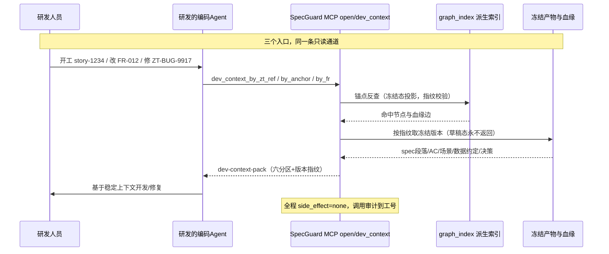
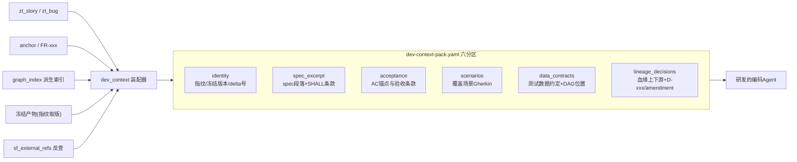

# SpecGuard · 研发侧 MCP 消费场景设计

> 版本：v1 · 2026-07-31 ｜ 定位：M13 旗舰场景的具象化展开 ｜ 上游：M13《Skill与MCP体系及对外开放面》、M06《禅道集成》、M10《血缘链StoryLine》
> 一句话：**研发人员在链上、在体系外——他们不进入 SpecGuard 的流程，但他们是质量链产物最大的下游消费者。MCP 是他们消费这些产物的唯一正确姿势。**

---

## 1. 问题定性：研发「在链上、在体系外」的真含义

原定义里研发人员被划在体系外，指的是**流程外**：面试、落锤、冻结、三闸，都不需要研发参与，SpecGuard 不为研发开工作台账号流程。但这绝不等于研发不需要链上的东西——恰恰相反：

- 产品面试冻结的需求（spec、AC、锚点） → 研发**照着开发**；
- 禅道里的故事/BUG → 研发**每天从这里领活**；
- 执行报告里的失败证据、SPQ → 研发**修 BUG 的第一现场**。

所以更准确的关系是：**研发是质量链下游最大消费者，消费的是产物，不是流程。**「链可跨界、资产不跨界」铁律在这个方向上反过来用：产物出链给研发，研发的人与工具不进入链。

## 2. 现状：各自的 Agent 各自读 spec 仓库，五个不稳

目前研发的编码 Agent（Copilot 类、Claude Code 类、自研 CLI）都是自己去 clone/读取 spec 仓库拼装上下文。这在单点上能跑，但系统性看有五个"不稳"：

| # | 不稳 | 具体表现 | 后果 |
|---|---|---|---|
| 1 | **口径不稳** | Agent 读到的是仓库 HEAD，可能是草稿态、可能是别条线的产物 | 照着未冻结的需求写代码，写完需求变了 |
| 2 | **版本不稳** | 没有任何机制告诉 Agent「这个 FR 对应哪个冻结指纹」 | 同一接口三个人三个 Agent 读出的"当前 spec"可能不同 |
| 3 | **锚点不稳** | Agent 自己 grep，靠关键词碰运气，锚点体系（FR-xxx/AC-xxx）对它不可见 | 上下文漏装、错装；无法实现"改需求精准通知受影响代码" |
| 4 | **入口不稳** | 从禅道故事/BUG 到 spec 的映射在人脑里，Agent 拿不到 | 研发要自己找"这个 zt story 对应哪份 spec" |
| 5 | **审计不稳** | 谁家的 Agent 读了什么、拿走什么，完全不可见 | 出了口径问题无从追溯；也无法评估上下文质量 |

一句话：**上下文是研发提效的第一生产资料，现在这份生产资料是散装的。**

## 3. 三个高价值消费场景

### 场景 A：接需求（禅道故事 → 冻结 spec 上下文）

> 触发：研发在禅道领到 story-1234，准备开工。

链路上这个故事本来就是 T-053 zentao-cli 幂等创建的，`sf_external_refs` 里登记了 `zt_story → delta/FR` 的锚点。研发的 Agent 拿 story 号一问，直接拿到**装配好的开发上下文包**：这份需求冻结时的 spec 段落、全部 SHALL 条款、AC 锚点、关联接口契约、历史决策 D-xxx（含 amendment 增补——为什么这么做）。

对比现状：研发自己翻禅道描述 → 找到 spec 仓库 → 判断哪份是当前版 → grep 相关段落 → 猜测上下文边界。省掉的是每一步的不确定性。

### 场景 B：开发接口（锚点/FR → 精准上下文）

> 触发：研发要动 `FR-012 订单创建幂等` 这个点，或要改某个锚点覆盖的接口。

按 FR/锚点直接取：spec 原文段落、AC 验收条款、**覆盖该锚点的场景 Gherkin**（测试在怎么验它）、**测试数据制造约定**（这条链需要什么前置数据、DAG 里它在哪个 batch）、血缘上下游（改它会震到谁）。这是"改之前知道谁会疼"的能力，graph_index（T-070）天然支撑。

### 场景 C：修 BUG（BUG 单 → 血缘投影上下文）

> 触发：研发领到 ZT-BUG-9917（单元测试/执行报告产出，经 M06 登记）。

BUG 单在链上有完整血缘：哪个 run 暴露的 → 失败证据摘要 → 关联场景与锚点 → 对应 spec 版本 → 相关历史决策。Agent 一问拿到整条投影，而不是从禅道描述里的三行文字开始破案。修完回归时，同一份上下文里的场景就是验收标准。

### 三场景共用一张时序

## 4. 为什么 MCP 是对的形态（而不是继续各读各的）

| 维度 | 各自读仓库 | 经 MCP 消费 | 本质差别 |
|---|---|---|---|
| 读到的状态 | HEAD，含草稿 | **只读冻结态**，草稿物理不可见 | 闸门语义延伸到消费端 |
| 版本确定性 | 无 | 每份 pack 带 sha256-12 聚合指纹 | 可校验"你我读的是同一份" |
| 上下文装配 | 每个 Agent 自己拼 | 平台统一装配六分区 pack | 装配方从 N 个变 1 个 |
| 禅道反查 | 人肉 | `sf_external_refs` 确定性反查 | 跨界锚点第一次对研发可用 |
| 变更影响 | 不可知 | 血缘上下游随包附赠 | 改前知震感 |
| 审计 | 无 | 调用审计到工号/会话/入参 | 可追溯、可度量提效 |
| 成本 | 每个 Agent 全仓扫描 | graph_index 派生索引毫秒级 | 重活平台干一次 |

这不是"多了一个方便接口"，而是把质量链的一个隐含假设——**冻结产物的价值在于被下游无损耗消费**——第一次做实。spec 冻结得再漂亮，下游用散装方式读，价值在最后一公里漏光。

## 5. 设计：open/ 新增 dev_context 模块

归属 M13 开放面 **L0 只读**层（与 specflow_refs/quality_query/lineage_query/refs_query/intake 同级第六模块），遵守 M13 全部既定约束：side_effect=none 运行时强制、调用审计到工号、草稿态永不开放、外部写不进 MCP。

### 5.1 工具面（3 个工具，全是纯读）

| 工具 | 入参 | 服务场景 |
|---|---|---|
| `dev_context_by_zt_ref` | ref_type(zt_story/zt_bug), ref_id | 场景 A / C |
| `dev_context_by_anchor` | anchor（如 API-ORDER-CREATE） | 场景 B |
| `dev_context_by_fr` | fr_id（如 FR-012），可选 delta 版本 | 场景 B / 精准取版 |

### 5.2 dev-context-pack 六分区（与 info_pack 同构的装配思路）

| 分区 | 内容 | 数据源（owner） |
|---|---|---|
| identity | 聚合指纹、冻结版本号、delta 号、装配时间 | M05 / M11 |
| spec_excerpt | spec 相关段落、SHALL 条款 | M05 冻结产物 |
| acceptance | AC 锚点与验收条款 | M05 |
| scenarios | 覆盖该锚点的场景 Gherkin 摘要 | M07 / scenarios/ |
| data_contracts | 数据制造约定、DAG batch 位置 | M08 |
| lineage_decisions | 血缘上下游节点、D-xxx 与 amendment 链 | M10 / M04 |

### 5.3 三条红线（与 M13 一脉相承，对研发场景重申）

1. **只读冻结态**：pack 里任何内容都来自已冻结版本；草稿、未确认议题、未清零的 P0 物理不可达。
2. **研发不进入流程**：MCP 不给研发任何写通道——不回写 spec、不动台账、不改 BUG 状态。研发要反馈问题，走原有禅道/SPQ 人工通道。
3. **pack 是快照不是订阅**：每次调用按当时指纹装配；研发侧 Agent 缓存多久是它自己的事，指纹让它随时可校验"我读的还是不是当前版"。

## 6. 与既有设计的衔接

| 既有设计 | 关系 |
|---|---|
| M13 旗舰场景「编码 Agent 读冻结 spec」 | 本文 = 该场景的具象化：三个入口、一个模块、一个 pack 结构 |
| T-083 open/ 对外 L0 五模块 + 旗舰 e2e | dev_context 作为第六模块纳入；e2e 用例建议直接采用场景 A（从 zt story 到拿到 pack） |
| T-056 sf_external_refs | 场景 A/C 的反查基石，owner 不变 |
| T-070 graph_index | 场景 B 的锚点反查与血缘投影的算力来源 |
| M06 禅道集成 | 双向链接从「平台 → 禅道」延伸为「研发从禅道侧 → 平台产物」 |
| 铁律 4「链可跨界、资产不跨界」 | 本设计是其消费侧表达：产物出链，流程不出链 |

**排期建议**：dev_context 不新增阶段——并入 S8 T-083（拆为 T-083a 五模块 + T-083b dev_context + 旗舰 e2e 用场景 A 收口），或作为独立任务 T-085 挂 S8，依赖 T-056/T-070 不变。研发侧提效是可度量卖点，建议旗舰 e2e 演示脚本就用「研发领 zt story → Agent 拿到 pack → 按 AC 开发」这条线。

## 7. 结论

研发人员「在体系外」的定义不需要改——他们依然不进入流程。要补的是**消费侧的最后一公里**：质量链把产物冻结好、登记好、连好血缘之后，用 MCP 这个只读、带指纹、可审计的通道，把它们以「装配好的稳定上下文」形态递给研发的 Agent。这是 SpecGuard 对外 MCP 全部场景里价值密度最高、风险最低（纯读）、复用现有资产最多（external_refs + graph_index + 冻结产物）的一条，应当从「旗舰场景」升级为「旗舰场景群」。
