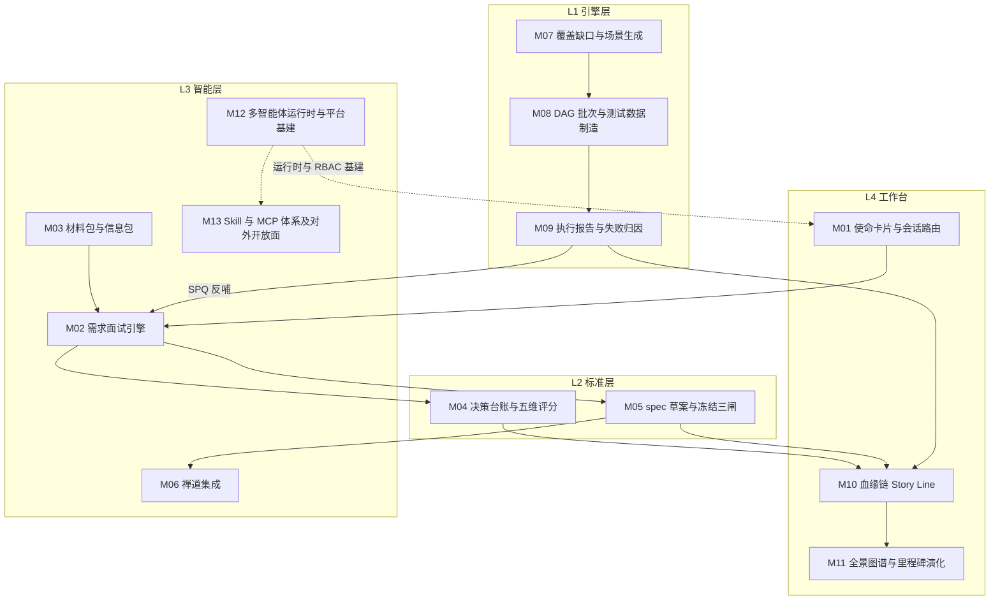

# 00 · 模块地图与统一约定

> SpecGuard Vision（远期完整版）原型落地拆解 · 总览
> 输入事实源：《SpecGuard 技术架构》（2026-07-31 快照，代码实测）、specflow 体系设计方案、汇报演示原型（9 屏）
> 产出：13 份模块详细设计文档（M01-M13），每模块一份 Markdown

---

## 1. 原型屏 → 模块映射

原型 9 屏中，S0 封面 / S1 价值总览 / S2 路线图为汇报叙事屏，不拆模块；S3-S8 对应 13 个落地模块：

| # | 模块 | 原型屏 | 架构层 | 现状定性 | 文档 |
|---|------|--------|--------|----------|------|
| M01 | 使命卡片与会话路由 | S3 新建会话 | L4 工作台 + L3 智能层 | 增强：AgentChat 已有，目的锁定使命卡片新建 | `M01-使命卡片与会话路由.md` |
| M02 | 需求面试引擎 | S4 对话流 | L3 智能层 | 新建（specflow 需求侧） | `M02-需求面试引擎.md` |
| M03 | 材料包与信息包 | S4「材料包」页签 | L0 数据层 + L3 | 增强：info_pack 基础已有，多源文档解析新建 | `M03-材料包与信息包.md` |
| M04 | 决策台账与五维评分 | S4「决策台账」「五维评分」页签 | L2 标准层 + L3 | 新建 | `M04-决策台账与五维评分.md` |
| M05 | spec 草案与冻结三闸 | S4「spec 草案」「影响面」「产出交付」页签 | L2 标准层 | 增强：specstd conformance / delta 已有 | `M05-spec草案与冻结三闸.md` |
| M06 | 禅道集成（zentao-cli） | S4 产出交付 + S5 提 BUG | L3 + L0 | 新建 | `M06-禅道集成.md` |
| M07 | 覆盖缺口与场景生成 | S5「覆盖缺口」页签 | L1 引擎层 + L3 | 增强：covers 门禁 / 草稿通道已有 | `M07-覆盖缺口与场景生成.md` |
| M08 | DAG 批次与测试数据制造 | S5「DAG 批次」页签 | L1 引擎层 | 增强：DAG/调度已有，数据制造 Agent 新建 | `M08-DAG批次与测试数据制造.md` |
| M09 | 执行报告与失败归因 | S5「报告→SPQ」页签 | L1 + L0 | 增强：report/attribution/SPQ 台账已有，归因 Agent 新建 | `M09-执行报告与失败归因.md` |
| M10 | 血缘链 Story Line | S6 血缘链 | L2 + L4 | 新建 | `M10-血缘链StoryLine.md` |
| M11 | 全景图谱与里程碑演化 | S7 全景图谱 | L2 + L4 | 新建（图谱索引为确定性派生） | `M11-全景图谱与里程碑演化.md` |
| M12 | 多智能体运行时与平台基建 | S8 研发·智能体 + 全局 | L3 + L4 | 增强：薄 harness / MCP 24 工具 / RBAC 已有 | `M12-多智能体运行时与平台基建.md` |
| M13 | Skill 与 MCP 体系及对外开放面 | S8 Skill 与 MCP 体系 + 全局 | L3 + L4 | 增强+新建混合：skill_loader / mcp_server 已有，治理件与 open/ 开放面新建（含研发侧 dev_context 三入口旗舰场景群） | `M13-Skill与MCP体系及对外开放面.md` |

下图按架构层（L0-L4）与数据流向展示 M01-M13 的模块依赖关系，与上表一一对应：



## 2. 架构现状速查（引用真实模块名时以此为准）

- **L1 引擎层（冻结层）**：`scenario_runner.py`（flow/verify 双段执行、`{{a.b.c}}` 变量插值类型保留、shared/exclusive 调度、teardown、SKIP/BLOCKED 诚实语义）、`dependency_graph.py`（拓扑/环检测/契约版本仲裁 DRIFT/ORPHANED）、`scenario_loader.py`、`tool_registry.py`（适配包声明即注册，语法层零变更）、`versioning.py`（`^X`/`X.Y`、sha256-12 指纹、T6 校验）、`db_oracle.py`（SELECT-only 硬守卫）、`http_client.py`/`token_provider.py`、`report_writer.py`/`execution_record.py`、`registry.py`、`release_check.py`（格式/环/契约指纹三项发布门禁）。
- **L2 标准层 specstd（SPECSTD_VERSION=1.0）**：`schema.py`（规范单一事实源：锚点正则/RuleName/RuleLevel/ConformanceReport/DeltaOperation/ParsedDeltaSpec）、`anchors.py`、`conformance.py`（纯读无副作用）、`signature.py`（内容指纹）、`workspace.py`（多工作区注册表 + contextvar 全链路透传，前端 `X-SG-Workspace` header 注入）。
- **L3 智能层**：薄 harness `agent/`（`runtime.py` 工具分发+会话循环、`session.py` 按工号隔离、`llm_client.py` DB 驱动热加载、`compactor.py` 长对话压缩、`mode_loader.py`+`modes/` 30s TTL 热加载、`skill_loader.py`+`skills/` 正文注入 `<skills>` XML 块、`prompts/system.md.j2`、`cli.py` POC 入口）；MCP stdio `mcp_server/`（8 模块 24 工具：spec_reader / scenario_tools / registry_query / draft_writer / validator / attribution / audit / meta；`info_pack.py` 基础读写已实现但未挂载 server.TOOL_MODULES）。
- **L0 数据层**：`scenarios/`（按模块分目录 + `_suite.yaml`，双层 YAML：doc 层 given/when/then + `covers:[FR-xxx]` 给人看，flow/verify 层给机器跑）、`systems/{system}/` 适配包契约 5 项（env.{env}.yaml → config.py load_env() → steps.py 声明 tool → oracles.py 注册 DB 校对断言器 → SPEC_GUARD_SYSTEM 运行时指定；已接入 systems/tdm）、`feedback/ledger.py`（SPQ 状态机 pending→in_progress→closed）+ `notify.py`、`contracts_baseline.json`（场景 ID→{fingerprint,version}）。
- **L4 工作台**：FastAPI :9100（15 router：auth/users/scenarios/runs/reference/plans/spec_validation/agent/workspace/feedback/drafts/settings/notify/schedules；RBAC `Depends(get_current_user)`）；services 20 个要点——`format_spec.py` 格式规范唯一权威（动态生成，引擎能力变更三同步强制点）、`deps_editor.py`（YAML 文本外科手术，禁 round-trip 保中文注释）、`spec_validator.py`/`covers_gate.py`/`spec_baseline.py`、`draft_promote.py`、`runner.py`/`plan_executor.py`/`scheduler.py`、`auth.py`（SG_AUTH_MODE=uac|mock）；前端 React18+Vite5+TS 严格模式 16 页面（含 AgentChat / DagEditor elkjs / Monaco / useRunStream / WorkspaceSelector）；存储 SQLite workbench.db + 文件系统（YAML/.jsonl/各工作区 `.specguard/`：drafts/plans/reports/info_packs）。

## 3. 全局铁律（每份文档必须在「闸门与确定性校验」章节呼应）

1. **Agent 只建议，人拍板**——台账、冻结、定性、故事点，生效权永远在人。
2. **校验走确定性校验器**——P0 清零、锚点、DAG 无环、契约指纹，不靠 Agent 自觉、不靠 LLM 目测。
3. **每个产出必过闸**——草稿三闸（人工评审→格式校验→发布门禁）/ 冻结三闸 / 数据校验 / 人确认回写。
4. **链可跨界，资产不跨界**——研发产物（禅道故事/PR/单测）经 external_refs 登记引用入链，SpecGuard 不拥有研发资产。
5. **被测系统解耦**——接入新系统 = 新增 `systems/{system}/` 子包，引擎层零改动。
6. **计划只能由 delta 导入生成，禁止手动新建**。
7. **诚实结果语义**——上游失败下游 BLOCKED、数据缺失 SKIP，绝不把环境问题报成 FAIL。
8. **SpecGuard 不做编码智能体**——代码生成/补全/重构是 Codex/Claude Code 的事；SpecGuard 是质量链治理平台。

## 4. 统一 ID 与术语体系

| 前缀 | 含义 | 示例 |
|------|------|------|
| IV-xxx | 需求面试会话 | IV-007 九宫格落位规则调整 |
| D-xxx | 决策台账条目（P0/P1/P2 分级） | D-032 冻结存量仅对新会话生效 |
| FR-xxx / AC-xxx | spec 功能/验收锚点 | FR-012 作废级联删除 |
| SPQ-xxx | 执行反哺台账（Spec-fed Problem Queue） | SPQ-005 落位后名单未刷新 |
| delta | spec 增量（三段式 + manifest 一致） | `extend-void-scope`、`grid-rule-perf` |
| ZT-STORY / ZT-BUG | 禅道故事 / BUG（外部锚点） | ZT-STORY-4821 / ZT-BUG-9917 |
| 场景 ID | 模块缩写-语义-序号 | IS-RVT-002、IA-VOID-001、IS-PREP-002 |
| d-xxx | 场景草稿 | d-118 |
| MAT-xxx | 材料包条目（M03 内部前缀） | MAT-001 |
| TBD-xxx | spec 草案待确认标记（M04/M05 内部前缀） | TBD-032-1 |
| plan#/run# | 计划/执行实例 | plan#7 / run#23 |
| external_refs | 外部资产登记引用表 | sf_external_refs |

规则：FR/AC 跨模块引用时用 `FR-xxx@{module-path}` 消歧（如 FR-012@inventory-session）。

## 5. 文档模板（13 份文档统一章节）

```
# Mxx · {模块名} 详细设计
## 0. 模块卡          —— 名称/原型屏/架构层/现状定性/里程碑映射(F1-F4·G1-G3)/依赖模块 一张表
## 1. 模块定位与职责   —— 解决什么问题、不做什么（边界）
## 2. 原型交互 → 功能拆解 —— 表格：原型界面元素 → 功能点 → 后端支撑（已有/新建）
## 3. 现状与差距       —— 架构已有能力（引用真实模块名）vs 缺口清单（标注新建）
## 4. 数据模型         —— 表结构 / 文件布局 / YAML schema / 状态机
## 5. 接口设计         —— REST API / MCP 工具 / CLI / 前端组件，含入参出参要点
## 6. 关键流程         —— 编号步骤或时序描述（覆盖原型演示的主路径）
## 7. 闸门与确定性校验  —— 呼应全局铁律，列出本模块所有闸门与校验器
## 8. 依赖与边界       —— 上游/下游模块、跨模块数据流、明确不承担的职责
## 9. 里程碑映射与验收标准 —— F/G 阶段拆解 + 可检验的验收条件
```

## 6. 里程碑体系（路线图对齐）

- **F1 测试侧闭环**（已落地为主）：场景库/引擎/DAG/报告/SPQ/covers 门禁
- **F2 工作台与多用户**：RBAC、多工作区、调度、通知
- **F3 需求侧 specflow**：需求面试、决策台账、五维评分、冻结三闸、**zentao-cli 集成**、材料包
- **F4 血缘与图谱**：血缘链 Story Line、全景图谱 L0/L1/L2、里程碑演化 diff
- **G1-G3 智能体深化**：材料包解析 / 图谱索引 / 测试数据制造 / 失败归因 / 故事点评估 的分阶段专业化落地

---

*各模块文档若与本约定冲突，以本文件为准；架构事实以《SpecGuard 技术架构》2026-07-31 快照为准。*
