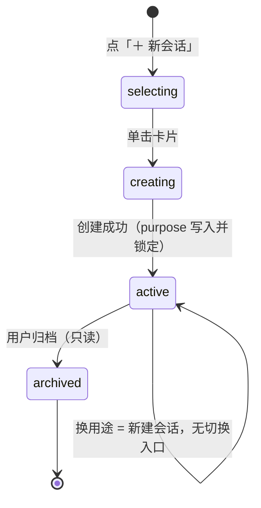
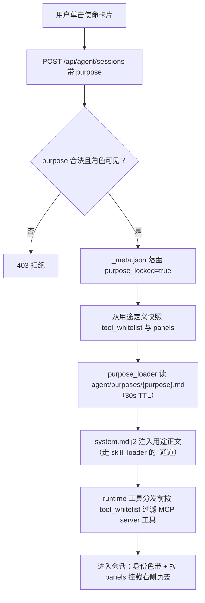

# M01 · 使命卡片与会话路由 详细设计

## 0. 模块卡

| 项 | 内容 |
|---|---|
| 模块名 | 使命卡片与会话路由（Mission Card & Session Routing） |
| 原型屏 | S3 新建会话（使命卡片 · 方案 A 已拍板） |
| 架构层 | L4 工作台（AgentChat 页面 + agent router）+ L3 智能层（agent/ 薄 harness） |
| 现状定性 | 增强：AgentChat / 会话隔离 / 提示词装配已有；purpose 锁定与使命卡片新建 |
| 里程碑映射 | F3（需求侧 specflow 的入口前提）+ G1（用途驱动工具集装配） |
| 依赖模块 | M02（需求面试会话的消费方）、M04/M05（右侧面板由用途驱动挂载）、M12（运行时与 RBAC 基建） |

---

## 1. 模块定位与职责

**解决什么问题**：需求侧（specflow）与测试侧（SpecGuard 现有能力）共用同一个 AgentChat 入口。会话在**创建期**由用户手动选择用途（purpose），创建即锁定、持久化、不可中途变更；用途一次性驱动四件事——**提示词装配、工具白名单、右侧面板、产物归属**（.specflow/ vs .specguard/）。

**核心职责**：

1. 新建会话时的使命卡片选择页（🧭需求面试 / 🧪测试工作台 两类卡），单击直达会话；
2. 会话模型扩展 `purpose` 创建期字段及全链路透传（前端 → agent router → agent/session → MCP 工具可见集）；
3. 会话树按用途过滤（全部 / 🧭 需求 / 🧪 测试）与身份色体系（需求紫 / 测试青蓝）；
4. purpose 锁定约束 LLM 行为边界：system prompt 静态装配用途章节 + MCP 工具白名单过滤。

**不做什么（边界）**：

- 不建独立「需求面试页面」——面试 UI 就是 AgentChat 的一种用途形态（用户已拍板 2026-07-30）；
- 不做运行时模式切换/路由/锁定中间件——`purpose` 是创建期一次性参数，替代一切运行时模式状态（specflow 方案「开工前提」硬性要求，与模式移除改造互为终态）；
- 用途清单初期**仅此两个**，防止模式机制借尸还魂；新增用途 = 加一张卡 + 一份用途定义文件；
- 不做「出发仪式」两步确认——单击卡片直接开启会话，锁定语义靠会话头明示；
- 不负责面试业务逻辑（见 M02）、不负责面板内容（见 M04/M05），本模块只管「会话是谁、能用什么、产物归哪」。

---

## 2. 原型交互 → 功能拆解

| 原型界面元素（S3 / S4 会话壳） | 功能点 | 后端支撑 |
|---|---|---|
| 「＋ 新会话」按钮（会话树头部，S4/S5 同构） | 进入用途选择页（页面内全宽，非弹窗） | 前端 AgentChat 页面状态（已有页面壳，新建：选择页组件） |
| 🧭 REQUIREMENT INTERVIEW 卡（chips：specflow 工具集 / 台账·评分明板 / 影响面图谱） | 单击创建 purpose=requirement_interview 会话并进入 | 新建：POST /api/agent/sessions 带 purpose；用途定义注册表（新建） |
| 🧪 TEST WORKBENCH 卡（chips：19 工具 / 统一提示词 / 草稿·计划面板） | 单击创建 purpose=test_workbench 会话并进入 | 同上；工具集=现有 MCP 测试侧工具（已有：mcp_server 8 模块 24 工具，按白名单过滤后呈现） |
| 卡片副标题「点击卡片直接开启会话 · 用途创建后锁定，不可中途变更」 | 锁定语义静态明示，不做拦截式确认 | 后端创建接口落库即生效（新建） |
| 键盘流 ←/→ 聚焦、Enter 开启、Esc 取消聚焦 | 键盘可达性 | 纯前端（零新依赖，纯 CSS/Tailwind 实现，已拍板） |
| hover 浮起 + 渐变描边 + 3D 微倾斜；背景网格微光 | 身份色体系视觉 | 纯前端 CSS（conic-gradient / perspective，已拍板方案 A） |
| 会话树过滤条「全部 / 🧭 需求 / 🧪 测试」 | 按 purpose 过滤会话列表 | 新建：GET /api/agent/sessions?purpose= 过滤参数 |
| 会话条目徽标（面试/测试 badge）+ 左侧边框身份色 | 用途可视化 | 会话元数据 purpose 字段（新建） |
| 会话条目副标题（IV-007 · P0 清零 ✓ · 门禁待确认 / 昨天 · 草稿 3 份） | 用途专属状态摘要 | 需求侧摘要由 M02/M04 提供（接口预留）；测试侧由 drafts/plans 统计（已有：drafts/plans router） |
| 聊天区顶部色带（紫/青蓝渐变 chat-band） | 会话内身份持续明示 | 前端按会话 purpose 渲染（新建） |
| 右侧六页签（需求）/ 四页签（测试）按用途切换 | 面板集由用途驱动 | 前端面板注册表按 purpose 挂载（新建装配点；面板内容见 M02-M05） |

**效率保护（已拍板，必须实现）**：单用途用户（RBAC 过滤后仅剩一个用途，如 product 角色只见需求面试卡）跳过选择页直接创建；记住上次选择并默认聚焦，Enter 即走。

---

## 3. 现状与差距

### 3.1 已有能力（真实模块，直接复用）

| 能力 | 真实模块 | 复用方式 |
|---|---|---|
| 会话管理与多用户隔离 | `agent/session.py`（`agent/sessions/{emp}/`，.jsonl 不入 git） | 会话元数据扩展 purpose 字段；物理隔离不变 |
| Agent 运行时（工具分发 + 会话循环） | `agent/runtime.py`（~420 行） | 不动；工具分发前增加用途白名单过滤层 |
| system prompt 模板装配 | `agent/prompts/system.md.j2` | 新增「用途章节」模板块，按 purpose 静态注入 |
| skill 正文注入机制 | `agent/skill_loader.py`（正文注入 `<skills>` XML 块） | 面试行为指引写成 markdown 片段，复用同一注入通道（**不写进 agent/modes/**） |
| LLM 配置热加载 | `agent/llm_client.py`（DB 驱动热加载） | 不动 |
| 长对话压缩 | `agent/compactor.py` | 不动（长面试会话直接受益） |
| 工作台 Agent 路由 | workbench `routers/agent.py`（:9100，挂 `Depends(get_current_user)`） | 扩展会话创建/列表接口 |
| RBAC 与认证 | workbench `services/auth.py`（SG_AUTH_MODE=uac\|mock）、`Depends(get_current_user)` | 新增 product 角色（见 M12），用途清单按角色过滤 |
| 前端 AgentChat 页面 | 前端 16 页面之一 AgentChat（React18+Vite5+TS 严格模式） | 加选择页组件 + 会话树过滤 + 色带 |
| 工作区透传 | `specstd/workspace.py` contextvar（`X-SG-Workspace` header 全链路） | purpose 与会话同样按工作区隔离，透传机制照搬 |

### 3.2 差距清单（全部新建）

| # | 缺口 | 落点 |
|---|---|---|
| G1 | 会话模型无 `purpose` 字段（创建期、持久化、不可变） | `agent/session.py` 扩展 + workbench 会话接口（新建） |
| G2 | 无用途定义注册表（id/标题/色/提示词片段/工具白名单/面板集/RBAC 可见性） | `agent/purposes/` 目录 + `purpose_loader.py`（新建，复用 mode_loader 的 30s TTL 热加载模式） |
| G3 | 无使命卡片选择页与会话树用途过滤 UI | 前端 AgentChat 页面（新建组件，纯 Tailwind 零新依赖） |
| G4 | 无按用途过滤的 MCP 工具白名单机制 | agent runtime 工具分发前置过滤 + workbench 会话上下文（新建） |
| G5 | 模式机制（`agent/mode_loader.py` + `agent/modes/`）正在被另一会话移除 | 本模块**不依赖** modes；purpose 即终态。落地顺序与模式移除无关，只需对齐会话模型 purpose 字段落点 |

> **注意**：`agent/mode_loader.py`（30s TTL 热加载）当前存在，但 specflow 方案明确「不得依赖模式机制」。本设计仅借鉴其热加载模式实现 `purpose_loader.py`，不调用、不扩展 modes。

---

## 4. 数据模型

### 4.1 会话元数据（扩展 agent/session.py）

会话物理位置不变（`agent/sessions/{emp}/`），每个会话一个 `.jsonl` 对话流水 + 一个 `_meta.json` 元数据文件（新建）：

```json
{
  "session_id": "sess-20260731-1007-a3f2",
  "emp": "u10086",
  "workspace": "tdm",
  "purpose": "requirement_interview",
  "title": "九宫格落位规则调整",
  "created_at": "2026-07-31T10:07:12+08:00",
  "purpose_locked": true,
  "biz_ref": "IV-007",
  "tool_whitelist": ["specflow_interview", "specflow_ledger", "specflow_pack", "spec_reader", "meta"],
  "panels": ["pack", "ledger", "score", "draft", "graph", "deliver"]
}
```

约束（由后端强制，前端仅展示）：

- `purpose` 只允许在 POST 创建时写入，之后任何更新接口拒绝修改（返回 409）；
- `purpose_locked` 恒为 true，是留给将来审计的显式字段；
- `biz_ref`：用途业务对象引用（需求面试=IV-xxx，测试工作台可空）；
- `tool_whitelist` / `panels` 在创建时从用途定义快照写入（用途定义后续热更新不影响已建会话，保证会话行为稳定）。

### 4.2 用途定义注册表（新建 `agent/purposes/`）

与 modes/skills 同构：`---` YAML frontmatter + Markdown 提示词片段，新增文件无需重启（30s TTL 热加载，复用 mode_loader 的加载器模式）：

```
agent/purposes/
├── requirement_interview.md
└── test_workbench.md
```

`requirement_interview.md` 示例：

```markdown
---
id: requirement_interview
title: 需求面试
icon: 🧭
color: req            # 身份色 token：紫（Stripe purple 系）
chips: [specflow 工具集, 台账/评分明板, 影响面图谱]
roles: [admin, product, dev]     # RBAC 可见性；tester 只读不建
tools: [specflow_interview, specflow_ledger, specflow_pack, spec_reader, meta]
panels: [pack, ledger, score, draft, graph, deliver]
description: AI 面试官按 spec 11 章多轮盘问需求，P0/P1/P2 决策台账，五维评分卡，P0 清零后冻结规格进基线。
---
你是 SpecGuard 需求面试官。你的职责是：按 spec 11 章扫描清单多轮提问；
每个回答结构化落入决策台账（P0/P1/P2），人拍板才生效；
你不得代答需求问题、不得绕过 P0 清零门禁承诺冻结。
（正文注入 system.md.j2 的 <skills> 块，与 skill_loader 同通道）
```

`test_workbench.md` 为现有测试侧统一行为（全量测试工具 + 统一提示词，内部不再分子类型）。

### 4.3 workbench 会话索引表（新建，workbench.db）

```sql
CREATE TABLE IF NOT EXISTS agent_sessions (
  session_id    TEXT PRIMARY KEY,           -- sess-YYYYMMDD-HHMM-xxxx
  emp           TEXT NOT NULL,              -- 工号，与 agent/sessions/{emp}/ 对齐
  workspace     TEXT NOT NULL,              -- 工作区（X-SG-Workspace）
  purpose       TEXT NOT NULL,              -- requirement_interview | test_workbench
  title         TEXT NOT NULL DEFAULT '',
  biz_ref       TEXT,                       -- IV-007 等
  status        TEXT NOT NULL DEFAULT 'active',  -- active | archived
  created_at    TEXT NOT NULL,
  last_active_at TEXT NOT NULL
);
CREATE INDEX idx_sessions_emp_ws ON agent_sessions(emp, workspace, purpose);
```

不建独立 purpose 表——用途定义在 `agent/purposes/` 文件中（热加载），DB 只存会话实例。

### 4.4 状态机

```
[选择页] --单击卡片--> creating(purpose 写入) --创建成功--> active(purpose 锁定，终身不可变)
active --用户归档--> archived（只读，purpose 仍不可变）
换用途 = 新建会话（可带引用跳转），不提供任何「切换用途」入口
```

上述会话状态机的图形化表示如下（purpose 自创建起终身锁定）：



---

## 5. 接口设计

### 5.1 REST（workbench `routers/agent.py` 扩展，均挂 `Depends(get_current_user)`）

| 方法 | 路径 | 说明 | 关键入参 / 出参 |
|---|---|---|---|
| GET | `/api/agent/purposes` | 当前用户可用的用途清单（RBAC 过滤后） | 出参：`[{id,title,icon,color,chips,description}]`；单用途时前端跳过选择页 |
| POST | `/api/agent/sessions` | 创建会话（唯一可写 purpose 的入口） | 入参：`{purpose, workspace, title?, biz_ref?}`；出参：会话元数据（含 tool_whitelist/panels 快照）；purpose 非法或无权限 → 403 |
| GET | `/api/agent/sessions?purpose=&workspace=` | 会话列表（会话树，按用途过滤） | 出参：会话数组 + 用途状态摘要（需求侧摘要字段由 M02/M04 接口聚合） |
| GET | `/api/agent/sessions/{sid}` | 会话详情（进入会话时装配） | 出参：元数据 + 面板配置 + 工具白名单 |
| PATCH | `/api/agent/sessions/{sid}` | 改标题/归档 | **请求体含 purpose 一律 409**「用途创建即锁定」 |
| WS/POST | `/api/agent/sessions/{sid}/chat` | 对话（沿用现有通道） | 服务端按会话 tool_whitelist 过滤 MCP 工具集后进入 runtime 循环 |

### 5.2 前端组件（新建，零新依赖）

- `MissionCardSelect.tsx`：选择页（卡片 + 键盘流 ←/→ Enter Esc + 单用途跳过 + 记住上次选择 localStorage）；
- `SessionTreeFilter.tsx`：全部/🧭需求/🧪测试过滤 + 徽标；
- `ChatBand.tsx`：顶部身份色带（按会话 purpose 的 color token 渲染）。

### 5.3 L3 装配链路

```
POST /sessions(purpose) ──> _meta.json 落盘（锁定）
进入会话 ──> workbench 读 purposes/{purpose}.md（purpose_loader，30s TTL）
           ──> system.md.j2 注入用途正文（走 skill_loader 的 <skills> 通道）
           ──> runtime 工具分发前按 tool_whitelist 过滤 MCP server 工具
```

该装配链路的全链路流程如下图所示：



---

## 6. 关键流程（覆盖原型 S3 演示主路径）

1. 用户（产品经理，product 角色）在会话树点「＋ 新会话」，聊天区中央出现选择页（页面内全宽、背景网格微光）；
2. 前端 GET `/api/agent/purposes`：该用户可见 [需求面试]（若同时具备测试权限则为两张卡）；
3. 用户单击 🧭「需求面试」卡（或 ←/→ 聚焦后 Enter）；hover 时卡片浮起 + 渐变描边 + 3D 微倾斜（纯 CSS）；
4. 前端 POST `/api/agent/sessions {purpose:"requirement_interview", workspace:"tdm", title:"九宫格落位规则调整"}`；
5. 后端校验：purpose 存在且角色可见 → 写 `agent_sessions` 行 + `agent/sessions/{emp}/_meta.json`（purpose_locked=true），从用途定义快照 tool_whitelist/panels；
6. 前端进入会话：顶部紫色身份带渲染，右侧挂载六页签壳（材料包/决策台账/五维评分/spec草案/影响面/产出交付）；
7. 会话创建事件触发 M02 面试开标（生成 IV-xxx、装配信息包，见 M02 §6）；会话条目出现在会话树，徽标「面试」，副标题由 M02/M04 聚合（如「IV-007 · P0 清零 ✓ · 门禁待确认」）；
8. 用户在会话树切换过滤「🧪 测试」：GET `/sessions?purpose=test_workbench`，只见测试会话（如「PP-RC-008 场景生成 · 草稿 3 份」）；
9. 用户尝试 PATCH 修改 purpose → 409，前端 toast「用途创建即锁定，请新建会话」；
10. 单用途用户（纯 product 角色）点「＋ 新会话」→ 步骤 2 返回单卡 → 跳过选择页直接创建，记住上次选择。

---

## 7. 闸门与确定性校验

| 闸门/校验 | 实现 | 呼应铁律 |
|---|---|---|
| purpose 不可变校验 | 服务端 PATCH 拒绝 + `_meta.json` 创建后只读（文件权限 + 接口层双重） | 铁律 2（校验走确定性校验器，不靠前端自觉） |
| 工具白名单强制过滤 | runtime 工具分发前置过滤；MCP server 侧对 specflow_* 模块校验会话 purpose（双层） | 铁律 2：LLM 行为边界由机制保证，不靠提示词自觉 |
| 用途清单 RBAC 过滤 | `/purposes` 按角色出参；POST 创建二次鉴权 | 铁律 1（人选择用途，Agent 无权自选身份） |
| 会话行为稳定性 | tool_whitelist/panels 创建时快照，用途定义热更新不回流已建会话 | 确定性：同一会话全程行为一致、可复盘 |
| 用途清单收敛 | 用途=新增文件+评审，初期仅两张卡；禁止运行时注册用途 | 铁律 8（边界收敛，防模式机制复活） |
| Agent 只建议 | 使命卡片不代用户做选择；「记住上次选择」仅做默认聚焦，Enter/单击仍是人操作 | 铁律 1 |

---

## 8. 依赖与边界

**上游**：workbench `services/auth.py`（RBAC/工号）；`specstd/workspace.py`（工作区透传）；M12（product 角色定义、运行时基建、模式移除终态对齐）。

**下游**：

- M02 需求面试引擎：消费 `purpose=requirement_interview` 会话，监听会话创建事件开标（IV-xxx）；
- M04/M05：按会话 panels 快照挂载台账/评分/草案面板（面板内容由其实现）；
- M03：材料包面板是需求用途面板集的第一页签。

**跨模块数据流**：`_meta.json`（purpose/biz_ref）→ M02 读取绑定 IV-xxx；`agent_sessions.biz_ref` ← M02 开标回写。

**不承担**：面试提问/台账/评分/冻结逻辑（M02/M04/M05）；材料解析（M03）；图谱渲染（M11）；运行时与 RBAC 底层改造（M12）。

---

## 9. 里程碑映射与验收标准

### F3（需求侧 specflow · 入口前提）

- 交付：会话模型 purpose 字段 + `agent/purposes/` 注册表（两张卡）+ 创建/列表/锁定接口 + 使命卡片选择页 + 会话树过滤 + 身份色带。
- **验收标准**：
  1. 单击需求面试卡 → 5 秒内进入会话，顶部紫色带、右侧六页签壳齐全，`_meta.json` 含 `purpose=requirement_interview` 且后续 PATCH purpose 返回 409；
  2. 会话树「🧭 需求」过滤下只见面试会话且徽标正确；「全部」下两类徽标并存；
  3. product 角色账号只见需求面试卡且跳过选择页；admin 见两卡；
  4. 键盘流：←/→ 焦点切换、Enter 创建、Esc 取消，全程无鼠标可用；
  5. 需求面试会话内 LLM 调用工具时，测试侧工具（如 draft_writer）不在其工具清单中（服务端过滤，抓包/日志可验）。

### G1（智能体深化 · 用途驱动装配）

- 交付：purpose 提示词片段经 `<skills>` 通道注入 system prompt；工具白名单双层过滤（runtime + MCP 侧）；面板注册表装配点。
- **验收标准**：
  1. 两类会话的 system prompt 快照 diff 仅差用途章节（prompt 装配日志可验）；
  2. 在需求面试会话中以提示注入方式诱导 Agent 调用 draft_writer → MCP 侧拒绝并留审计日志；
  3. 新增一份 `agent/purposes/*.md`（评审后）无需重启即出现在 `/purposes` 出参（30s TTL 内）；
  4. 已建会话的工具白名单不随后续用途定义变更而改变（快照语义单测覆盖）。
