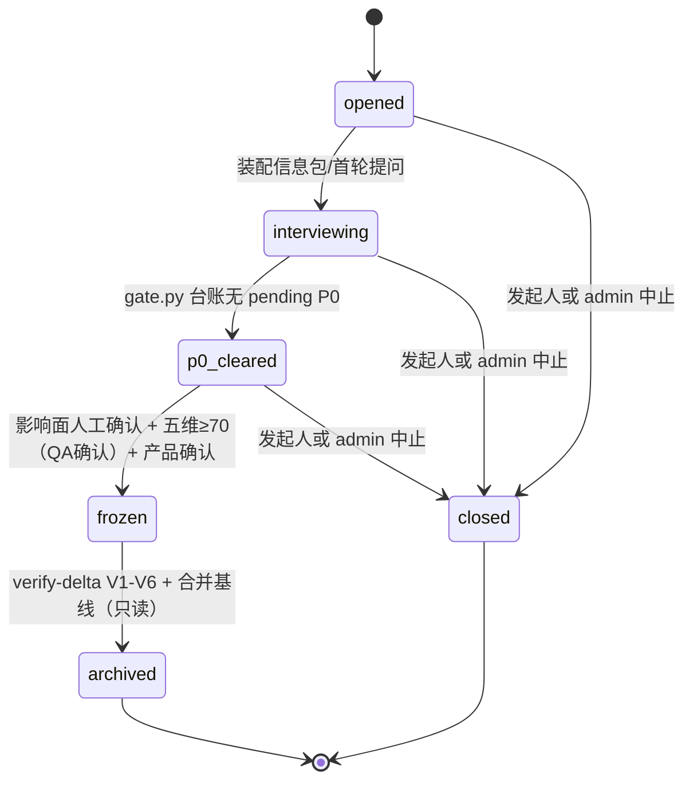
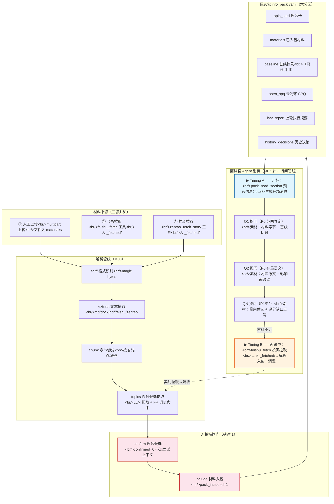
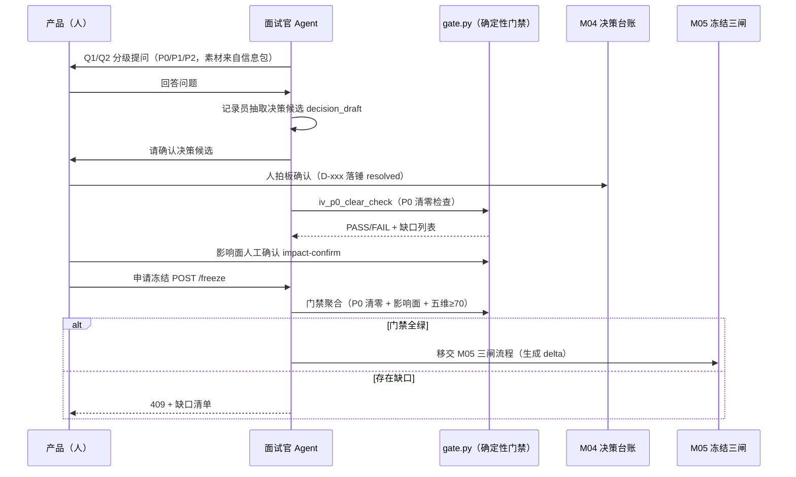

# M02 · 需求面试引擎 详细设计

## 0. 模块卡

| 项 | 内容 |
|---|---|
| 模块名 | 需求面试引擎（Interview Engine，specflow 侧核心） |
| 原型屏 | S4 需求面试会话 · 对话流 |
| 架构层 | L3 智能层（新顶层包 `specflow/interview/` + 面试官 Agent） |
| 现状定性 | 新建（specflow 需求侧）；会话循环/压缩/提示词注入复用 agent/ 已有设施 |
| 里程碑映射 | F3（specflow 面试最小闭环 = 价值拐点）+ G2（影响面图谱挂 P0 确认入门禁） |
| 依赖模块 | M01（purpose 会话入口）、M03（材料包/info_pack 装配）、M04（决策台账与五维评分）、M05（spec 草案与冻结三闸）、M11（影响面图谱） |

---

## 1. 模块定位与职责

**解决什么问题**：现状假设「上游已有人做完需求面试、交付冻结 spec」——该假设不受控。本模块把需求面试变成平台内结构化流程：AI 面试官按 spec 11 章扫描清单多轮盘问，产品回答逐条落入 P0/P1/P2 决策台账，P0 清零 + 影响面确认 + 五维达标后放行冻结，面试全程留档可追溯。

**素材来源（v1.1 增补：飞书生态直取 + 禅道需求只读引用）**：面试素材不限于人工上传文件——飞书文档（PRD/方案）、多维表格（需求池/申请台账）、妙记（会议纪要）、群/私聊记录（需求讨论）均可经 **lark-cli 只读拉取**（文本类内容直接获取、无需下载，2026-08-10 实测验证）；禅道是产品给研发提供需求的平台，面试议题可**只读引用禅道需求**（`zentao_cli story get/search`，实测 ZT-STORY-56746，2026-08-10 验证）。飞书通道见《SpecGuard-飞书CLI能力背景-S2面试材料获取》，禅道只读通道见《SpecGuard-禅道需求读取背景-S2面试材料来源》（完整禅道写通道保持 S5/M06）。

**核心职责（AI 三重角色，手册拍板）**：

1. **比对引擎**：议题映射基线 FR 锚点（specstd 只读引用），做「现状 vs 目标」比对，生成「这个改动影响什么」类 P0 提问；
2. **扫描仪**：以 spec 11 章为 checklist 扫描议题覆盖面，保证 15-20 问的结构化产出；
3. **记录员**：产品回答 → 决策结构化（100% 可追溯，落笔即挂链 → FR/Q/SPQ），移交 M04 台账落锤。

**面试生命周期**：开标（IV-xxx + 议题卡 + 信息包装配）→ 多轮提问/记录 → P0 清零 → 冻结门禁（影响面人工确认 + 五维 ≥70）→ 冻结归档（changes→archive，见 M05）。

**不做什么（边界）**：

- 不代答需求问题、不替产品拍板——每个决策生效权在人（产品确认才 resolved）；
- 不做 P0 清零/锚点/齐全性的「目测」——全走确定性校验器（`specflow/interview/gate.py` + specstd）；
- 不拥有台账/评分/草案/冻结的实现（M04/M05），本模块只产生候选与接口调用；
- 不做会话入口与用途管理（M01）；不写业务代码、不做分步开发/TDD（手册阶段 ④⑤ 出边界）。

---

## 2. 原型交互 → 功能拆解

| 原型界面元素（S4 对话流） | 功能点 | 后端支撑 |
|---|---|---|
| 开场消息「已装载议题…基线相关功能点：绩效域落位规则、名单过滤；上轮遗留 1 条未闭环 SPQ 已放入信息包」 | 开标：议题卡解析 + 基线锚点比对 + 未闭环 SPQ 装配 | 新建 `specflow/interview/` 开标流程；基线引用（已有：`specstd/anchors.py` + `mcp_server spec_reader.read_spec`）；SPQ 读取（已有：`feedback/ledger.py`） |
| 提问消息前缀 `Q1 · P0` / `Q3 · P1` 分级徽章（qchip） | 问题分级（P0=阻塞冻结 / P1=本期应决 / P2=可后置） | 新建：问题模型 + 面试官提问生成（LLM 建议分级，人可改） |
| Q1「只改绩效域还是三域同改？」 | 范围界定类 P0（来自议题卡来源 PRD §2.7 + 基线比对） | 新建：`question_bank.py` 11 章扫描清单 + 议题候选（M03 供给） |
| Q2「存量已落位名单怎么处理？…这决定是修改还是新增。右侧影响面已标红」 | 存量语义类 P0 + 影响面联动提示 | 新建：议题→候选 FR 集合映射；影响面图（见 M11，G2） |
| 「已记录 D-032：冻结存量、规则维持修改、刷新逻辑拆新增——P0 全部清零 ✓。spec 草案对应待确认标记已落锤」 | 回答→决策候选→人确认→台账落锤；草案 TBD 联动 | 新建：记录员结构化抽取；落台账接口（见 M04）；草案联动（见 M05） |
| Q3 引用「SPQ-005（落位后名单未刷新，疑似产品缺陷）…是否纳入本期」 | 未闭环 SPQ 直接成为提问素材（闭环最后一边） | 已有：`feedback/ledger.py` SPQ 状态机 + `report_writer.py` 报告归档；新建：SPQ→提问素材装配 |
| 「已记录 D-033，SPQ-005 转入本期处置、台账闭环 ✓」 | 决策回写 SPQ 状态（in_progress→closed 通道） | 已有 SPQ 状态机；新建：决策↔SPQ 关联边 |
| 收官消息「冻结门禁剩两项：① 影响面人工确认 ② 五维评分 68/70 未及格…全部达成后三方冻结、生成 delta grid-rule-perf」 | 门禁状态聚合播报 | 新建：`gate.py` P0 清零确定性检查；五维/影响面状态（见 M04/M11） |
| Q4（演示续写）「规则切换中落位异常…正好补上五维边界异常缺口」 | 评分缺口反哺提问（五维机打缺口 → 追加提问） | 新建：评分缺口订阅（接口见 M04） |
| 「⚡ 演示：确认影响面」按钮 → 门禁推进、图谱快照留档 `.specflow/interviews/IV-007/` | P0 影响面人工确认入清零门禁 | 新建：确认动作 API + 快照留档；图谱（见 M11） |
| 聊天输入框「回答面试官的问题…（Enter 发送）」 | 多轮对话 | 已有：`agent/runtime.py` 会话循环 + `compactor.py` 长对话压缩 |

---

## 3. 现状与差距

### 3.1 已有能力（真实模块）

| 能力 | 真实模块 | 复用方式 |
|---|---|---|
| 多轮会话循环 + 工具分发 | `agent/runtime.py` | 面试官 Agent 即一个 purpose=requirement_interview 的会话（见 M01） |
| 长对话压缩 | `agent/compactor.py` | 15-20 问长面试自动摘要早期轮次 |
| 提示词注入通道 | `agent/prompts/system.md.j2` + `agent/skill_loader.py`（`<skills>` XML 块） | 面试行为指引片段经 M01 用途装配注入（**不进 agent/modes/**） |
| spec 只读访问 | `mcp_server` spec_reader 模块（read_spec / list_spec_files / read_run_report） | 基线摘录、上轮报告摘要 |
| 锚点解析 / 合规校验 / 指纹 | `specstd/anchors.py` / `conformance.py`（纯读无副作用）/ `signature.py` | 锚点定位不断链；「现状 vs 目标」比对输入 |
| SPQ 台账 | `feedback/ledger.py`（pending→in_progress→closed） | 未闭环 SPQ 读取 + 决策处置后的状态回写 |
| 执行报告归档 | `engine/report_writer.py` / `execution_record.py`（`.specguard/reports/`） | 上轮执行摘要（run#23 · plan#7 · 4 PASS/1 FAIL） |
| 会话隔离/工作区透传 | `agent/session.py`、`specstd/workspace.py`（contextvar + X-SG-Workspace） | .specflow/ 产物按工作区隔离 |
| 飞书生态材料拉取（v1.1） | `lark-cli`（skills：lark-doc/lark-base/lark-minutes/lark-im/lark-drive，user 身份 `--as user`） | 面试素材四通道：`docs +fetch`（文档正文）/ `base +record-list`（表格记录）/ `minutes +detail`（妙记总结）/ `im +chat-messages-list`（聊天消息）——全部只读、直接返回文本，实测链路见《SpecGuard-飞书CLI能力背景-S2面试材料获取》§2.3 |
| 禅道需求只读引用（v1.1） | `zentao_cli.py`（devops skill；S2 新增 `story get`/`story search` 只读二命令） | 议题 source 支持 `zentao_story`：需求列表 `stories --product-id 251` 实测通过（ZT-STORY-56746「人才打标AI构建」）；详情/搜索命令 S2 补建，设计见《SpecGuard-禅道需求读取背景-S2面试材料来源》§3 |

### 3.2 差距清单（全部新建）

| # | 缺口 | 落点 |
|---|---|---|
| G1 | 无 specflow 顶层包与 interview 子包 | `specflow/interview/{question_bank.py, decision_ledger.py(接口壳,实现见M04), gate.py}`（新建） |
| G2 | 无 IV-xxx 会话生命周期与议题卡模型 | `sf_interviews` 表 + `.specflow/interviews/IV-xxx/` 目录（新建） |
| G3 | 无面试官提问生成管线（议题候选+基线锚点+未闭环 SPQ → P0/P1/P2 分级问题） | `specflow/interview/interviewer.py` + 提示词片段（新建） |
| G4 | 无「回答→决策候选→人确认」结构化抽取 | 记录员工具 + M04 台账写入接口（新建） |
| G5 | 无 P0 清零确定性门禁 | `specflow/interview/gate.py`（新建，纯函数无 LLM） |
| G6 | 无 specflow 独立 MCP 工具模块 | `mcp_server/tools/specflow_interview.py` 等（新建，与测试工具不同模块） |
| G7 | 无 specflow 后端路由/服务 | workbench `routers/specflow_interview.py` + `services/specflow/`（新建，独立前缀） |

---

## 4. 数据模型

### 4.1 .specflow/ 工作区目录布局（与 .specguard/ 双系统分离）

```
{workspace}/
├── .specguard/                    # 测试侧（现有，不动）：drafts/plans/reports/info_packs
└── .specflow/                     # 需求侧（新建，版本化保留，临时 LLM 缓存 gitignore）
    ├── interviews/
    │   └── IV-007/
    │       ├── topic.yaml         # 议题卡（开标即落盘）
    │       ├── transcript.jsonl   # 面试流水（问/答/决策候选，逐行追加）
    │       ├── materials/         # 材料包源文件与解析产物（见 M03）
    │       ├── impact_snapshot.json  # 影响面确认时图谱快照留档
    │       └── archive_meta.yaml  # 归档元数据（冻结后）
    ├── decisions/                 # 决策台账落盘（见 M04）
    ├── changes/<delta>/           # 进行中的 delta（见 M05）
    ├── archive/<delta>/           # 已冻结归档（只读，见 M05）
    └── graph_snapshots/           # 图谱里程碑快照（见 M11）
```

### 4.2 议题卡 topic.yaml（schema）

```yaml
iv_id: IV-007
title: 九宫格落位规则调整
initiator: { emp: u20001, role: product }
opened_at: 2026-07-31T10:07:00+08:00
source:                        # 议题来源（产物落笔即挂链）
  - { type: prd_section, ref: "PRD v3.2 §2.7", material: prd-v3.2.pdf }   # ← M03 材料包
  - { type: spq, ref: SPQ-005 }                                          # ← 反哺
  # v1.1 增补：飞书生态来源（type 扩展，拉取链路见《SpecGuard-飞书CLI能力背景-S2面试材料获取》）
  #  - { type: feishu_doc, ref: <docx_token>, url: "https://fehorizon.feishu.cn/docx/xxx" }        # 飞书文档/PRD
  #  - { type: feishu_base, ref: <base_token>, url: ".../wiki/xxx", note: "需求池/申请台账" }        # 多维表格
  #  - { type: feishu_minutes, ref: <minute_token>, url: ".../minutes/obcnxxx", note: "会议纪要" }  # 妙记
  #  - { type: feishu_im, ref: <chat_id>, url: ".../chat/open?openChatId=oc_xxx", note: "群/私聊讨论" } # 聊天记录
  # v1.1 增补：禅道需求来源（只读引用，story get/search 链路见《SpecGuard-禅道需求读取背景-S2面试材料来源》；完整写通道 S5/M06）
  #  - { type: zentao_story, ref: ZT-STORY-56746, url: "https://zentao.tdm.cn/story-view-56746.html", note: "人才打标AI构建" }
target_delta: grid-rule-perf   # 冻结目标（三段式 + manifest 一致，见 M05）
baseline_refs:                 # 开标比对出的相关基线锚点（specstd 解析，只读引用）
  - { fr: FR-003, file: specs/inventory/grid-placement/spec.md, note: 本次拟改 }
  - { fr: FR-002, file: specs/inventory/grid-placement/spec.md }
  - { fr: FR-008, file: specs/inventory/grid-placement/spec.md }
  - { fr: FR-006, file: specs/inventory/grid-placement/spec.md, note: 规则本体 }  # FR-006=规则本体（本期 MODIFIED 主体，见 M05）、FR-003=存储结构，同期受影响
history_decisions: [D-012]     # 历史相关决策（不得推翻，仅可增补）
status: interviewing           # 状态机见 4.4
```

### 4.3 SQLite 表（新建，sf_ 前缀，不动现有表）

```sql
CREATE TABLE sf_interviews (
  iv_id        TEXT PRIMARY KEY,            -- IV-xxx，工作区内递增
  workspace    TEXT NOT NULL,
  session_id   TEXT NOT NULL,               -- ← M01 会话（purpose=requirement_interview）
  title        TEXT NOT NULL,
  initiator    TEXT NOT NULL,               -- 工号
  target_delta TEXT,
  status       TEXT NOT NULL DEFAULT 'opened',
  -- opened → interviewing → p0_cleared → frozen → archived
  opened_at    TEXT NOT NULL,
  frozen_at    TEXT,
  UNIQUE(workspace, session_id)
);

CREATE TABLE sf_questions (
  q_id         TEXT PRIMARY KEY,            -- IV-007-Q1（会话内序号）
  iv_id        TEXT NOT NULL REFERENCES sf_interviews(iv_id),
  priority     TEXT NOT NULL,               -- P0 | P1 | P2（LLM 建议，人可改）
  chapter      INTEGER,                     -- 对应 spec 11 章扫描维度
  question     TEXT NOT NULL,
  answer       TEXT,
  decision_ref TEXT,                        -- → D-xxx（落锤后回写，见 M04）
  spq_ref      TEXT,                        -- ← SPQ-xxx（素材来源挂链）
  fr_refs      TEXT,                        -- JSON 数组，→ FR-xxx 挂链
  status       TEXT NOT NULL DEFAULT 'pending',  -- pending → answered → decided
  asked_at     TEXT NOT NULL,
  decided_at   TEXT
);
CREATE INDEX idx_q_iv ON sf_questions(iv_id, priority, status);
```

`transcript.jsonl` 行格式：`{ts, role: interviewer|product, q_ref?, text, extracted_decision?: {…}, confirmed?: bool}`——LLM 上下文缓存（压缩摘要等）单独 gitignore。

### 4.4 状态机

```
opened ──装配信息包/首轮提问──> interviewing
interviewing ──gate.py: 台账无 pending P0──> p0_cleared
p0_cleared ──影响面人工确认 + 五维≥70(QA确认) + 产品确认──> frozen   （冻结执行见 M05）
frozen ──verify-delta V1-V6 + 合并基线──> archived（只读）
任何状态 ──发起人或 admin──> closed（中止，留档不删）
```

IV-xxx 面试生命周期的状态机图示如下：



---

## 5. 接口设计

### 5.1 REST（新建 `routers/specflow_interview.py`，前缀 `/api/specflow`，挂 RBAC）

| 方法 | 路径 | 说明 | 关键入参/出参 |
|---|---|---|---|
| POST | `/api/specflow/interviews` | 开标（通常由 M01 会话创建联动触发） | 入参 `{session_id, title, source[], target_delta}`；出参议题卡 + 首轮信息包摘要；创建 IV-xxx 目录与 topic.yaml |
| GET | `/api/specflow/interviews/{iv}` | 面试详情 | 议题卡 + 问题列表 + 门禁状态聚合（台账/评分/影响面分别取自 M04/M11） |
| GET | `/api/specflow/interviews/{iv}/questions?status=&priority=` | 问题列表 | Q 数组（含分级徽章、挂链 refs） |
| POST | `/api/specflow/interviews/{iv}/questions/{q}/answer` | 记录产品回答 | 触发记录员抽取决策候选 → 返回 `decision_draft`（未生效，待人拍板，见 M04） |
| POST | `/api/specflow/interviews/{iv}/impact-confirm` | P0 影响面人工确认 | 入参 `{confirmed_by, scope[]}`；写 impact_snapshot.json 留档；入清零门禁证据链 |
| GET | `/api/specflow/interviews/{iv}/gate` | 冻结门禁聚合（确定性） | 出参 `{p0_pending:0, impact_confirmed, score:{value:68,threshold:70}, freeze_allowed:false}`——全部由 gate.py 计算，无 LLM |
| POST | `/api/specflow/interviews/{iv}/freeze` | 申请冻结 | 前置调用 gate 全绿才放行，否则 409 + 缺口清单；通过后移交 M05 三闸流程 |

### 5.2 MCP 工具（新建 `mcp_server/tools/specflow_interview.py`，挂载 server.TOOL_MODULES）

| 工具 | 参数 | 说明 |
|---|---|---|
| `iv_open_topic` | `{session_id, title, source[], target_delta}` | 开标建议题卡（面试官 Agent 首轮动作） |
| `iv_read_baseline` | `{fr_refs[]}` | 基线锚点摘录（内部走 spec_reader + specstd.anchors，**纯读**） |
| `iv_next_question` | `{iv_id}` | 读取当前议题状态与未决问题，供面试官生成下一问（LLM 在 Agent 侧，工具只供数据） |
| `iv_record_answer` | `{q_id, answer}` | 记录回答 + 返回决策候选结构（不落台账，落台账走 M04 工具且需人确认） |
| `iv_p0_clear_check` | `{iv_id}` | **确定性**：台账无 pending P0 → PASS/FAIL + 缺口列表（gate.py 纯函数） |
| `iv_append_transcript` | `{iv_id, entry}` | 面试流水追加（写 .jsonl） |

约束：校验类工具纯读无副作用；所有写工具只写 `.specflow/`，绝不写 `specs/` 与 `.specguard/`。

### 5.3 面试官提问生成管线（interviewer.py）

```
输入：议题卡（来源/基线锚点）+ 材料包解析产物（议题候选，见 M03）
    + 未闭环 SPQ 条目（feedback/ledger.py）+ 上轮报告摘要（read_run_report）
    + 历史相关决策（不得推翻约束）
    + 飞书生态素材（v1.1：面试官经 feishu_fetch 工具按 URL/token 直取文档/表格/妙记/聊天，素材挂 source 链）
    + 禅道需求素材（v1.1：面试官经 zentao story get/search 只读拉取需求详情，source 挂 zentao_story 链；见《SpecGuard-禅道需求读取背景-S2面试材料来源》）
处理：question_bank.py 按 spec 11 章扫描清单对齐议题覆盖面
    → LLM 生成 P0/P1/P2 分级候选问题（分级为建议，前端可改）
输出：sf_questions 行（落笔即挂 fr_refs/spq_ref）+ 对话消息
```

### 5.4 材料溯源与面试提问映射（v1.1）

需求面试中，面试官 Agent 对材料的处理**不是黑盒**——每份材料（飞书文档/多维表格/妙记/禅道需求/日程纪要）进入信息包后，Agent 会从中提取议题候选、挂链到 FR 锚点、生成分级提问。下面用流程图 + 真实材料片段示例展示这个映射过程。

#### 5.4.1 材料流与面试时机的全貌



> 蓝色上框 🟦 = Timing A 开标预装配（Pessimistic，面试创建时）；橙色框 🟧 = Timing B 面试中按需拉取（Just-in-time，提问轮次间）；红色框 🔴 = 人拍板闸门，未确认不进面试上下文。

#### 5.4.2 材料溯源示例：原始片段 × Agent 意义

下面用两个真实材料片段展示 Agent 如何从原始内容映射到面试提问。格式为 **git-diff 式 side-by-side**：左列=材料原文（摘录），右列=Agent 的处理意义。

```text
【示例一：飞书文档·智能纪要】       │  Agent 读取意义
source: feishu_doc: FBxodQka…      │  ──────────────────────────────────
────────────────────────────────────┤
# 总结                              │  → docs +fetch 读取正文 outline
                                     │  → 提取全文，按 § 锚点切 chunk
本次会议对齐人才盘点系统的需求落地…  │  → 识别为需求沟通纪要，标记入信息包
                                     │  → 映射到议题卡 source
- **需求归集规则**                    │  → 提取议题候选 T01「需求归集规则」
  所有过往群内反馈 bug…统一归集…    │  → FR 词表命中：FR-003（需求管理）
- **全量导出功能**                    │  → 提取议题候选 T02「全量数据导出」
  支持按人、按部门批量导出所有数据…  │  → 判断为 P1 功能需求
                                     │  → 入 info_pack.yaml materials 分区
- **搜索字段调整**                    │  → 提取议题候选 T03「搜索字段排序」
  搜索字段按平台、部门、岗位前置…    │  → 挂 chain 到 FR-008（搜索规则）
                                     │  → 入 info_pack.yaml baseline 分区
                                     │
     ↓ 面试官提问管线（§5.3）         │
────────────────────────────────────┤
Q1（P0 范围界定）                    │  素材：PRD §2.7 + 基线比对
「只改绩效域还是三域同改？」          │  → 从 T01+T02 的 FR 交集中提取
                                     │
Q2（P0 存量语义）                    │  素材：文档原文「存量名单」段落
「存量已落位名单怎么处理？」          │  → docs +fetch --scope keyword"存量"
                                     │  → 命中「存量名单冻结」→ 生成提问
                                     │

【示例二：妙记·会议纪要】            │  Agent 处理意义
source: feishu_minutes: obcn5poq…  │  ──────────────────────────────────
────────────────────────────────────┤

AI 总结：                            │  → minutes +detail --summary
                                     │  → 直接返回结构化总结文本
- **多语言流程核心实现逻辑**          │  → 提取议题候选 T04「多语言流程设计」
  - 判定规则：通过 i18n 参数判断…   │  → 识别为流程改造类 P0 候选
  - 存量兼容规则：完全不改存量流程…  │  → 挂 FR-006（规则本体，MODIFIED）
- **人员语言偏好体系设计**            │  → 提取议题候选 T05「语言偏好存储」
  架构选型：hr-center 人力中台…     │  → 识别为跨模块架构决策（P0）
                                     │  → 入 info_pack.yaml
                                     │
     ↓ 面试官提问管线（§5.3）         │
────────────────────────────────────┤
Q3（P1 SPQ 处置）                    │  素材：妙记 + SPQ-005 联动
「多语言流程存量兼容性有验证方案吗？」 │  → 妙记已明确「完全不影响存量」
                                     │  → Agent 追问"验证方案"确认
                                     │
Q4（P1 评分缺口反哺）                │  素材：妙记+材料覆盖率缺口
「规则切换中落位异常场景怎么处理？」   │  → 妙记未覆盖此场景→边界异常55分
                                     │  → 评分缺口反哺提问（M04 联动）
```

#### 5.4.3 面试官 Agent 真的会做这种映射吗？——会

**回答用户提问**：是的。上表展示的映射不是事后回溯，而是**面试官提问管线（§5.3）的实时行为**。具体来说：

1. **材料读取**：Agent 调用 MCP 工具（`feishu_fetch`/`pack_read_section`）获取材料原文——与示例左侧的原始片段完全一致；
2. **议题候选提取**：解析 Agent（M03）从原文中提取候选问题 + 映射 FR 锚点——对应示例右侧的「→ 提取议题候选」行；
3. **提问生成**：面试官 LLM 综合候选 + 基线比对待决定义 P0/P1/P2 分级问题——对应示例底部的 Q1/Q2/Q3 行；
4. **产物挂链**：每个问题、每次决策落锤都携带 `fr_refs`/`spq_ref`/`decision_ref`（铁律 2「落笔即挂链」）——对应示例中的「挂 FR-xxx」标注；
5. **UI 呈现**：产品经理在 AgentChat 界面看到的是提问消息（Q1/Q2/Q3），**看不到 side-by-side 映射表**——这个映射表是设计阶段的理解工具，不是运行时的 UI。

```text
产品视角（AgentChat）             设计视角（本 §5.4）
─────────────────────────         ─────────────────────────
I: Q1「只改绩效域还是三域同改？」  │  [材料] 智能纪要¶需求归集规则
P: 只动绩效域                      │    → 链接 FR-003（需求管理）
I: Q2「存量已落位名单怎么处理？」  │  [材料] 智能纪要¶存量名单段落
P: 冻结存量，规则修改拆新增        │    → 链接 FR-008（搜索规则）
                                   │    → 评分缺口补 Q4
```

**一句话**：面试官 Agent 的处理逻辑与上表映射完全相同，区别在于**人看到的是提问对话（左侧），设计文档展示的是材料溯源链（右侧）**。

面试主路径中「提问 → 回答 → 决策落锤 → 门禁放行」的交互时序如下：



1. **开标**：M01 创建需求面试会话 → POST `/interviews`：生成 IV-007、写 topic.yaml（来源：PRD v3.2 §2.7 + SPQ-005；目标 delta grid-rule-perf）；specstd.anchors 比对基线 → 挂 FR-003（本次拟改）/FR-002/FR-008；M03 装配信息包（材料三份 + 未闭环 SPQ-005 + run#23 摘要 + 历史决策 D-012）；
2. **开场**：面试官发送装载消息（议题、基线功能点、未闭环 SPQ 提示）；
3. **Q1（P0）**：范围界定——「只改绩效域还是三域同改」→ 产品答「只动绩效域」→ 记录员生成决策候选 D-031 → 产品确认落锤（见 M04）；
4. **Q2（P0）**：存量语义——「存量名单重算 vs 冻结」+ 影响面页签联动标红 3 个受影响功能点 → 产品答「冻结存量、规则维持修改、刷新拆新增」→ D-032 落锤 → **P0 清零**（gate.py 校验通过，消息播报「P0 全部清零 ✓」）→ spec 草案对应「待确认」标记落锤为「✓ D-032」（见 M05）；
5. **Q3（P1）**：SPQ 处置——引用信息包 SPQ-005（← run#23 IS-RVT-002 FAIL，疑似产品缺陷）→ 产品答「纳入本期」→ D-033 落锤 → SPQ-005 状态回写处置中、台账闭环 ✓；
6. **门禁播报**：面试官聚合 gate 状态——剩 ① 影响面人工确认 ② 五维 68/70 未及格（边界异常 55 分，缺「规则切换中落位」场景）；
7. **Q4（P1，评分缺口反哺）**：补问切换窗口异常语义 → 产品补充 → 边界异常维度预期达标（见 M04 复核流程）；
8. **影响面确认**：产品在影响面页签点「P0 影响面人工确认」→ POST impact-confirm → impact_snapshot.json 留档 ← `.specflow/interviews/IV-007/` → 门禁项 ① 转绿；
9. **冻结放行**：五维 QA 复核 ≥70 后 gate 全绿 → POST freeze → 移交 M05 需求侧三闸（产品确认→specstd 合规→P0 清零门禁）→ 生成 delta grid-rule-perf（changes/ → archive/）；
10. **归档**：面试全程 transcript.jsonl + 决策过程 + 影响面快照版本化保留，IV-007 状态 → archived（只读）。

---

## 7. 闸门与确定性校验

| 闸门/校验 | 实现 | 呼应铁律 |
|---|---|---|
| **P0 清零门禁** | `gate.py` 纯函数：台账无 pending P0 → 放行；任何 LLM 播报「P0 清零 ✓」必须以此为准 | 铁律 2（不靠 Agent 自觉/LLM 目测） |
| **决策生效权** | 记录员只产 `decision_draft`；产品确认才 resolved 入台账（接口在 M04，本模块不直写） | 铁律 1（Agent 只建议，人拍板） |
| **历史决策保护** | 新决策候选与 history_decisions 冲突检测（同 FR 相反语义 → 强制提示「仅可增补」） | 铁律 1/2（可追溯与防推翻由校验器把关） |
| **产物落笔即挂链** | 问题/决策必带 fr_refs/spq_ref/decision_ref；delta 必带 ← IV-xxx；缺链 → 合规校验 WARNING（确定性） | 铁律 2 + 血缘链纪律（见 M10） |
| **冻结双出口** | 冻结产物只走 ① specs/ 基线合入 ② changes/ 供 delta 导入生成计划；面试过程产物不出 .specflow/ | 铁律 6（计划只能由 delta 导入生成）+ 双系统分离 |
| **影响面确认入门禁** | 无 impact-confirm 记录 → gate 不放行；快照留档供审计 | 铁律 3（每个产出必过闸） |
| **诚实语义继承** | SPQ 素材携带原始归因（诚实 FAIL 非环境 SKIP，如 IS-RVT-002）原样呈现，面试官不得改写定性 | 铁律 7 |

---

## 8. 依赖与边界

**上游**：M01（purpose 会话与 tool_whitelist；会话创建即触发开标）；M03（材料包解析产物 + info_pack 装配）；`feedback/ledger.py`、`report_writer.py`（SPQ/报告素材）；specstd（锚点/合规/指纹，只读）；**飞书 CLI（v1.1：lark-cli 只读拉取面试素材，user 身份授权；多用户下每用户独立授权，详见《SpecGuard-飞书CLI能力背景-S2面试材料获取》§4）**；**禅道只读（v1.1：zentao_cli story get/search 只读引用需求，完整写通道 S5/M06，详见《SpecGuard-禅道需求读取背景-S2面试材料来源》）**。

**下游**：M04（决策候选 → 台账落锤；五维缺口订阅）；M05（TBD 落锤联动 + 冻结移交）；M11（影响面图谱与快照）；M06（冻结后 zentao-cli 交付）；M10（IV/D/SPQ 血缘挂链供给图谱索引）。

**跨模块数据流**：`.specflow/interviews/IV-xxx/` 是本模块唯一写域；读 `.specguard/reports/` 与 `specs/`（只读引用，不跨界写）。

**不承担**：台账存储与状态机（M04）、五维评分计算（M04）、spec 草案编辑与冻结三闸执行（M05）、图谱构建（M11）、禅道交付（M06）、材料解析管线（M03）。

---

## 9. 里程碑映射与验收标准

### F3（需求侧 specflow · 面试最小闭环 = 价值拐点）

- 交付：specflow/interview 包 + IV 生命周期 + 议题卡 + 提问管线 + P0 清零门禁 + 面试归档 + specflow_interview MCP 模块 + 路由。
- **验收标准**：
  1. 走通演示主路径：开标 IV-xxx → ≥3 轮分级提问 → D 落锤（M04 联调）→ gate 状态随每次落锤实时变化，P0 pending 计数由 gate.py 计算而非 LLM 文本；
  2. 未确认影响面时 POST freeze 必返 409 且缺口清单准确（单测 + 接口测试覆盖三种缺口组合）；
  3. `.specflow/interviews/IV-xxx/` 四类产物（topic/transcript/snapshot/archive_meta）齐全且入 git，临时缓存被 gitignore；
  4. 面试官会话工具集仅含 specflow_* / spec_reader / meta（M01 白名单联调验证），无法触碰 draft_writer；
  5. 议题卡 source 缺挂链（无 prd/spq 来源）时创建被拒或 WARNING（确定性校验）。

### G2（智能体深化 · 影响面图谱联动）

- 交付：议题→候选 FR 集合映射接入 M11 图谱；影响面确认入 P0 清零门禁；评分缺口反哺提问。
- **验收标准**：
  1. Q2 类问题发出时，影响面页签同步高亮候选 FR 邻域（接口契约：interview 推 candidate_frs 事件，M11 消费）；
  2. 五维某维度 <70 时，面试官下一轮提问包含针对该维度的补充问题（以边界异常 55 分为用例）；
  3. 影响面确认后快照文件可凭指纹重建校验（复用 specstd/signature 机制）。
