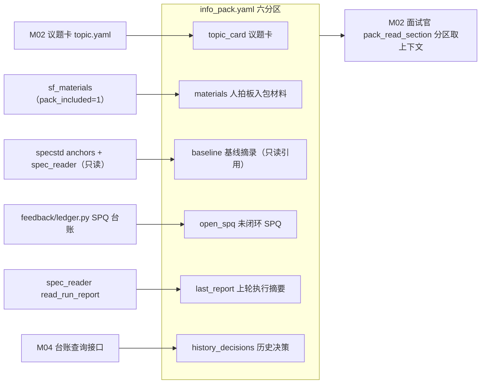
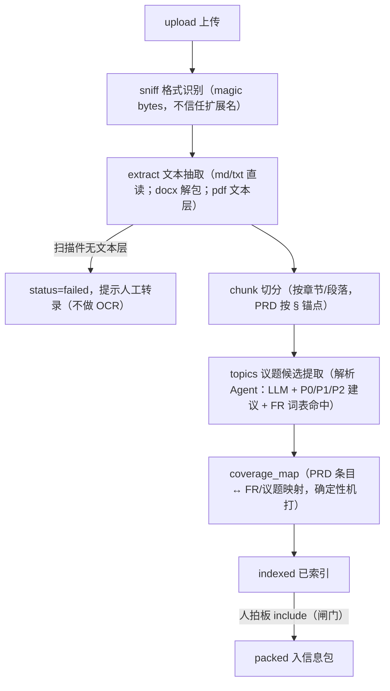

# M03 · 材料包与信息包 详细设计

## 0. 模块卡

| 项 | 内容 |
|---|---|
| 模块名 | 材料包与信息包（Materials Pack & Info Pack） |
| 原型屏 | S4 需求面试会话 ·「材料包」页签 |
| 架构层 | L0 数据层（材料文件/解析产物存储）+ L3 智能层（材料包解析 Agent + MCP 工具） |
| 现状定性 | 增强：info_pack 基础读写与新鲜度已有；多源办公文档解析管线、议题候选提取、面试绑定新建 |
| 里程碑映射 | F3（材料包随 specflow 落地）+ G1（材料包解析 Agent 专业化） |
| 依赖模块 | M01（需求会话入口）、M02（面试官 Agent 消费方）、M04（覆盖率机打依据入五维评分）、M12（MCP 挂载基建） |

---

## 1. 模块定位与职责

**解决什么问题**：需求面试的上下文不是凭空来的——会议纪要、访谈文字记录、PRD 等办公文档承载了大量需求素材，上轮执行的 SPQ 与报告承载反哺证据。本模块把「多源文档 → 可消费上下文」打通：上传 → 解析 → 索引 → 入信息包，让面试官 Agent 提问有据、覆盖率评分有机打依据，并保证信息包**新鲜度可见**（基线变更后旧材料失效可感知）。

**核心职责**：

1. 材料包：多源文档（.md 会议纪要 / .docx 访谈记录 / .pdf PRD 等）的上传、存储、解析、索引，按面试会话（IV-xxx）组织；
2. 文档解析管线：格式识别 → 文本抽取 → 议题候选提取 → 覆盖率机打依据产出；
3. 信息包装配：议题卡 + 材料解析产物 + 基线摘录（specstd 只读引用）+ 未闭环 SPQ + 上轮执行摘要 + 历史决策，成包供 M02 面试官消费；
4. 材料包解析 Agent：输入纪要/记录/办公文档 → 解析·议题候选提取 → 输出提问素材 + 覆盖率机打依据；**闸门：人拍板入台账**。

**不做什么（边界）**：

- 不做通用文档管理系统——材料必须挂在某个 IV-xxx（或显式的工作区级材料池）下，无孤儿文档；
- 不把解析结果直接写进决策台账/spec 草案——解析产物一律是「候选/依据」，人拍板才生效（铁律 1）；
- 不重新发明信息包机制——复用已有 `info_pack.py` 读写与 meta 工具三件套，补挂载与 specflow 侧装配；
- 不解析 spec 基线（那是 spec_reader/specstd 的事），基线摘录只做只读引用聚合。

---

## 2. 原型交互 → 功能拆解

| 原型界面元素（S4「材料包」页签） | 功能点 | 后端支撑 |
|---|---|---|
| 🎯 议题卡（IV-007 · 发起人/开标时间/来源 PRD v3.2 §2.7＋SPQ-005 反哺/冻结目标 delta grid-rule-perf） | 议题上下文展示 | M02 议题卡（新建）；材料包页签只读引用 |
| 📎 上传材料列表：① 会议纪要 `meeting-notes-0728.md` 2.1KB「已解析入信息包」② 访谈文字记录 `interview-transcript.docx` 18.4KB ③ PRD `prd-v3.2.pdf` 1.2MB「覆盖率机打依据」 | 多源文档上传 + 解析状态徽标（✓ 已索引） | 新建：上传接口 + 解析管线 + `sf_materials` 表 |
| 材料包解析 Agent 条（输入：纪要/记录/办公文档 → 处理：解析·议题候选提取 → 输出：提问素材+覆盖率机打依据；闸门：人拍板入台账） | 解析 Agent 可视化（输入/处理/输出/闸门四段） | 新建：`specflow/materials/parser_agent.py` + 提示词片段 |
| 📖 基线摘录（FR-003「← 本次拟改」/FR-002/FR-008，注明来源 specs/inventory/grid-placement/spec.md，「锚点定位不断链 · 真实基线」） | spec 锚点只读引用聚合 | 已有：`specstd/anchors.py` + `mcp_server spec_reader.read_spec`；新建：按议题聚合进信息包 |
| 🧊 未闭环 SPQ（SPQ-005 ← run#23 · IS-RVT-002 FAIL 归因，「已纳入本期（D-033）」） | 执行反哺素材入包 + 闭环状态联动 | 已有：`feedback/ledger.py` SPQ 状态机、`report_writer.py` 归档；新建：入包装配与状态回显 |
| 📊 上轮执行摘要（run#23 · plan#7 · 4 PASS / 1 FAIL，报告归档于 `.specguard/reports/`） | 报告摘要入包 | 已有：`mcp_server spec_reader.read_run_report`；新建：摘要装配 |
| 🗂 历史相关决策（D-012 ← IV-003 extend-void-scope 已冻结，「不得推翻，仅可增补」） | 历史决策入包 | 新建：M04 台账查询接口供给 |
| （页签整体）材料包 = info_pack 物化视图 | 信息包内容分区呈现 + 新鲜度提示 | 已有：`mcp_server/tools/info_pack.py` 基础读写（未挂载）+ meta 工具 `add_to_info_pack`/`read_info_pack`/`list_info_pack_artifacts` + `services/info_pack_freshness.py`；新建：挂载 + specflow 侧装配 |

---

## 3. 现状与差距

### 3.1 已有能力（真实模块）

| 能力 | 真实模块 | 复用方式 |
|---|---|---|
| 信息包基础读写 | `mcp_server/tools/info_pack.py`（已实现但**未挂载** server.TOOL_MODULES） | 挂载到 TOOL_MODULES 并作为信息包落盘原语 |
| 信息包 MCP 工具三件套 | meta 模块：`add_to_info_pack` / `read_info_pack` / `list_info_pack_artifacts` | 面试官 Agent 与解析 Agent 直接调用 |
| 信息包新鲜度 | workbench `services/info_pack_freshness.py` | 材料/基线变更后的失效检测与页签提示 |
| 文件预览 | workbench `services/file_preview.py` | 材料原文预览（上传后查看） |
| 信息包物理布局 | 各工作区 `.specguard/info_packs/` | 测试侧布局不动；specflow 侧在 `.specflow/interviews/IV-xxx/materials/`，装配产物沿用 info_pack 读写机制 |
| spec 只读 + 报告读取 | `mcp_server` spec_reader（read_spec / list_spec_files / read_run_report） | 基线摘录与上轮摘要的数据源 |
| SPQ 台账 | `feedback/ledger.py`（pending→in_progress→closed） | 未闭环 SPQ 入包 |
| 工作区透传 | `specstd/workspace.py`（contextvar + X-SG-Workspace） | 材料与信息包按工作区隔离 |

### 3.2 差距清单

| # | 缺口 | 定性 |
|---|---|---|
| G1 | `info_pack.py` 未挂载 server.TOOL_MODULES，Agent 无法经 MCP 使用底层读写 | 挂载（小改，已有能力接通） |
| G2 | 无多源文档解析管线（.md/.docx/.pdf 格式识别 + 文本抽取） | 新建 `specflow/materials/pipeline.py` |
| G3 | 无议题候选提取与覆盖率机打依据产出 | 新建材料包解析 Agent（LLM 提取 + 确定性映射） |
| G4 | 无材料↔面试会话绑定与上传/解析/索引状态管理 | 新建 `sf_materials` 表 + `.specflow/interviews/IV-xxx/materials/` 布局 |
| G5 | 无 specflow 侧信息包装配器（议题卡+材料+基线+SPQ+报告+历史决策六分区） | 新建 `specflow/materials/pack_assembler.py` |
| G6 | 无材料路由/工具暴露 | 新建 `routers/specflow_materials.py` + `mcp_server/tools/specflow_pack.py` |

---

## 4. 数据模型

### 4.1 文件布局（新建，.specflow 侧）

```
.specflow/interviews/IV-007/
├── materials/                      # 材料包（源文件版本化保留）
│   ├── meeting-notes-0728.md       # 原始上传（原文不动）
│   ├── interview-transcript.docx
│   ├── prd-v3.2.pdf
│   └── _parsed/                    # 解析产物（派生物，可重建，gitignore 可选）
│       ├── meeting-notes-0728.extract.txt
│       ├── meeting-notes-0728.topics.yaml    # 议题候选
│       ├── interview-transcript.extract.txt
│       ├── prd-v3.2.extract.txt              # 按章节切分
│       └── prd-v3.2.coverage_map.yaml        # 覆盖率机打依据（PRD 条目 ↔ FR/议题映射）
└── info_pack.yaml                  # 装配后的信息包清单（六分区索引）
```

`_parsed/` 是**派生物**：任何时刻删除后可由源文件 + 指纹重建（与图谱「派生物不是事实源」红线同哲学，见 M11）。

### 4.2 SQLite 表（新建，sf_ 前缀）

```sql
CREATE TABLE sf_materials (
  material_id   TEXT PRIMARY KEY,        -- MAT-xxx（工作区内递增）
  iv_id         TEXT NOT NULL,           -- 归属面试（或 POOL 表示工作区材料池）
  workspace     TEXT NOT NULL,
  filename      TEXT NOT NULL,
  fmt           TEXT NOT NULL,           -- md | docx | pdf | txt
  size_bytes    INTEGER NOT NULL,
  sha256_12     TEXT NOT NULL,           -- 内容指纹（复用 specstd/signature 语义）
  status        TEXT NOT NULL DEFAULT 'uploaded',
  -- uploaded → parsing → parsed → indexed → packed | failed
  parsed_at     TEXT,
  pack_included INTEGER NOT NULL DEFAULT 0,  -- 人拍板入包标记（闸门）
  uploaded_by   TEXT NOT NULL,
  uploaded_at   TEXT NOT NULL
);
CREATE INDEX idx_mat_iv ON sf_materials(iv_id, status);

CREATE TABLE sf_material_topics (        -- 议题候选（解析 Agent 产出，人拍板前不生效）
  topic_id      TEXT PRIMARY KEY,        -- MAT-xxx-T01
  material_id   TEXT NOT NULL REFERENCES sf_materials(material_id),
  title         TEXT NOT NULL,
  priority_hint TEXT,                    -- P0/P1/P2 建议（LLM）
  fr_hints      TEXT,                    -- JSON：候选 FR 锚点（机打依据：文本相似 + 锚点词表）
  prd_section   TEXT,                    -- 如 "§2.7"
  confirmed     INTEGER NOT NULL DEFAULT 0,  -- 人确认后供 M02 提问消费
  created_at    TEXT NOT NULL
);
```

### 4.3 信息包清单 info_pack.yaml（schema）

```yaml
iv_id: IV-007
assembled_at: 2026-07-31T10:07:30+08:00
freshness:                       # 由 info_pack_freshness.py 计算写入
  baseline_fingerprint: a1b2c3d4e5f6     # specstd signature
  stale: false
sections:
  topic_card:   { ref: topic.yaml }                       # 议题卡（M02）
  materials:    [{ material: MAT-001, topics: [T01,T03] }] # 人拍板入包的材料子集
  baseline:     [{ fr: FR-003, file: specs/inventory/grid-placement/spec.md, note: 本次拟改 },
                 { fr: FR-002, ... }, { fr: FR-008, ... }] # 只读引用，不落副本正文
  open_spq:     [{ id: SPQ-005, from: run#23, verdict: "IS-RVT-002 FAIL 疑似产品缺陷" }]
  last_report:  { run: run#23, plan: plan#7, summary: "4 PASS / 1 FAIL" }
  history_decisions: [{ id: D-012, iv: IV-003, note: "不得推翻，仅可增补" }]
```

信息包六分区的结构与供给来源如下图所示（pack_assemble 为确定性装配，无 LLM）：



### 4.4 覆盖率机打依据 coverage_map.yaml（schema）

```yaml
source: prd-v3.2.pdf
section: "§2.7 落位规则"
entries:
  - prd_item: "绩效≥4.5 落第 9 宫格"
    mapped: { type: fr, ref: FR-003 }      # 机打：关键词+锚点词表命中
    confidence: high                        # high=机打确定 / low=LLM 建议待确认
  - prd_item: "存量名单冻结"
    mapped: { type: decision, ref: D-032 }  # 决策落锤后回填（见 M04 接口）
```

五维评分「需求覆盖率」维度直接消费本文件做机打（见 M04）；未映射条目 = 覆盖率缺口，反哺面试官提问（见 M02）。

---

## 5. 接口设计

### 5.1 REST（新建 `routers/specflow_materials.py`，前缀 `/api/specflow`，挂 RBAC）

| 方法 | 路径 | 说明 | 关键入参/出参 |
|---|---|---|---|
| POST | `/api/specflow/interviews/{iv}/materials` | 上传材料（multipart） | 校验格式/大小（默认 ≤20MB）→ 存 materials/ + 写 sf_materials（status=uploaded）→ 触发解析任务 |
| GET | `/api/specflow/interviews/{iv}/materials` | 材料列表 | 出参含状态徽标（uploaded/parsing/parsed/indexed/packed/failed）+ sha256_12 |
| GET | `/api/specflow/materials/{mid}/topics` | 议题候选列表 | 出参 sf_material_topics 行（含 confirmed 标记） |
| POST | `/api/specflow/materials/{mid}/topics/{tid}/confirm` | 人拍板：议题候选生效 | confirmed=1 → 供 M02 提问管线消费；**未确认不得入面试** |
| POST | `/api/specflow/interviews/{iv}/materials/{mid}/include` | 人拍板：材料入信息包 | pack_included=1 → 触发重新装配 info_pack.yaml |
| GET | `/api/specflow/interviews/{iv}/pack` | 读取装配后信息包 | 出参 info_pack.yaml + freshness（stale 时前端页签提示「基线已变更，材料可能过期」） |
| POST | `/api/specflow/interviews/{iv}/pack/reassemble` | 重新装配 | 材料/SPQ/报告/基线任一变更新后调用（也可由新鲜度失效自动触发） |
| GET | `/api/specflow/materials/{mid}/preview` | 原文/抽取文本预览 | 复用 `services/file_preview.py` |

### 5.2 MCP 工具

**挂载（接通已有）**：将 `tools/info_pack.py` 加入 `server.TOOL_MODULES`；meta 三件套（`add_to_info_pack`/`read_info_pack`/`list_info_pack_artifacts`）保持。

**新建 `mcp_server/tools/specflow_pack.py`**（面试官/解析 Agent 消费）：

| 工具 | 参数 | 说明 |
|---|---|---|
| `pack_assemble` | `{iv_id}` | 六分区装配 → 写 info_pack.yaml（确定性装配，无 LLM） |
| `pack_read_section` | `{iv_id, section}` | 读单分区（baseline/open_spq/last_report…），面试官按需取上下文 |
| `material_parse_status` | `{iv_id}` | 材料状态机快照（纯读） |
| `material_extract_topics` | `{material_id}` | 触发/重跑议题候选提取（LLM 在 Agent 侧，工具读写 _parsed/ 产物） |
| `pack_freshness_check` | `{iv_id}` | 新鲜度校验（内部走 info_pack_freshness.py + specstd signature，纯读） |

### 5.3 解析管线（pipeline.py）

```
upload ──> sniff（magic bytes 格式识别，不信任扩展名）
        ──> extract（.md/.txt 直读；.docx 解包 document.xml；.pdf 文本层抽取；
                     扫描件无文本层 → status=failed 并提示人工转录，不做 OCR 承诺）
        ──> chunk（按章节/段落切分，PRD 按 § 锚点切）
        ──> topics（解析 Agent：LLM 提取议题候选 + P0/P1/P2 建议 + FR 词表命中）
        ──> coverage_map（PRD 类材料：条目↔FR/议题映射，确定性部分机打）
        ──> indexed → 待人拍板 → packed
```

解析管线的流程与状态推进图示如下：



技术选型：纯 Python 标准库 + 已有依赖内解决（docx=zip+xml 解析；pdf 文本层用 pypdf 类轻量库，**新增依赖须过依赖评审**，与使命卡片「零新前端依赖」同一纪律）。

---

## 6. 关键流程（覆盖原型演示主路径）

1. 产品经理在 IV-007 会话「材料包」页签上传三份文档：meeting-notes-0728.md、interview-transcript.docx、prd-v3.2.pdf；
2. 后端逐份落盘 + 写 sf_materials（status=uploaded），异步进入解析管线；
3. 管线 sniff/extract/chunk 完成 → 解析 Agent 提取议题候选（如会议纪要中「绩效阈值 4.2→4.5」「存量名单怎么办」）→ _parsed/*.topics.yaml 落盘，状态 → indexed，页签徽标转「✓ 已索引」；
4. PRD 额外产 coverage_map.yaml（§2.7 条目 ↔ FR-003 等机打映射）——页签标注「覆盖率机打依据」；
5. 产品经理逐条确认议题候选（confirm）+ 点选材料入包（include）——**闸门：人拍板入台账/入包**；未确认候选不进面试官上下文；
6. `pack_assemble` 触发：议题卡（M02）+ 已入包材料 + specstd 基线摘录（FR-003 标「← 本次拟改」）+ feedback/ledger.py 未闭环 SPQ-005 + read_run_report 上轮摘要（run#23 · 4 PASS/1 FAIL）+ M04 历史决策 D-012 → info_pack.yaml 六分区成包；
7. M02 面试官开标时 `pack_read_section` 分区取上下文，生成开场消息与 Q1（P0 范围问题，素材=PRD §2.7 + 基线比对）；
8. 面试中 D-032 落锤（见 M04）→ 覆盖率机打依据回填 `mapped: decision D-032`；SPQ-005 经 D-033 处置 → 页签联动「✓ 已纳入本期」；
9. 基线 spec 中途变更 → `pack_freshness_check` 判定 stale → 页签顶部提示「基线已变更」，产品点击重新装配（reassemble）；
10. 冻结后（见 M05）材料包随 IV-007 整体归档只读，_parsed/ 可凭指纹重建。

---

## 7. 闸门与确定性校验

| 闸门/校验 | 实现 | 呼应铁律 |
|---|---|---|
| **人拍板入包/入台账** | 议题候选 confirmed=0 不进面试上下文；材料 pack_included=0 不进信息包；覆盖率依据仅落锤后回填 | 铁律 1（Agent 只建议，人拍板） |
| **机打 vs 建议分离** | 格式识别/指纹/章节切分/PRD↔FR 词表命中为确定性；议题优先级、low 置信映射为 LLM 建议并显式标注 | 铁律 2（校验走确定性校验器） |
| **新鲜度门禁** | 信息包 stale 时面试官首轮消息强制携带「材料可能过期」提示；冻结前 gate（见 M02）要求 freshness.stale=false | 铁律 3（每个产出必过闸） |
| **原文不动** | 源文件上传后只读，sha256_12 指纹登记；_parsed/ 派生物可重建，不回写源文件 | 单一事实源（与图谱红线同哲学） |
| **双系统分离** | 材料只写 `.specflow/interviews/`；读取 `.specguard/reports/` 与 `specs/` 一律只读引用 | 链可跨界，资产不跨界（铁律 4 变体：需求侧/测试侧产物零混放） |
| **诚实呈现** | SPQ/报告摘要原样携带归因结论（FAIL 非 SKIP），解析 Agent 不得改写 | 铁律 7 |
| **无孤儿文档** | 上传必须绑定 iv_id（或显式 POOL）；删除面试中止时材料保留留档不物理删除 | 可追溯纪律 |

---

## 8. 依赖与边界

**上游**：M01（需求会话与工具白名单——specflow_pack 模块仅需求用途可见）；M02（议题卡供给、面试官消费）；M04（历史决策查询、决策落锤回填 coverage_map、覆盖率维度消费）；`feedback/ledger.py` / `spec_reader` / `info_pack_freshness.py` / `file_preview.py`（已有数据源与服务）。

**下游**：M02（提问素材）；M04（覆盖率机打依据入五维「需求覆盖率」机打分）；M05（冻结归档时材料包随卷）；M11（材料/议题节点入图谱索引为可选 G3 扩展，本模块只提供稳定 material_id）。

**跨模块数据流**：`.specflow/interviews/IV-xxx/materials/` + `info_pack.yaml` 是本模块写域；`sf_materials`/`sf_material_topics` 两表归本模块所有（M02/M04 只读引用）。

**不承担**：面试提问生成（M02）、决策台账（M04）、spec 草案（M05）、通用文档管理与全文检索（无此规划）、OCR（明确不做承诺）。

---

## 9. 里程碑映射与验收标准

### F3（需求侧 specflow · 材料包落地）

- 交付：上传/解析/索引/入包管线 + sf_materials/sf_material_topics 表 + info_pack.py 挂载 TOOL_MODULES + specflow_pack MCP 模块 + 材料包页签后端 + 六分区装配器。
- **验收标准**：
  1. 上传 .md/.docx/.pdf 各一份 → 状态机走完 uploaded→indexed，页签徽标「✓ 已索引」；无文本层 PDF → failed + 明确提示（不做静默降级）；
  2. `info_pack.py` 挂载后 `list_info_pack_artifacts` 可列出 IV-007 装配产物（MCP 层可验）；
  3. 议题候选未 confirm 时，面试官会话上下文中不出现该候选内容（日志/快照可验）；
  4. info_pack.yaml 六分区齐全；基线 spec 变更后 pack_freshness_check 返回 stale=true，页签出现过期提示；
  5. 材料源文件 sha256_12 与上传时一致（原文不动），删除 _parsed/ 后重新解析产物一致（指纹比对）。

### G1（智能体深化 · 材料包解析 Agent 专业化）

- 交付：议题候选提取提示词片段专业化（按材料类型分模板）+ 覆盖率机打依据产出 + 覆盖率缺口反哺 M02 提问。
- **验收标准**：
  1. 以演示三份文档为用例：会议纪要提取 ≥2 条议题候选且 FR 词表命中可解释；PRD §2.7 条目 100% 出现在 coverage_map（机打 high 置信或标注 low 待确认，无漏项）；
  2. 覆盖率维度机打分（见 M04）与 coverage_map 重算结果一致（确定性复算）；
  3. 未映射 PRD 条目自动生成覆盖率缺口清单并被 M02 面试官下一轮提问引用（联调用例：Q1 范围问题）。
