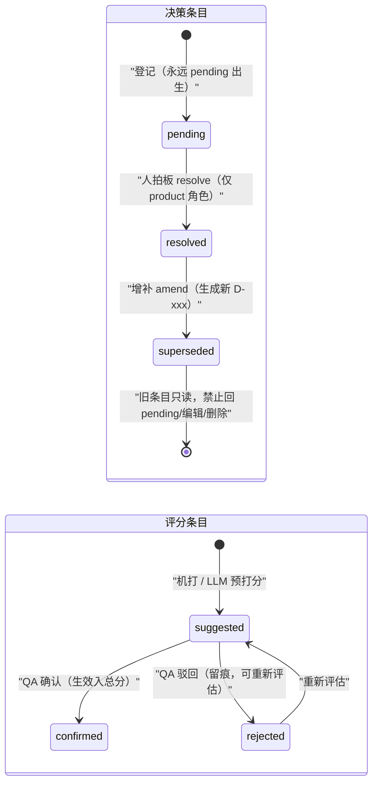
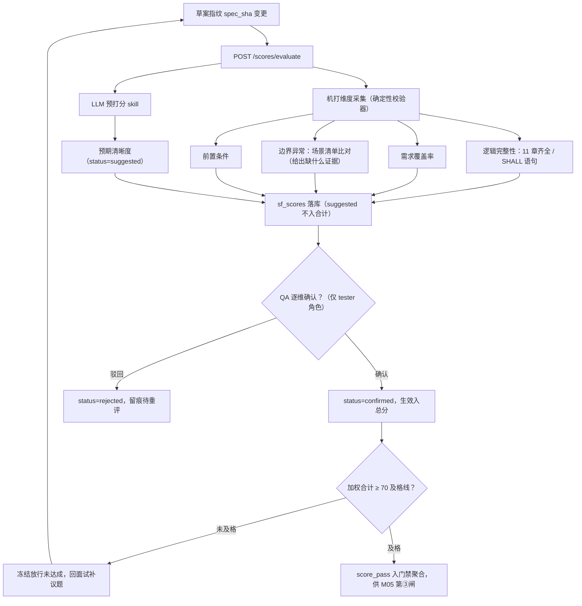

# M04 · 决策台账与五维评分 详细设计

## 0. 模块卡

| 项 | 内容 |
|----|------|
| 模块名 | 决策台账与五维评分（Decision Ledger & Five-Dimension Scoring） |
| 原型屏 | S4 需求面试会话 · 右面板「决策台账」「五维评分」页签（pt-ledger / pt-score） |
| 架构层 | L2 标准层（台账/评分数据结构与确定性校验）+ L3 智能层（LLM 预打分建议） |
| 现状定性 | **新建**（specflow 需求侧，无现有实现；参照 feedback/ledger.py 状态机模式独立实现） |
| 里程碑映射 | F3（specflow F1 台账 schema + P0 清零校验 → specflow F2 评分卡半自动 → specflow F3 RBAC/三闸对接）→ G2（影响面确认入门禁） |
| 依赖模块 | M02（面试引擎产出决策）、M05（P0 清零是冻结三闸之一）、M03（材料包提供评分输入）、M11（决策→FR 边入图谱索引） |
| 数据归属 | `{workspace}/.specflow/decisions/`（版本化保留）+ workbench.db `sf_*` 前缀表 |

## 1. 模块定位与职责

**解决什么问题**：需求面试中产品经理与 AI 面试官的每一次拍板，必须结构化留痕、可追溯、可机检。口头共识会蒸发，"当时说好了"是下游带病工作的源头。本模块把面试对话中的共识沉淀为 D-xxx 决策台账（P0/P1/P2 分级 + pending→resolved 状态机），把 spec 质量量化为五维评分卡，并用确定性校验器守死"P0 不清零，spec 不准冻结"这条红线。

**核心职责**：

1. 决策台账生命周期：登记（Agent 建议结构化条目）→ 落锤（人确认 resolved）→ 增补（amendment，永不推翻）→ 台账导出（血缘链边）。
2. P0 清零门禁：纯确定性校验（台账无 pending 状态的 P0 条目 → 放行），是 M05 冻结三闸的第③闸。
3. 决策 ↔ spec 草案「待确认」标记联动：草案中每个待定项锚定一个 pending 决策；决策 resolved 后草案对应 TBD 标记落锤为确定文本（M05 执行文本替换，本模块供状态）。
4. 五维评分：逻辑完整性 / 预期清晰度 / 需求覆盖率 / 边界异常 / 前置条件，五个维度中机打维度走确定性校验器，主观维度 LLM 预打分、QA 确认才生效；合计加权分 ≥70 及格。

**不做什么（边界）**：

- 不替人做决策——"评分是建议，人确认是闸门"，Agent 输出永远是 pending 建议。
- 不做提问生成（M02 的职责），只消费 M02 产出的问题分级（Q1·P0 等）。
- 不写 spec.md 正文（M05 的职责），只维护决策与草案标记的映射。
- 不做图谱呈现（M11），只向图谱索引提供"决策→FR/议题"确定性边。

## 2. 原型交互 → 功能拆解

| 原型界面元素（S4） | 功能点 | 后端支撑 | 现状 |
|--------------------|--------|----------|------|
| 决策台账页签：D-031/D-032 标 `P0 · ✓已决`、D-033 标 `P1 · ✓已决` | 决策条目卡片：优先级徽章 + 状态徽章 + 问题/决策/拍板人/时间戳 | `sf_decisions` 表 + GET 列表 API | 新建 |
| 条目内 `→ 绩效域落位规则 · Q1` 链接行 | 决策挂链：→ FR 锚点 / 议题 Q-xxx / SPQ-xxx（落笔即挂链） | `sf_decision_links` 表 | 新建 |
| `—— 产品经理 07-31 10:12` 落款 | 拍板留痕（谁确认谁留痕，记录级归属） | `resolved_by`/`resolved_at` 字段（复用 RBAC `auth.py` 用户体系，已有） | 半新建 |
| 材料包页签内 `D-012（IV-003）作废级联含 6 张结果表 ✅` 历史决策卡 | 历史相关决策装配：同议题历史决策只读引用，**不得推翻仅可增补** | 台账跨会话查询 + amendment 机制 | 新建 |
| 门禁面板 `P0 清零门禁（确定性校验）`：`P0 待定 0 项 ✓` | P0 清零确定性校验 | `specflow/interview/gate.py`（新建） | 新建 |
| 门禁面板 `影响面图确认 未确认 → 已确认`（demoGate()） | 影响面人工确认入清零门禁证据链 | `sf_gate_evidence` 表（G2） | 新建 |
| 门禁面板 `五维评分（QA 确认后生效）68 / 70`、`冻结放行 🔒 未达成` | 评分门槛 70 + 冻结放行汇总信号 | 评分服务 + 门禁聚合 API | 新建 |
| 五维评分页签：SVG 雷达 + 虚线及格线环 70 | 五维雷达可视化（五维值 78/85/55/70/62） | GET 评分 API 返回五维分数与来源 | 新建 |
| `逻辑完整性 78 · 机打：11 章齐全 ✓ SHALL 语句 ✓` | 机打维度：确定性校验器直出 | 调 specstd/conformance.py（已有）+ specflow 11 章齐全性检查（新建） | 增强 |
| `预期清晰度 62 · LLM 建议：…待 QA 复核` | 主观维度 LLM 预打分 + QA 确认生效 | LLM 评分建议（agent harness，已有薄壳）+ `sf_scores.confirmed_by` 闸门 | 新建 |
| `边界异常 55 · 机打：缺「规则切换中落位」异常场景 ← 拉低总分的主因` | 机打维度缺陷定位：给得出"缺什么"的具体证据 | 边界异常场景清单比对器（新建） | 新建 |
| `合计（加权）68 / 70 未及格` | 加权合计与及格判定 | 评分聚合（权重配置化） | 新建 |

## 3. 现状与差距

**已有能力（引用真实模块名）**：

- `feedback/ledger.py`（已有）：SPQ 状态机 pending→in_progress→closed 的实现范式——本模块**参照其模式独立实现** D-xxx 状态机（不共用表，保需求侧/测试侧分离）。
- `specstd/conformance.py`（已有，纯读无副作用）：锚点/合规规则校验，机打维度"SHALL 语句 ✓""锚点格式 ✓"直接复用。
- `specstd/schema.py`（已有）：RuleName/RuleLevel/ConformanceReport 数据结构，评分机打证据复用其报告模型。
- `agent/` 薄 harness（`runtime.py`/`skill_loader.py`）（已有）：LLM 预打分以 skill 形式落地，正文注入 `<skills>` 块，无需新运行时。
- workbench `services/auth.py`（已有）：RBAC 用户体系，拍板人/复核人留痕直接引用工号。
- workbench 前端 AgentChat 右侧面板框架（已有）：页签壳复用，新增两个页签组件。

**缺口清单（全部新建）**：

| # | 缺口 | 说明 |
|---|------|------|
| G1 | `sf_decisions` / `sf_decision_links` / `sf_decision_amendments` 表 | specflow `sf_*` 前缀独立表，不动现有表 |
| G2 | 决策状态机 + amendment（增补不推翻）机制 | 参照 ledger.py 模式 |
| G3 | P0 清零校验器 `specflow/interview/gate.py` | 纯确定性，无 LLM 参与 |
| G4 | 决策 ↔ 草案「待确认」标记映射 | `sf_decision_draft_marks`（M05 消费） |
| G5 | 五维评分服务：机打维度采集器 + LLM 预打分 skill + QA 确认闸门 | `specflow/anchor/scoring.py` |
| G6 | 11 章齐全性/边界异常场景清单比对器 | specflow F2 触及 specstd 规则扩展须先评审 |
| G7 | REST 路由 `routers/specflow_decisions.py` / `specflow_scores.py` + MCP specflow 工具模块 | 独立前缀/独立模块 |

## 4. 数据模型

### 4.1 SQLite 表（workbench.db，`sf_*` 前缀，新建）

```sql
-- 决策台账主表
CREATE TABLE sf_decisions (
  id            TEXT PRIMARY KEY,        -- D-031（工作区内唯一，序号 per-workspace 递增）
  workspace     TEXT NOT NULL,           -- specstd 工作区注册名
  interview_id  TEXT NOT NULL,           -- ← 面试 IV-007（落笔即挂链，铁律：必带上游 ID）
  question_ref  TEXT,                    -- 议题编号 Q1/Q2（M02 产出）
  priority      TEXT NOT NULL CHECK(priority IN ('P0','P1','P2')),
  question      TEXT NOT NULL,           -- 问题原文（如"调整范围：仅绩效域，还是三域同改？"）
  status        TEXT NOT NULL DEFAULT 'pending'
                CHECK(status IN ('pending','resolved')),
  resolution    TEXT,                    -- 决策内容（如"仅绩效域。潜能/综合域规则冻结不变。"）
  resolved_by   TEXT,                    -- 拍板人工号（RBAC users）
  resolved_at   TEXT,                    -- ISO8601
  superseded_by TEXT,                    -- 增补后指向新决策 D-xxx（原条目保留只读，永不删除）
  created_by    TEXT NOT NULL DEFAULT 'agent',  -- agent=LLM 建议结构化 / human=手工登记
  created_at    TEXT NOT NULL DEFAULT (datetime('now')),
  content_sha   TEXT NOT NULL            -- specstd/signature 指纹，防篡改审计
);
CREATE INDEX idx_sf_decisions_ws_iv ON sf_decisions(workspace, interview_id);
CREATE INDEX idx_sf_decisions_pending_p0 ON sf_decisions(workspace, priority, status);

-- 决策挂链边（确定性派生图谱的源数据之一，见 M11）
CREATE TABLE sf_decision_links (
  decision_id TEXT NOT NULL REFERENCES sf_decisions(id),
  link_type   TEXT NOT NULL CHECK(link_type IN ('fr_anchor','delta','spq','question','decision')),
  link_ref    TEXT NOT NULL,             -- FR-006 / grid-rule-perf / SPQ-005 / Q1 / D-012
  direction   TEXT NOT NULL DEFAULT 'out',  -- out=决策产出引用 / in=历史决策被增补
  PRIMARY KEY (decision_id, link_type, link_ref)
);

-- 增补记录：落锤即不可推翻，仅可增补（原型 D-012"不得推翻仅可增补"）
CREATE TABLE sf_decision_amendments (
  id            INTEGER PRIMARY KEY AUTOINCREMENT,
  base_decision TEXT NOT NULL REFERENCES sf_decisions(id),  -- 被增补的已决决策
  new_decision  TEXT NOT NULL REFERENCES sf_decisions(id),  -- 增补形成的新决策
  reason        TEXT NOT NULL,
  created_by    TEXT NOT NULL, created_at TEXT NOT NULL DEFAULT (datetime('now'))
);

-- 决策 ↔ spec 草案「待确认」标记联动
CREATE TABLE sf_decision_draft_marks (
  mark_id      TEXT PRIMARY KEY,         -- TBD-<decision_id>-<seq>
  decision_id  TEXT NOT NULL REFERENCES sf_decisions(id),
  draft_path   TEXT NOT NULL,            -- .specflow/changes/<delta>/drafts/spec.draft.md
  anchor_ref   TEXT NOT NULL,            -- FR-006 等锚点
  mark_text    TEXT NOT NULL,            -- 待确认占位文本
  resolved     INTEGER NOT NULL DEFAULT 0 -- 决策 resolved 后 M05 落锤为确定文本
);

-- 五维评分记录（每次评估一行，保留历史）
CREATE TABLE sf_scores (
  id           INTEGER PRIMARY KEY AUTOINCREMENT,
  workspace    TEXT NOT NULL,
  interview_id TEXT NOT NULL,            -- IV-007
  dimension    TEXT NOT NULL CHECK(dimension IN
               ('logic','clarity','coverage','boundary','precondition')),
  score        INTEGER NOT NULL CHECK(score BETWEEN 0 AND 100),
  source       TEXT NOT NULL CHECK(source IN ('machine','llm_suggested')),
  evidence     TEXT,                     -- 机打证据 JSON / LLM 建议理由
  status       TEXT NOT NULL DEFAULT 'suggested'
               CHECK(status IN ('suggested','confirmed','rejected')),
  confirmed_by TEXT, confirmed_at TEXT,  -- QA 复核留痕（闸门：确认后生效）
  spec_sha     TEXT NOT NULL,            -- 评分针对的草案指纹，草案变更旧分自动失效
  created_at   TEXT NOT NULL DEFAULT (datetime('now'))
);

-- 门禁证据链（影响面确认等人工动作，G2）
CREATE TABLE sf_gate_evidence (
  id           INTEGER PRIMARY KEY AUTOINCREMENT,
  workspace    TEXT NOT NULL,
  interview_id TEXT NOT NULL,
  gate_item    TEXT NOT NULL,            -- impact_confirm / score_pass / p0_zero
  verdict      TEXT NOT NULL,            -- pass / pending
  evidence     TEXT,                     -- 如图谱快照路径 .specflow/interviews/IV-007/snapshots/
  actor        TEXT, acted_at TEXT
);
```

### 4.2 文件布局（工作区内，版本化保留）

```
{workspace}/.specflow/decisions/
├── IV-007.ledger.yaml          # 本面试会话的台账快照（导出物，DB 为事实源）
└── archive/                    # 已冻结会话台账只读归档（M05 冻结时写入）
```

`IV-007.ledger.yaml` 示例：

```yaml
interview: IV-007
topic: 九宫格落位规则调整
decisions:
  - id: D-031
    priority: P0
    status: resolved
    question: 调整范围：仅绩效域，还是三域同改？
    resolution: 仅绩效域。潜能/综合域规则冻结不变。
    resolved_by: pm.zhang
    resolved_at: '2026-07-31T10:12:00'
    links: [{type: fr_anchor, ref: FR-006}, {type: question, ref: Q1}]
  - id: D-032
    priority: P0
    status: resolved
    question: 存量已落位名单：重算覆盖 vs 冻结存量？
    resolution: 冻结存量，仅对新会话生效；落位规则维持修改，刷新逻辑拆新增功能点。
    links: [{type: fr_anchor, ref: FR-006}, {type: fr_anchor, ref: FR-012}]
  - id: D-033
    priority: P1
    status: resolved
    question: SPQ-005 遗留：落位后名单刷新延迟是否进本次范围？
    resolution: 纳入本期，与名单刷新新增功能点一并处理；SPQ-005 台账闭环。
    links: [{type: spq, ref: SPQ-005}, {type: fr_anchor, ref: FR-009}]
p0_gate:
  pending_p0: 0
  impact_confirmed: true
  score: {total: 68, threshold: 70, pass: false}
```

### 4.3 状态机

```
决策条目：pending ──人拍板──> resolved ──增补──> resolved(新条目) + 旧条目 superseded 只读
          └── 任何 resolved 条目：禁止回 pending、禁止编辑原文、禁止删除
评分条目：suggested ──QA 确认──> confirmed（生效入总分）
                  └──QA 驳回──> rejected（留痕，可重新评估）
```

下面用状态图直观呈现 D-xxx 决策生命周期（含 amendment 增补链）与评分条目状态机：



## 5. 接口设计

### 5.1 REST API（workbench FastAPI，新增 `routers/specflow_decisions.py`、`specflow_scores.py`，RBAC `Depends(get_current_user)`；工作区经 `X-SG-Workspace` 透传）

| 方法 | 路径 | 关键入参 | 出参要点 | 说明 |
|------|------|----------|----------|------|
| GET | `/api/specflow/decisions?interview_id=IV-007` | 会话过滤 / `status` / `priority` | 条目数组（含 links、落款） | 台账页签数据源 |
| POST | `/api/specflow/decisions` | `{interview_id, priority, question, question_ref, links[]}` | `{id: "D-034", status: "pending"}` | Agent/人登记，永远 pending 出生 |
| POST | `/api/specflow/decisions/{id}/resolve` | `{resolution}`（拍板人取当前用户） | 更新后条目 | **闸门：仅 product 角色可调** |
| POST | `/api/specflow/decisions/{id}/amend` | `{new_decision: {...}, reason}` | 新 D-xxx + 旧条目标 superseded | 增补不推翻；仅 resolved 条目可被增补 |
| GET | `/api/specflow/decisions/gate?interview_id=IV-007` | — | `{pending_p0: 0, impact_confirmed: false, score: {total:68, pass:false}, freeze_allowed: false}` | P0 清零门禁聚合（M05 第③闸调用） |
| POST | `/api/specflow/decisions/gate/impact-confirm` | `{interview_id, affected_frs[], snapshot_path}` | evidence 落库 | 影响面人工确认（demoGate） |
| GET | `/api/specflow/scores?interview_id=IV-007` | — | 五维数组 `[{dimension, score, source, status, evidence}]` + 合计 | 雷达图数据源 |
| POST | `/api/specflow/scores/evaluate` | `{interview_id}` | 触发机打维度采集 + LLM 预打分，返回 suggested 集合 | 草案指纹变更后重评 |
| POST | `/api/specflow/scores/{id}/confirm` | `{verdict: confirm\|reject, comment?}` | 生效/驳回 | **闸门：仅 tester(QA) 角色可调** |

### 5.2 MCP 工具（新增 `mcp_server/tools/specflow_ledger.py`，独立模块，与测试工具不同模块）

| 工具 | 参数 | 返回 | 约束 |
|------|------|------|------|
| `sf_list_decisions` | `interview_id, status?` | 台账条目 | 纯读 |
| `sf_propose_decision` | `interview_id, priority, question, links[]` | pending 条目 | 建议语义：Agent 只能 propose，不能 resolve |
| `sf_check_p0_gate` | `interview_id` | `{pending_p0, freeze_allowed}` | 纯读，确定性 |
| `sf_suggest_scores` | `interview_id` | 五维 suggested 分 + 理由 | 建议语义，写库 status=suggested |
| `sf_read_score_gate` | `interview_id` | 及格判定 + 生效分 | 纯读 |

> resolve / confirm / amend 三个写闸门**不暴露给 MCP**——拍板动作只能由人在工作台 UI/REST 完成，从通道上杜绝 Agent 越权（铁律 1）。

### 5.3 前端组件

- `LedgerPanel.vue/tsx`（决策台账页签）：条目卡片 + 门禁面板轮询 `GET .../gate`。
- `ScoreRadar.tsx`（五维评分页签）：SVG 雷达，虚线环=及格线 70，节点色 ≥70 绿 / ≥60 黄 / <60 红（与原型一致）；QA 角色显示「确认/驳回」按钮。
- 两页签均挂在 AgentChat 右侧面板（需求面试用途会话专属，见 M01 会话用途锁定）。

## 6. 关键流程

**主路径（原型 S4 演示流）**：

1. M02 面试引擎按 11 章扫描提问，消息携带分级芯片 `Q1 · P0`（调整范围）——议题入会话上下文。
2. 产品经理对话中拍板"仅绩效域"；Agent 调 `sf_propose_decision` 生成 pending 条目 D-031（含 →FR-006 / Q1 挂链）。
3. 产品经理在台账页签核对，点「确认决策」→ `POST /decisions/D-031/resolve`，落锤留痕（产品经理 07-31 10:12），状态 → resolved。
4. 同步联动：`sf_decision_draft_marks` 中 D-031 对应的草案「待确认」标记通知 M05 落锤（草案中"存量名单：冻结存量 ✓ D-032"即联动结果）。
5. Q2（P0 存量处理）→ D-032、Q3（P1 SPQ-005 处置）→ D-033，同样落锤；P0 待定计数归零。
6. `sf_check_p0_gate` 确定性校验：pending P0 = 0 → 门禁面板显示 `P0 待定 0 项 ✓`。
7. 评分：草案指纹变更触发 `POST /scores/evaluate`——机打维度直出（逻辑完整性 78：11 章齐全 ✓ SHALL ✓；覆盖率 85；边界异常 55：缺「规则切换中落位」异常场景；前置条件 70）；LLM 建议预期清晰度 62（suggested）。
8. QA 收到复核通知，在雷达页签逐维确认；合计 68/70 未及格 → 冻结放行 🔒 未达成。
9. 面试对话补 Q4·P1（边界异常场景确认）→ 草案补场景 → 重评 → QA 确认达标 → 门禁放行，M05 三闸第③闸解锁。
10. 影响面页签点「✋ P0 影响面人工确认」→ 证据（3 受影响功能点 + 图谱快照路径）落 `sf_gate_evidence`，门禁面板 `影响面图确认 ✓`。

**增补路径（历史决策 D-012）**：新议题触及已决决策 D-012（作废级联含 6 张结果表）→ 材料包只读展示 → 如需变更，`POST /decisions/D-012/amend` 生成新 D-xxx 并标 superseded，D-012 原文永不修改。

下面用流程图直观呈现五维评分的采集、确认与及格判定链路：



## 7. 闸门与确定性校验

| 闸门/校验 | 类型 | 实现 | 呼应铁律 |
|-----------|------|------|----------|
| P0 清零门禁 | 确定性 | `gate.py`：`SELECT count(*) FROM sf_decisions WHERE priority='P0' AND status='pending'` = 0 才放行；**零 LLM 参与** | 铁律 2 |
| 评分及格线 70 | 确定性 | 加权合计仅统计 `status='confirmed'` 维度分；suggested 分不入合计 | 铁律 1/2 |
| 决策落锤 | 人工闸门 | resolve 仅 product 角色、UI/REST 通道；MCP 不暴露 | 铁律 1：Agent 只建议，人拍板 |
| 评分生效 | 人工闸门 | confirm 仅 tester 角色；LLM 预打分永远是建议 | 铁律 1 + specflow Q5 拍板 |
| 落锤不可推翻 | 结构性 | resolved 条目禁止 UPDATE 原文/DELETE，仅 amendment 追加；content_sha 指纹防篡改 | 铁律 2（结构保证而非自觉） |
| 草案变更使旧评分失效 | 确定性 | `sf_scores.spec_sha` 与当前草案指纹（specstd/signature）不一致 → 旧分自动降级 suggested 待重评 | 铁律 2 |
| 挂链完整性 | 确定性 | 决策创建必带 interview_id（NOT NULL）；缺 FR/议题链接 → 合规 WARNING | 血缘链 ID 脊柱（见 M10） |

## 8. 依赖与边界

**上游**：

- M02（需求面试引擎）：议题分级（Q1·P0）、对话上下文、面试归档目录；本模块消费其产出，不回写。
- M03（材料包）：历史相关决策（D-012）与未闭环 SPQ 装配进信息包，由 M03 读取本模块台账。
- M01（会话路由）：`purpose=需求面试` 会话才挂载本模块页签与工具集。

**下游**：

- M05（spec 草案与冻结三闸）：第③闸 = 本模块 `GET .../gate` 的 `freeze_allowed`；`sf_decision_draft_marks` 供 M05 落锤「待确认」标记；决策引用（D-031~D-033）写入 proposal.md 四段式。
- M10/M11：台账导出为图谱索引的 `decides` 边（确定性派生源数据）；台账快照路径入 `.specflow/interviews/IV-007/` 归档。

**不承担的职责**：提问生成（M02）、草案文本写盘（M05）、图谱可视化（M11）、SPQ 台账本身（测试侧 `feedback/ledger.py` 已有，仅经 link 引用）。

## 9. 里程碑映射与验收标准

| 阶段 | 内容 | 可检验的验收标准 |
|------|------|------------------|
| **F3 · specflow F1**（台账最小闭环） | `sf_decisions` 表 + 状态机 + amendment + P0 清零校验器 + 台账页签 | ① 建库迁移脚本可重入；② 造 1 条 pending P0 时 `GET /gate` 返回 `freeze_allowed=false`，resolve 后为 true；③ 对已决条目调 amend 生成新 D-xxx 且原条目只读（UPDATE 被拒）；④ MCP 无 resolve 工具（工具清单断言） |
| **F3 · specflow F2**（扫描仪与评分卡半自动） | 机打维度采集（11 章齐全/SHALL/边界异常清单）+ 五维雷达 + LLM 预打分 | ① 对原型 IV-007 场景重放：机打四维 78/85/55/70 与证据文本一致；② LLM 建议分落库 status=suggested 且不计入合计；③ 触及 specstd 规则扩展的 PR 有评审记录 |
| **F3 · specflow F3**（锚定与归档） | QA 确认闸门 + RBAC product/tester 角色 + 门禁证据链 + 与 M05 三闸对接 | ① tester 确认后合计入总分、68/70 未及格时 M05 冻结 API 拒绝（403 + 原因）；② 非 QA 角色调 confirm 返回 403；③ M05 冻结成功后台账归档至 `.specflow/decisions/archive/` 只读 |
| **G2**（图谱支线） | 影响面人工确认入门禁 + 决策→FR 边入图谱索引 | ① 未确认影响面时 `freeze_allowed=false`；② 确认后 `sf_gate_evidence` 有快照路径记录；③ 图谱索引重建后决策边与台账 links 完全一致（确定性派生对拍） |

**验收通用红线**：任一阶段 P0 清零判定不得出现 LLM 调用；所有拍板动作（resolve/confirm/amend）在审计日志有工号 + 时间戳可查。
