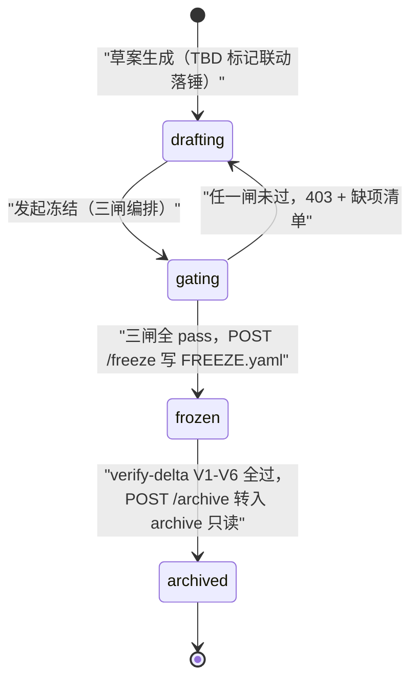
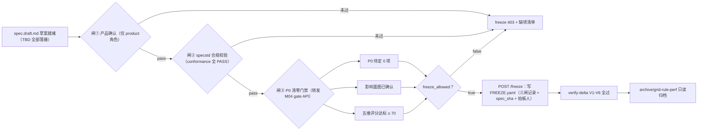

# M05 · spec 草案与冻结三闸 详细设计

## 0. 模块卡

| 项 | 内容 |
|----|------|
| 模块名 | spec 草案与冻结三闸（Spec Draft & Freeze Gates） |
| 原型屏 | S4 需求面试会话 · 右面板「spec 草案」「影响面」「产出交付」页签（pt-draft / pt-graph / pt-deliver） |
| 架构层 | L2 标准层（specflow/anchor + specflow/delta，依赖 specstd 不污染 specstd） |
| 现状定性 | **增强**：specstd conformance/delta 数据结构已有，草案生成/三闸/verify-delta 新建 |
| 里程碑映射 | F3（specflow F1 草案扫描校验 → specflow F2 三闸冻结 + delta manifest + verify-delta V1-V6 → specflow F3 归档对接）→ G2（影响面图谱） |
| 依赖模块 | M02（面试产出）、M04（决策台账/P0 清零门禁 = 第③闸）、M03（材料包基线摘录）、M06（冻结产物 → 禅道故事）、M07（delta 导入生成计划，铁律 6）、M11（影响面图谱索引） |
| 数据归属 | `{workspace}/.specflow/changes/<delta>/`（版本化保留）→ 冻结后 spec.md 合入工作区 `specs/` + `.specflow/archive/<delta>/` 只读 |

## 1. 模块定位与职责

**解决什么问题**：需求面试的产出不能停在对话里——必须落成锚点规范、specstd 合规、三方冻结的 spec 基线与 delta 变更，这是需求侧写给测试侧的**唯一两个界面产物**（specflow 双体系分离拍板）。本模块负责 spec 草案的生成与生命周期管理，并用需求侧三闸守住"冻结"这个质量阀门。

**核心职责**：

1. spec 草案生成与维护：FR 锚点 + SHALL 语句 + `[delta:代号]` 标记 + `[V1.x MODIFIED]` 版本标记；待定项挂「待确认」TBD 标记并与决策台账联动落锤（M04 供状态，本模块执行文本替换）。
2. proposal.md 四段式生成：为什么做 / 做什么 / 不做什么 / 验收口径，含 D-xxx 决策引用。
3. delta 三段式 + manifest 一致：ADDED/MODIFIED/REMOVED；MODIFIED 必须写全量（原/新/原因三要素）；`delta.manifest.yaml` 是机器清单、合并单一真相。
4. 影响面分析：议题候选 FR → 受影响功能点标红 + 覆盖场景波及清单，挂「P0 影响面人工确认」动作（证据入 M04 门禁）。
5. 需求侧三闸：① 产品确认 → ② specstd 合规校验 → ③ P0 清零门禁，全过才允许冻结。
6. 冻结与归档：spec.md 修订合入工作区 `specs/`；`changes/<delta>/` 经 verify-delta V1-V6 后合并基线、转入 `archive/<delta>/` 只读。

**不做什么（边界）**：

- 不做决策拍板与评分（M04），只消费其门禁结果。
- 不做提问与对话（M02）。
- 不消费 delta 生成测试计划（M07，铁律 6：计划只能由 delta 导入生成）。
- 不创建禅道故事（M06），只向其交付冻结产物。
- 不在 specstd 里放任何需求侧产物——specflow **依赖** specstd（合规校验、指纹、锚点正则），**不修改**其目录约定（规范扩展走 Ask First 评审）。

## 2. 原型交互 → 功能拆解

| 原型界面元素（S4） | 功能点 | 后端支撑 | 现状 |
|--------------------|--------|----------|------|
| spec 草案页签：`绩效域落位规则 [V1.1 MODIFIED]` + `系统 SHALL 按新规则计算…` | FR 锚点段落草案：锚点高亮 + 版本标记 + SHALL 语句 | specflow/anchor/spec_draft.py（新建）；锚点正则用 specstd/schema.py（已有） | 增强 |
| 草案行内 `✓ D-032` / `✓ 纳入本期（D-033 · SPQ-005 处置）` | 决策落锤联动：TBD 标记替换为确定文本 + 决策回链 | `sf_decision_draft_marks`（M04）+ 草案文本替换器（新建，YAML/文本外科手术保注释） | 新建 |
| 草案行 `落位名单刷新 [delta:grid-rule-perf ADDED]` | delta 三段式标记（ADDED/MODIFIED/REMOVED）内嵌草案 | specflow/delta/manifest.py（新建）；DeltaOperation/ParsedDeltaSpec 结构（已有：specstd/schema.py） | 增强 |
| 草案尾部 `## Changelog（草案）🔧 [delta:grid-rule-perf] …` | 变更日志段（11 章之变更日志章） | 草案模板（新建） | 新建 |
| `待冻结：影响面确认 + 五维达标后放行`（tbd 样式） | 冻结前置条件可视化 | GET 门禁聚合（M04 gate API） | 新建 |
| 影响面页签：FR-006 议题焦点脉冲，FR-009/FR-012@grid-placement/FR-008 标红，FR-001/011/013/015 压暗底图 | 影响面图谱：候选 FR → 受影响节点 + 无关节点压暗 | 图谱索引（M11，确定性派生）；本期数据源：anchors/covers/delta 标记（已有：specstd/anchors.py、场景 covers） | 新建（G2 完整图谱，F3 先出列表版） |
| 节点 backlink：`covers ← 落位主流程 PP-RC-005`、`delta ← extend-void-scope`、`决策 ← D-031/D-032` | 计算型反向链接（只读、不落盘、不回写 spec.md） | graph_index（M11） | 新建 |
| `✋ P0 影响面人工确认（纳入清零门禁）` 按钮 + 确认后 `3 个受影响功能点…已纳入 P0 清零门禁证据链 · 图谱快照已留档 ← .specflow/interviews/IV-007/` | 影响面确认动作 + 快照留档 | M04 `sf_gate_evidence` + 快照导出（新建） | 新建 |
| 产出交付页签：`proposal.md · 四段式…含 D-031~D-033 决策引用 · 草案·待三闸` | proposal 四段式产物卡 | specflow/anchor/proposal_schema.py（新建） | 新建 |
| `spec.md（grid-placement 修订）· FR 锚点 + SHALL + [delta:grid-rule-perf] 标记 · specstd 合规校验 ✓ · 草案·待冻结` | spec 修订产物卡 + 合规状态 | specstd/conformance.py（已有，纯读）经 workbench services/spec_validator.py（已有）调用 | 已有为主 |
| 三闸面板：`① 产品确认 ✓ ② specstd 合规校验 ✓ ③ P0 清零门禁 待影响面确认+五维达标` | 需求侧三闸状态聚合 | 三闸编排服务（新建）= ① 人工确认记录 + ② conformance 报告 + ③ M04 gate API | 新建 |
| 会话副标题 `IV-007 · P0 清零 ✓ · 门禁待确认` | 会话级冻结进度徽标 | 门禁聚合 API | 新建 |

## 3. 现状与差距

**已有能力（引用真实模块名）**：

- `specstd/schema.py`（已有）：锚点正则、RuleName/RuleLevel、ConformanceReport、**DeltaOperation/ParsedDeltaSpec**——delta 三段式的数据结构与合规规则单一事实源，本模块直接复用，不重定义。
- `specstd/conformance.py`（已有）：合规校验器，纯读无副作用——第②闸的确定性引擎。
- `specstd/signature.py`（已有）：内容指纹——草案变更检测、冻结前后一致性比对、归档指纹留档的基础。
- `specstd/anchors.py`（已有）：FR/AC 锚点解析——影响面候选 FR 集合与 backlink 的锚点源。
- `specstd/workspace.py`（已有）：contextvar 全链路工作区透传——`.specflow/` 产物天然按工作区隔离。
- workbench `services/spec_validator.py`（已有）：工作台侧 spec 合规校验服务封装——草案页签"specstd 合规校验 ✓"直接复用其调用通道。
- workbench `services/covers_gate.py`（已有）：covers 关联门禁模式——影响面"覆盖场景波及清单"复用其 covers 查询。
- workbench `services/deps_editor.py`（已有）：YAML 文本外科手术范式（禁 round-trip 保中文注释）——草案落锤文本替换沿用同一纪律。
- 场景双层 YAML `covers: [FR-xxx]`（已有，L0）：影响面"哪些场景覆盖我"的事实源。

**缺口清单**：

| # | 缺口 | 定性 |
|---|------|------|
| G1 | specflow/anchor/proposal_schema.py + spec_draft.py（草案模板/TBD 标记/落锤替换） | 新建 |
| G2 | specflow/delta/manifest.py + merge.py + verify.py（V1-V6）+ archive.py | 新建（specflow 方案已定层） |
| G3 | 三闸编排服务 `services/specflow/freeze_gate.py` + REST 路由 | 新建 |
| G4 | 影响面分析服务（F3 列表版：covers/delta/决策三类波及查询；G2 图谱版移交 M11 索引） | 新建 |
| G5 | spec 草案合入工作区 specs/ 的写路径 | 新建（按 specflow Q2 倾向：工作台导出由人提交，不自动 git commit） |
| G6 | 草案页签/影响面页签/产出交付页签前端组件 | 新建 |

## 4. 数据模型

### 4.1 目录树（工作区内，全部版本化保留）

```
{workspace}/.specflow/changes/grid-rule-perf/
├── proposal.md              # 四段式（为什么做/做什么/不做什么/验收口径，含 D-031~D-033 引用）
├── delta-spec.md            # delta 三段式正文（ADDED/MODIFIED/REMOVED + [delta:grid-rule-perf] 标记）
├── delta.manifest.yaml      # 机器清单（合并单一真相，与 markdown 一致）
├── drafts/
│   └── spec.draft.md        # spec.md 修订草案（含 TBD 待确认标记 → 决策落锤后替换）
├── snapshots/
│   └── impact-20260731.png/json   # 影响面确认快照留档
└── FREEZE.yaml              # 冻结凭证（三闸通过记录 + 指纹 + 拍板人）

{workspace}/.specflow/archive/grid-rule-perf/    # 冻结后整体转入，只读
```

### 4.2 delta.manifest.yaml 示例（对应原型 grid-rule-perf）

```yaml
delta: grid-rule-perf
specstd_version: '1.0'
source_interview: IV-007            # 落笔挂链（铁律：delta 必带 ← 面试 IV-xxx）
base_spec: specs/inventory/grid-placement/spec.md
base_spec_sha: <signature 指纹>
operations:
  - op: MODIFIED
    anchor: FR-006                  # 绩效域落位规则
    version_mark: '[V1.1 MODIFIED]'
    requires_full_block: true       # MODIFIED 必须写全量：原/新/原因三要素
    decisions: [D-031, D-032]
  - op: ADDED
    anchor: FR-012                  # 落位名单刷新，即 FR-012@grid-placement（原型影响面中的新增节点）
    version_mark: '[delta:grid-rule-perf ADDED]'
    decisions: [D-032, D-033]
    spq_refs: [SPQ-005]
  # REMOVED: [] 本期无删除
freeze:
  gates: {product_confirm: pass, conformance: pass, p0_zero: pass}
  frozen_at: null                   # 未冻结为空；冻结时写入 + spec_sha
```

### 4.3 proposal.md 四段式结构（specflow/anchor/proposal_schema.py，新建）

```markdown
# Proposal: grid-rule-perf · 九宫格绩效域落位规则调整
## 1. 为什么做      ← 背景/痛点/来源（PRD v3.2 §2.7 + SPQ-005 反哺）
## 2. 做什么        ← FR 操作集摘要（FR-006 MODIFIED / FR-012 ADDED），引用 D-031/D-032/D-033
## 3. 不做什么      ← 显式排除项（潜能/综合域规则不动——D-031；extend-void-scope 不重开旧账）
## 4. 验收口径      ← 每个 FR 对应 AC 锚点 + 验证方式（场景 covers 预期：FR-012 缺口需生成场景）
```

约束：四段标题为固定常量，缺段 → 闸② 合规校验 FAIL；决策引用必须指向 `sf_decisions` 中已 resolved 条目（悬空引用 → WARNING）。

### 4.4 SQLite 表（workbench.db，`sf_*` 前缀，新建）

```sql
-- delta 生命周期台账（DB 记状态，文件是内容事实源）
CREATE TABLE sf_deltas (
  delta_id     TEXT NOT NULL,          -- grid-rule-perf
  workspace    TEXT NOT NULL,
  interview_id TEXT NOT NULL,          -- ← IV-007
  status       TEXT NOT NULL DEFAULT 'drafting'
               CHECK(status IN ('drafting','gating','frozen','archived')),
  gate1_product_by  TEXT, gate1_product_at TEXT,   -- 闸① 产品确认
  gate2_report      TEXT,                          -- 闸② ConformanceReport JSON（specstd 结构）
  gate3_verdict     TEXT,                          -- 闸③ M04 P0 清零聚合快照 JSON
  spec_sha     TEXT,                   -- 冻结时 spec.md 指纹（specstd/signature）
  archived_at  TEXT,
  created_at   TEXT NOT NULL DEFAULT (datetime('now')),
  PRIMARY KEY (workspace, delta_id)
);

-- 影响面确认记录（列表版即落库，图谱版快照路径复用）
CREATE TABLE sf_impact_confirms (
  id           INTEGER PRIMARY KEY AUTOINCREMENT,
  workspace    TEXT NOT NULL,
  delta_id     TEXT NOT NULL,
  affected_frs TEXT NOT NULL,          -- JSON: ["FR-006","FR-009","FR-008"] + 新增 FR-012
  affected_scenarios TEXT,             -- JSON: ["PP-RC-005","GP-101","EX-07"]（covers 波及）
  snapshot_path TEXT,                  -- .specflow/changes/<delta>/snapshots/…
  confirmed_by TEXT NOT NULL, confirmed_at TEXT NOT NULL DEFAULT (datetime('now'))
);
```

下面用状态图直观呈现 `sf_deltas.status` 的 delta 生命周期流转：



### 4.5 verify-delta V1-V6（机械校验清单，specflow/delta/verify.py，新建）

| # | 校验 | 确定性依据 |
|---|------|-----------|
| V1 | 锚点有效：delta 内所有 FR/AC 锚点匹配 specstd 锚点正则且可解析 | specstd/anchors.py + schema.py 正则 |
| V2 | 全量替换：MODIFIED 块必含 原/新/原因 三要素 | manifest `requires_full_block` + 正文比对 |
| V3 | 双向锁定：每条操作带 `[delta:代号]` + 决策/任务回链 | manifest decisions 与正文标记交叉 |
| V4 | 可追溯：delta 必带 `source_interview: IV-xxx`（缺 → WARNING/ERROR） | manifest 必填字段 |
| V5 | 合并后完整：merge 后 spec.md 过 specstd/conformance 全规则 | conformance.py 纯读调用 |
| V6 | manifest 一致：markdown 正文操作集 == manifest operations 集 | 双解析对拍，不靠人看 |

## 5. 接口设计

### 5.1 REST API（新增 `routers/specflow_freeze.py`，RBAC；`X-SG-Workspace` 透传工作区）

| 方法 | 路径 | 关键入参 | 出参要点 | 说明 |
|------|------|----------|----------|------|
| GET | `/api/specflow/changes/{delta}/draft` | — | spec.draft.md 全文（锚点/TBD 标记位） | 草案页签数据源 |
| PUT | `/api/specflow/changes/{delta}/draft` | `{content, base_sha}` | 新 `spec_sha` | 文本外科手术写盘，保注释；base_sha 防并发覆盖 |
| POST | `/api/specflow/changes/{delta}/draft/resolve-marks` | `{decision_id}` | 替换的 TBD 标记清单 | M04 决策落锤后联动调用 |
| GET | `/api/specflow/changes/{delta}/impact` | — | `{focus: FR-006, affected: [{fr, reason, scenarios[]}], dimmed: [...]}` | 影响面页签（F3 列表版） |
| POST | `/api/specflow/changes/{delta}/impact/confirm` | `{affected_frs[], snapshot_path}` | 落 `sf_impact_confirms` + 通知 M04 门禁 | 原型 demoGate() 动作 |
| POST | `/api/specflow/changes/{delta}/gates/1-product-confirm` | — | 闸① 通过记录 | **仅 product 角色** |
| POST | `/api/specflow/changes/{delta}/gates/2-conformance` | — | ConformanceReport（rule/level/明细） | 确定性，调 spec_validator.py |
| GET | `/api/specflow/changes/{delta}/gates` | — | 三闸聚合状态（③ 转发 M04 gate API） | 三闸面板 |
| POST | `/api/specflow/changes/{delta}/freeze` | — | FREEZE.yaml + 导出包路径 | 三闸全 pass 才放行，否则 403 + 缺项清单 |
| POST | `/api/specflow/changes/{delta}/archive` | — | archive 路径 + 指纹 | verify-delta V1-V6 全过后可归档；归档目录只读 |
| GET | `/api/specflow/changes/{delta}/export` | — | proposal.md + spec.md 修订 + delta-spec.md + manifest 打包 | 人提交工作区 specs/（Q2 倾向：不自动 git commit） |

### 5.2 MCP 工具（`mcp_server/tools/specflow_draft.py`，独立模块）

| 工具 | 参数 | 返回 | 约束 |
|------|------|------|------|
| `sf_read_draft` | `delta_id` | 草案全文 + TBD 清单 | 纯读 |
| `sf_write_draft_section` | `delta_id, anchor_ref, content, base_sha` | 新指纹 | 写草案可开放（仍是草案，入库过人） |
| `sf_check_conformance` | `delta_id` | ConformanceReport | 纯读（校验类工具禁副作用，沿用 mcp_server 约束） |
| `sf_verify_delta` | `delta_id` | V1-V6 逐项 verdict | 纯读、确定性 |

> freeze / archive / gates-1 不暴露给 MCP——冻结拍板只能人在 UI/REST 完成（铁律 1/3）。

### 5.3 CLI（specflow/delta 自包含，供 CI/审计）

```bash
python -m specflow.delta.verify --workspace tdm --delta grid-rule-perf   # V1-V6 全量
python -m specflow.delta.merge  --workspace tdm --delta grid-rule-perf --dry-run
```

## 6. 关键流程

**主路径（原型 S4 演示流，接续 M04 面试过程）**：

1. 面试进行中，Agent 按草案模板把已拍板内容写入 `drafts/spec.draft.md`：FR-006 段落标 `[V1.1 MODIFIED]`，未定部分挂 TBD 标记并登记 `sf_decision_draft_marks`。
2. D-032 落锤 → `POST .../draft/resolve-marks` → TBD「存量处理待定」替换为「冻结存量，仅对新会话生效 ✓ D-032」（页签内原型所示绿色回链样式）。
3. D-033 落锤 → FR-012 新增段落标 `[delta:grid-rule-perf ADDED]` + 「✓ 纳入本期（D-033 · SPQ-005 处置）」；Changelog 段同步追加 🔧/✨ 两条。
4. `POST .../gates/2-conformance`：spec_validator.py → specstd/conformance.py 纯读校验 → 锚点格式/SHALL/章节齐全全过 → 产物卡显示「specstd 合规校验 ✓」。
5. 影响面页签：`GET .../impact` 返回 FR-006 焦点 + FR-009/FR-008 标红（covers 波及 PP-RC-005/GP-101/EX-07）+ FR-012 新增缺口（covers 无）；产品经理点「✋ 人工确认」→ 快照留档 → M04 门禁 `影响面图确认 ✓`。
6. M04 侧 P0 清零 + 五维达标后，`GET .../gates` 三闸全绿。
7. product 角色点「冻结」→ `POST .../freeze`：写 FREEZE.yaml（三闸记录 + spec_sha + 拍板人）、`sf_deltas.status='frozen'`、台账归档（M04 联动）。
8. 导出交付包（proposal.md 四段式 + spec.md 修订 + delta-spec.md + manifest），由人提交工作区 `specs/`（不自动 git commit）。
9. **出口 ① → M06**：冻结产物驱动 `zentao-cli story create`（产出交付页签终端演示，见 M06）。
10. **出口 ② → M07**：`changes/grid-rule-perf/` 作为 delta 导入源生成测试计划——**计划只能由 delta 导入生成，禁止手动新建**（铁律 6）。
11. 归档：delta 合并入基线后 `sf_verify_delta` V1-V6 全过 → `POST .../archive` → `archive/grid-rule-perf/` 只读，spec_sha 留档可重建校验。

下面用流程图直观呈现需求侧冻结三闸的编排与放行逻辑：



## 7. 闸门与确定性校验

| 闸门/校验 | 类型 | 实现 | 呼应铁律 |
|-----------|------|------|----------|
| 闸① 产品确认 | 人工闸门 | 仅 product 角色，UI/REST 留痕 | 铁律 1/3 |
| 闸② specstd 合规 | 确定性 | conformance.py 纯读，ConformanceReport 全 PASS；LLM 不参与判定 | 铁律 2 |
| 闸③ P0 清零（含影响面确认 + 五维达标） | 确定性聚合 | 转发 M04 gate API，三项全过才 `freeze_allowed=true` | 铁律 2/3 |
| verify-delta V1-V6 | 确定性 | 脚本验证不靠 agent（手册铁律） | 铁律 2 |
| 冻结顺序硬约束 | 结构性 | `POST /freeze` 服务端强制三闸顺序与全过校验，缺任一 → 403 + 缺项清单 | 铁律 3：每个产出必过闸 |
| 指纹一致性 | 确定性 | 冻结 spec_sha / 归档重建指纹用 specstd/signature；base_sha 防草案并发覆盖 | 铁律 2 |
| archive 只读 | 结构性 | 归档目录写保护，修改走新 delta | 手册归档铁律 |
| 计划入口约束 | 跨模块 | 本模块只交付 delta；计划生成唯一入口在 M07 delta 导入 | 铁律 6 |

## 8. 依赖与边界

**上游**：M02（面试内容与议题）、M04（决策落锤联动 + 第③闸 + 影响面确认证据）、M03（基线摘录/PRD 映射材料）。

**下游**：

- M06：冻结产物（spec.md 修订 + delta 代号）是禅道故事创建的唯一输入；`spec↔故事` 双向锁定信息经 M06 登记 sf_external_refs。
- M07：`changes/<delta>/` 是测试计划生成的唯一合法来源（铁律 6）。
- M10/M11：delta/FR/决策边入图谱索引与血缘链；归档事件触发里程碑快照（图谱派生物，源数据指纹含本模块 spec_sha）。
- M01：`purpose=需求面试` 会话挂载本模块三页签。

**不承担的职责**：决策状态机与评分（M04）、图谱索引构建（M11，本模块只提供确定性源数据）、禅道调用（M06）、测试计划生成（M07）、specstd 规范演进（任何规则扩展走 Ask First 评审，不随本模块夹带）。

## 9. 里程碑映射与验收标准

| 阶段 | 内容 | 可检验的验收标准 |
|------|------|------------------|
| **F3 · specflow F1**（草案扫描校验） | 草案模板 + TBD 标记 + specstd 合规校验接入（闸②） | ① 对原型 grid-rule-perf 草案跑闸②，ConformanceReport 全 PASS 且报告结构与 specstd/schema.py 定义一致；② 草案含非法锚点时报告 FAIL 且定位到行；③ conformance 调用零写副作用（文件指纹前后一致） |
| **F3 · specflow F2**（三闸冻结） | 三闸编排 + 冻结/导出 + delta manifest + merge + verify-delta V1-V6 + RBAC product | ① 任一闸未过时 freeze 返回 403 且缺项清单准确；② 重放 IV-007 全流程：三闸全过后 FREEZE.yaml 含三拍板人/时间/指纹；③ 构造 manifest 与正文不一致的 delta，V6 必 FAIL；④ MODIFIED 缺"原因"要素，V2 必 FAIL；⑤ 归档目录写保护生效（写入被拒）；⑥ 非 product 角色调闸① 返回 403 |
| **F3 · specflow F3 → M07 对接**（归档对接） | delta 导出包作为计划生成唯一来源 | 手工构造的 delta（无 source_interview 或无 manifest）被 M07 导入侧拒绝（V4） |
| **G2**（图谱支线） | 影响面图谱版（L2 邻域高亮 + backlink 面板）替换列表版，快照留档沿用 | ① 影响面确认仍落 `sf_impact_confirms` 且快照路径有效；② 图谱索引重建后影响面节点集与 covers/delta/决策三类源数据确定性对拍一致；③ backlink 只读、不回写 spec.md（红线：spec_sha 不变） |

**验收通用红线**：三闸中②③不得出现 LLM 调用；冻结/归档动作审计日志含工号 + 时间戳 + 指纹三要素；spec.md 正文的一切变更只能经"草案 → 三闸 → 人提交"路径，不存在第二条写通道。
