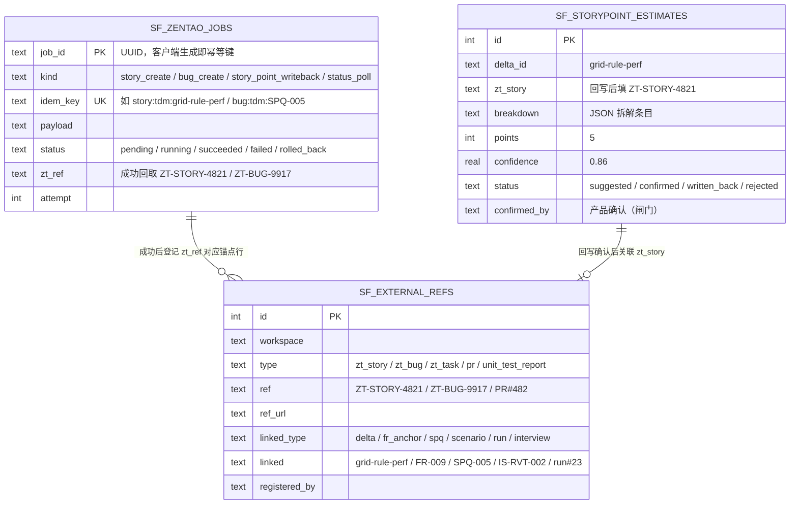
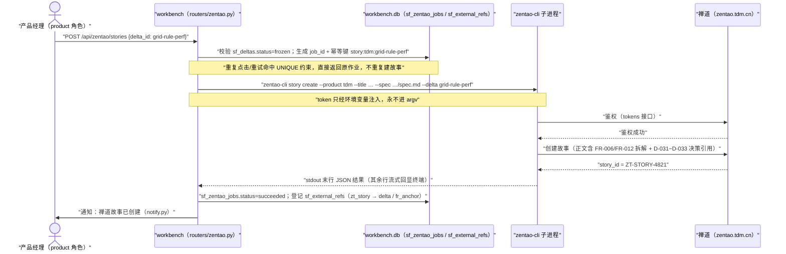

# M06 · 禅道集成（zentao-cli）详细设计

## 0. 模块卡

| 项 | 内容 |
|----|------|
| 模块名 | 禅道集成（ZenTao Integration via zentao-cli） |
| 原型屏 | S4 产出交付页签「🔗 出口：一键创建禅道故事」+ S5 报告→SPQ 页签「🐞 出口：一键提禅道 BUG」；S2 路线图 F3「zentao-cli 集成」 |
| 架构层 | L3 智能层（故事点评估 skill、复现步骤装配）+ L0 数据层（sf_external_refs 外部锚点登记、zentao-cli 进程调用） |
| 现状定性 | **新建**（仓库内无任何禅道对接代码；仅有 feedback/notify.py 通知出口可复用） |
| 里程碑映射 | F3（zentao-cli 集成：故事创建 + BUG 提单 + 外部锚点登记，随 RBAC）→ G2（故事点评估 skill 专业化） |
| 依赖模块 | M05（冻结 spec 是故事创建唯一输入）、M04（决策引用进故事正文）、M09（DAG 执行失败归因 → 提 BUG 入口①）、M10（血缘链外部节点呈现）、M12（harness/skill 加载与 RBAC） |
| 数据归属 | workbench.db `sf_external_refs` / `sf_zentao_jobs` 表 + `.specflow/` 冻结产物（只读消费）；**禅道侧资产归禅道，SpecGuard 只登记引用** |

## 1. 模块定位与职责

**解决什么问题**：spec 冻结之后，研发排期在禅道；测试发现缺陷之后，缺陷管理在禅道。SpecGuard 不做研发管理平台（铁律 8 的边界推论），但质量链必须能跨过去再跨回来——故事/BUG 编号作为**外部锚点**登记入血缘链，形成"spec ↔ 禅道故事双向锁定、BUG ↔ SPQ 双向链接、修复后回归验证闭环"。本模块用一条统一的 zentao-cli 通道承担所有出入禅道的动作。

**核心职责**：

1. zentao-cli 封装：故事创建（story create）、BUG 提单（bug create）、故事点回写（story update）、状态查询（story/bug get）四条命令的子进程封装，含凭据管理、幂等重试、失败回滚。
2. 故事创建出口：M05 冻结产物（spec.md 修订 + delta 代号 + proposal.md）→ 禅道故事，故事编号回登记 sf_external_refs。
3. 故事点评估 skill（zentao-story-point）：输入冻结 spec 的 FR 拆解 → 历史故事参照 + 置信度评估 → 输出故事点建议，**产品确认后才回写禅道**。
4. 提 BUG 双入口：入口① DAG 场景执行 FAIL 归因后一键提单，复现步骤自动装配（场景 flow given/when/then + run 执行证据）；入口② 手动测试手工录入复现步骤，同一条 zentao-cli 通道。
5. 关联与闭环：BUG ↔ 禅道故事关联、BUG ↔ SPQ 双向链接、禅道修复状态回查 → 触发 SpecGuard 回归验证 → SPQ 闭环。
6. sf_external_refs 外部锚点登记表：一切外部资产（禅道故事/BUG/task、PR、单测报告）的统一登记口，供 M10 血缘链呈现。

**不做什么（边界）**：

- 不管理禅道资产：不在 SpecGuard 内编辑/关闭/指派禅道对象（除故事点回写这一个经人确认的写字段）；**链可跨界，资产不跨界**（铁律 4）。
- 不做失败归因定性（M09），只消费其"疑似产品缺陷"结论作为提单依据。
- 不做冻结与三闸（M05），故事创建只接受 `status='frozen'` 的 delta。
- 不做研发任务拆解与排期（禅道侧的事），不做代码生成（铁律 8）。

## 2. 原型交互 → 功能拆解

### S4 产出交付页签（故事创建）

| 原型界面元素 | 功能点 | 后端支撑 | 现状 |
|--------------|--------|----------|------|
| `⚡ 演示：zentao-cli 创建禅道故事` 按钮 + 终端逐行输出 | 故事创建触发 + 流式执行回显 | REST 触发 + 子进程流式 stdout（复用 useRunStream 模式，已有） | 新建 |
| 终端 `$ zentao-cli story create --product tdm --title "绩效域落位规则调整" --spec specs/inventory/grid-placement/spec.md --delta grid-rule-perf` | 故事创建命令装配（spec 路径 + delta 代号入参） | zentao-cli 封装（新建）；冻结产物路径由 M05 导出 | 新建 |
| `✓ 鉴权成功 · 禅道 zentao.tdm.cn（token 已配置）` | 凭据管理：token 配置化注入，不落日志 | 凭据存储（settings_store.py 模式 + crypto.py，已有） | 半新建 |
| `✓ spec 双向锁定解析：FR-绩效域落位规则(改) + FR-落位名单刷新(增)` | 冻结 spec 的 FR 拆解（ADDED/MODIFIED 操作集 → 故事正文） | 解析 manifest（M05，specflow/delta/manifest.py） | 新建 |
| `✓ 禅道故事创建成功 → ZT-STORY-4821（模块：盘点/九宫格）` | 故事创建 + 编号回取 | zentao-cli story create 返回解析 | 新建 |
| `◆ skill「zentao-story-point」故事点评估中… 拆解：落位规则修改 2 点 + 名单刷新新增 2 点 + 级联影响面 1 点 → 故事点 5 · 置信度 0.86（参考历史故事 A-02-Δ=8 / A-01=3）` | 故事点评估 skill：FR 拆解 → 历史故事参照 → 故事点 + 置信度 | skill 文件（agent/skills/ 热加载，已有薄壳）+ 历史故事参照查询 | 新建 |
| `✓ 故事点 5 已回写禅道（待产品经理在禅道侧确认生效）` | 故事点回写：**产品确认才回写**（闸门） | story update 命令 + 人工确认记录 | 新建 |
| `✓ 外部锚点已登记 sf_external_refs：ZT-STORY-4821 → delta:grid-rule-perf` | 外部锚点登记 | sf_external_refs 表（新建） | 新建 |
| agent-strip 卡片「故事点评估 skill：输入 冻结 spec·FR 拆解 → 处理 历史故事参照·置信度评估 → 输出 故事点回写禅道·编号登记 sf_external_refs · 闸门 产品确认才回写」 | skill 四要素展示（输入/处理/输出/闸门） | 前端卡片组件 | 新建 |
| `→ 到血缘链查看已挂链的禅道故事节点（S6 · ② 研发阶段）` 跳转 | 血缘链外部节点（↗ 可跳转） | M10 血缘链视图消费 sf_external_refs | 新建（本模块供数据） |

### S5 报告→SPQ 页签（提 BUG）

| 原型界面元素 | 功能点 | 后端支撑 | 现状 |
|--------------|--------|----------|------|
| `⚡ 演示：zentao-cli 提 BUG（IS-RVT-002 失败）` | 入口①：DAG 执行 FAIL 归因后一键提单 | 归因结论（M09）+ run 报告（report_writer.py 产物，已有） | 新建 |
| 终端 `$ zentao-cli bug create --product tdm --title "落位后名单未刷新" --story ZT-STORY-4821 --severity 2 --opened-build trunk` | BUG 提单命令装配（故事关联 + 严重度 + 版本） | zentao-cli 封装 | 新建 |
| `✓ 复现步骤已装配 ← IS-RVT-002 场景 flow（given/when/then）+ run#23 执行证据` | 复现步骤自动装配：场景 doc 层 + 执行证据合成 steps 字段 | scenario_loader.py 读场景（已有）+ `.specguard/reports/` 执行记录（已有） | 新建（装配器） |
| `✓ 关联：场景 IS-RVT-002 · 报告 run#23 · FR-009 · 禅道故事 ZT-STORY-4821` | 四元关联（场景/报告/FR/故事） | sf_external_refs + SPQ 台账（feedback/ledger.py，已有） | 新建 |
| `✓ 禅道 BUG 创建成功 → ZT-BUG-9917（指派：九宫格模块负责人）` | 提单成功 + 指派映射 | zentao-cli 返回解析；模块→负责人映射配置 | 新建 |
| `◆ 手动测试入口同权：无场景时手工录入复现步骤，同一条 zentao-cli 通道提单` | 入口②：手工录入表单 → 同一命令通道 | 手工录入表单 + 复用 bug create 服务 | 新建 |
| `✓ BUG 编号已登记 sf_external_refs ↔ SPQ-005 双向链接` | BUG↔SPQ 双向链接 | sf_external_refs 双向引用 + SPQ 条目回挂 | 新建 |
| `⟳ SPQ-005 状态：pending → 已提禅道 BUG（修复后回归验证，闭环）` | SPQ 状态扩展 + 修复回归闭环 | ledger.py 状态机扩展（新增 zentao_filed 状态）+ 回查轮询 | 增强 |

## 3. 现状与差距

**已有能力（引用真实模块名）**：

- `feedback/ledger.py`（已有）：SPQ 台账状态机 pending→in_progress→closed——BUG↔SPQ 双向链接与"修复后回归闭环"的状态载体；本模块**扩展**其状态枚举（新增 `zentao_filed`），不改其语义。
- `feedback/notify.py`（已有）：通知出口——提单成功/故事创建成功/修复状态回查结果的通知复用此通道，不另建通知体系。
- workbench `services/settings_store.py` + `crypto.py`（已有）：配置存储与加密——禅道 token 凭据管理沿用同模式（DB 驱动热加载、加密落盘、环境变量覆盖）。
- workbench `services/notify_config.py`（已有）：通知配置。
- `scenario_loader.py`（已有）：场景 YAML 加载——复现步骤装配读取 doc 层 given/when/then 的事实源。
- `report_writer.py` / `execution_record.py`（已有）：run 报告产物落 `.specguard/reports/`——执行证据（响应/DB 快照/失败断言）的来源。
- `agent/skill_loader.py` + `skills/`（已有）：skill 热加载机制——zentao-story-point 以 frontmatter + Markdown 正文落地，零代码接入运行时。
- 前端 `useRunStream`（已有）：流式输出 hook——终端演示的逐行回显复用同模式（WebSocket/SSE）。
- MCP `mcp_server/` 工具模块范式（已有）：specflow 外部锚点查询工具按同范式新增模块。

**缺口清单（全部新建）**：

| # | 缺口 | 说明 |
|---|------|------|
| G1 | zentao-cli 本体 | 独立 CLI 包（`integrations/zentao/`），Python 实现禅道 REST API 调用，四命令 |
| G2 | zentao-cli 封装服务 `services/zentao/client.py` | 子进程调用、超时、幂等键、重试、回滚 |
| G3 | 凭据管理 | token 加密存储 + 注入子进程环境变量，禁止落日志 |
| G4 | `sf_external_refs` 表 + 登记/查询 API | 外部锚点统一登记口（M10 血缘链消费） |
| G5 | `sf_zentao_jobs` 幂等作业表 | 防重复提单/重复建故事 |
| G6 | 复现步骤装配器 `services/zentao/repro_builder.py` | 场景 doc 层 + run 证据 → 禅道 steps 格式 |
| G7 | 故事点评估 skill `agent/skills/zentao-story-point.md` + 历史故事参照缓存 | G2 阶段专业化 |
| G8 | REST 路由 `routers/zentao.py` + S4/S5 两个触发面板前端 | 双入口共用服务 |
| G9 | SPQ 状态机扩展 + 禅道修复状态回查器 | 回归验证闭环 |

## 4. 数据模型

### 4.1 SQLite 表（workbench.db，新建）

```sql
-- 外部锚点登记表（链可跨界，资产不跨界 —— 铁律 4；与 M10 血缘链口径一致）
CREATE TABLE sf_external_refs (
  id          INTEGER PRIMARY KEY AUTOINCREMENT,
  workspace   TEXT NOT NULL,
  type        TEXT NOT NULL CHECK(type IN
              ('zt_story','zt_bug','zt_task','pr','unit_test_report')),
  ref         TEXT NOT NULL,            -- ZT-STORY-4821 / ZT-BUG-9917 / PR#482
  ref_url     TEXT,                     -- 禅道侧可跳转 URL
  linked_type TEXT NOT NULL CHECK(linked_type IN
              ('delta','fr_anchor','spq','scenario','run','interview')),
  linked      TEXT NOT NULL,            -- grid-rule-perf / FR-009 / SPQ-005 / IS-RVT-002 / run#23
  note        TEXT,
  registered_by TEXT NOT NULL,          -- 登记人（或 'system:zentao-cli'）
  created_at  TEXT NOT NULL DEFAULT (datetime('now')),
  UNIQUE (workspace, type, ref, linked_type, linked)
);

-- zentao-cli 作业幂等表（防重复建故事/提单，崩溃可续）
CREATE TABLE sf_zentao_jobs (
  job_id      TEXT PRIMARY KEY,         -- UUID；客户端生成 = 幂等键
  kind        TEXT NOT NULL CHECK(kind IN ('story_create','bug_create','story_point_writeback','status_poll')),
  idem_key    TEXT NOT NULL UNIQUE,     -- 幂等键：如 story:tdm:grid-rule-perf / bug:tdm:SPQ-005
  payload     TEXT NOT NULL,            -- 命令参数 JSON（不含凭据）
  status      TEXT NOT NULL DEFAULT 'pending'
              CHECK(status IN ('pending','running','succeeded','failed','rolled_back')),
  cli_stdout  TEXT, cli_stderr TEXT,    -- 终端回显留档（凭据已脱敏）
  zt_ref      TEXT,                     -- 成功回取 ZT-STORY-4821 / ZT-BUG-9917
  attempt     INTEGER NOT NULL DEFAULT 0,
  created_by  TEXT NOT NULL,
  created_at  TEXT NOT NULL DEFAULT (datetime('now')),
  finished_at TEXT
);

-- 故事点评估记录（建议永远留痕，回写必须过人）
CREATE TABLE sf_storypoint_estimates (
  id          INTEGER PRIMARY KEY AUTOINCREMENT,
  workspace   TEXT NOT NULL,
  delta_id    TEXT NOT NULL,            -- grid-rule-perf
  zt_story    TEXT,                     -- 回写后填 ZT-STORY-4821
  breakdown   TEXT NOT NULL,            -- JSON: [{item:'落位规则修改',points:2},…]
  points      INTEGER NOT NULL,         -- 5
  confidence  REAL NOT NULL,            -- 0.86
  references  TEXT,                     -- JSON: [{story:'A-02-Δ',points:8},{story:'A-01',points:3}]
  status      TEXT NOT NULL DEFAULT 'suggested'
              CHECK(status IN ('suggested','confirmed','written_back','rejected')),
  confirmed_by TEXT, confirmed_at TEXT, -- 产品确认（闸门）
  created_at  TEXT NOT NULL DEFAULT (datetime('now'))
);
```

下面用 ER 图直观呈现本模块三张表的核心字段与关联（sf_external_refs 是 M10 血缘链的唯一数据源）：



### 4.2 zentao-cli 配置（凭据与实例）

```yaml
# workbench 设置存储（settings_store + crypto 加密），导出为子进程环境变量
zentao:
  base_url: https://zentao.tdm.cn
  product: tdm
  token: <加密落盘；亦可用 SG_ZENTAO_TOKEN 环境变量覆盖>
  module_map:                      # 模块 → 禅道模块路径 + 默认负责人
    grid-placement: {path: 盘点/九宫格, assignee: zhangsan}
  severity_map: {致命: 1, 严重: 2, 一般: 3, 轻微: 4}
  timeout_sec: 30
  retry: {max_attempts: 3, backoff: [2, 8, 20]}   # 指数退避
```

### 4.3 BUG↔SPQ 状态联动（ledger.py 扩展，增强）

```
SPQ: pending → in_progress → closed
                    │
                    └─扩展─> zentao_filed（已提禅道 BUG，挂 sf_external_refs 双向链接）
                                │ 禅道侧状态回查 = resolved/closed
                                ↓
                          触发回归验证（重跑关联场景，如 IS-RVT-002）
                                │ PASS                │ FAIL
                                ↓                     ↓
                          SPQ closed（闭环）    SPQ 回 in_progress + 通知（notify.py）
```

## 5. 接口设计

### 5.1 zentao-cli 命令行（integrations/zentao/，新建）

```bash
# 故事创建（原型 S4 终端演示原样命令）
zentao-cli story create --product tdm --title "绩效域落位规则调整" \
    --spec specs/inventory/grid-placement/spec.md --delta grid-rule-perf
# 出参（stdout 末行 JSON）：{"story_id":"ZT-STORY-4821","url":"…","module":"盘点/九宫格"}

# 故事点回写（产品确认后）
zentao-cli story update --id ZT-STORY-4821 --points 5

# BUG 提单（原型 S5 终端演示原样命令）
zentao-cli bug create --product tdm --title "落位后名单未刷新" \
    --story ZT-STORY-4821 --severity 2 --opened-build trunk \
    --steps-file /tmp/repro-SPQQ005.md --assignee zhangsan
# 出参：{"bug_id":"ZT-BUG-9917","url":"…"}

# 状态回查（回归闭环轮询）
zentao-cli bug get --id ZT-BUG-9917        # {"status":"resolved",…}
zentao-cli story get --id ZT-STORY-4821
```

约定：凭据只经环境变量（`SG_ZENTAO_TOKEN` / `ZENTAO_BASE_URL`）注入子进程，**永不进 argv**（防 ps 泄漏与日志留痕）；stdout 末行固定 JSON 结果，其余行为人类可读进度（终端演示逐行回显的来源）。

### 5.2 REST API（新增 `routers/zentao.py`，RBAC；`X-SG-Workspace` 透传）

| 方法 | 路径 | 关键入参 | 出参要点 | 闸门 |
|------|------|----------|----------|------|
| POST | `/api/zentao/stories` | `{delta_id, title?}` | `{job_id, story_id}` 流式 stdout 走 WS | delta 必须 `status='frozen'`（M05），否则 403 |
| POST | `/api/zentao/stories/{id}/estimate-points` | `{delta_id}` | `{points:5, confidence:0.86, breakdown[], references[]}` | skill 建议，落 `sf_storypoint_estimates(suggested)` |
| POST | `/api/zentao/stories/{id}/writeback-points` | `{estimate_id}` | 回写结果 | **仅 product 角色确认后调** |
| POST | `/api/zentao/bugs/from-run` | `{run_id, scenario_id, severity, title?}` | `{job_id, bug_id}` | 入口①：要求该场景 verdict=FAIL 且归因定性=疑似产品缺陷（M09） |
| POST | `/api/zentao/bugs/manual` | `{title, steps, severity, story_id?, fr_ref?}` | `{job_id, bug_id}` | 入口②：手工录入，同一服务同一命令 |
| GET | `/api/zentao/jobs/{job_id}` | — | 作业状态 + 终端行 | 终端回显/审计 |
| GET | `/api/zentao/refs?linked_type=spq&linked=SPQ-005` | 组合过滤 | 外部锚点数组 | 血缘链/面板数据源（M10 同用） |
| POST | `/api/zentao/refs` | `{type, ref, linked_type, linked, note}` | 登记行 | 手工登记外部资产（PR/单测等） |
| GET | `/api/zentao/bugs/{id}/poll` | — | 禅道侧状态；resolved → 触发回归建议 | 闭环回查 |

### 5.3 MCP 工具（新增 `mcp_server/tools/specflow_refs.py`）

| 工具 | 参数 | 返回 | 约束 |
|------|------|------|------|
| `sf_list_external_refs` | `linked_type?, linked?` | 锚点数组 | 纯读 |
| `sf_register_external_ref` | 四元组 + note | 登记行 | 写但低风险（仅登记引用，不触禅道） |
| `sf_get_zentao_job` | `job_id` | 作业状态 | 纯读 |

> story/bug 创建与故事点回写**不暴露给 MCP**——触外部系统的写动作必须人在 UI/REST 确认（铁律 1/4）。

### 5.4 故事点评估 skill（agent/skills/zentao-story-point.md，新建）

```markdown
---
description: 禅道故事点评估（冻结 spec FR 拆解 → 故事点 + 置信度）
trigger: 冻结 spec 创建禅道故事后 / 手动请求评估
tools: [sf_read_draft, sf_list_external_refs, sf_check_conformance]
---
输入：冻结 spec（delta-spec.md + manifest）的 FR 拆解（ADDED/MODIFIED 操作集）。
处理：① 按操作拆条目并逐条估点（修改 2 点 / 新增 2 点 / 级联影响面 1 点 为经验基线，可调）；
② 参照历史故事（sf_external_refs 中同模块 zt_story 及其点数，如 A-02-Δ=8 / A-01=3）校准；
③ 输出总点数 + 置信度（拆解条目数、历史参照覆盖率、边界异常维度分共同决定）。
输出：sf_storypoint_estimates(status=suggested) + 终端汇报。
红线：评估永远是建议；回写禅道必须产品确认（POST writeback-points，MCP 不可达）。
```

## 6. 关键流程

### 6.1 故事创建主路径（S4 demoZentao() 终端时序 → 真实时序）

1. 前置：M05 冻结完成（`sf_deltas.status='frozen'`，grid-rule-perf），导出包就绪。
2. 产品经理在产出交付页签点「zentao-cli 创建禅道故事」→ `POST /api/zentao/stories {delta_id}`；服务端校验冻结状态，生成 `job_id` + 幂等键 `story:tdm:grid-rule-perf`（重复点击/重试命中 UNIQUE 约束直接返回原作业，**不会重复建故事**）。
3. 装配命令：`zentao-cli story create --product tdm --title "绩效域落位规则调整" --spec …/spec.md --delta grid-rule-perf`；token 经环境变量注入。
4. 鉴权：CLI 请求禅道 `tokens` 接口 → 终端行 `✓ 鉴权成功 · 禅道 zentao.tdm.cn`。
5. 双向锁定解析：读取 delta.manifest.yaml operations → FR-006(MODIFIED) + FR-012(ADDED) → 故事正文（含 FR 锚点、决策引用 D-031~D-033、proposal 摘要）。
6. 创建成功，解析返回 `ZT-STORY-4821` → `sf_zentao_jobs.status='succeeded'`。
7. 触发故事点评估 skill（流式输出 `◆ skill「zentao-story-point」…`）：FR 拆解 2+2+1=5 点、置信度 0.86、参照 A-02-Δ=8/A-01=3 → 落 `sf_storypoint_estimates(suggested)`。
8. 产品经理确认 → `POST writeback-points`（product 角色）→ `zentao-cli story update --points 5` → 终端行 `✓ 故事点 5 已回写禅道（待产品经理在禅道侧确认生效）`。
9. 外部锚点登记：`sf_external_refs` 写入 `(zt_story, ZT-STORY-4821) → (delta, grid-rule-perf)` + `(fr_anchor, FR-006/FR-012)` 两条细分链；终端行 `⟳ 血缘链已挂链`。
10. notify.py 推送「禅道故事已创建」通知；M10 血缘链视图出现可跳转的 ZT-STORY-4821 外部节点（↗）。

下面用时序图直观呈现 zentao-cli 幂等建故事的跨系统交互：



### 6.2 提 BUG 主路径（S5 demoZentaoBug() 终端时序 → 真实时序）

**入口①（DAG 执行 FAIL 归因）**：

1. 前置：run#23 执行报告落盘，IS-RVT-002 FAIL；M09 归因 Agent 建议"诚实 FAIL · 疑似产品缺陷"，人拍板建 SPQ-005（ledger.py）。
2. 测试人员在报告页点「一键提禅道 BUG」→ `POST /api/zentao/bugs/from-run {run_id:23, scenario_id:'IS-RVT-002', severity:2}`；服务端校验 verdict=FAIL + 归因定性，幂等键 `bug:tdm:SPQ-005`。
3. 复现步骤装配器（repro_builder.py）：scenario_loader 读 IS-RVT-002 doc 层 given/when/then + run#23 执行证据（失败断言、响应快照、DB 校对结果）→ 生成 steps 文件。
4. 装配命令：`zentao-cli bug create --product tdm --title "落位后名单未刷新" --story ZT-STORY-4821 --severity 2 --opened-build trunk --steps-file …`（--story 由 SPQ-005 关联 delta（grid-rule-perf）经 sf_external_refs 反查得到，与 §6.1 步骤 9 的登记口径一致）。
5. 提单成功 → `ZT-BUG-9917`，按 module_map 指派九宫格模块负责人。
6. 双向链接：`sf_external_refs` 写入 `(zt_bug, ZT-BUG-9917) → (spq, SPQ-005)` 及 `(scenario, IS-RVT-002)`、`(run, run#23)`、`(fr_anchor, FR-009)` 关联行；SPQ-005 状态 → `zentao_filed`。
7. notify.py 推送；M10 血缘链出现 ZT-BUG-9917 节点（S6 ④ 反哺闭环段）。

**入口②（手动测试）**：测试人员在「手动测试」表单录入标题/复现步骤/严重度/关联故事（可选）→ `POST /api/zentao/bugs/manual` → **同一条 zentao-cli 通道**、同一幂等/重试/登记管线；无场景时 steps 直接采用手工录入文本。

**回归闭环**：调度器周期 `bug get` 回查（或手工点 poll）→ 禅道侧 resolved → notify.py 提醒「ZT-BUG-9917 已修复，建议回归 IS-RVT-002」→ 重跑 PASS → SPQ-005 closed，血缘链反哺段闭环（SPQ 入下轮面试信息包，见 M03/M04）。

### 6.3 失败与回滚路径

- CLI 非零退出 / 超时：作业 `failed`，stderr 留档；按 backoff 重试（同一 job_id、同一幂等键，不产生第二单）。
- 创建成功但回写/登记阶段崩溃：重启后扫描 `succeeded` 但缺 sf_external_refs 的作业补登记（对账任务，幂等键 UNIQUE 保底）。
- 故事点回写失败：故事本体保留（不回滚删除，资产在禅道），作业标 `failed` 由人处理——**回滚只回滚 SpecGuard 侧登记，不删禅道资产**。

## 7. 闸门与确定性校验

| 闸门/校验 | 类型 | 实现 | 呼应铁律 |
|-----------|------|------|----------|
| 故事创建前置 | 确定性 | delta `status='frozen'` 硬校验，未冻结 403 | 铁律 3：冻结产物才可出闸 |
| 故事点回写 | 人工闸门 | estimate 永远 suggested；`writeback-points` 仅 product 角色；MCP 不暴露 | 铁律 1：Agent 只建议，人拍板（原型"产品确认才回写"） |
| 提 BUG 入口① 前置 | 确定性 | run verdict=FAIL + 归因为人拍板的"疑似产品缺陷"；SKIP/BLOCKED（环境问题）禁止提单 | 铁律 7：诚实结果语义 |
| 幂等防重 | 结构性 | `sf_zentao_jobs.idem_key` UNIQUE + 作业重入返回原单 | 铁律 2（机制保证而非自觉） |
| 凭据安全 | 结构性 | token 加密落盘（crypto.py）/环境变量覆盖；只经环境变量注入子进程；stdout/stderr 留档前脱敏 | — |
| 资产边界 | 结构性 | SpecGuard 侧只有 sf_external_refs 登记行；任何禅道资产编辑/删除无对应 API | 铁律 4：链可跨界，资产不跨界 |
| BUG↔SPQ 一致性 | 确定性 | `zentao_filed` 状态必须存在对应 sf_external_refs 双向行，否则对账 WARNING | 血缘链 ID 脊柱（见 M10） |
| 回归闭环诚实 | 确定性 | 回归以场景真实重跑结果为准（PASS 才允许 SPQ closed），不接受"禅道已关"直接闭环 | 铁律 7 |

## 8. 依赖与边界

**上游**：

- M05：冻结 delta 与导出包是故事创建的唯一合法输入；manifest 提供 FR 拆解。
- M04：决策引用（D-031~D-033）进故事正文；评分/门禁与本模块无直接耦合。
- M09：归因定性结论（疑似产品缺陷）是入口① 的提单依据；本模块不做归因。
- M12：harness/skill 加载、RBAC 角色、WebSocket 流式基建。
- M13：zt 反查对外只读面（refs_query，经 sf_external_refs 同表同源）见 M13；禅道写不开放按「外部写不进 MCP」通则执行。

**下游**：

- M10（血缘链）：sf_external_refs 是禅道故事/BUG 外部节点的唯一数据源，呈现为可跳转节点（↗），口径与 M10 一致（同一张表，不另建副本）。
- M11（图谱索引）：external_refs 登记行派生 `references` 边入索引（确定性派生）。
- M03（材料包）：未闭环 SPQ 的禅道 BUG 状态可随信息包装配进下轮面试。

**不承担的职责**：禅道侧项目管理（排期/指派流转/关闭）、研发资产管理（PR/单测归业务项目，仅登记引用）、代码生成（铁律 8）、归因定性（M09）、血缘链可视化（M10）。**明确红线：SpecGuard 不膨胀成研发管理平台。**

## 9. 里程碑映射与验收标准

| 阶段 | 内容 | 可检验的验收标准 |
|------|------|------------------|
| **F3**（zentao-cli 集成，随 RBAC product 角色） | zentao-cli 四命令 + 封装服务（凭据/幂等/重试）+ 故事创建出口 + 提 BUG 双入口 + sf_external_refs + SPQ 状态扩展 | ① 重放 S4 演示：冻结 grid-rule-perf 后建故事，终端行序列与原型一致（鉴权→双向锁定解析→创建成功→登记），sf_external_refs 落行正确；② 同一 delta 重复调建故事接口，返回同一 job、禅道侧仅一个故事（幂等）；③ 重放 S5 演示：run#23/IS-RVT-002 提单，steps 文件含场景 given/when/then 与执行证据，ZT-BUG 与 SPQ-005 双向链接成行；④ 手动入口提单与入口① 走同一 service 函数（代码级断言）；⑤ SKIP/BLOCKED 场景调 from-run 返回 403；⑥ 非 product 角色调 writeback-points 返回 403；⑦ token 不出现在任何日志/argv（日志扫描断言） |
| **F3 闭环** | 禅道状态回查 + 回归触发 + notify 通知 | ① 模拟禅道侧 resolved → 收到回归建议通知；② 回归重跑 PASS 后 SPQ 自动 closed，FAIL 回 in_progress；③ 对账任务能补登崩溃窗口期的 external_refs |
| **G2**（故事点评估 skill 专业化） | 历史故事参照库 + 置信度模型调优 + 评估留痕审计 | ① 对 grid-rule-perf 评估输出 5 点 + 置信度 + 参照清单（含 A-02-Δ/A-01 类历史故事）；② 未确认时 sf_storypoint_estimates 恒为 suggested 且禅道侧点数不变；③ 评估-确认-回写三步在审计日志可串联 |

**验收通用红线**：任何触禅道的写动作（建故事/提单/回写点数）审计日志含工号 + job_id + 幂等键三要素；sf_external_refs 与 M10 血缘链视图同表同源，禁止第二份外部资产台账。
