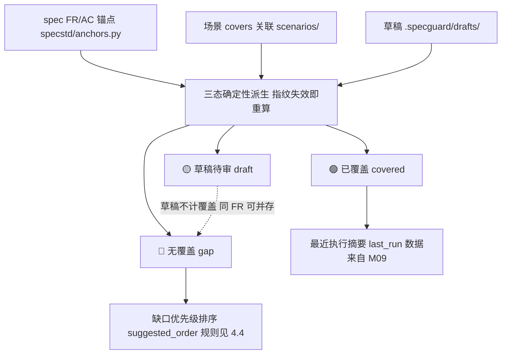
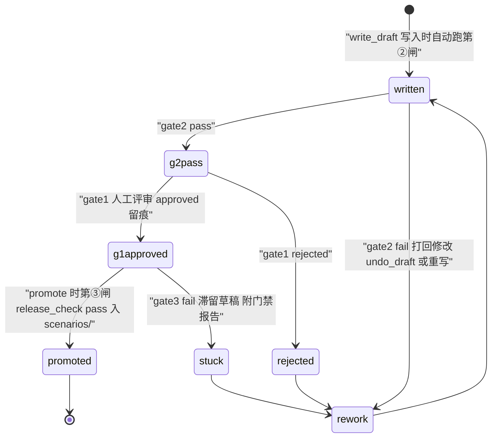

# M07 · 覆盖缺口与场景生成 详细设计

> 原型：S5 测试工作台「覆盖缺口」页签（含「草稿三闸」页签的生成侧）· L1 引擎层 + L3 智能层 · 增强
> 事实源：《SpecGuard 技术架构》2026-07-31 快照、specflow 设计方案、汇报原型 S5

---

## 0. 模块卡

| 项 | 内容 |
|----|------|
| 模块名称 | 覆盖缺口与场景生成（Coverage Gap & Scenario Generation） |
| 原型屏 | S5「覆盖缺口」页签（三泳道看板 + 「⚙ 生成下一批」）；联动「草稿三闸」页签 |
| 架构层 | L1 引擎层（covers/草稿/门禁）+ L3 智能层（generate 模式与 skill）+ L4 工作台（缺口视图） |
| 现状定性 | **增强**：covers 关联门禁、草稿通道、发布门禁、generate-scenario skill 均已有；缺口聚合视图、优先级排序、批量生成编排新建 |
| 里程碑映射 | F1（covers 门禁/草稿三闸已有，补强）→ G1（覆盖缺口视图）→ G2（批量生成编排深化） |
| 依赖模块 | M05（冻结 spec 基线与 delta）、M08（DAG 批次编排）、M11（缺口图谱化呈现）、M12（Agent 运行时） |

## 1. 模块定位与职责

**解决什么问题**：测试侧消费冻结 spec 基线时，「哪些 FR 有场景覆盖、哪些是缺口、哪些只有草稿」必须一眼可见；缺口按确定性优先级排序；Agent 可针对缺口 FR 生成场景草稿，但**入库永远过人**——草稿三道闸（人工评审 → 格式校验 → 发布门禁）全过前不可 promote。

**核心职责**：

1. 覆盖状态聚合：以 spec FR/AC 锚点为行、场景 `covers` 为列，计算 🔴 无覆盖 / 🟡 草稿待审 / 🟢 已覆盖三态；
2. 缺口优先级排序：确定性规则（本期 delta 新增 > P0 阻塞 > 历史缺口），给出补齐顺序建议；
3. 场景草稿生成：衔接 generate 模式 + generate-scenario skill，产出格式 2.0 双层 YAML 草稿；
4. 草稿三道闸状态机：① 人工评审（人拍板）→ ② 格式校验（确定性）→ ③ 发布门禁（release_check 入库自动跑）；
5. 「生成下一批」：按缺口圈定 FR 集合批量产草稿，**只产草稿、不建计划**（计划只能由 delta 导入生成，铁律 6）。

**不做什么（边界）**：

- 不做 DAG 拓扑编排与批次执行调度 —— 见 M08；
- 不做覆盖缺口的图谱化/星座图呈现 —— 见 M11（本模块输出数据供其消费）；
- 不做 spec 生产与冻结 —— 见 M02/M05；
- 不做执行结果归因 —— 见 M09；
- Agent 不得绕过三闸直接写 `scenarios/` —— 这是红线，不是可配置项。

## 2. 原型交互 → 功能拆解

| 原型界面元素（S5） | 功能点 | 后端支撑 | 已有/新建 |
|---|---|---|---|
| 三泳道看板 🔴 无覆盖 5 / 🟡 草稿待审 2 / 🟢 已覆盖 3 | FR 覆盖状态聚合视图（真实基线 `specs/system-settings/inventory-activity` 13 FR） | 覆盖矩阵计算（`covers_gate.py` 锚点扫描）+ 缺口聚合服务 | 已有：`covers_gate.py`、场景 `covers` 字段；**新建**：三态聚合 API 与泳道投影 |
| FR 卡片点击 → backlink 信息条（「covers ← IS-RVT-001/002/003」「covers ← 草稿 d-118（未入库，不计覆盖）」） | 计算型反向链接：FR → 场景/草稿/最近执行 | backlink 查询服务（从 covers + drafts + reports 派生，不落库） | **新建** |
| 会话建议「① FR-012 → ② FR-005/006 → ③ FR-001」 | 缺口优先级排序建议（delta 新增 P0 阻塞 > 历史缺口 > 边界冲突） | 确定性排序器 + Agent 话术包装 | **新建**（排序器确定性）；已有：AgentChat 会话壳 |
| 「要我为 FR-012 生成草稿吗？」→ 用户确认 | 单 FR 草稿生成 | generate 模式 + generate-scenario skill + `spec_reader.read_spec` + `scenario_tools.next_scenario_id`（generate 能力在模式移除后由 skill/purpose 承载，见 M01/M12；generate-scenario skill 不受影响） | 已有：`agent/modes/`、`agent/skills/generate-scenario`、MCP `spec_reader`/`scenario_tools` |
| 「⚡ 演示：生成草稿」按钮 → d-118 出现并自动切到「草稿三闸」页签 | 草稿生成 + 草稿落盘 + 面板联动 | `draft_writer.write_draft`（MCP）→ `.specguard/drafts/` | 已有：`mcp_server` draft_writer 4 工具；**新建**：工作台面板联动事件 |
| d-118 / d-121 卡片徽章「① 人工评审 ● 待评审 / ② 格式校验 ✓ / ③ 发布门禁 ⏸」 | 草稿三闸状态机（逐闸状态、评审人留痕） | 闸门状态持久化 + `draft_promote.py` 晋升通道 | 已有：`draft_promote.py`、drafts router；**新建**：逐闸状态字段与评审 API |
| d-118 YAML 预览（格式 2.0：doc 层 + `covers: [FR-012]` + flow/verify + `depends_on {mode: exclusive, version: ^0}`） | 草稿 YAML 预览（格式权威渲染） | `format_spec.py`（格式规范唯一权威，动态生成） | 已有：`format_spec.py`；前端 Monaco 高亮（已有技术栈） |
| 格式校验明细「格式 2.0 ✓ 锚点存在 ✓ covers 标签 ✓」 | 第②闸：确定性格式校验报告 | `validator.validate`（MCP）+ `covers_gate.py` 锚点校验 | 已有：`mcp_server` validator、covers_gate |
| 「⚙ 生成下一批（按缺口优先级：FR-012 → FR-005/006 → FR-001）」→ 圈定 4 FR 产 4 份草稿 | 批量草稿生成编排：圈定 → 逐 FR 生成 → 全部入草稿通道 | 批量编排服务（调 generate skill N 次，产出全部走三闸） | **新建**（编排）；已有：底层生成与草稿通道 |
| 「source_delta ← extend-void-scope · covers 锚点校验 ✓」 | 产物落笔即挂链：草稿必带 `source_delta` + `covers` | 草稿 YAML schema 扩展 + 挂链确定性校验 | **新建**（字段与校验）；已有：covers 门禁机制 |
| 「三道闸全过前不可 promote（Agent 不会自己入库）」 | promote 前置硬校验 | `draft_promote.py` + `release_check.py` 三项门禁 | 已有：`release_check.py`（格式/环/契约指纹） |

## 3. 现状与差距

### 3.1 已有能力（真实模块名）

- **covers 锚点机制（L0/L1）**：场景双层 YAML 的 doc 层 `covers: [FR-xxx]` 是场景 ↔ spec FR/AC 锚点的**强制关联**，是 DAG 编排的前置铁律；`scenario_loader.py` 加载解析，`tool_registry.py` 注册体系不感知 covers（纯数据层语义）。
- **covers 关联门禁（L4）**：`workbench/backend/services/covers_gate.py` —— covers 校验与覆盖矩阵基础；`spec_baseline.py` 提供 spec 基线读取；`spec_validator.py` 提供合规校验入口。
- **草稿通道（L3/L4）**：MCP `draft_writer` 4 工具（`write_draft` / `promote_draft` / `promote_drafts` / `undo_draft`）；工作台 drafts router + `services/draft_promote.py` 晋升通道；草稿落各工作区 `.specguard/drafts/`。
- **发布门禁（L1）**：`release_check.py` 三项门禁（格式 / 环 / 契约指纹），`python release_check.py` 全 PASS 才允许入库；`contracts_baseline.json` 为比对基准。
- **格式规范权威（L4）**：`format_spec.py` 由引擎注册表动态生成格式 2.0.0 规范，文档快照仅是导出。
- **生成能力（L3）**：`agent/modes/` 的 generate 模式 + `agent/skills/generate-scenario` skill（正文注入 `<skills>` XML 块，30s TTL 热加载；generate 能力在模式移除后由 skill/purpose 承载，见 M01/M12，generate-scenario skill 不受影响）；MCP `spec_reader.read_spec` / `list_spec_files` 读冻结 spec，`scenario_tools.next_scenario_id` 取号、`edit_dependency` 改依赖、`validator.validate` 校验。
- **前端（L4）**：AgentChat 统一会话入口、Drafts 页面、SpecValidation 页面均已在 16 页清单中。

### 3.2 缺口清单（全部新建）

| # | 缺口 | 说明 |
|---|------|------|
| G-1 | 覆盖缺口聚合服务 | 把 covers_gate 的校验能力升级为**三态投影**（无覆盖/草稿待审/已覆盖），按工作区 + spec 模块聚合，供 S5 泳道与 M11 图谱复用 |
| G-2 | 缺口优先级排序器 | 确定性规则排序（见 4.4），输出建议顺序；Agent 只负责把排序结果翻译成人话，不得自行重排 |
| G-3 | 草稿三闸状态机持久化 | 现有 drafts 只有「草稿/晋升」两态，缺逐闸状态（gate1 评审人+时间戳、gate2 校验报告、gate3 门禁结果） |
| G-4 | 草稿 `source_delta` 挂链字段 | 血缘链铁律「产物落笔即挂链」：草稿必带来源 delta，缺失 → 合规 WARNING |
| G-5 | 「生成下一批」批量编排 | 圈定 FR 集合 → 逐 FR 调生成 → 批量写草稿；全程 deterministic，产物全部进三闸 |
| G-6 | FR backlink 查询 | 计算型反向链接（场景/草稿/最近 run），只读派生，不落库不回写 spec |
| G-7 | 工作台覆盖缺口面板 | S5 泳道看板前端组件（复用 AgentChat 右侧 panel 壳） |

## 4. 数据模型

### 4.1 覆盖聚合（派生物，不落库）

覆盖状态**永远从源数据确定性派生**：spec 锚点（`specstd/anchors.py`）× 场景 covers（`scenarios/`）× 草稿（`.specguard/drafts/`）。遵循图谱红线——删掉重建必须得到同一结果。运行时允许进程内缓存，键 = 工作区 + 模块 + 源数据指纹（`specstd/signature.py`），指纹失效即重算。

```json
// GET /api/coverage/gaps 响应元素（示例：inventory-activity）
{
  "module": "system-settings/inventory-activity",
  "fr_total": 13,
  "lanes": {
    "gap":   [{"fr": "FR-012", "name": "作废级联逻辑删除", "reason": "delta_new_p0", "source_delta": "extend-void-scope"},
              {"fr": "FR-005", "name": "DRAFT→ACTIVE 单向流转", "reason": "history"}],
    "draft": [{"fr": "FR-012", "draft_id": "d-118", "scenario_id": "IA-VOID-001", "gates": {"g1": "pending", "g2": "pass", "g3": "blocked"}}],
    "covered": [{"fr": "FR-012@inventory-session", "scenarios": ["IS-RVT-001","IS-RVT-002","IS-RVT-003"], "last_run": {"run_id": 23, "verdict": "FAIL"}}]
  },
  "suggested_order": ["FR-012", "FR-005", "FR-006", "FR-001"],
  "fingerprint": "sha256-12 of anchors+covers+drafts"
}
```

注意原型语义：**草稿不计覆盖**（🟡 泳道与 🔴 缺口可同 FR 并存，d-118 未入库前 FR-012 仍是缺口）；「已覆盖」泳道同时展示相邻功能点已覆盖项作为参照。

下图示意覆盖三态的确定性派生关系与泳道投影：



### 4.2 草稿三闸状态表（SQLite workbench.db，新建）

```sql
CREATE TABLE sg_draft_gates (
  draft_id       TEXT PRIMARY KEY,        -- d-118（与 .specguard/drafts/ 文件名对应）
  workspace      TEXT NOT NULL,
  scenario_id    TEXT NOT NULL,           -- IA-VOID-001
  covers_json    TEXT NOT NULL,           -- ["FR-012"]
  source_delta   TEXT,                    -- extend-void-scope；缺失 → 挂链 WARNING
  gate1_status   TEXT NOT NULL DEFAULT 'pending',   -- pending/approved/rejected
  gate1_reviewer TEXT, gate1_comment TEXT, gate1_ts TEXT,
  gate2_status   TEXT NOT NULL DEFAULT 'pending',   -- pending/pass/fail（write 时自动跑）
  gate2_report   TEXT,                    -- JSON：格式2.0/锚点存在/covers 标签 逐项结果
  gate3_status   TEXT NOT NULL DEFAULT 'blocked',   -- blocked/pass/fail（promote 时自动跑）
  promoted_at    TEXT,                    -- 三闸全过后 draft_promote 成功时间
  created_by     TEXT NOT NULL,           -- agent:<session> 或 emp 工号
  created_at     TEXT NOT NULL
);
```

状态机：

```
write_draft ──自动②──> [g2 pass] ──人评审①──> [g1 approved] ──promote──> release_check ③
                                                              │              │ pass → promoted（入 scenarios/）
              ② fail → 打回修改（undo_draft 或重写）            │ rejected     │ fail → 滞留草稿，附门禁报告
```

闸门语义说明（与原型一致）：② 格式校验在草稿写入时**自动先跑**（所以 d-118 展示「② ✓ / ① 待评审」），但**生效顺序**是①人拍板 → ③发布门禁；三闸全过前 `promote_draft` 一律拒绝。

下面的状态图与上方文字版状态机一一对应，展示 `sg_draft_gates` 的三闸流转：



### 4.3 草稿文件布局（沿用已有约定）

```
{workspace}/.specguard/drafts/
├── d-118.IA-VOID-001.yaml     # 草稿场景（格式 2.0 双层 YAML）
├── d-121.IA-NAME-409.yaml
└── _index.json                # 草稿索引（draft_id ↔ 文件 ↔ gates 快照，由 sg_draft_gates 重建）
```

草稿 YAML 在场景格式 2.0 基础上新增两个挂链字段（新建，向后兼容）：

```yaml
id: IA-VOID-001
title: 作废活动级联逻辑删除（会话→人员→快照→结果表）
covers: [FR-012]              # 已有强制字段
source_delta: extend-void-scope   # 新建：血缘挂链，缺失 → 合规 WARNING
source: {kind: agent, session: <session_id>, suggested_by: gap-order}   # 新建：生成溯源
doc: {given: ..., when: ..., then: ...}
depends_on:
  - {id: IS-PREP-003, mode: exclusive, version: ^0}
flow: [...]
verify: [...]
```

### 4.4 缺口优先级排序规则（确定性，新建）

排序器输入 = 缺口 FR 集合 + delta manifest + 决策台账 P0 标记；规则按优先级降序：

1. **本期 delta 新增且 P0 阻塞**（如 FR-012 ← extend-void-scope，决策台账 P0）→ 权重 100；
2. **本期 delta 修改触及** → 权重 80；
3. **历史缺口且被活跃场景相邻引用**（状态机主干，如 FR-005/FR-006）→ 权重 50；
4. **历史缺口·边界/冲突类**（如 FR-001 重名 409、FR-010 乐观锁）→ 权重 30；
5. 同权重按 FR 编号升序（稳定输出，保证演示与复算一致）。

输出 `suggested_order` 仅作建议；用户可在「生成下一批」弹层手工增删 FR，但最终圈定集合落审计。

## 5. 接口设计

### 5.1 REST API（工作台 FastAPI :9100，前缀随现有 router 风格）

| 方法 | 路径 | 说明 | 关键入参 | 关键出参 |
|---|---|---|---|---|
| GET | `/api/coverage/gaps?module=system-settings/inventory-activity` | 三态缺口聚合（新建） | module（缺省全模块）；workspace 走 `X-SG-Workspace` header | 4.1 结构：lanes / suggested_order / fingerprint |
| GET | `/api/coverage/backlink/{fr_id}` | FR 反向链接（新建，只读派生） | fr_id | `{scenarios[], drafts[], recent_runs[], deltas[]}` |
| POST | `/api/coverage/next-batch` | 「生成下一批」批量草稿（新建） | `{module, frs[], source_delta}` | `{batch_id, drafts:[d-118…], rejected[]}`（异步任务，轮询/WS 推送） |
| GET | `/api/drafts?lane=pending` | 草稿列表（已有 drafts router，扩展三闸字段） | 状态过滤 | 草稿 + gates 三态 |
| GET | `/api/drafts/{draft_id}/yaml` | 草稿 YAML 预览（已有能力扩展） | — | 原始 YAML 文本（Monaco 渲染） |
| POST | `/api/drafts/{draft_id}/review` | 第①闸人工评审（新建） | `{decision: approved/rejected, comment}` | 更新 gate1，留痕 reviewer+ts |
| POST | `/api/drafts/{draft_id}/promote` | 晋升（已有 `draft_promote.py`，加三闸前置校验） | — | 成功 → 入 `scenarios/` + contracts_baseline 更新；失败 → 门禁报告 |
| POST | `/api/drafts/{draft_id}/revalidate` | 重跑第②闸（新建） | — | gate2 逐项报告 |

RBAC：gaps/backlink 只读（tester+）；review/promote 需 tester 及以上；全部挂 `Depends(get_current_user)`。

### 5.2 MCP 工具（stdio，已有为主）

| 工具 | 状态 | 用途 |
|---|---|---|
| `spec_reader.read_spec` / `list_spec_files` | 已有 | 生成前读冻结 spec 锚点（如 FR-012 级联范围） |
| `scenario_tools.next_scenario_id` | 已有 | 取场景号（IA-VOID-001） |
| `scenario_tools.list_scenarios` / `read_scenario` | 已有 | 复用参照（IS-PREP-002/003 数据准备场景） |
| `draft_writer.write_draft` | 已有 | 写草稿（触发 gate2 自动校验——新增挂钩） |
| `draft_writer.promote_draft` / `promote_drafts` / `undo_draft` | 已有 | 晋升/撤销（promote 前置改为读 sg_draft_gates） |
| `validator.validate` | 已有 | 第②闸确定性校验器（纯读无副作用约束不变） |
| **新建**：`coverage.query_gaps` | 新建（挂 scenario_tools 或独立模块） | Agent 侧查询缺口与建议顺序，与 REST 同一服务实现 |

### 5.3 Agent 侧衔接

- **generate 模式 + generate-scenario skill（已有）**：单 FR 生成的执行体；skill 正文补充「缺口语境」章节（当前缺口泳道摘要 + 建议顺序 + 数据复用提示 IS-PREP-002/003），经 `<skills>` XML 块注入。generate 能力在模式移除后由 skill/purpose 承载（见 M01/M12），generate-scenario skill 不受影响。
- **批量编排（新建）**：`services/coverage_batch.py` 循环调用生成管线（不新开 N 个会话，单会话内逐 FR 生成），每个产出独立 `write_draft`；任一失败不阻塞其余，结果汇总进 next-batch 响应。
- **「冻结→生成场景草稿」跳转入口（F3，见 M05）**：需求侧冻结 delta 后可一键跳到本模块 next-batch（预填 source_delta + 触及 FR 集合），不做自动串联。

## 6. 关键流程（原型演示主路径）

**路径 A：单 FR 生成草稿（「演示：生成草稿」按钮）**

1. 测试人员在覆盖缺口泳道看到 🔴 5 个无覆盖 FR；AgentChat 内 Agent 给出建议顺序：① FR-012（extend-void-scope 本期新增，P0 回归阻塞）② FR-005/FR-006 ③ FR-001，并提示数据准备可复用 IS-PREP-002/003（exclusive 实例）；
2. 用户点「⚡ 演示：生成草稿」（等价于发送「为 FR-012 作废级联删除生成场景草稿」）；
3. Agent 经 `spec_reader.read_spec` 读 `specs/system-settings/inventory-activity/spec.md` 锚点 FR-012（级联：会话→人员→快照→6 张结果表）；`next_scenario_id` 取号 IA-VOID-001；
4. generate-scenario skill 生成格式 2.0 草稿：doc 层 given/when/then + `covers: [FR-012]` + `source_delta: extend-void-scope` + `depends_on: [{id: IS-PREP-003, mode: exclusive, version: ^0}]` + flow/verify；
5. `write_draft` 落 `.specguard/drafts/d-118.IA-VOID-001.yaml`，同时插 sg_draft_gates 行并**自动跑第②闸**：格式 2.0 ✓ / 锚点存在 ✓ / covers 标签 ✓ → gate2=pass；
6. 工作台右栏自动切「草稿三闸」页签，d-118 卡片出现：① 待评审 / ② ✓ / ③ ⏸；泳道中 FR-012 同时出现在 🔴（仍未覆盖）与 🟡（草稿待审）；
7. 测试人员点开 YAML 预览评审，点「评审通过」（`POST /drafts/d-118/review`）→ gate1=approved（留痕）；
8. 点「promote」→ `draft_promote.py` 校验三闸齐备 → `release_check.py` 三项门禁自动跑 → PASS 后入 `scenarios/system-settings/inventory-activity/`，`contracts_baseline.json` 登记指纹；
9. 泳道重算：FR-012 转入 🟢 已覆盖；场景可由 M08 编入 plan#7 batch 1。

**路径 B：「⚙ 生成下一批」批量生成**

1. 用户点「生成下一批」→ 后端按 4.4 规则圈定 FR-012 / FR-005 / FR-006 / FR-001 共 4 个 FR（弹层可改）；
2. `coverage_batch.py` 逐 FR 走路径 A 的步骤 3-5，产出 4 份草稿（d-118、d-119、d-120、d-121），全部 `source_delta ← extend-void-scope` 挂链；
3. 汇总页展示「预计产出 4 份草稿，全部走三道闸评审后入库」；**不产生任何计划**——计划等 M05 delta 导入（铁律 6）；
4. 任一 FR 生成失败（锚点缺失/格式不过）→ 该 FR 进 rejected 清单并附原因，不影响其余。

**路径 C：backlink 查看**

1. 用户点 🟢 泳道「会话退回语义 inventory-session FR-012」卡片；
2. `GET /coverage/backlink/FR-012?module=inventory-session` 返回 covers ← IS-RVT-001/002/003、recent_runs ← run#23 FAIL → SPQ-005；
3. 信息条只读展示，不回写任何文件。

## 7. 闸门与确定性校验

| 铁律 | 本模块落点 |
|---|---|
| 1. Agent 只建议，人拍板 | 建议顺序是建议；草稿第①闸人工评审人拍板；「生成下一批」圈定集合人确认后才执行 |
| 2. 校验走确定性校验器 | 覆盖三态由锚点×covers 确定性派生；优先级排序器是规则引擎非 LLM；第②闸走 `validator.validate` + `covers_gate.py`；第③闸走 `release_check.py` |
| 3. 每个产出必过闸 | 草稿三闸状态机（4.2）：三闸全过前 `promote_draft` 硬拒绝；Agent 无写 `scenarios/` 的路径 |
| 6. 计划只能由 delta 导入生成 | 「生成下一批」**只产草稿不产计划**；草稿 `source_delta` 挂链，为后续 delta 导入（M05）与计划生成（M08）提供确定性输入 |
| 4. 链可跨界，资产不跨界 | 草稿/场景的 `source_delta`、`covers` 是链；spec 资产归工作区仓库，SpecGuard 不回写 spec.md |
| 5. 被测系统解耦 | 生成草稿引用 `systems/{system}/` 已注册 tool（`tool_registry.py` 声明即注册），引擎层零改动 |

确定性校验器清单：① 锚点存在性（`specstd/anchors.py` 正则）② covers 非空且锚点有效（`covers_gate.py`）③ 场景格式 2.0（`validator.validate`，权威 `format_spec.py`）④ DAG 无环 + 契约指纹（`release_check.py`，promote 时）⑤ 挂链完整性（`source_delta` 缺失 → 合规 WARNING，新建）。

## 8. 依赖与边界

- **上游**：M05（冻结 spec 基线 + delta 导入，是覆盖计算的锚点源与 source_delta 源）；M12（Agent 运行时、RBAC、多工作区透传 `X-SG-Workspace`）。
- **下游**：M08（promote 后的场景进入 DAG 编排；d-118 评审通过是 plan#7 batch 1 编入前置）；M11（缺口三态数据供全景图谱着色，本模块不做图）；M09（covered 泳道展示 last_run 摘要，数据来自报告产物）。
- **跨模块数据流**：spec 锚点（M05）→ 缺口聚合（本模块）→ 草稿（三闸）→ `scenarios/`（M08 消费）；执行结果（M09）→ covered 泳道「最近 PASS/FAIL」着色。
- **明确不承担**：DAG 拓扑与批次调度（M08）、失败归因与 SPQ（M09）、spec 草案与冻结三闸（M05）、图谱索引与呈现（M11）、禅道集成（M06）。

## 9. 里程碑映射与验收标准

### F1（补强已有，随测试侧闭环）

- 目标：covers 门禁 + 草稿三闸状态机 + promote 前置硬校验。
- 验收：
  1. 无 covers 或 covers 锚点失效的草稿，`write_draft` 后 gate2=fail 且给出逐项报告；
  2. gate1 未 approved 时调用 `promote` 返回 409 且 scenarios/ 无变更（自动化测试断言）；
  3. promote 成功路径必过 `release_check.py`，且 `contracts_baseline.json` 新增对应指纹。

### G1（覆盖缺口视图，不依赖 specflow，可先行）

- 目标：三态聚合 API + S5 泳道面板 + backlink + 确定性排序器。
- 验收：
  1. 以真实基线 `specs/system-settings/inventory-activity`（13 FR）跑聚合，输出与人工清点一致（13 FR 全缺口；d-118 存在时 FR-012 同时挂🟡）；
  2. 删除进程缓存重建，两次聚合结果逐字节一致（指纹相同）；
  3. 排序器对构造输入（delta 新增 P0 / 历史缺口混合）输出稳定且符合 4.4 规则；
  4. backlink 接口只读：调用前后 `scenarios/`、spec 文件、drafts 目录哈希不变。

### G2（批量生成编排）

- 目标：「生成下一批」编排 + `coverage.query_gaps` MCP 工具 + 冻结→生成跳转入口（随 M05 F3）。
- 验收：
  1. 对 4 个缺口 FR 执行 next-batch，产出 4 份草稿且每份 gate2 报告齐全、`source_delta` 挂链完整；
  2. 批量过程中任一 FR 失败不影响其余，rejected 清单带机器可读原因；
  3. 全程审计可查：圈定集合、生成会话、评审人、门禁结果四要素齐全；
  4. 演示路径 A（生成 d-118 → 三闸 → promote → 泳道转绿）端到端可重复执行。
