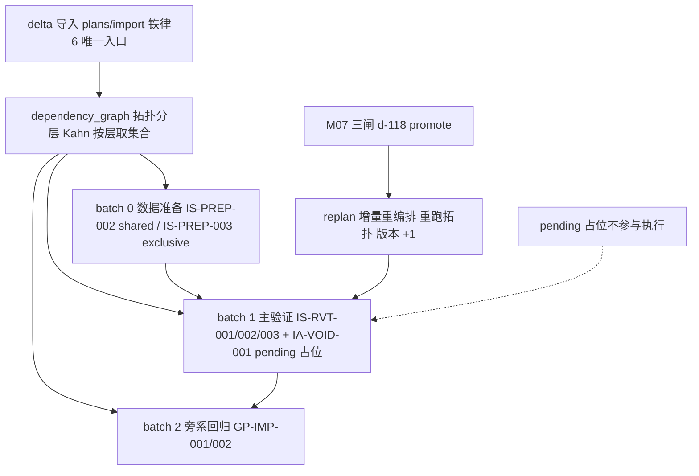
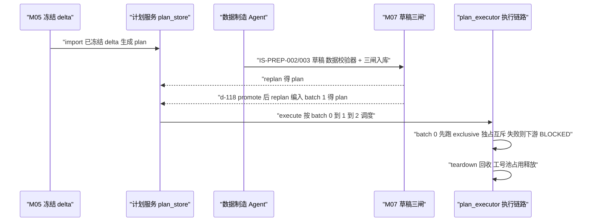

# M08 · DAG 批次与测试数据制造 详细设计

> 原型：S5 测试工作台「DAG 批次」页签 · L1 引擎层 · 增强
> 事实源：《SpecGuard 技术架构》2026-07-31 快照、specflow 设计方案、汇报原型 S5

---

## 0. 模块卡

| 项 | 内容 |
|----|------|
| 模块名称 | DAG 批次与测试数据制造（DAG Batching & Test Data Fabrication） |
| 原型屏 | S5「DAG 批次」页签（plan#7 v3 · batch 0/1/2 · 测试数据制造 Agent strip · DAG 校验行） |
| 架构层 | L1 引擎层（DAG/调度/版本仲裁）+ L0 数据层（适配包数据资产）+ L3 智能层（数据制造 Agent，新建） |
| 现状定性 | **增强**：`dependency_graph.py` / `versioning.py` / `scenario_runner.py`（shared/exclusive 调度）/ 计划执行链路已有；数据制造 Agent、批次投影、计划版本化新建 |
| 里程碑映射 | F1（DAG/调度已有，补强）→ G2（测试数据制造 Agent 专业化） |
| 依赖模块 | M05（delta 冻结与导入）、M07（草稿三闸，d-118 评审是 batch 1 编入前置）、M09（执行报告）、M12（Agent 运行时） |

## 1. 模块定位与职责

**解决什么问题**：delta 冻结后，测试计划**只能由 delta 导入生成**（铁律 6）；计划内场景按 `depends_on` 拓扑分批执行，数据准备场景（IS-PREP）与主验证场景分层调度；`depends_on` 的版本期望（`^X` / `X.Y` / `optional`）由契约版本仲裁保证不断链；测试数据由专职「测试数据制造 Agent」按 spec 锚点 + delta 场景契约制造，产出 IS-PREP 数据实例场景，与业务场景同走三闸入库。

**核心职责**：

1. delta → 计划：导入冻结 delta，圈定涉及场景集合，生成版本化计划（plan#7 v1→v3）；
2. DAG 批次投影：对计划内场景集合跑 `dependency_graph.py` 拓扑分层，派生 batch 0/1/2 视图；
3. 契约版本仲裁：`depends_on` 版本期望确定性仲裁，产出 DRIFT / ORPHANED verdict；
4. shared/exclusive 调度语义：数据实例场景的共享/独占声明在执行期由 `scenario_runner.py` 落实；
5. 测试数据制造 Agent（新建）：输入 spec 锚点 + delta 场景契约，输出高质量 IS-PREP 数据实例场景（batch 0），闸门 = 格式校验 + 数据校验器。

**不做什么（边界）**：

- 不允许手动新建计划（铁律 6），也不提供「空白计划」API；
- 不做覆盖缺口分析与草稿生成 —— 见 M07；
- 不做执行报告与失败归因 —— 见 M09（本模块只把计划交给执行链路）；
- 数据制造 Agent 不直接写业务库——它产出的是**场景 YAML**（数据准备场景），真实数据由场景执行经适配包 tool 创建；
- 不做 DAG 画布编辑器交互设计本身（前端 DagEditor/elkjs 已有，本模块供数据）。

## 2. 原型交互 → 功能拆解

| 原型界面元素（S5「DAG 批次」） | 功能点 | 后端支撑 | 已有/新建 |
|---|---|---|---|
| 「plan#7 · extend-void-scope 回归批次 ⓿v3」卡片 | 计划版本化：同一 plan 随草稿编入/delta 更新递增版本快照 | 计划存储 + 版本快照 | 已有：`plan_store.py`、plans router；**新建**：版本快照（v1→v3）与 diff |
| 「来源：delta extend-void-scope（IV-003 已冻结）——计划只能由 delta 导入生成」 | delta 导入入口 + 来源挂链校验 | 导入服务校验 delta 已冻结且带 `← IV-xxx` 来源 | 已有：双反馈循环 B（delta 导入生成计划）机制；**新建**：冻结态与挂链字段校验 |
| 测试数据制造 Agent strip（输入 spec 锚点+delta 场景契约 → 处理：高质量数据制造·shared/exclusive 调度·版本仲裁 ^0 → 输出 IS-PREP 数据实例 batch 0；闸门：格式校验+数据校验器） | 数据制造 Agent 全管线 | 新建编排服务 + skill + 数据校验器 | **新建**（Agent 与校验器）；已有：底层执行/注册机制 |
| batch 0 · 数据准备「IS-PREP-002 活动+会话+3人（shared） · IS-PREP-003 活动+COMPLETED 会话（exclusive）」 | 数据准备批次 + 资源调度语义标注 | `scenario_runner.py` shared/exclusive 调度 | 已有：`scenario_runner.py` 依赖语义；**新建**：批次投影中的语义标注展示 |
| batch 1 · 主验证（虚线 pending：「待 d-118 评审后编入」，IA-VOID-001 草稿 + IS-RVT-001/002/003） | 草稿编入闸门：三闸未过不进计划 | `draft_promote.py` 衔接 + 计划增量重编排 | 已有：draft_promote 通道；**新建**：重编排（replan）逻辑 |
| batch 2 · 旁系回归「GP-IMP-001/002 九宫格导入容错」 | 受影响邻域的旁系回归圈定 | delta 影响面 → 场景集合圈定 | **新建**（圈定规则）；已有：场景库与 covers |
| 「DAG 校验：无环 ✓ · 版本仲裁 ^0 ✓ · dependency_graph 确定性校验」 | DAG 校验面板 | `dependency_graph.py`（拓扑/环检测/DRIFT/ORPHANED）+ `versioning.py`（^X/X.Y、sha256-12、T6） | 已有：引擎校验器 + MCP `scenario_tools.check_dag`；**新建**：计划级聚合校验 API |
| `depends_on: [{id: IS-PREP-003, mode: exclusive, version: ^0}]`（d-118 YAML） | 版本期望声明 | `versioning.py` ^0 兼容仲裁 | 已有 |

## 3. 现状与差距

### 3.1 已有能力（真实模块名）

- **DAG 引擎（L1，冻结层）**：`dependency_graph.py` —— 拓扑排序 / 环检测 / 契约版本仲裁（DRIFT = 版本漂移、ORPHANED = 依赖缺失 verdict）；`versioning.py` —— `^X` 兼容 / `X.Y` 精确匹配、契约指纹 sha256-12、T6 校验（指纹变更但 version 未 bump → ERROR）；`contracts_baseline.json` 为比对基准。
- **执行与调度（L1）**：`scenario_runner.py` —— flow/verify 双段执行、`{{a.b.c}}` 变量插值（类型保留）、**shared/exclusive 依赖调度**（shared 共享资源可并发复用、exclusive 独占互斥）、teardown、SKIP/BLOCKED 诚实语义。
- **注册体系（L1）**：`tool_registry.py` —— 新 tool 在适配包 `steps.py` 声明、模块导入时注册，语法层零变更；`registry.py` 步骤类型/断言器/提供者注册表。
- **计划链路（L4）**：`services/runner.py` + `plan_executor.py` + `scheduler.py`（场景执行/计划执行/定时调度）；`plan_store.py` / `scenario_store.py` 持久化；plans router；前端 DagEditor 页面（elkjs 懒加载布局）。
- **适配包数据资产（L0）**：`systems/tdm/` —— `env.sit.yaml` + **`emp-pool.yaml` 工号池**；`steps.py` 提供 select_emp / fetch_permission 等 4 个 tool；`oracles.py` 注册快照冻结、权限过滤等 8+ DB 校对断言器；配套 `emp_pool.py` / `queries.py` / `hr_center_oracle.py`；`db_oracle.py` SELECT-only 硬守卫。
- **MCP 工具（L3）**：`scenario_tools.check_dag` / `edit_dependency` / `run_scenario` / `db_evidence`。

### 3.2 缺口清单（全部新建）

| # | 缺口 | 说明 |
|---|------|------|
| G-1 | 测试数据制造 Agent | skill `fabricate-test-data` + 编排服务：读 spec 锚点与 delta 契约 → 设计数据拓扑（活动+会话+人员）→ 生成 IS-PREP 场景草稿 |
| G-2 | 数据校验器 | 数据制造产物的专属闸门：实例完整性（会话必挂活动、人员必在工号池）、shared/exclusive 声明合法性、版本期望可仲裁 |
| G-3 | 计划版本快照 | plan#7 v1→v3：每次 delta 更新或草稿编入产生不可变快照 + diff（哪些场景进/出/改版本） |
| G-4 | 批次投影 API | dependency_graph 拓扑分层 → batch 0/1/2 视图数据（含 shared/exclusive 标注、pending 编入占位） |
| G-5 | 增量重编排（replan） | 草稿 promote 后把新场景编入既有计划：重跑拓扑、重分层、版本 +1 |
| G-6 | 旁系回归圈定 | delta 影响面（MODIFIED/REMOVED 触及的 FR）→ covers 反查场景 → batch 2 集合 |

## 4. 数据模型

### 4.1 计划与版本快照（SQLite workbench.db，新建版本表）

```sql
CREATE TABLE sg_plan_versions (
  id            INTEGER PRIMARY KEY AUTOINCREMENT,
  plan_id       INTEGER NOT NULL,          -- plan#7
  version       INTEGER NOT NULL,          -- v3
  source_delta  TEXT NOT NULL,             -- extend-void-scope（铁律 6：必有来源）
  source_iv     TEXT,                      -- IV-003（delta 的面试挂链，缺失 → WARNING）
  scenario_set  TEXT NOT NULL,             -- JSON：[{id, covers, depends_on, batch}]
  dag_verdict   TEXT NOT NULL,             -- JSON：{cycle: "none", arbitration: [{id, verdict}]}
  created_by    TEXT NOT NULL,             -- delta 导入操作人
  created_at    TEXT NOT NULL,
  UNIQUE(plan_id, version)
);
```

### 4.2 批次投影（派生物，不落库）

批次 = 计划场景集合经 `dependency_graph.py` 拓扑分层（Kahn 按层取集合）的**确定性投影**；同一 plan version 任何时候重算结果一致。层内再按数据语义归类：

```json
// GET /api/plans/7/batches 响应（plan#7 v3 示例）
{
  "plan_id": 7, "version": 3, "source_delta": "extend-void-scope",
  "batches": [
    {"level": 0, "label": "数据准备", "items": [
      {"id": "IS-PREP-002", "mode": "shared",    "desc": "活动+会话+3人"},
      {"id": "IS-PREP-003", "mode": "exclusive", "desc": "活动+COMPLETED 会话"}]},
    {"level": 1, "label": "主验证", "pending": true, "pending_reason": "待 d-118 评审后编入",
     "items": [{"id": "IA-VOID-001", "draft_id": "d-118", "gates": "①待评审"},
               {"id": "IS-RVT-001"}, {"id": "IS-RVT-002"}, {"id": "IS-RVT-003"}]},
    {"level": 2, "label": "旁系回归", "items": [{"id": "GP-IMP-001"}, {"id": "GP-IMP-002"}]}
  ],
  "dag_check": {"cycle": "none ✓", "arbitration": [{"id": "IS-PREP-003", "expect": "^0", "verdict": "OK ✓"}]}
}
```

pending 占位语义：batch 1 虚线框是「已圈定但未入库场景」的投影，`pending_reason` 指向 M07 三闸状态；占位节点**不参与执行**，仅编排视图可见。

下图示意 delta 导入 → 拓扑分层 → batch 0/1/2 投影及 replan 编入路径：



### 4.3 数据制造产物契约（IS-PREP 场景 YAML schema）

数据制造 Agent 的输出就是格式 2.0 场景草稿（与 M07 同一草稿通道、同一三闸）：

```yaml
id: IS-PREP-003
title: 数据准备·活动+COMPLETED 会话（独占实例）
covers: [FR-012]                 # 数据场景也挂 covers（其服务的主验证锚点）
source_delta: extend-void-scope
data_contract:                   # 新建：数据制造声明块（数据校验器消费）
  provides:                      # 本实例产出的数据拓扑
    activity: {status: ACTIVE}
    session:  {status: COMPLETED, count: 1}
    members:  {count: 3, from: emp-pool}   # 引用 systems/tdm emp-pool.yaml 工号池
  isolation: exclusive           # shared|exclusive，与 depends_on mode 呼应
  cleanup: teardown              # 执行后回收策略
flow:
  - call: {method: POST, path: /api/inventory/activities, save: activity}
  - call: {method: POST, path: "/api/inventory/activities/{{activity.id}}/sessions", save: session}
verify:
  - db: {oracle: inventory_session_frozen, of: session}   # oracles.py 注册的断言器校对
```

### 4.4 契约版本仲裁规则（已有，明确口径）

| 声明 | 语义 | 仲裁结果 |
|---|---|---|
| `version: ^0` | 兼容 0.x 活跃快照期任意 minor | 上游指纹在 `^0` 兼容域内 → OK；跨域 → DRIFT |
| `version: 1.2` | 精确匹配 | 上游 version ≠ 1.2 → DRIFT |
| `optional: true` | 依赖缺失不阻塞 | 缺失 → ORPHANED 但不 BLOCKED，执行时跳过 |
| 指纹变更但 version 未 bump | T6 校验 | ERROR（发布门禁拦截，见 `release_check.py`） |

### 4.5 适配包数据资产与工号池（已有，数据制造的供给源）

数据制造 Agent 的「数据从哪来」完全由适配包回答，引擎层不感知业务：

```yaml
# systems/tdm/emp-pool.yaml（已有，示意）
pool:
  - {emp: "E100321", role: 被盘点人, dept: "平台部", lock: null}   # exclusive 场景执行期置 lock=run_id
  - {emp: "E100322", role: 盘点人,   dept: "平台部", lock: null}
quotas: {exclusive_max: 2, shared_max: 8}
```

- **工号池**：`emp-pool.yaml` + `emp_pool.py` 提供 select_emp 等 tool（`steps.py` 声明、`tool_registry.py` 注册）；exclusive 实例执行期占用工号，teardown 释放，泄漏检测 = 池 lock 计数清零校验；
- **断言器**：`oracles.py` 已注册快照冻结、权限过滤等 8+ DB 校对断言器，IS-PREP 场景的 `verify.db.oracle` 只能引用已注册名，未注册 → 格式校验（三闸②）直接拦截；
- **查询**：`queries.py` / `hr_center_oracle.py` 提供 SQL 模板，全部经 `db_oracle.py`（SELECT-only 硬守卫）执行；
- **接入新系统**：新增 `systems/{system}/` 子包（env 配置 → steps → oracles → emp-pool 同类资产），数据制造 Agent 经 `registry_query.query_registry` 次日即可发现新 tool/oracle，引擎零改动（铁律 5）。

### 4.6 计划版本 diff 示例（新建，G-3）

```json
// GET /api/plans/7/versions?from=2&to=3
{"plan_id": 7, "from": 2, "to": 3,
 "added":   [{"id": "IA-VOID-001", "batch": 1, "source": "draft d-118 promoted"}],
 "removed": [],
 "changed": [],
 "dag_verdict_delta": {"cycle": "none", "new_edges": [["IS-PREP-003", "IA-VOID-001"]]},
 "reason": "d-118 三闸全过，replan 编入 batch 1"}
```

## 5. 接口设计

### 5.1 REST API

| 方法 | 路径 | 说明 | 关键入参 | 关键出参 |
|---|---|---|---|---|
| POST | `/api/plans/import` | delta 导入生成计划（铁律 6 唯一入口；已有 plans 链路扩展） | `{delta_id}`（必须已冻结） | `{plan_id, version: 1, scenario_set, dag_verdict}`；未冻结/无来源 → 422 |
| GET | `/api/plans/{plan_id}/batches` | 批次投影（新建） | — | 4.2 结构 |
| GET | `/api/plans/{plan_id}/dag-check` | 计划级 DAG 校验聚合（新建，包装 `dependency_graph.py`） | — | `{cycle, arbitration[], t6[]}` |
| POST | `/api/plans/{plan_id}/replan` | 增量重编排（新建） | `{add_scenarios:[...]}`（仅允许已 promote 场景） | `{version: v+1, diff}`；草稿直接编入 → 409 指向三闸 |
| GET | `/api/plans/{plan_id}/versions` | 版本快照列表与 diff（新建） | `?from=1&to=3` | 快照列表 / 场景进出 diff |
| POST | `/api/data-fab/fabricate` | 数据制造 Agent 编排入口（新建） | `{delta_id, anchors:[FR-xxx…], target: "IS-PREP"}` | `{drafts:[…], validation_report}`（产物一律草稿态） |
| POST | `/api/plans/{plan_id}/execute` | 计划执行（已有 `plan_executor.py` 链路） | `{env: sit}` | run_id（交 M09） |

### 5.2 MCP 工具

| 工具 | 状态 | 用途 |
|---|---|---|
| `scenario_tools.check_dag` | 已有 | Agent 侧 DAG 无环/仲裁校验（纯读） |
| `scenario_tools.edit_dependency` | 已有 | 调整 depends_on（配 `deps_editor.py` 文本外科手术，保中文注释） |
| `scenario_tools.run_scenario` | 已有 | 单场景试跑（数据制造 Agent 自验用） |
| `scenario_tools.db_evidence` | 已有 | 数据校验期 DB 侧证据（SELECT-only） |
| `registry_query.query_registry` | 已有 | 查适配包已注册 tool/oracle，供数据制造选型 |
| **新建** `fabrication.fabricate_data` | 新建（独立 MCP 模块候选） | 数据制造编排：入参 `{anchors[], delta_id}`，出参草稿清单 + 校验报告 |

### 5.3 数据制造 Agent 设计（新建，L3）

- **skill**：`agent/skills/fabricate-test-data.md`（frontmatter：temperature 0.2 / tools: registry_query+scenario_tools+draft_writer；正文：数据拓扑设计指引、shared/exclusive 判定规则、emp-pool 复用约束）——沿用 skill 热加载机制，无需重启。
- **输入**：spec 锚点（`spec_reader.read_spec`）+ delta 场景契约（`ParsedDeltaSpec`）+ 现有 IS-PREP 库（`list_scenarios`）。
- **处理**：① 从 delta 契约提取数据前置条件（如「作废需 COMPLETED 会话」）② 复用优先——已有 IS-PREP-002/003 可参数化复用则不新造 ③ 设计数据拓扑与隔离级别 ④ 生成草稿 YAML（含 `data_contract` 声明块）⑤ 自验：`run_scenario` 试跑 + `db_evidence` 校对。
- **输出**：IS-PREP 数据实例草稿（batch 0 候选），**一律走 M07 三闸**。
- **闸门**：格式校验（`validator.validate`）+ 数据校验器（G-2：拓扑完整性 / 工号池存在性 / 隔离级别合法性 / `^0` 版本期望可仲裁）。Agent 只建议，入库过人。

## 6. 关键流程（原型演示主路径）

1. delta `extend-void-scope` 在 M05 冻结（IV-003 已归档，V1-V6 全过）；
2. 测试侧 `POST /plans/import {delta_id}` → 校验冻结态 + `← IV-003` 挂链 → 圈定场景集合（新增 FR-012 无场景 → 记缺口标记交 M07；修改「已关闭可重开」→ covers 反查圈定 IS-RVT-001/002/003；旁系 GP-IMP-001/002）→ 生成 **plan#7 v1**；
3. 数据制造 Agent 启动：`/data-fab/fabricate` 读 FR-012 锚点（级联：会话→人员→快照→6 张结果表）→ 判定需独占实例 → 产出/更新 IS-PREP-002（shared）、IS-PREP-003（exclusive）草稿 → 过数据校验器 + 三闸入库 → replan 得 **plan#7 v2**（batch 0 成形）；
4. M07 路径 A 产出草稿 d-118（IA-VOID-001，depends_on IS-PREP-003 `^0` exclusive）；批次投影中 batch 1 显示虚线 pending「待 d-118 评审后编入」；
5. 测试人员打开「DAG 批次」页签：`GET /plans/7/dag-check` → 无环 ✓、版本仲裁 `^0` ✓（IS-PREP-003 指纹在 ^0 兼容域）；
6. d-118 三闸全过 promote 后，`POST /plans/7/replan {add_scenarios:["IA-VOID-001"]}` → 重跑拓扑：IA-VOID-001 落在 IS-PREP-003 之后 → 编入 batch 1 → **plan#7 v3**（原型展示版本）；
7. 执行（交 M09）：`plan_executor.py` 按批次调度——batch 0 先跑（IS-PREP-003 exclusive 独占调度，阻塞并发冲突场景）；batch 1 主验证；batch 2 旁系回归；任一场景失败 → 下游 BLOCKED（诚实语义）；
8. 数据回收：exclusive 实例 teardown，工号池占用释放回 `emp-pool.yaml`。

下面的时序图概括上述演示主路径中各参与方的协作顺序（v1 → v2 → v3 → 执行）：



## 7. 闸门与确定性校验

| 铁律 | 本模块落点 |
|---|---|
| 6. 计划只能由 delta 导入生成 | `/plans/import` 是唯一创建入口，强制校验 delta 已冻结 + 挂链；无任何手动新建 API/UI |
| 2. 校验走确定性校验器 | DAG 无环（`dependency_graph.py`）、契约版本仲裁 DRIFT/ORPHANED（`versioning.py` + `contracts_baseline.json`）、T6 指纹校验、数据校验器（G-2）全部机器判定；批次投影 deterministic（同 version 重算一致） |
| 3. 每个产出必过闸 | 数据制造产物 = 草稿，同走 M07 三闸 + 本模块数据校验器；pending 占位场景不参与执行 |
| 1. Agent 只建议，人拍板 | 数据制造 Agent 只产草稿与建议；replan 编入需场景已 promote（人评审过）；delta 导入操作人留痕 |
| 7. 诚实结果语义 | shared/exclusive 调度不做资源造假；上游失败下游 BLOCKED、数据缺失 SKIP（`scenario_runner.py` 已有语义，执行结果口径见 M09） |
| 5. 被测系统解耦 | 数据制造只引用适配包已注册 tool/oracle（`tool_registry.py` / `oracles.py` / `emp-pool.yaml`），接入新系统 = 新增 `systems/{system}/` 子包，引擎零改动 |

确定性校验器清单：① 环检测 ② 版本仲裁（^X/X.Y/optional）③ T6 指纹 bump ④ 数据校验器（拓扑完整/工号池/隔离级别）⑤ 格式校验（三闸②）⑥ 发布门禁（`release_check.py`，入库时）。

## 8. 依赖与边界

- **上游**：M05（冻结 delta 是计划的唯一来源；`ParsedDeltaSpec` / manifest 提供圈定输入）；M07（草稿三闸——d-118 promote 是 batch 1 编入前置；IS-PREP 草稿同通道入库）。
- **下游**：M09（plan execute 产出 run 报告；BLOCKED/SKIP 语义由 M09 呈现与归因）；M11（DAG 拓扑边供图谱索引派生）。
- **与适配包关系（关键口径）**：数据制造 Agent 不绕过适配包——工号来自 `systems/{system}/emp-pool.yaml`，DB 断言走 `oracles.py` 注册断言器 + `db_oracle.py`（SELECT-only），tool 选型查 `tool_registry.py`；适配包新增能力（新 tool/新 oracle）次日即可被数据制造发现，引擎层零改动。
- **明确不承担**：执行报告生成与失败归因（M09）、覆盖缺口呈现（M07）、delta 生产与冻结（M05）、禅道提单（M06）。

## 9. 里程碑映射与验收标准

### F1（DAG 与调度补强，随测试侧闭环）

- 目标：计划版本快照、批次投影 API、计划级 DAG 校验聚合、replan 增量重编排。
- 验收：
  1. 同一 plan version 连续两次 `GET /batches` 输出逐字节一致（确定性投影）；
  2. 构造含环场景集执行导入，`dag-check` 报环且拒绝生成版本快照；
  3. 构造 `version: ^0` 但上游指纹跨域的依赖，仲裁输出 DRIFT 并定位到具体场景对；
  4. 未 promote 的草稿调 `/replan` 返回 409，计划版本不变；
  5. `/plans/import` 对未冻结 delta 返回 422；全库不存在任何「无 source_delta」的计划行（SQL 断言）。

### G2（测试数据制造 Agent 专业化）

- 目标：fabricate-test-data skill + 数据校验器 + fabrication 编排入口。
- 验收：
  1. 对 FR-012（作废级联）执行数据制造，产出 IS-PREP 草稿含完整 `data_contract` 声明块，且数据校验器报告全过；
  2. 已有可复用实例（IS-PREP-002/003）时 Agent 优先复用而非新造（复用率纳入评审指标）；
  3. 数据制造产物 100% 以草稿态落地，无一绕过三闸（审计抽查 + 写路径静态检查）；
  4. 端到端演示路径（导入 → v1 → 数据制造 → v2 → d-118 编入 → v3 → 执行）可重复跑通，batch 0/1/2 分层与原型一致；
  5. exclusive 实例并发冲突时调度互斥生效，且 teardown 后工号池无泄漏（池占用计数前后一致）。
