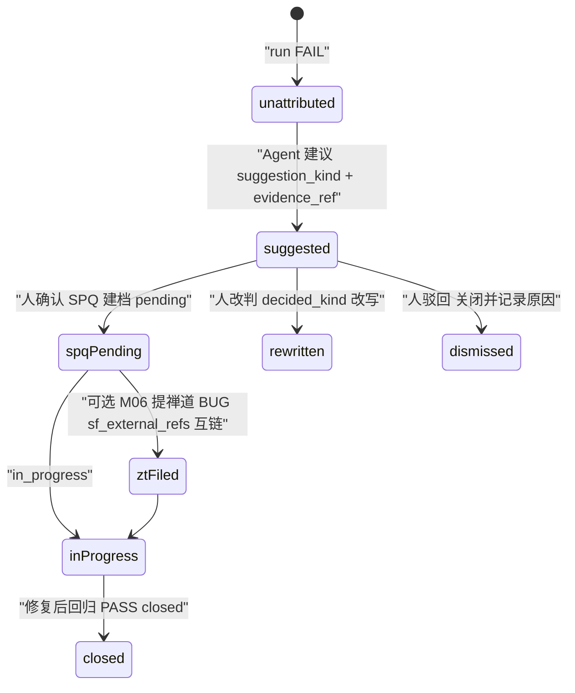
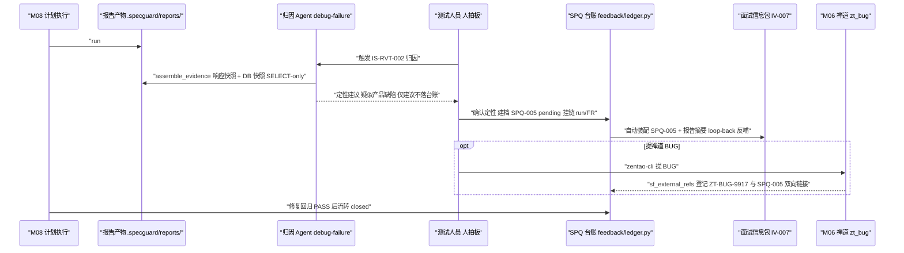

# M09 · 执行报告与失败归因 详细设计

> 原型：S5 测试工作台「报告→SPQ」页签 · L1 引擎层 + L0 数据层 · 增强
> 事实源：《SpecGuard 技术架构》2026-07-31 快照、specflow 设计方案、汇报原型 S5

---

## 0. 模块卡

| 项 | 内容 |
|----|------|
| 模块名称 | 执行报告与失败归因（Run Report & Failure Attribution） |
| 原型屏 | S5「报告→SPQ」页签（run#23 摘要 · 逐场景结果行 · 失败归因 Agent strip · SPQ-005 · zentao-cli 提 BUG 出口） |
| 架构层 | L1 引擎层（报告产物/诚实语义）+ L0 数据层（SPQ 台账）+ L3 智能层（归因 Agent，新建） |
| 现状定性 | **增强**：`report_writer.py` / `feedback/ledger.py` / attribution MCP / 诚实结果语义已有；归因 Agent、证据包、SPQ→信息包自动装配新建 |
| 里程碑映射 | F1（报告/SPQ/归因基础已有，补强）→ G2（失败归因 Agent 专业化） |
| 依赖模块 | M08（计划执行产出 run）、M06（禅道 BUG 提单，仅接口边界）、M02/M03（SPQ 进下轮面试信息包）、M10（血缘链节点） |

## 1. 模块定位与职责

**解决什么问题**：计划执行后，结果必须**诚实**呈现（FAIL / SKIP / BLOCKED 语义分明，绝不把环境问题报成 FAIL）；FAIL 场景由失败归因 Agent 装配证据、给出定性建议，但**定性生效权永远在人**；人拍板后建 SPQ 台账条目，SPQ 自动进入下一轮需求面试的信息包——这是「需求→验证→反哺」大闭环的最后一边。

**核心职责**：

1. 报告产物归档与呈现：`report_writer.py` / `execution_record.py` 落各工作区 `.specguard/reports/`，工作台按 run 展示摘要与逐场景结果；
2. 诚实结果语义守护：PASS / FAIL / SKIP / BLOCKED 四态口径统一（`scenario_runner.py` 语义为权威）；
3. 失败归因 Agent（新建）：证据包自动装配（响应快照 + DB 快照）→ 定性建议（产品缺陷 / spec 质疑 / 环境问题）→ 人拍板才生效；
4. SPQ 台账：复用 `feedback/ledger.py` 状态机（pending → in_progress → closed），补归因关联边（← run_id / FR-xxx）；
5. 反哺闭环：未闭环 SPQ + 报告摘要自动装配进下轮面试信息包（复用 info_pack 机制）。

**不做什么（边界）**：

- 不做禅道 BUG 提单细节（字段映射、zentao-cli 封装、故事关联）—— 归 M06；本模块只定义衔接接口与挂链口径；
- 不做 DAG 批次编排与执行调度 —— 见 M08；
- 不替人定性：归因 Agent 输出永远是「建议」，SPQ 条目由人创建/确认；
- 不做血缘链视图呈现 —— 见 M10（本模块是链上节点「报告 run_id → SPQ-xxx」的数据源）。

## 2. 原型交互 → 功能拆解

| 原型界面元素（S5「报告→SPQ」） | 功能点 | 后端支撑 | 已有/新建 |
|---|---|---|---|
| 「run#23 · plan#7 · SIT · 07-30 21:14 · 4 PASS / 1 FAIL」摘要条 | 执行摘要展示 | 报告产物读取 + runs router | 已有：`report_writer.py` / `execution_record.py`、runs router、History 页面、`useRunStream` |
| 逐场景结果行（IS-RVT-001 ✓ 1.2s / IS-RVT-003 ✓ 0.8s / GP-IMP-001 ✓ 2.1s / GP-IMP-002 ✓ 1.9s / IS-RVT-002 ✗ 1.4s） | 逐场景 verdict + 耗时 | 报告 JSON 逐场景段 | 已有：execution_record 结构 |
| IS-RVT-002「CLOSED 活动退回 —— 名单刷新延迟」标红 FAIL | 诚实 FAIL 认定（非环境 SKIP） | `scenario_runner.py` SKIP/BLOCKED 语义 + 断言失败 = FAIL | 已有：诚实结果语义（引擎冻结层） |
| 失败归因 Agent strip（证据：IS-RVT-002 FAIL·响应/DB 快照 → 定性建议：诚实 FAIL·疑似产品缺陷（非环境 SKIP）→ 人拍板：建 SPQ-005 台账·进 IV-007 信息包 ⟳；闸门：人定性才生效） | 归因 Agent 三段管线 | 新建归因编排 + debug-failure skill + 证据包装配 | **新建**（Agent 与证据包）；已有：`agent/skills/debug-failure`、`scenario_tools.db_evidence`、`spec_reader.read_run_report` |
| SPQ-005「落位后名单未刷新 · pending · 待定性」台账条目 | SPQ 台账状态机 | `feedback/ledger.py`（pending→in_progress→closed） | 已有：`feedback/ledger.py`、`feedback/notify.py`、Feedback 页面；**新建**：归因关联边（run_id/FR）与人定性 API |
| 「进 IV-007 信息包 ⟳」（S4 材料包页签展示 SPQ-005 反哺卡片） | SPQ 自动进下轮面试信息包 | info_pack 机制 + 装配服务 | 已有：`mcp_server` meta 工具（add_to_info_pack / read_info_pack / list_info_pack_artifacts）、`info_pack_freshness.py`；**新建**：`info_pack.py` 挂载 server.TOOL_MODULES + SPQ 自动装配钩子 |
| 「🐞 出口：一键提禅道 BUG（DAG 场景执行 / 手动测试）」+「⚡ 演示：zentao-cli 提 BUG（IS-RVT-002 失败）」 | BUG 提单入口（复现步骤自动装配自场景 flow + 执行证据） | M06 禅道集成 | 仅接口边界（见 5.3）；实现归 M06 |
| 「BUG 编号已登记 sf_external_refs ↔ SPQ-005 双向链接」 | 外部锚点登记挂链 | `sf_external_refs` 表 | 新建（归 M06）：external_refs 登记机制（specflow §4.7 机制 2）；**新建**：BUG↔SPQ 双向链接字段 |
| 「⟳ 去 S4 看 SPQ-005 如何进入下轮面试 →」 | 闭环跳转（叙事） | M02/M03 面试信息包 | 见 M02/M03 |

## 3. 现状与差距

### 3.1 已有能力（真实模块名）

- **报告产物（L1）**：`report_writer.py` / `execution_record.py` —— 执行报告与记录产物，落各工作区 `.specguard/reports/`。
- **诚实结果语义（L1，冻结层）**：`scenario_runner.py` —— 上游失败 → 下游 BLOCKED；测试数据缺失/账号未配置 → SKIP；**绝不把环境问题报成 FAIL**。断言失败 = FAIL（IS-RVT-002 名单刷新延迟是产品行为与预期不符，诚实 FAIL）。
- **执行链路（L4）**：`services/runner.py` + `plan_executor.py` + `scheduler.py`；runs router；前端 History / RunControl 页面 + `useRunStream` 流式输出。
- **SPQ 台账（L0）**：`feedback/ledger.py` —— SPQ 状态机 pending → in_progress → closed；`feedback/notify.py` 通知出口。
- **归因工具（L3）**：MCP `attribution.report_vulnerability`（已有）；`agent/skills/debug-failure`（已有 skill）；`scenario_tools.db_evidence`（DB 侧证据）；`spec_reader.read_run_report`（Agent 读报告）。
- **只读 DB 证据（L1）**：`db_oracle.py` —— SELECT-only 硬守卫，归因证据 DB 快照的安全基础。
- **信息包（L3/L4）**：MCP meta 工具 `add_to_info_pack` / `read_info_pack` / `list_info_pack_artifacts`（已有）；`mcp_server/info_pack.py` 基础读写已实现但**尚未挂载 server.TOOL_MODULES**；`services/info_pack_freshness.py` 新鲜度。
- **外部锚点（specflow 方案机制）**：`sf_external_refs` 登记引用表——由 M06 新建，本模块消费（见 M06 §4.1；链可跨界，资产不跨界）。

### 3.2 缺口清单（全部新建）

| # | 缺口 | 说明 |
|---|------|------|
| G-1 | 失败归因 Agent 编排 | debug-failure skill 升级为完整管线：证据包装配 → 定性建议 → 人拍板落 SPQ；编排服务 + 会话内交互 |
| G-2 | 归因证据包 schema | 标准化证据包：响应快照 + DB 快照（db_oracle SELECT-only）+ 场景 flow 摘录 + 环境指纹 |
| G-3 | SPQ 归因关联边 | SPQ 条目扩展 `← run_id / scenario_id / FR-xxx` 挂链字段（血缘「产物落笔即挂链」），缺失 → 合规 WARNING |
| G-4 | 人定性 API 与留痕 | 定性（产品缺陷/spec 质疑/环境问题）必须人确认，留痕 decided_by + 时间戳；Agent 建议仅存 suggestion 字段 |
| G-5 | SPQ → 信息包自动装配 | SPQ 建档/状态变更时，按议题相关性把未闭环 SPQ + 报告摘要注入下轮面试信息包（闭环最后一边） |
| G-6 | info_pack.py 挂载 | 已实现未挂载——加入 `server.TOOL_MODULES`，Agent 侧可查信息包 |
| G-7 | BUG↔SPQ 双向链接 | `sf_external_refs` 记录 ZT-BUG ↔ SPQ 互链（提单实现归 M06，本模块消费登记结果） |

## 4. 数据模型

### 4.1 报告产物布局（已有约定，明确结构）

```
{workspace}/.specguard/reports/
└── plan-7/
    └── run-23/
        ├── report.json          # 摘要 + 逐场景结果（execution_record）
        ├── record.jsonl         # 执行流水（步骤级，供流式回放）
        └── evidence/            # 新建：失败场景证据包（4.2）
            └── IS-RVT-002.evidence.json
```

`report.json` 关键 schema（在已有产物结构上约定呈现层消费字段）：

```json
{
  "run_id": 23, "plan_id": 7, "env": "sit", "started_at": "2026-07-30T21:14",
  "summary": {"pass": 4, "fail": 1, "skip": 0, "blocked": 0},
  "scenarios": [
    {"id": "IS-RVT-001", "verdict": "PASS", "duration_s": 1.2},
    {"id": "IS-RVT-002", "verdict": "FAIL", "duration_s": 1.4,
     "failure": {"assert": "名单刷新延迟", "evidence": "evidence/IS-RVT-002.evidence.json"}},
    {"id": "GP-IMP-002", "verdict": "PASS", "duration_s": 1.9}
  ]
}
```

四态口径（权威 = `scenario_runner.py`）：**PASS** 断言全过；**FAIL** 断言失败（产品行为与预期不符）；**SKIP** 数据缺失/账号未配置（前置不满足，未真正执行）；**BLOCKED** 上游失败导致下游无法执行。

### 4.2 归因证据包（新建，G-2）

```json
// evidence/IS-RVT-002.evidence.json
{
  "scenario_id": "IS-RVT-002", "run_id": 23,
  "flow_digest": "sha256-12(场景 YAML)",        // 证据与场景版本绑定
  "response_snapshot": {                        // HTTP 响应快照（失败断言现场）
    "status": 200, "body_excerpt": "…", "assertion_failed": "$.list[?(@.emp=='…')] 未含新退回人员"},
  "db_snapshots": [                             // db_oracle.py SELECT-only 快照，只读硬守卫
    {"oracle": "inventory_member_list", "sql_digest": "sha256-12(sql)",
     "rows_excerpt": "…", "captured_at": "…"}],
  "env_fingerprint": {"env": "sit", "gateway": "…", "db": "…"},
  "collected_by": "attribution-agent", "collected_at": "…"
}
```

约束：DB 快照只能经 `db_oracle.py`（SELECT-only 硬守卫）采集；响应快照只存摘录（body_excerpt），全量流水在 record.jsonl。

### 4.3 归因定性分类口径（新建，Agent 建议与人定性共用同一枚举）

| decided_kind | 含义 | 典型后续 | 原型示例 |
|---|---|---|---|
| `product_defect` | 疑似产品缺陷（行为与冻结 spec 预期不符） | 提禅道 BUG（M06）/ 进面试信息包 | IS-RVT-002 名单刷新延迟 → SPQ-005 |
| `spec_question` | spec 质疑（预期本身存疑，需需求侧澄清） | 进下轮面试议题（M02） | 场景预期与 spec 表述歧义 |
| `environment` | 环境问题（网关/数据/账号） | 不修产品；核查是否应改判 SKIP | SIT 网关 502、工号池耗尽 |

口径红线：`environment` 定性成立时，必须复核该场景历史 verdict 是否应改写为 SKIP——**把环境问题记成 FAIL 是数据事故**，归因 Agent 对此类场景强制附「诚实性复核」结论。

### 4.4 SPQ 台账扩展（feedback/ledger.py 状态机不变，加挂链字段）

基础状态机 `pending → in_progress → closed` 不变；`zentao_filed` 分支由 M06 扩展（见 M06 §4.3），本模块消费该状态（原型演示「pending → 已提禅道 BUG（修复后回归验证）→ closed」）。

```sql
-- SPQ 台账表（feedback/ledger.py 管理）扩展列（新建，兼容迁移）
ALTER TABLE spq_ledger ADD COLUMN run_id INTEGER;          -- ← run#23（落笔挂链）
ALTER TABLE spq_ledger ADD COLUMN scenario_id TEXT;        -- IS-RVT-002
ALTER TABLE spq_ledger ADD COLUMN fr_refs TEXT;            -- JSON ["FR-009"]
ALTER TABLE spq_ledger ADD COLUMN suggestion_kind TEXT;    -- Agent 建议：product_defect/spec_question/environment
ALTER TABLE spq_ledger ADD COLUMN decided_kind TEXT;       -- 人定性（生效值）
ALTER TABLE spq_ledger ADD COLUMN decided_by TEXT;         -- 人拍板留痕（铁律 1）
ALTER TABLE spq_ledger ADD COLUMN decided_at TEXT;
ALTER TABLE spq_ledger ADD COLUMN info_pack_synced TEXT;   -- 已装配进的面试 IV-xxx 清单
```

`sf_external_refs`（M06 新建机制，见 M06 §4.1）新增一行即完成 BUG↔SPQ 双向链接：`{type: zt_bug, ref: "ZT-BUG-9917", linked: "SPQ-005", note: "← run#23 IS-RVT-002"}`。

### 4.5 归因状态机（新建，G-4）

```
run FAIL ──> unattributed ──Agent 建议──> suggested(suggestion_kind, evidence_ref)
                                              │ 人确认          │ 人改判          │ 人驳回
                                              ▼                ▼                ▼
                                     SPQ 建档 pending   decided_kind 改写   关闭（记录驳回原因）
                                              │
                            （M06 可选：提禅道 BUG → sf_external_refs 互链）
                                              ▼
                              in_progress ──修复后回归 PASS──> closed
```

下面的状态图与上方文字版状态机一一对应：



## 5. 接口设计

### 5.1 REST API

| 方法 | 路径 | 说明 | 关键入参 | 关键出参 |
|---|---|---|---|---|
| GET | `/api/runs/{run_id}/report` | 报告读取（已有 runs router 扩展） | — | 4.1 report.json 结构 |
| GET | `/api/runs/{run_id}/evidence/{scenario_id}` | 证据包读取（新建） | — | 4.2 结构 |
| POST | `/api/runs/{run_id}/attribute` | 触发归因 Agent 装配证据 + 定性建议（新建） | `{scenario_id}` | `{suggestion_kind, evidence_ref, rationale}`（仅建议，不落台账） |
| POST | `/api/feedback/spq` | 人定性建档 SPQ（新建；走 ledger.py） | `{run_id, scenario_id, decided_kind, fr_refs[], comment}` | `{spq_id: "SPQ-005", status: "pending"}`；decided_by 取当前用户 |
| PATCH | `/api/feedback/spq/{spq_id}` | 状态流转（已有 ledger 能力暴露） | `{status: in_progress/closed, note}` | 状态机非法迁移 → 409 |
| GET | `/api/feedback/spq?status=pending&fr=FR-xxx` | 台账查询（已有 Feedback 页数据源） | 过滤 | 条目列表（含挂链字段） |
| POST | `/api/feedback/spq/{spq_id}/sync-info-pack` | 手动触发装配进指定面试信息包（新建；自动钩子之外的人工补偿） | `{iv_id: "IV-007"}` | `{added: true}` |
| GET | `/api/runs/{run_id}/zentao-bug-context` | M06 提单上下文（新建，仅装配） | `{scenario_id}` | `{title, repro_steps, evidence_refs, spq_id}`（见 5.3） |

### 5.2 MCP 工具

| 工具 | 状态 | 用途 |
|---|---|---|
| `attribution.report_vulnerability` | 已有 | Agent 侧上报漏洞/缺陷线索 |
| `spec_reader.read_run_report` | 已有 | Agent 读 run 报告 |
| `scenario_tools.db_evidence` | 已有 | 采集 DB 证据（SELECT-only） |
| `meta.add_to_info_pack` / `read_info_pack` / `list_info_pack_artifacts` | 已有 | 信息包装配与读取（SPQ 反哺落地工具） |
| `info_pack.py` 基础读写 | 已有未挂载 | **挂载 server.TOOL_MODULES**（G-6，无新逻辑） |
| **新建** `attribution.assemble_evidence` | 新建（attribution 模块扩展） | 入参 `{run_id, scenario_id}`，出参证据包路径 + 摘要；纯装配、确定性采集 |

### 5.3 与 M06（禅道集成）的衔接口径（只写接口边界）

- **本模块提供**：`GET /api/runs/{run_id}/zentao-bug-context?scenario_id=…` —— 提单上下文装配：标题（场景 doc 层 + 失败断言）、复现步骤（场景 flow given/when/then 转写 + 证据包引用）、关联（SPQ id / FR / run）。
- **M06 负责**：zentao-cli 封装、字段映射、BUG 创建与故事关联（ZT-STORY）、手动测试手工录入通道。
- **回挂约定**：M06 提单成功后写 `sf_external_refs {type: zt_bug, ref: ZT-BUG-9917, linked: SPQ-005}`，并回调 `PATCH /feedback/spq/{id}` 备注 BUG 编号；本模块在 SPQ 详情与血缘链（M10）呈现该外部节点。**本模块不实现任何禅道协议细节。**

## 6. 关键流程（原型演示主路径）

1. **执行与归档**：plan#7 v3 在 SIT 环境执行完成（M08 交棒），`report_writer.py` / `execution_record.py` 落 `.specguard/reports/plan-7/run-23/`：摘要 4 PASS / 1 FAIL，逐场景行含耗时；
2. **诚实 FAIL 认定**：IS-RVT-002（CLOSED 活动退回）断言失败——名单刷新延迟，产品行为与预期不符 → verdict=FAIL（不是 SKIP：数据与环境齐备；不是 BLOCKED：上游数据准备成功）；
3. **触发归因**：用户在报告页点 IS-RVT-002 的「归因」（或 `POST /runs/23/attribute`）；
4. **证据装配**：归因 Agent 经 `attribution.assemble_evidence` 装配证据包——响应快照（断言失败现场摘录）+ DB 快照（`db_oracle.py` SELECT-only 查询名单表）+ 场景 flow digest + 环境指纹；
5. **定性建议**：debug-failure skill 分析证据 → 建议「诚实 FAIL · 疑似产品缺陷（非环境 SKIP）」，附 rationale；建议仅写 suggestion 字段，**不产生台账**；
6. **人拍板**：测试人员确认定性（或改判 spec 质疑/环境问题）→ `POST /feedback/spq` 建档 **SPQ-005**（pending），留痕 decided_by/decided_at，挂链 `← run#23 / IS-RVT-002 / FR-009`；
7. **反哺装配（闭环最后一边）**：SPQ-005 建档触发自动钩子 → 按议题相关性（FR / 模块 / delta）匹配到进行中的面试 IV-007 → `meta.add_to_info_pack` 注入「SPQ-005 落位后名单未刷新 + run#23 报告摘要」→ S4 材料包页签出现反哺卡片，成为面试 Q3 素材（见 M02/M03）；
8. **可选出口（M06）**：用户点「zentao-cli 提 BUG」→ 本模块装配提单上下文 → M06 创建 ZT-BUG-9917 → `sf_external_refs` 登记互链 → SPQ-005 状态流转（zentao_filed，由 M06 扩展）+ 备注「已提禅道 BUG」；
9. **闭环**：修复后回归验证 IS-RVT-002 PASS → `PATCH /feedback/spq/SPQ-005 {status: closed}` → 台账闭环，血缘链（M10）节点状态同步。

下面的时序图概括上述归因与反哺闭环的完整链路（含 zt_bug 登记与信息包 loop-back）：



## 7. 闸门与确定性校验

| 铁律 | 本模块落点 |
|---|---|
| 7. 诚实结果语义 | 四态口径以 `scenario_runner.py` 为唯一权威；报告呈现不改写 verdict；归因 Agent 的定性建议必须显式声明「FAIL/SKIP/BLOCKED 是否诚实」，环境问题建议改 SKIP 时须附证据 |
| 1. Agent 只建议，人拍板 | 归因闸门 = 「人定性才生效」：suggestion 永不自动转 decided；SPQ 建档/改判/驳回全留痕（decided_by + decided_at + comment） |
| 2. 校验走确定性校验器 | 证据装配是确定性采集（响应/DB 快照 + digest），不靠 LLM 编造；DB 证据只能经 `db_oracle.py` SELECT-only 硬守卫；场景版本以 sha256-12 digest 绑定防「证据与场景漂移」 |
| 3. 每个产出必过闸 | SPQ 建档必带挂链字段（run_id/scenario_id/FR），缺失 → 合规 WARNING（链完整性校验，与 M10 共用）；状态机非法迁移（pending→closed 跳过 in_progress 需强制备注）由 `feedback/ledger.py` 拦截 |
| 4. 链可跨界，资产不跨界 | ZT-BUG 只经 `sf_external_refs` 登记引用，SpecGuard 不拥有禅道资产；BUG 详情跳外链 |
| 8. 不做编码智能体 | 归因止步于定性与证据，不生成修复代码 |

确定性校验器清单：① verdict 四态枚举校验（报告写入时）② 证据包 digest 一致性（场景/环境指纹）③ SPQ 状态机迁移合法性 ④ 挂链完整性（SPQ 缺 run/FR → WARNING）⑤ 信息包装配幂等（同一 SPQ 重复同步不重复入包）。

## 8. 依赖与边界

- **上游**：M08（计划执行产出 run 与批次上下文；BLOCKED 级联关系来自 DAG）。
- **下游**：M02/M03（SPQ + 报告摘要装配进面试信息包，闭环最后一边）；M06（BUG 提单，接口边界见 5.3）；M10（血缘链节点 run_id → SPQ-xxx → ZT-BUG ↗）；M07（SPQ 关联 FR 的覆盖泳道「最近 FAIL」着色数据源）。
- **跨模块数据流**：执行（M08）→ 报告产物（.specguard/reports/）→ 证据包 → 归因建议 →（人拍板）SPQ 台账 → 信息包（M02/M03）→ 下轮面试；修复回归 → SPQ closed。
- **明确不承担**：禅道协议与提单实现（M06）、批次编排（M08）、面试会话与材料包呈现（M02/M03）、血缘链视图（M10）、通知渠道配置（M12，`feedback/notify.py` 仅出口）。

## 9. 里程碑映射与验收标准

### F1（报告/SPQ/归因基础补强，随测试侧闭环）

- 目标：报告呈现字段约定、SPQ 挂链字段迁移、人定性 API、info_pack.py 挂载。
- 验收：
  1. run#23 级报告（4 PASS / 1 FAIL）经 `GET /runs/{id}/report` 输出四态摘要与逐场景行，verdict 与 `scenario_runner.py` 产出逐字节一致；
  2. 构造上游失败场景，下游 verdict=BLOCKED 且报告不出现 FAIL 误报（诚实语义回归测试）；
  3. SPQ 建档缺 run_id 或 fr_refs → 400 或 WARNING 落审计；状态机非法迁移 → 409；
  4. `info_pack.py` 挂载后，MCP 工具清单出现对应工具且只读工具无副作用（调用前后工作区哈希不变）。

### G2（失败归因 Agent 专业化）

- 目标：归因 Agent 编排、证据包 schema、SPQ→信息包自动装配钩子、M06 衔接联调。
- 验收：
  1. 对 IS-RVT-002 FAIL 执行归因，证据包含响应快照 + DB 快照 + flow digest + 环境指纹四要素，DB 采集 100% 走 SELECT-only（SQL 审计日志断言无写语句）；
  2. Agent 定性建议在人工确认前不产生任何台账行（DB 断言）；人拍板后 SPQ-005 建档且留痕完整；
  3. SPQ 建档后 5 秒内自动装配进匹配面试 IV 的信息包（幂等：重复触发不重复入包）；S4 材料包页签可见反哺卡片；
  4. M06 联调：提单上下文接口输出可直接驱动提单，回挂后 `sf_external_refs` 存在 ZT-BUG ↔ SPQ 双向行；
  5. 端到端演示路径（run#23 → IS-RVT-002 归因 → SPQ-005 → IV-007 信息包 → 回归 closed）可重复执行，闭环状态在血缘链可查（见 M10）。
