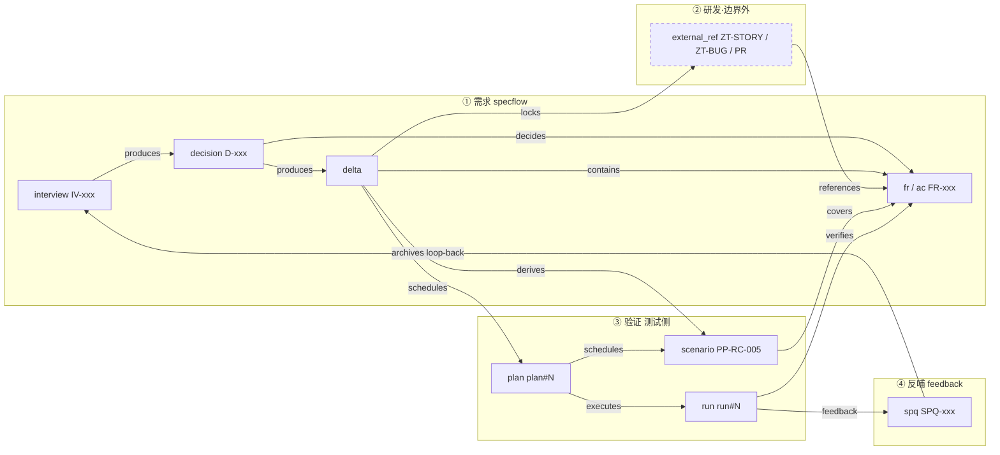
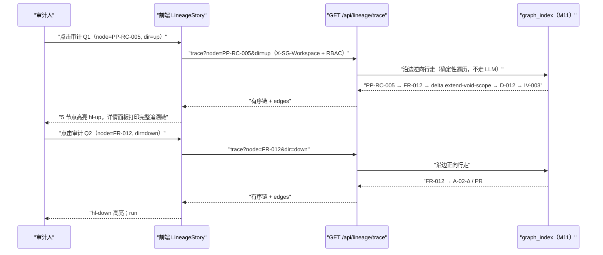

# M10 · 血缘链 Story Line 详细设计

> 原型屏：S6 血缘链 · 架构层：L2 标准层 + L4 工作台 · 现状定性：新建
> 事实源：《SpecGuard 技术架构》2026-07-31 快照、specflow 方案 §4.7、Vision 原型 S6（STAGES / auditTrace）
> 依赖：见 M02（面试）、M04（决策台账）、M05（冻结）、M06（禅道集成/sf_external_refs）、M07（覆盖）、M09（报告/SPQ）、M11（图谱索引）

---

## 0. 模块卡

| 项 | 内容 |
|---|---|
| 模块名 | 血缘链 Story Line（Lineage / Story Line） |
| 原型屏 | S6 · 血缘链（四阶段分带 + 审计 Q1/Q2 + 虚线外部节点 + SPQ-005 闭环） |
| 架构层 | L2 标准层（谱系数据模型 + 断链确定性校验）+ L4 工作台（血缘链视图、审计 trace 交互） |
| 现状定性 | **新建**（谱系视图与断链校验为零起步；谱系所需的源数据边 —— anchors/covers/DAG/manifest/SPQ —— 全部已有） |
| 里程碑映射 | F4 血缘与图谱（主线）；挂点：specflow F1（决策台账挂链）/ F3（delta 挂链 + external_refs）；G2（与 M11 共用 graph_index） |
| 依赖模块 | M11 图谱索引（血缘链 = 图谱索引的线性投影，本模块不建独立存储）、M06 sf_external_refs、M09 SPQ/报告归档、M04 决策台账 |

## 1. 模块定位与职责

**解决什么问题**：审计与复盘最贵的两个问题没有廉价答案——

- **Q1「这个场景为什么存在」**：需要一个场景能向上走回那轮面试的那个 P0 决策；
- **Q2「这个需求被验证了吗」**：需要一个 FR 能向下走到具体的执行报告与反哺闭环。

specflow 方案 §4.7 已定调：**图谱索引是体，ID 脊柱是纪律，血缘链视图是呈现，info_pack 是闭环的最后一边**。本模块负责的是「视图」与「纪律的校验」：不新建存储，血缘链是 M11 graph_index 按「单节点上下游可达集」的线性投影；不新建数据，链上的边全部来自已有源数据（anchors/covers/DAG/manifest/决策台账/external_refs）。

**纪律只有一条：产物落笔即挂链**。任何产物创建时必须记录上游 ID，事后补链视为不合格产物；链完整性由确定性校验器保证，断链 = WARNING，与覆盖缺口同级的可检查项。

**本模块不做**（边界）：

- 不拥有研发资产——禅道故事/PR/单测经 external_refs 登记引用入链呈现，**链可跨界，资产不跨界**（铁律 4）；
- 不手工维护链接——不引入任何 `[[wiki-link]]` 式人工标注通道，边一律从源数据确定性派生；
- 不做链上节点的业务编辑——血缘链视图只读 + 跳转，修改永远回源系统；
- 不做图谱布局与缩放渲染——那是 M11 的职责，本模块只消费 graph_index 的查询结果。

## 2. 原型交互 → 功能拆解

| 原型界面元素（S6） | 功能点 | 后端支撑（已有/新建） |
|---|---|---|
| 四阶段分带 ①需求 specflow ②研发·业务项目侧（边界外） ③验证 测试侧 ④反哺 feedback | 谱系节点的阶段归属与分带渲染 | 节点→阶段映射规则（**新建**：`stage_of(node_type)` 纯函数）；阶段内节点序由边序推导 |
| 节点卡片（IV-003 / D-012 / delta / FR-012 / A-02-Δ / PR#482 / PP-RC-005 / plan#7 / run#23 / SPQ-005 / ZT-BUG-9917） | 谱系节点物化与详情展示 | 各产物本身（已有：决策台账见 M04、delta manifest 见 M05、场景 `covers`（已有：场景双层 YAML）、plans（已有：plan_store）、报告（已有：`report_writer.py` / `execution_record.py` 落 `.specguard/reports/`）、SPQ（已有：`feedback/ledger.py`））；节点统一装配（**新建**） |
| 虚线节点 A-02-Δ / PR#482 / ZT-BUG-9917（↗ 外部引用） | 外部锚点入链呈现、可跳转外链 | `sf_external_refs` 登记引用表（见 M06，登记口径一致）；血缘链外部节点适配（**新建**） |
| 灰色虚线 UT-??「单测报告未登记 ⚠ 落笔未挂链」 | 断链示例：应有边缺失的呈现 | 断链确定性校验（**新建**：`lineage_check.py`） |
| 审计 Q1 按钮「这个场景为什么存在？— 从 PP-RC-005 向上追溯」 | 向上追溯：场景 → spec 锚点 → delta → D-xxx → IV-xxx | trace API（**新建**）：`GET /api/lineage/trace` dir=up |
| 审计 Q2 按钮「这个需求被验证了吗？— 从 FR-012 向下追溯」 | 向下追溯：FR → 外部锚点 → covers 场景 → DAG plan → run 报告 → SPQ | trace API（**新建**）：`GET /api/lineage/trace` dir=down |
| 分带间隔标「冻结合入基线 · spec↔task 双向锁定」「外部锚点登记」「执行完成 · 结果反哺」 | 阶段间边的语义标注 | 边类型表（**新建**，见 §4） |
| 点击节点 → 详情面板（描述 / 状态 / 上游血缘 `up`） | 节点详情 + 直接上游列表 | trace API 返回的一阶邻域（**新建**） |
| 底部「⟳ SPQ-005 已自动进入 IV-007 面试信息包——回到 ① 需求阶段，闭环」 | loop-back 闭环呈现 | SPQ→info_pack 装配（已有基础：`mcp_server` meta 工具 `add_to_info_pack`/`read_info_pack`；**新建**：面试开工装配时自动带未闭环 SPQ，见 M02/M03） |
| STAGES 数据 = 真实 ID 脊柱 | 演示数据口径 | 演示用真实工作区快照；实现期读 graph_index |

## 3. 现状与差距

**已有能力（真实模块名）**：

- 谱系源数据边全部存在：场景 doc 层 `covers: [FR-xxx]`（已有：场景双层 YAML，`scenario_loader.py` 加载）；spec FR/AC 锚点解析（已有：`specstd/anchors.py`）；delta 结构与 manifest（见 M05，对应 specflow `delta/manifest.py`）；DAG 编排与计划（已有：`dependency_graph.py`、`plan_store.py`，铁律 6「计划只能由 delta 导入生成」保证了 plan→delta 边天然存在）；执行报告按 plan 归档（已有：`report_writer.py` / `execution_record.py` → 各工作区 `.specguard/reports/`）；SPQ 状态机（已有：`feedback/ledger.py` pending→in_progress→closed）；info_pack 读写（已有：`mcp_server` meta 工具组 5 个工具）。
- 多工作区隔离：血缘链数据按工作区隔离无需新机制（已有：`specstd/workspace.py` contextvar + 前端 `X-SG-Workspace` header 全链路透传）。
- 内容指纹：`specstd/signature.py`（已有）为链上产物「事后被篡改」检测与 M11 索引失效判定提供现成机制。

**缺口清单（新建）**：

1. **谱系投影查询**（新建）：从 graph_index 取单节点向上/向下可达集，输出有序线性链；本模块核心算法，纯函数、确定性。
2. **断链确定性校验器**（新建）：按「落笔即挂链」规则集校验每类产物的必填上游边，产出 WARNING 清单。
3. **trace REST API + 前端血缘链视图**（新建）：四阶段分带渲染、向上/向下高亮路径、外部节点虚线与跳转。
4. **SPQ→info_pack 自动装配**（新建，与 M02/M03 共建）：面试开工信息包自动带相关未闭环 SPQ 条目与报告摘要，闭环最后一边。
5. **挂链字段补齐**（跨模块增量，非本模块独有）：delta 增 `← 面试 IV-xxx` 字段（见 M05）、场景草稿增 `source_delta` 字段（见 M07）、SPQ 增 `← run_id / FR-xxx` 关联边（见 M09）。

## 4. 数据模型

血缘链不建独立事实表——节点与边活在 M11 的 graph_index（`.specguard/graph_index.db` 或等价物，见 M11 §4）中。本模块定义**谱系口径**：节点类型枚举、边类型枚举、阶段映射、断链规则，作为 specflow 侧的规范代码（建议落 `specflow/lineage/` 子包，新建）。

### 4.1 节点类型与阶段映射

| 节点类型 | ID 命名空间 | 阶段 | 来源（事实源） |
|---|---|---|---|
| `interview` | IV-xxx | ①需求 | `.specflow/interviews/`（见 M02） |
| `decision` | D-xxx | ①需求 | 决策台账（见 M04） |
| `delta` | delta 代号 | ①需求 | `.specflow/changes/` + manifest（见 M05） |
| `fr` / `ac` | FR-xxx / AC-xxx | ①需求 | spec 锚点（已有：`specstd/anchors.py`） |
| `external_ref` | ZT-STORY / ZT-BUG / PR / task 编号 | ②研发（边界外） | `sf_external_refs`（见 M06） |
| `scenario` | 场景 ID（如 PP-RC-005） | ③验证 | `scenarios/` 场景 YAML |
| `plan` | plan#N | ③验证 | 计划（已有：plan_store；只能由 delta 导入生成） |
| `run` | run#N | ③验证 | `.specguard/reports/` 归档报告 |
| `spq` | SPQ-xxx | ④反哺 | `feedback/ledger.py` 台账 |

### 4.2 类型化边（谱系视角只消费以下边类型）

| 边类型 | 方向语义 | 派生来源 |
|---|---|---|
| `produces` | 面试 → 决策 / 决策 → delta | 台账字段 / delta 挂链字段（M04/M05） |
| `contains` | delta → FR/AC | delta-spec 三段式 `[delta:代号]` 标记（已有规范） |
| `decides` | 决策 → FR/AC | 台账 `→ FR-xxx` 字段（M04） |
| `locks` | delta/spec ↔ 禅道故事 | 双向锁定 + sf_external_refs（M06） |
| `references` | external_ref → FR/delta | sf_external_refs `linked` 字段（M06） |
| `covers` | 场景 → FR/AC | 场景 doc 层 `covers`（已有） |
| `derives` | 场景 ← delta（`source_delta` 字段） | 场景草稿挂链字段（M07 增量） |
| `schedules` | plan → 场景；delta → plan | delta 导入生成计划（已有：铁律 6） |
| `executes` | run → plan | 报告归档按 plan_id（已有） |
| `verifies` | run → FR（经 covers 链折算） | 计算型派生边 |
| `feedback` | SPQ ← run / FR | 归因关联边（M09） |
| `archives` | SPQ → 下轮 IV（入 info_pack） | loop-back 装配记录（M02/M03） |

### 4.3 断链规则表（确定性校验规则集，新建）

每条规则 = 「某类节点必须存在的边」+ 严重级别（一律 WARNING，不阻断流水线）：

```yaml
# specflow/lineage/broken_link_rules.yaml（新建）
rules:
  - id: BL-01
    node: scenario
    require: covers          # 场景必须 covers 至少一个 FR（已有 covers 门禁的谱系视角）
    level: WARNING
  - id: BL-02
    node: scenario
    require: derives         # source_delta 缺失 = 落笔未挂链
    level: WARNING
  - id: BL-03
    node: delta
    require: produces        # delta 缺面试/决策来源 → WARNING
    level: WARNING
  - id: BL-04
    node: fr
    require: any_of[covers, references]   # FR 既无场景覆盖也无外部锚点登记 = 双侧断链
    level: WARNING
  - id: BL-05
    node: spq
    require: feedback        # SPQ 必须可回溯到 run 或 FR
    level: WARNING
  - id: BL-06
    node: external_ref
    require: references      # 外部引用必须挂到 FR/delta（登记时强制，见 M06）
    level: WARNING
```

原型 S6 中的 UT-?? 断链示例即 BL-06 的反面教材：单测报告存在但未登记 external_refs，链上呈灰色虚线。

下图把 §4.1/§4.2 的节点与类型化边投影成一条主链——即「需求 → spec → 场景 → 执行 → 报告 → 反哺」的血缘主路径（外部锚点为边界外虚线节点）：



### 4.4 校验结果落盘（新建）

断链校验结果**可重建、非事实源**，缓存落各工作区：

```
{workspace}/.specguard/lineage_check.json   # 新建，gitignore；删除后重跑校验即重建
{
  "workspace": "tdm",
  "graph_fingerprint": "sha256-12...",        # 复用 specstd/signature.py 口径
  "checked_at": "2026-07-31T10:00:00",
  "warnings": [
    {"rule": "BL-06", "node": "UT-??", "node_type": "external_ref",
     "message": "单测报告未登记 external_refs，落笔未挂链"}
  ]
}
```

## 5. 接口设计

### 5.1 REST API（新建，挂 workbench 新 router `lineage`，RBAC `Depends(get_current_user)` 同款）

| 方法 | 路径 | 入参 | 出参要点 |
|---|---|---|---|
| GET | `/api/lineage/trace` | `node=<节点ID>`，`dir=up|down|both`，`max_depth=8` | 有序链：`{path: [{id,type,stage,title,status,external}], edges: [{from,to,type}], truncated: bool}`；`dir=up` 到 interview 为止，`dir=down` 到 run/spq 为止 |
| GET | `/api/lineage/node/{id}` | 路径参数节点 ID | 节点详情 + 一阶邻域（上游血缘列表，即原型 `up` 字段） |
| GET | `/api/lineage/story` | `focus=<节点ID>`（可选，默认取最近活跃链） | 四阶段分带完整视图数据：`{stages: [{key,title,nodes:[...]}], broken: [...]}`，对齐原型 STAGES 结构 |
| GET | `/api/lineage/check` | — | 断链校验结果（读缓存 `.specguard/lineage_check.json`） |
| POST | `/api/lineage/check` | — | 触发重跑断链校验（确定性，幂等） |

出参中的 `external: true` 节点由前端渲染为虚线可跳转节点（↗ 外链取自 sf_external_refs 的 `ref` 字段）。

### 5.2 MCP 工具（新建，挂 `mcp_server` 新工具模块 `lineage`，注册进 `server.TOOL_MODULES`）

| 工具 | 参数 | 说明 |
|---|---|---|
| `lineage_trace` | `node: str, dir: "up"\|"down"\|"both"` | 审计追溯，返回与 REST 同构的链数据；纯读 |
| `lineage_check` | `rebuild: bool = false` | 断链校验；纯读（rebuild 只重写缓存文件，不动源数据） |
| `register_external_ref` | `type, ref, linked, note` | 登记外部锚点（写 sf_external_refs，**有副作用**，与 M06 共用实现，不重复造） |

约束（沿用 mcp_server 既有纪律）：`lineage_trace`/`lineage_check` 校验类工具必须纯读，禁止副作用。

### 5.3 前端组件（新建，React18 + TS 严格模式，零新依赖）

- `LineageStory.tsx`：血缘链页（新页面，入 16 页面清单之外的第 17 页，或作为 M11 图谱页内视图）；四阶段分带渲染（①req 紫 / ②ext 灰虚线 / ③test 青蓝 / ④fb 琥珀）。
- `AuditTraceButtons`：Q1/Q2 两个审计按钮 → 调 trace API → 路径节点高亮（向上 hl-up / 向下 hl-down，对齐原型 auditTrace 行为）+ 详情面板底部打印完整追溯链文本。
- `LineageNodeCard` / `LineageDetailPanel`：节点卡 + 详情（描述/状态/上游血缘）；外部节点带 ↗ 跳转。
- `BrokenLinkBadge`：断链节点灰色虚线 + ⚠ 标记，点击展开 WARNING 详情。

## 6. 关键流程

> 演示数据注：本节演示数据沿用原型 S6；场景 ID 与 covers 关系以场景库实际为准——S5 叙事中同 FR 的覆盖场景为 IA-VOID-001/d-118（见 M07）；Q2 链下游 SPQ-005 实为名单过滤（FR-009）问题，此处为演示压缩。

### 6.1 审计 Q1：「这个场景为什么存在」——向上追溯时序（原型主路径）

1. 审计人在血缘链页点击「审计 Q1」按钮（或直接在 trace 输入框填 `PP-RC-005`、dir=up）。
2. 前端 `GET /api/lineage/trace?node=PP-RC-005&dir=up`（携带 `X-SG-Workspace` header，RBAC 鉴权）。
3. 后端从 graph_index 沿边逆向行走（确定性图遍历，不走 LLM）：
   - `PP-RC-005` —covers→ `FR-012@inventory-activity`（场景 doc 层 covers 边）；
   - `FR-012@inventory-activity` —contains← `delta:extend-void-scope`（delta 三段式 `[delta:代号]` 标记）；
   - `extend-void-scope` —produces← `D-012`（决策台账「作废级联含 6 张结果表」，P0 已决）；
   - `D-012` —produces← `IV-003`（作废范围扩展面试，已归档）。
4. 返回有序链；前端将 5 个节点高亮（hl-up），详情面板展示：`追溯链（向上）：PP-RC-005 → FR-012 → delta extend-void-scope → D-012 → IV-003 —— 场景存在的理由 = 那轮面试的那个 P0 决策`。
5. 任一节点可点击下钻详情（如 D-012 跳转决策台账条目，见 M04）。

### 6.2 审计 Q2：「这个需求被验证了吗」——向下追溯时序（原型主路径）

1. 点击「审计 Q2」（或 trace `FR-012`、dir=down）。
2. 后端沿边正向行走：
   - `FR-012` —locks/references→ `A-02-Δ`（禅道故事，sf_external_refs，external）→ `PR#482`（external）；
   - `FR-012` —covers← `PP-RC-005`；
   - `PP-RC-005` —schedules← `plan#7`（extend-void-scope 导入生成，4 场景）；
   - `plan#7` —executes→ `run#23`（4 PASS / 1 FAIL，已归档）；
   - `run#23` —feedback→ `SPQ-005`（落位后名单未刷新，pending）。
3. 前端高亮 hl-down 路径（外部锚点保持虚线样式），详情面板展示：`追溯链（向下）：FR-012 → PR#482（外部锚点）→ PP-RC-005 → plan#7 → run#23 → SPQ-005 —— 被验证了，且失败已反哺进 IV-007 闭环`。
4. 点击 `run#23` 跳转执行报告（已有：History 页 / `.specguard/reports/` 归档）；点击 `SPQ-005` 跳转反哺台账（已有：Feedback 页）。

下图把 §6.1 / §6.2 两条审计主路径合并为一次 trace 交互时序（Q1 向上、Q2 向下，均为 graph_index 确定性图遍历）：



### 6.3 断链检测流程（确定性校验）

1. 触发：POST `/api/lineage/check`（手动）或 graph_index 重建完成后自动（指纹失效事件，见 M11）。
2. `lineage_check.py` 逐条执行 `broken_link_rules.yaml`：对每类节点在 graph_index 中查必填边，缺边 → 记 WARNING。
3. 结果写 `.specguard/lineage_check.json`（带 graph_fingerprint，过期自动作废）。
4. 前端血缘链视图读校验结果：命中节点渲染灰色虚线 + ⚠（原型 UT-?? 样式）；WARNING 清单同步进工作台通知（已有：`notify.py` 出口，可选）。

### 6.4 loop-back 闭环流程（SPQ-005 → IV-007 信息包）

1. run#23 失败归因定性后生成 SPQ-005（已有：反馈环 A，见 M09）。
2. 新一轮面试 IV-007 开工装配信息包：装配器按议题候选 FR 集合查 graph_index，取 `feedback` 边关联的未闭环 SPQ（状态 pending/in_progress）+ 相关 run 报告摘要，经 `add_to_info_pack` 写入 IV-007 信息包（新建装配逻辑，复用已有 info_pack 机制，见 M02/M03）。
3. 血缘链页底部呈现闭环标：`⟳ SPQ-005 已自动进入 IV-007 面试信息包——回到 ① 需求阶段，闭环`；同时 graph_index 增加 `archives` 边（SPQ-005 → IV-007），使 loop-back 本身可被 Q1 类追溯发现。

## 7. 闸门与确定性校验

逐条呼应全局铁律中与本模块相关者：

- **铁律 2（校验走确定性校验器）**：断链检测是纯图遍历 + 规则集匹配（`lineage_check.py`），不靠 LLM 目测、不靠 Agent 自觉；trace 查询同样是确定性图算法，LLM 只允许解读结果，不允许生成链。
- **铁律 3（每个产出必过闸）**：谱系纪律「产物落笔即挂链」即产出门禁的谱系形态——挂链字段（delta ← IV-xxx、场景 source_delta、SPQ ← run/FR、external_ref → linked）在各自产物的既有闸门中校验（M05 冻结三闸 / M07 草稿三闸 / M09 归因定性），本模块的断链 WARNING 是兜底复查，不替代源头门禁。
- **铁律 4（链可跨界，资产不跨界）**：外部节点一律经 sf_external_refs 登记引用；血缘链视图对外部资产只读 + 跳转外链，不提供任何研发资产的编辑/管理入口；BL-06 校验登记完整性。
- **铁律 1（Agent 只建议，人拍板）**：血缘链不引入任何自动修复——断链只报 WARNING，补链动作（登记 external_ref、补 source_delta）永远由人执行。
- **图谱红线承接（自 specflow §4.6）**：谱系数据是派生物——`lineage_check.json` 可删可重建；绝不把链信息回写 spec.md 等源文件。
- **RBAC**：lineage router 全挂 `Depends(get_current_user)`（已有：`workbench/services/auth.py`）；审计追溯为只读操作，全角色可看。

## 8. 依赖与边界

**上游**：

- M11 图谱索引（graph_index 节点 + 类型化边，本模块的唯一直接数据源）；
- M04 决策台账（D-xxx 节点与 produces/decides 边）、M05 冻结 delta（contains 边、`← IV-xxx` 挂链字段）、M06 sf_external_refs（外部锚点节点）、M07 场景 covers/source_delta、M09 run/SPQ（executes/feedback 边）、M02/M03 loop-back 装配。

**下游**：

- M11 全景图谱（共享 graph_index，血缘链是其线性投影视图之一）；
- 工作台通知（已有：`notify.py`，断链 WARNING 可选推送）。

**不承担**：

- 不建谱系独立存储（graph_index 归 M11）；不做图谱缩放渲染（M11）；
- 不管理 external_refs 的登记入口细节（M06）；不定义决策台账/delta/SPQ 的业务状态机（各归 M04/M05/M09）；
- 不做任何研发侧资产操作（铁律 4/8）。

## 9. 里程碑映射与验收标准

**F4（血缘与图谱主线，本模块主交付）**：

- 交付：谱系口径规范（§4.1-4.3）、trace API、断链校验器、血缘链前端视图、loop-back 装配。
- 验收：
  1. 真实工作区（tdm 快照）中任选一个有 covers 的场景，Q1 向上追溯可到达 IV/D 节点，路径边全部来自源数据、无手工标注；
  2. 任选一个 FR，Q2 向下追溯可到达至少一个 run 报告节点；链上外部锚点（禅道故事/BUG）渲染为虚线可跳转节点；
  3. 人为构造一个缺 `source_delta` 的场景草稿，`POST /api/lineage/check` 后该节点在视图上呈断链样式且 WARNING 含规则 ID 与节点 ID；
  4. 删除 `.specguard/lineage_check.json` 后重跑校验，得到逐字节一致的结果文件（确定性、可重建）。

**specflow F1/F3 挂点**（挂链字段补齐，跨模块增量）：

- F1：决策台账记录必带 `→ FR-xxx`（验收：新建缺挂链的台账条目被台账校验拦下，见 M04）；
- F3：delta 增 `← 面试 IV-xxx` 字段 + sf_external_refs 登记入口（验收：BL-03/BL-06 规则生效，见 M05/M06）。

**G2（图谱支线共用）**：

- 血缘链视图与 M11 面试影响面图谱共用 graph_index 上线。
- 验收：graph_index 重建一次，血缘链视图与图谱视图渲染同一份节点/边集合，无双份数据、无漂移。

**验收红线（任何阶段）**：血缘链全链路只读——通过血缘链 UI 的任何操作序列不改变 spec.md、场景 YAML、台账、sf_external_refs 的任何字节。
