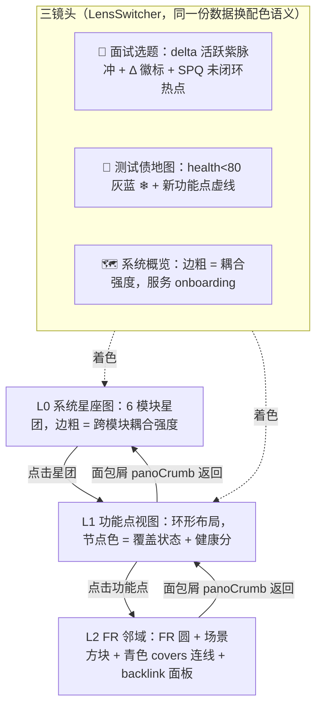
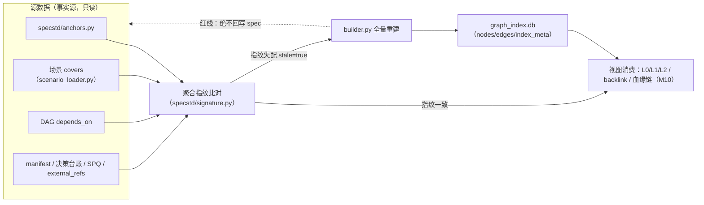

# M11 · 全景图谱与里程碑演化 详细设计

> 原型屏：S7 全景图谱 · 架构层：L2 标准层 + L4 工作台 · 现状定性：新建（图谱索引为确定性派生）
> 事实源：《SpecGuard 技术架构》2026-07-31 快照、specflow 方案 §4.6、Vision 原型 S7（PANODATA / renderPano / renderDiffSum）
> 血缘链视图（图谱的线性投影）见 M10；图谱索引 Agent 的运行时承载见 M12。

---

## 0. 模块卡

| 项 | 内容 |
|---|---|
| 模块名 | 全景图谱与里程碑演化（Graph Index & Panorama / Milestone Evolution） |
| 原型屏 | S7 · 全景图谱（L0 星座图 → L1 功能点 → L2 FR 邻域 · 三镜头 · 图谱索引 Agent strip · 里程碑时间轴 · 演化 diff） |
| 架构层 | L2 标准层（图谱索引：确定性派生服务）+ L4 工作台（图谱视图、时间轴、diff 视图） |
| 现状定性 | **新建**（图谱索引/快照/视图为零起步；全部源数据已有；渲染依赖 elkjs 已有） |
| 里程碑映射 | G1 可先行（图谱索引 + 覆盖缺口视图 + 里程碑快照机制，不依赖 specflow）→ F4 血缘与图谱主线 → G2（时间轴/diff 视图、面试影响面）→ G3（V2 候选：圈选/术语节点） |
| 依赖模块 | M07（覆盖缺口数据）、M04（决策台账，G2 起）、M05（delta manifest/归档事件）、M09（报告/SPQ，测试债与反哺热度）、M10（血缘链共用 graph_index）、M12（Agent 运行时） |

## 1. 模块定位与职责

**解决什么问题**：SpecGuard 的链接关系早已以确定性结构存在——场景 `covers`、DAG `depends_on`、delta `[delta:代号]` 标记、决策台账——但它们散落在 YAML/SQLite/文件系统里，不可浏览、不可下钻、不可回答「系统这几周真实长出了什么」。本模块把隐式图谱**物化成索引 + 可视化**，并给全景配历史版本（里程碑事件快照 + 源数据指纹）。

**三条设计红线**（specflow §4.6 已拍板，本模块的最高约束）：

1. **不引入 `[[wiki-link]]` 语法**——反向链接一律计算得出，spec.md 格式权威是 specstd，手工链接是第二条会腐烂的标注通道；
2. **图谱是派生物，不是事实源**——任何时刻删掉索引重建必须得到同一张图；内容指纹失效即重建；**绝不把链接回写进 spec.md 等文件**；
3. **每个视图必须挂一个决策动作**——全景页挂三镜头（面试选题 / 测试债地图 / 系统概览），不做无目的的原始节点漫游页。

**历史版本原则**：不建图谱级 git、不跟踪连续变化。触发点 = delta 冻结 / 归档 / 计划执行完成（都是已有事件）；快照 = 节点 ID 集 + 边集 + 着色属性 + 源数据指纹；任何快照可凭指纹 checkout 重建校验，日常不跑、审计可验。

**本模块不做**：

- 不做图谱级版本库（给派生物配版本库违反红线且必然与源数据漂移）；
- 不做血缘链的线性叙事视图（M10 的职责，共用本模块 graph_index）；
- 不做 LLM 生成式构图——索引构建是确定性派生，「图谱索引 Agent」的名字指其流水线形态（源数据 → 处理 → 输出 + 闸门），不是指 LLM 自由发挥；
- 不做业务编辑入口——图谱视图只读，修改永远回源系统。

## 2. 原型交互 → 功能拆解

| 原型界面元素（S7） | 功能点 | 后端支撑（已有/新建） |
|---|---|---|
| L0 系统星座图（6 模块星团：系统设置/盘点操作/人员管理/360评价/数据管理/ES 加速，半径 ∝ FR 总数） | 模块级聚合视图 | 图谱索引 L0 聚合（**新建**：`graph_index` 模块节点 + 聚合查询）；模块划分 = spec 目录结构（已有：`scenarios/` 按模块分目录 + `_suite.yaml`） |
| L0 模块间连线，边粗 = 跨模块耦合强度（w: 1.2~3） | 跨模块耦合度量化 | 耦合强度计算（**新建**：跨模块 covers 共享/场景 DAG 跨模块依赖计数，确定性公式） |
| 点击星团 → L1 功能点视图（环形布局 + 中心模块锚点） | L1 模块内视图 | 图谱索引 L1 查询（**新建**）；elkjs 布局（已有：前端 DagEditor 用 elkjs 懒加载，同款复用） |
| L1 节点色 = 覆盖状态（绿全覆盖 / 红零覆盖 / 黄部分），副标「FR n · 健康分」 | 覆盖状态着色 | covers 关联统计（已有：`covers_gate.py` 的 covers 口径）；健康分数据（**新建**：健康分计算服务，输入 = 覆盖 + 近期执行 + SPQ 未闭环数） |
| 点击功能点 → L2 FR 邻域（圆 = FR，方块 = 场景，青色 covers 连线；点击节点聚焦邻域、其余压暗为底图） | L2 FR 邻域视图 | 图谱索引 L2 查询（**新建**：FR 节点 + covers 边 + FR 互提边） |
| backlink 面板（点 FR →「哪些场景覆盖我 / 哪些 delta 改过我 / 哪些决策引用我」） | 计算型反向链接 | backlink 查询 API（**新建**：graph_index 逆向查询，只读不落盘） |
| 三镜头按钮：🧭 面试选题 / 🧊 测试债地图 / 🗺 系统概览 + 镜头提示语 | 三套配色语义切换 | 镜头语义层（**新建**：纯呈现策略，索引层不变） |
| 🧭 面试选题：紫色脉冲 = 本期 delta 活跃、Δ 徽标 = delta 密集度、SPQ 未闭环热点 | 面试选题依据物化 | delta 密集度统计（**新建**：按模块聚合本期 ADDED/MODIFIED FR 数）；SPQ 未闭环（已有：`feedback/ledger.py` 状态机） |
| 🧊 测试债地图：❄ = 健康分 <80 的功能点、虚线 = 新功能点（无健康分） | 测试债可视化 | 健康分 <80 筛选 + 长期无执行判定（**新建**：执行历史来自 `.specguard/reports/` 归档，已有：`report_writer.py`/`execution_record.py`） |
| 🗺 系统概览：边粗 = 耦合强度，服务新人 onboarding | 系统全貌视图 | 同 L0 耦合数据 |
| 图谱索引 Agent strip：源数据（anchors/covers/DAG/manifest/决策台账）→ 处理（确定性派生 · 指纹失效即重建）→ 输出（图谱索引）→ 闸门（派生物非事实源 · 可删可重建 · 绝不回写 spec） | 索引构建流水线的对外宣示 | 图谱索引构建器（**新建**：`graph_index/builder.py`）；指纹机制（已有：`specstd/signature.py` 内容指纹） |
| 里程碑时间轴滑块（V1.0 初始基线 07-09 → history-inventory-refactor 归档 07-21 → es-acceleration 归档 07-21 → smart-tag 进行中 07-31） | 事件驱动里程碑快照 | 快照机制（**新建**：`.specflow/graph_snapshots/`）；触发点事件（已有：delta 冻结/归档见 M05、计划执行完成已有：`plan_executor.py`） |
| 「⇄ 演化 diff」开关 + diff 汇总条（+新增 / -移除 / ~修改统计 + 快照指纹） | 系统演化地图 | 快照 diff（**新建**：两快照节点/边集合比对，确定性） |
| diff 着色：新增绿脉冲 / 消失红空心虚线 / 属性变黄 | 演化状态呈现 | diff 结果渲染（**新建** 前端） |
| 数据 = 真实工作区快照（28 功能 · 298 FR · 25 场景 covers） | 数据口径 | 真实工作区 tdm specs 解析（已有：`specstd/anchors.py` + `scenario_loader.py`） |

## 3. 现状与差距

**已有能力（真实模块名）**：

- 全部源数据就绪：FR/AC 锚点解析（已有：`specstd/anchors.py`）；场景 covers（已有：场景双层 YAML + `scenario_loader.py`）；DAG 依赖（已有：`dependency_graph.py` 拓扑/环检测）；covers 关联门禁口径（已有：`workbench/backend/services/covers_gate.py`）；执行历史（已有：`.specguard/reports/` 归档）；SPQ 台账（已有：`feedback/ledger.py`）；delta/manifest 结构（见 M05）。
- 指纹机制：内容指纹已有（`specstd/signature.py`，delta diff 与契约指纹的基础）——「指纹失效即重建」的确定性依据直接复用；契约指纹 sha256-12（已有：`versioning.py`）同款口径。
- 前端渲染底座：DAG 画布用 elkjs 懒加载布局（已有：DagEditor 页），图谱视图同款复用，零新依赖；React18 + TS 严格模式 + 16 页面路由体系已有。
- 多工作区隔离：索引按工作区缓存，透传链路已有（`specstd/workspace.py` contextvar + `X-SG-Workspace` header）。

**缺口清单（新建）**：

1. **图谱索引构建器**（新建：`graph_index/builder.py`）：源数据 → 节点 + 类型化边的确定性派生；按工作区缓存；指纹比对失效即重建。
2. **图谱索引存储**（新建：各工作区 `.specguard/graph_index.db`，SQLite，gitignore，可删可重建）。
3. **健康分与测试债指标**（新建：确定性公式，输入 = 覆盖率 + 近 N 天执行次数 + 未闭环 SPQ 数）。
4. **里程碑快照机制**（新建：`.specflow/graph_snapshots/` + 三触发点挂接 + 快照指纹）。
5. **快照 diff 服务**（新建：两快照集合比对 → ADDED/MODIFIED/REMOVED）。
6. **图谱视图前端**（新建：L0/L1/L2 语义缩放 + 三镜头 + 时间轴 + diff 视图 + backlink 面板）。
7. **REST API + MCP 工具**（新建，见 §5）。

## 4. 数据模型

### 4.1 图谱索引存储（新建，按工作区隔离）

```
{workspace}/.specguard/graph_index.db      # SQLite，gitignore，删了重建必须得到同一张图
{workspace}/.specflow/graph_snapshots/     # 里程碑快照（需求侧产物口径，版本化保留）
├── snap_2026-07-09_init.json              # V1.0 初始基线
├── snap_2026-07-21_history-inventory-refactor.json
├── snap_2026-07-21_es-acceleration.json
└── snap_2026-07-31_smart-tag-wip.json     # 进行中档（最新计划执行完成触发）
```

graph_index.db DDL 草拟（新建）：

```sql
CREATE TABLE nodes (
  id          TEXT NOT NULL,              -- FR-012 / PP-RC-005 / delta:extend-void-scope / D-012 / mod:inventory
  node_type   TEXT NOT NULL,              -- module|feature|fr|ac|scenario|delta|decision|plan|run|spq|external_ref|interview
  stage       TEXT,                       -- req|dev_ext|test|feedback（M10 谱系阶段，可空）
  title       TEXT,
  module      TEXT,                       -- 归属模块（L0 聚合键）
  feature     TEXT,                       -- 归属功能点（L1 聚合键，如 inventory/grid-placement）
  attrs       TEXT NOT NULL DEFAULT '{}', -- JSON：covers 状态/健康分/era/delta 代号等着色属性
  PRIMARY KEY (id)
);
CREATE TABLE edges (
  src      TEXT NOT NULL,
  dst      TEXT NOT NULL,
  edge_type TEXT NOT NULL,   -- covers|depends_on|modifies|decides|references|contains|produces|derives|schedules|executes|feedback|archives|locks|relates
  attrs    TEXT NOT NULL DEFAULT '{}',
  PRIMARY KEY (src, dst, edge_type)
);
CREATE TABLE index_meta (
  key   TEXT PRIMARY KEY,   -- source_fingerprint / built_at / specstd_version / workspace
  value TEXT NOT NULL
);
```

`index_meta.source_fingerprint` = 全部源数据（specs 目录内容指纹 + 场景目录内容指纹 + 决策台账/SPQ 台账最大时间戳 + manifest 清单）的聚合指纹，算法复用 `specstd/signature.py`（已有）。重建判定：读源数据算指纹 → 与 index_meta 比对 → 不一致即整库重建。

### 4.2 里程碑快照 JSON schema（新建）

```json
{
  "snapshot_id": "snap_2026-07-21_es-acceleration",
  "trigger": "delta_archived",            // delta_frozen | delta_archived | plan_completed
  "label": "es-acceleration 归档",
  "created_at": "2026-07-21T18:00:00",
  "source_fingerprint": "sha256-12:9f3a…",   // 可凭指纹 checkout 重建校验
  "nodes": [{"id": "FR-…", "node_type": "fr", "module": "es-acceleration", "feature": "…", "attrs": {}}],
  "edges": [{"src": "…", "dst": "…", "edge_type": "covers"}]
}
```

快照体量：300 FR 量级 ≈ 数百 KB JSON，符合 specflow「几百 KB JSON」预期。

### 4.3 视图数据 schema（对齐原型 PANODATA，API 出参）

```json
{
  "eras": [{"id": "init", "label": "V1.0 初始基线", "date": "07-09"}],
  "l0mods": {"inventory": {"name": "盘点操作", "x": 500, "y": 230}},
  "l0edges": [{"a": "system-settings", "b": "inventory", "w": 3}],
  "l1": {"inventory": [{"id": "inventory/grid-placement", "name": "九宫格落位",
          "health": 92, "counts": [8, 8, 8, 8], "era": 0, "nCov": 0, "nGap": 8}]},
  "l2": {"inventory/grid-placement": {
    "frs": [{"id": "FR-012", "t": "作废级联删除…", "era": 1, "modAt": null, "goneAt": null, "cov": "ok"}],
    "frEdges": [["FR-012", "FR-013"]],
    "scenarios": [{"id": "PP-RC-005", "covers": ["FR-012"]}]}}
}
```

字段语义：`counts[i]` = 第 i 个里程碑档的 FR 数（时间轴着色）；`era` = 节点首次出现的快照档；`modAt`/`goneAt` = 最后修改/移除档；`nCov`/`nGap` = 有覆盖/缺口场景计数；`health` = 健康分（null = 新功能点）。

> 演示数据注：本节示例中的 PP-RC-005、FR-012（即 FR-012@grid-placement）等为原型 S7 演示数据；场景 ID 与 covers 关系以场景库实际为准——S5 叙事中同 FR 的覆盖场景为 IA-VOID-001/d-118（见 M07）。

### 4.4 健康分公式（新建，确定性）

```
health = clamp(0..100,
  100
  - 30 * (1 - covered_fr_ratio)        # 覆盖率项
  - 40 * stale_factor                  # 近 30 天无执行 → stale_factor 线性升到 1
  - 10 * open_spq_count)               # 未闭环 SPQ（pending/in_progress）每个扣 10
```

数据源：覆盖率（已有：covers 口径）、执行时间（已有：`.specguard/reports/`）、SPQ 状态（已有：`feedback/ledger.py`）。公式可调参数落 settings（已有：`settings_store.py` DB 驱动热加载），调整不需发版。

## 5. 接口设计

### 5.1 REST API（新建，挂 workbench 新 router `graph`，RBAC `Depends(get_current_user)`）

| 方法 | 路径 | 入参 | 出参要点 |
|---|---|---|---|
| GET | `/api/graph/panorama` | `level=L0`，`lens=topic|debt|map`，`era=<snap_id>`（缺省当前） | L0 视图数据（模块节点 + 耦合边 + 镜头着色属性） |
| GET | `/api/graph/panorama/{module}` | `lens`、`era` | L1 功能点视图数据（含 l1edges、health、counts、nCov/nGap） |
| GET | `/api/graph/panorama/{module}/{feature}` | `era` | L2 FR 邻域（frs + frEdges + scenarios + covers 边） |
| GET | `/api/graph/backlink/{node_id}` | — | 计算型反向链接：`{covered_by: [], modified_by: [], decided_by: [], referenced_by: []}`，只读不落盘 |
| GET | `/api/graph/snapshots` | — | 里程碑快照列表（id/label/date/trigger/fingerprint） |
| GET | `/api/graph/diff` | `from=<snap_id>`，`to=<snap_id|current>` | `{added: n, removed: n, modified: n, per_module: {...}, fingerprint_from, fingerprint_to}` |
| POST | `/api/graph/rebuild` | — | 强制重建索引（幂等；校验类管理操作，需 admin 或 tester 角色） |
| GET | `/api/graph/status` | — | `{fingerprint, source_fingerprint, stale: bool, built_at}`（指纹失配 stale=true） |

### 5.2 MCP 工具（新建，挂 `mcp_server` 新工具模块 `graph_index`，注册进 `server.TOOL_MODULES`）

| 工具 | 参数 | 说明 |
|---|---|---|
| `graph_query` | `level, module?, feature?, era?` | 图谱查询（同 REST panorama）；纯读 |
| `graph_backlink` | `node_id: str` | 反向链接查询；纯读 |
| `graph_rebuild` | — | 触发索引重建（写索引库，不动任何源数据；区别于「纯读校验类」） |
| `graph_snapshot` | `label?, trigger` | 手动打里程碑快照（三自动触发点之外的补充）；写 `.specflow/graph_snapshots/` |

### 5.3 前端组件（新建，复用 elkjs 懒加载同款模式，零新依赖）

- `GraphPanorama.tsx`：图谱页（新页面）。SVG/elkjs 渲染 L0/L1/L2 三层语义缩放 + 面包屑（`panoCrumb`：系统星座图 / 模块 / 功能点，可点击返回）。
- `LensSwitcher`：三镜头按钮 + 镜头提示语（LENSHINT 口径）。
- `MilestoneTimeline`：时间轴滑块（tlRange）+ 里程碑刻度（tlMarks）；切档即重取该 era 的视图数据。
- `EvolutionDiffPanel`：diff 开关 + 汇总条（`📸 {from} → 当前：+a 新增 · -r 移除 · ~m 修改 ｜ 快照指纹 …可凭指纹 checkout 重建校验`）。
- `BacklinkPanel`：点 FR 弹计算型 backlink 列表。
- 规模策略：当前 28 功能 · 298 FR 量级 L0 可直接展开；模块规模超阈值（如 FR > 2000）时 L0 自动聚合——缩放仅是呈现策略，索引层第一天即全量。

## 6. 关键流程

### 6.1 图谱下钻时序（原型主路径：L0 → L1 → L2）

> 演示数据注：本流程示例（PP-RC-005、FR-012@grid-placement 等）沿用原型 S7 演示数据；场景 ID 与 covers 关系以场景库实际为准（见 §4.3 注与 M07）。

1. 用户打开图谱页，前端 `GET /api/graph/status`：若 `stale=true`（指纹失配）自动触发 rebuild 后再取数（对用户透明，页头短暂显示「索引重建中」）。
2. `GET /api/graph/panorama?level=L0&lens=topic` → 渲染 6 模块星团；面试选题镜头下 smart-tag 所在模块（system-settings/inventory）紫脉冲 + Δ 徽标（本期 delta 活跃计数）。
3. 点击「盘点操作」星团 → `GET /api/graph/panorama/inventory?lens=topic` → L1 环形布局：11 个功能点围绕中心锚点，节点色 = 覆盖状态（九宫格落位 health 92 黄、盘点人员清单 health 75 带 ❄ 徽标）。
4. 切 🧊 测试债地图镜头 → 同一份 L1 数据换配色语义：health<80 灰蓝 ❄、新功能点虚线描边。
5. 点击「九宫格落位」→ `GET /api/graph/panorama/inventory/grid-placement` → L2：FR 圆点环 + 场景方块（PP-RC-005 等）+ 青色 covers 连线；点击 FR-012@grid-placement 聚焦其邻域、其余压暗为底图，backlink 面板列出 `covers ← PP-RC-005` / `delta ← extend-void-scope` / `互提 → FR-013…`。

下图把 §6.1 的下钻路径抽象为 L0/L1/L2 三层语义缩放与三镜头着色（索引层不变，镜头只是呈现策略）：



### 6.2 里程碑快照生成流程（事件驱动，三触发点）

1. 触发点 A：delta 冻结（见 M05 冻结三闸通过事件）；触发点 B：delta 归档（changes→archive，见 M05）；触发点 C：计划执行完成（已有：`plan_executor.py` 收尾钩子）。
2. 快照器从当前 graph_index 导出节点 ID 集 + 边集 + 着色属性（covers 状态/健康分/era），计算源数据聚合指纹（`specstd/signature.py` 口径）。
3. 写 `.specflow/graph_snapshots/snap_<date>_<label>.json`（版本化保留，随工作区 git 提交）。
4. 时间轴出现新刻度；进行中档（如 smart-tag）随最近一次触发点 C 持续刷新。

### 6.3 演化 diff 流程（原型主路径）

1. 用户拖时间轴到「history-inventory-refactor 归档」档，打开「⇄ 演化 diff」。
2. 前端 `GET /api/graph/diff?from=snap_2026-07-21_history-inventory-refactor&to=current`。
3. 后端读两份快照（或快照 vs 当前索引），逐节点比对：在 from 不在 to → removed（红空心虚线）；在 to 不在 from → added（绿脉冲）；两边都在但 attrs 变 → modified（黄）。
4. 汇总条输出：`📸 history-inventory-refactor 归档 → 当前：+N 新增 · -M 移除 · ~K 修改 ｜ 快照指纹 ws@refactor · 真实 specs 解析（可凭指纹 checkout 重建校验）`——即评审会/复盘要用的「系统演化地图」。

### 6.4 索引重建流程（指纹失效即重建）

1. 任意图谱查询前置校验：实时计算源数据聚合指纹 → 比对 `index_meta.source_fingerprint`。
2. 失配 → builder 全量重建：解析 specs 锚点（`specstd/anchors.py`）→ 扫描场景 covers（`scenario_loader.py`）→ 读 DAG depends_on → 读 manifest/决策台账/SPQ/external_refs → 写入 nodes/edges → 更新指纹。
3. 重建全程不触碰任何源文件（红线 2：绝不回写 spec）；重建结果对同一份源数据必须确定性一致（入验收标准）。

下图概括 graph_index 的确定性派生流水线与「指纹失效即重建」判定（对应 §6.4 与图谱索引 Agent strip）：



## 7. 闸门与确定性校验

- **图谱红线 1（无手工链接语法）**：边只从 anchors/covers/DAG/manifest/决策台账/external_refs 确定性派生；代码层不设任何「手动加边」API。
- **图谱红线 2（派生物非事实源）**：索引库与快照可删可重建——验收强制项「删除 graph_index.db 重建，节点/边集合与删除前逐条一致」；任何写路径不得触碰 spec.md / 场景 YAML / 台账。
- **图谱红线 3（每个视图挂决策动作）**：三镜头各自挂动作——面试选题 → 下轮面试议题（见 M02）；测试债地图 → 生成选题依据（见 M07；generate 能力在模式移除后由 skill/purpose 承载，见 M01/M12，generate-scenario skill 不受影响）；系统概览 → 新人 onboarding 导览；backlink 面板挂「跳转源节点」。
- **铁律 2（确定性校验）**：索引构建、健康分、耦合强度、diff 全部为确定性计算，零 LLM 参与；「图谱索引 Agent」是流水线命名，其闸门就是「可删可重建」。
- **铁律 1（Agent 只建议，人拍板）**：镜头给出的选题/测试债清单是建议，生成场景、安排面试永远由人发起。
- **铁律 4（链可跨界，资产不跨界）**：external_ref 节点入图但只读跳转（与 M10/M06 同口径）。
- **RBAC**：graph router 全挂 `Depends(get_current_user)`；rebuild/snapshot 等写索引操作限 admin/tester。

## 8. 依赖与边界

**上游**：

- 源数据：`specstd/anchors.py`（已有）、场景库 covers（已有）、`dependency_graph.py`（已有）、delta manifest（见 M05）、决策台账（见 M04，G2 起）、`.specguard/reports/`（已有）、`feedback/ledger.py`（已有）、`sf_external_refs`（见 M06）。
- 指纹：`specstd/signature.py`（已有）。
- 运行时：图谱索引 Agent 的 mode/skill 承载见 M12。

**下游**：

- M10 血缘链（本模块 graph_index 是其唯一直接数据源）；
- M02 面试会话右面板「影响面图谱」页签（G2：候选 FR → 受影响连通分量高亮）；
- M07 覆盖缺口图谱（G1：无覆盖红/有覆盖绿/草稿待审黄，复用本索引）。

**不承担**：

- 不定义覆盖门禁规则本身（已有：`covers_gate.py`，本模块只消费其口径）；
- 不做 delta 合并/归档业务逻辑（见 M05，本模块只挂其事件）；
- 不做血缘链线性视图渲染（M10）；不做研发资产管理（铁律 4/8）。

## 9. 里程碑映射与验收标准

**G1（可先行，不依赖 specflow）**：图谱索引 + 测试侧覆盖缺口视图 + 里程碑快照机制（三触发点）。

- 验收：
  1. 真实 tdm 工作区构建索引，FR/场景/covers 边计数与 `covers_gate.py` 的覆盖矩阵口径一致（抽样 10 个 FR 比对通过）；
  2. 删除 graph_index.db 重建，nodes/edges 与重建前逐条一致（确定性派生证明）；
  3. 修改任一场景 covers 后 `/api/graph/status` 返回 stale=true，rebuild 后 stale=false；
  4. 手动触发 `graph_snapshot`，`.specflow/graph_snapshots/` 出现带 source_fingerprint 的快照文件。

**F4（血缘与图谱主线）**：全景页三层语义缩放 + 三镜头 + 时间轴 + 演化 diff。

- 验收：
  1. L0→L1→L2 下钻路径全程可用，L2 中点击 FR 的 backlink 面板三类反向链接（covered_by / modified_by / decided_by）均可追溯到真实源数据；
  2. 时间轴拖至历史档 + 打开 diff，汇总条 ADDED/MODIFIED/REMOVED 计数与两份快照逐节点人工抽验一致；
  3. 凭快照中的 source_fingerprint checkout 源数据历史状态重建索引，与快照节点/边集合一致（审计可验）。

**G2**：面试影响面图谱 + 决策→FR 边 + 快照时间轴/diff 视图完善（依赖 specflow F1 决策台账）。

- 验收：面试会话右面板影响面页签中，议题映射的候选 FR 集合高亮且下游连通分量变色；「影响面确认」动作纳入 P0 清零门禁（见 M02/M04）。

**G3（V2 候选）**：delta 图谱圈选 → manifest 草稿；glossary 术语节点入图。单独立项评审，不在本模块承诺范围。

**验收红线（任何阶段）**：对 graph_index / 快照的全部读写操作序列，不改变 specs/、scenarios/、台账、sf_external_refs 的任何字节；图谱页不存在任何「编辑边/编辑节点」入口。
