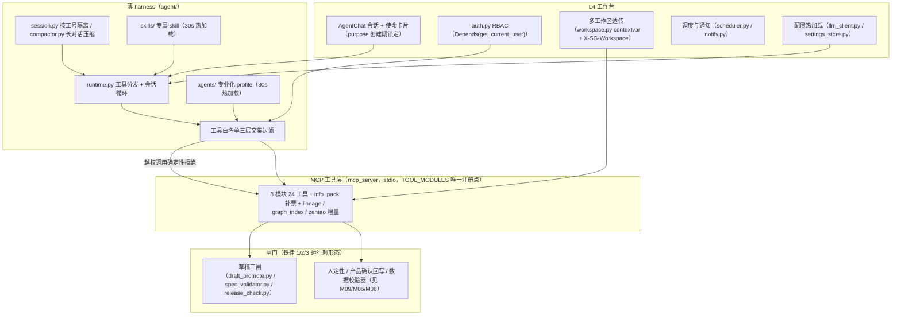

# M12 · 多智能体运行时与平台基建 详细设计

> 原型屏：S8 研发·智能体 + 全局 · 架构层：L3 智能层 + L4 工作台 · 现状定性：增强（薄 harness / MCP 24 工具 / RBAC 已有）
> 事实源：《SpecGuard 技术架构》2026-07-31 快照、specflow 方案 §4.2/§4.5/七、Vision 原型 S8（边界宣言 / 5 智能体卡片 / 三原则）
> 本模块是其他模块的「承载层」：各专业化 Agent 的业务设计见 M03/M08/M09/M06/M11，本文只定运行时与基建规范。

---

## 0. 模块卡

| 项 | 内容 |
|---|---|
| 模块名 | 多智能体运行时与平台基建（Agent Runtime & Platform Foundation） |
| 原型屏 | S8 · 研发在链上的位置 & 多智能体策略；全局基建（RBAC/多工作区/配置/调度通知） |
| 架构层 | L3 智能层（薄 harness、MCP 工具层）+ L4 工作台（RBAC、多工作区、配置、调度） |
| 现状定性 | **增强**：薄 harness（`agent/`）、MCP stdio 8 模块 24 工具、RBAC、多工作区透传、DB 驱动配置热加载、调度通知均已上线；专业化 Agent 装配规范、工具白名单、外部边界声明为新建 |
| 里程碑映射 | F2 工作台与多用户（已落地为主）→ G1-G3 智能体深化（材料包解析 / 图谱索引 / 测试数据制造 / 失败归因 / 故事点评估 的分阶段专业化落地） |
| 依赖模块 | 承载 M03（📎材料包解析）、M11（🌐图谱索引）、M08（🧬测试数据制造）、M09（🔬失败归因）、M06（📊故事点评估 skill）；被 M01（会话路由/使命卡片）消费 |

## 1. 模块定位与职责

**解决两个问题**：

1. **立场问题（边界宣言）**：SpecGuard 与编码智能体（Codex / Claude Code）是什么关系？——互补不竞争。研发在链上、但在边界外：研发产物（禅道故事 / PR / 单测）经 external_refs 登记引用入链接受治理，**链可跨界，资产不跨界**（铁律 4）。SpecGuard 不做编码智能体（铁律 8）。
2. **工程问题**：多智能体有必要，但路线是**按阶段专业化 + 确定性闸门**——不做全能大 Agent。本模块给出薄 harness 承载阶段专业化的规范：每个专业化 Agent = 一个工作模式（agent profile）+ 一组 skill + 工具白名单，全部走 30s 热加载，新增/调整 Agent 无需重启、无需改运行时代码。

**本模块做什么**：

- Agent 装配规范（profile + skills + 工具白名单三件套）与热加载机制维护；
- MCP 工具层扩展规范（新工具模块如何挂载 `TOOL_MODULES`、校验类工具纯读纪律）；
- 平台基建的维护与扩展：RBAC/多用户、多工作区透传、LLM 配置热加载、调度与通知；
- G1-G3 智能体深化路线的运行时排期。

**本模块不做**（边界宣言，原型 S8 三列卡片的工程化）：

| ✕ 不做 | ✓ 做 | ⇄ 与编码 Agent 的关系 |
|---|---|---|
| 代码生成 / 补全 / 重构 | 登记引用 · 落笔即挂链 | Codex / Claude Code ＝ 研发的编码工具 |
| 研发管理（不替代禅道 / GitLab） | spec ↔ 禅道故事双向锁定（见 M06） | SpecGuard ＝ 质量链治理平台 |
| 拥有研发资产（PR / 单测） | 链完整性校验：断链 = WARNING（见 M10） | 互补：编码 Agent 产出入链被治理 |

## 2. 原型交互 → 功能拆解

| 原型界面元素（S8 + 全局） | 功能点 | 后端支撑（已有/新建） |
|---|---|---|
| 边界宣言头版「研发在链上，但 SpecGuard 不做编码智能体」 | 立场宣示 + 文档化边界 | 铁律 8（已有约定）；本模块 §1 边界表（**新建** 文档化，无代码） |
| 四段链图 ①需求 specflow ②研发·业务项目侧（边界外） ③验证 测试侧 ④反哺 feedback | 研发在链上的位置说明 | external_refs 登记引用（见 M06）；血缘链视图（见 M10） |
| ✕不做 / ✓做 / ⇄关系 三列卡片 | 能力边界清单 | 同上，文档化 |
| 5 个智能体卡片：📎材料包解析（S4·需求面试，闸门：人拍板入台账）/ 🌐图谱索引（S7，闸门：可删可重建）/ 🧬测试数据制造（S5·DAG，闸门：数据校验器）/ 🔬失败归因（S5·执行反馈，闸门：人定性才生效）/ 📊故事点评估 skill（S4·产出交付，闸门：产品确认回写） | 阶段专业化 Agent 注册与呈现 | 薄 harness 会话循环（已有：`agent/runtime.py` 工具分发 + 会话循环）；5 个专业化 Agent 的 profile/skill/白名单三件套（**新建**，业务逻辑各见 M03/M11/M08/M09/M06） |
| 每条卡片带「闸门：…」 | 每个产出必过闸的明示 | 各闸门实现（已有/见各模块：草稿三闸已有 `draft_promote.py` + `release_check.py`；数据校验见 M08；人定性见 M09；产品确认回写见 M06） |
| 三原则条：①Agent 只建议，人拍板 ②校验走确定性校验器 ③每个产出必过闸 | 治理原则 | 铁律 1/2/3（已有约定）；运行时强制点（**新建**：工具白名单阻断越权工具、写类工具必经闸门口径校验） |
| （全局）登录 / RBAC / 多用户 | 认证授权 | 已有：`workbench/backend/services/auth.py`（`SG_AUTH_MODE=uac|mock`）、`SG_ADMIN_ACCOUNTS` 预置管理员、15 router 挂 `Depends(get_current_user)` |
| （全局）工作区切换器 | 多工作区透传 | 已有：前端 WorkspaceSelector 注入 `X-SG-Workspace` header → `specstd/workspace.py` contextvar 全链路透传（agent/MCP/covers） |
| （全局）设置页 LLM 配置 | 配置热加载 | 已有：`agent/llm_client.py` DB 驱动配置热加载 + `llm_config.py`/`model_config.py`/`settings_store.py` |
| （全局）调度页 / 通知配置页 | 定时调度与通知出口 | 已有：`scheduler.py` + `notify.py` + `notify_config.py`，Schedules / NotifyConfigs 页面 |

## 3. 现状与差距

**已有能力（真实模块名）**：

- 薄 harness 完整在线：`agent/runtime.py`（~420 行，工具分发 + 会话循环）、`agent/session.py`（多用户按工号隔离 `agent/sessions/{emp}/`）、`agent/compactor.py`（长对话压缩）、`agent/llm_client.py`（DB 驱动配置热加载）、`agent/prompts/system.md.j2`（system prompt 模板）、`agent/cli.py`（POC 入口）。
- 热加载机制：`mode_loader.py` + `modes/`（现有 generate / debug / analyze / audit / chat 五个模式，YAML frontmatter + Markdown 正文，30s TTL 热加载）；`skill_loader.py` + `skills/`（现有 generate-scenario / validate-conformance / debug-failure，正文注入 `<skills>` XML 块）；新增文件无需重启。
- MCP 工具层：`mcp_server/server.py` stdio，8 个工具模块共 24 工具（spec_reader / scenario_tools / registry_query / draft_writer / validator / attribution / audit / meta）；`tools/live_registry.py` 运行时注册 engine 适配包；`info_pack.py` 基础读写已实现但**尚未挂载** `server.TOOL_MODULES`。
- 平台基建：RBAC（已有：`auth.py`，生产 UAC SSO 单端口 :9100，workers=1 不可改）；多工作区（已有：`specstd/workspace.py`）；配置（已有：DB 驱动热加载）；调度通知（已有：`scheduler.py`/`notify.py`）；存储 SQLite `workbench.db` + 文件系统。
- Agent 产物三闸已有先例：草稿三闸（人工评审 → 格式校验 → 发布门禁，已有：`draft_promote.py` / `spec_validator.py` / `release_check.py`）。

**缺口清单（新建/增强）**：

1. **专业化 Agent 装配规范**（新建）：profile（定位/工具白名单/闸门声明）+ 专属 skill 文件 + 系统提示词章节，三件套落盘约定；与「会话用途 purpose 创建期锁定」（specflow §4.5/七，已拍板）对齐——purpose 驱动提示词装配/工具可见集/面板/产物归属，不引入运行时模式切换中间件。
2. **工具白名单机制**（新建）：按 Agent 声明可见工具子集，`agent/runtime.py` 分发前过滤；越权调用直接拒绝（确定性，不靠提示词自觉）。skill 注册表/版本/审查管线的设计见 M13。
3. **5 个专业化 Agent 落地**（新建，业务设计各见 M03/M11/M08/M09/M06；本模块负责注册表与装配）。
4. **MCP 新工具模块**：`info_pack.py` 挂载补票 + M06 zentao 工具 / M10 lineage / M11 graph_index 模块（各见对应模块，挂载规范在本文 §5.2）。
5. **RBAC product 角色扩展 + 多角色支持**（增强：specflow F3，见 M04/M05；本模块负责 `auth.py` 角色枚举与路由权限矩阵）。**v1.8 决策：单角色→多角色**——`users.role` 单值改为 `roles` 多值（逗号分隔），`require_role(*roles)` 语义从「用户角色 ∈ roles」改为「用户角色集合 ∩ roles ≠ ∅」（包含任一即通过），`is_admin` 语义不变；新增 `product` 角色；一个人可同时持 tester+product（既做测试编排又做需求面试），用途可见性按角色集合并集（见 M01 v1.8）。

## 4. 数据模型

### 4.1 专业化 Agent 三件套（新建，目录约定）

```
agent/
├── modes/                        # 已有；专业化 Agent 的 profile 沿用同款 frontmatter 机制
│   └── （模式机制正按另一会话规划收敛，专业化 profile 改落 agents/，与模式移除互为终态）
├── agents/                       # 新建：专业化 Agent profile（YAML frontmatter + Markdown 正文）
│   ├── pack-parser.md            # 📎 材料包解析（业务见 M03）
│   ├── graph-indexer.md          # 🌐 图谱索引（业务见 M11）
│   ├── data-maker.md             # 🧬 测试数据制造（业务见 M08）
│   ├── failure-attribution.md    # 🔬 失败归因（业务见 M09）
│   └── story-point.md            # 📊 故事点评估（skill 形态，业务见 M06）
└── skills/                       # 已有；每个 Agent 的专属 skill 文件加入此目录
    ├── parse-material.md
    ├── make-test-data.md
    └── attribute-failure.md
```

> 注：模式机制（modes/mode_router/locked_mode）正在另一会话移除中（specflow 七 · 硬性前提 4）。专业化 profile 不复用 modes 运行时状态，只复用其「frontmatter + 正文 + 30s 热加载」的加载机制；会话侧语义由 `purpose` 创建期字段承担（见 M01）。若两改造时序冲突，以 purpose 方案为终态。

### 4.2 Agent profile schema（新建，frontmatter 示例）

```yaml
---
name: failure-attribution        # 🔬 失败归因 Agent
stage: s5-feedback               # 守护阶段：s4-interview|s4-delivery|s5-dag|s5-feedback|s7-graph
temperature: 0.2
tools:                           # 工具白名单（runtime 分发前确定性过滤）
  - read_run_report              # spec_reader（已有）
  - read_scenario                # scenario_tools（已有）
  - db_evidence                  # scenario_tools（已有）
  - report_vulnerability         # attribution（已有）
skills:
  - attribute-failure
gate: human-verdict              # 闸门声明：human-ledger|human-verdict|data-validator|human-confirm-writeback|rebuildable
description: 执行证据 → 诚实 FAIL / 环境 SKIP 定性建议；闸门：人定性才生效
---
你是失败归因专家。你只输出定性**建议**，定性生效权在人。
诚实语义红线：上游失败下游 BLOCKED、数据缺失 SKIP，绝不把环境问题报成 FAIL。
（业务细则见 M09）
```

`gate` 字段是声明式元数据：工作台 Agent 卡片/审计页据此展示「闸门：人定性才生效」，运行时据此在校验清单中挂载对应闸门口径。

### 4.3 会话与用途（已有 + 增强）

会话持久化沿用 `agent/session.py`（按工号隔离 `.jsonl`）；会话模型增加 `purpose` 创建期字段（持久化、不可变；已拍板，见 M01）：

```json
{
  "session_id": "sess-7f3a9c", "emp": "A01234",
  "biz_ref": "IV-007",               // 业务锚点引用（面试 IV-xxx 等），session_id 本身用 sess-… 形式
  "purpose": "requirement_interview", // requirement_interview | test_workbench（与 M01 一致；初期仅此两值，防模式借尸还魂）
  "agent_profile": "pack-parser",    // 可选：purpose 默认装配的 profile
  "created_at": "2026-07-31T09:00:00", "locked": true
}
```

### 4.4 平台基建配置（已有，不新建表）

LLM/模型/通知配置均在 `workbench.db`（已有：`settings_store.py`/`llm_config.py`/`model_config.py`/`notify_config.py`），`agent/llm_client.py` DB 驱动热加载——改配置不用重启、不用发版。本模块零新表；唯一新增是 `auth.py` 角色枚举加 `product` 且**支持一人多角色**（v1.8：`users.roles` 多值逗号分隔，`require_role` 包含任一；存量单值 `role` 列兼容迁移：读时按逗号拆、写时合并）。（specflow F3，评审后实施）

## 5. 接口设计

### 5.1 REST API（多数已有，标注增量）

| 方法 | 路径 | 状态 | 说明 |
|---|---|---|---|
| POST | `/api/agent/sessions` | 已有 router + **增强** | 创建会话；入参新增 `purpose`（创建即锁定，不可变）；RBAC 过滤可用用途清单 |
| GET | `/api/agent/sessions` | 已有 | 会话树按用途标记过滤（purpose 徽标 + 身份色） |
| POST | `/api/agent/chat` | 已有 | 会话循环；purpose 驱动提示词装配 + 工具可见集 + 右侧面板 |
| GET | `/api/agent/profiles` | **新建** | 专业化 Agent 注册表（name/stage/gate/description，读 `agent/agents/`） |
| GET | `/api/agent/skills` | **新建**（详见 M13 §5.2） | skill 注册表清单端点（name/version/description/绑定 profile/depends_tools） |
| GET | `/api/settings/llm` · PUT 同径 | 已有 | LLM 配置读写，DB 驱动热加载即时生效 |
| POST | `/api/schedules` 等 | 已有 | 定时调度（`scheduler.py`）；专业化批处理（如图谱快照、断链巡检）复用此通道 |
| GET/PUT | `/api/notify/configs` | 已有 | 通知出口配置（`notify.py`） |

### 5.2 MCP 工具层扩展规范（本模块核心规范）

新工具模块四步挂载（以 M10 lineage 模块为例）：

1. 新建 `mcp_server/tools/lineage.py`，每个工具一个纯函数，docstring 即工具说明；
2. 在 `mcp_server/server.py` 的 `TOOL_MODULES` 列表追加模块名——**唯一的注册点**；
3. 遵守工具分类纪律：**校验/查询类工具必须纯读，禁止副作用**（已有约束，沿用）；写类工具（如 `register_external_ref`）必须在 docstring 声明副作用与闸门口径；
4. 回归验证：`python -m mcp_server.server` 启动后 `list_tools` 计数变化符合预期。

补票项：`info_pack.py`（基础读写已实现）挂入 `TOOL_MODULES`，配合 M02/M03 的 loop-back 装配启用。

### 5.3 工具白名单（新建，运行时强制）

`agent/runtime.py` 工具分发前增加白名单过滤：

```
resolve_tools(session) = TOOL_REGISTRY ∩ profile.tools（声明集） ∩ rbac_visible_tools（角色可见集）
```

三层交集，全部为确定性过滤；LLM 请求越权工具 → 直接返回拒绝消息，不执行、不依赖提示词自觉（铁律 2 的运行时形态）。

下图总览运行时分层：薄 harness（会话循环）→ profile/skill 装配 → MCP 工具层 → 闸门与审计，以及平台基建横切件：



### 5.4 前端（已有为主）

统一 AgentChat 入口 + 使命卡片（见 M01）；Agent 卡片/身份色体系纯 CSS/Tailwind 零新依赖（已拍板）。本模块新增仅 `AgentProfiles` 管理只读页（可选，展示注册表与闸门声明）。

## 6. 关键流程

### 6.1 新增一个专业化 Agent 的落地步骤（以 🔬 失败归因为例）

1. 业务设计完成（见 M09），产出 profile 草稿 `agent/agents/failure-attribution.md`（frontmatter 声明 tools/skills/gate）+ skill 正文 `agent/skills/attribute-failure.md`。
2. 文件落盘即生效——`mode_loader.py`/`skill_loader.py` 同款 30s TTL 热加载机制扫描 `agents/` 目录，无需重启、无需改 `runtime.py`。
3. 闸门挂接：`gate: human-verdict` 声明映射到人定性接口（见 M09）；Agent 产出的定性建议进工作台 Attribution 页，人确认才生效（已有页面）。
4. 注册表核验：`GET /api/agent/profiles` 出现新条目；白名单生效核验：构造越权工具调用请求被运行时拒绝。
5. 通知/调度按需挂接（如「新 FAIL 报告生成 → 触发归因建议 → notify 推送」，复用已有 `scheduler.py`/`notify.py`）。

### 6.2 会话运行时主流程（purpose 驱动的专业化装配）

1. 用户在 AgentChat 点「+ 新会话」，单击使命卡片（单击直达，已拍板，见 M01）→ `POST /api/agent/sessions {purpose: "requirement_interview"}`，创建即锁定。
2. 后端按 purpose 装配：提示词章节（`prompts/system.md.j2` 条件块）+ 默认 agent profile + 工具可见集（specflow 工具模块 vs 测试工具模块）+ 右侧面板（决策台账/五维评分 vs 覆盖缺口/DAG）。
3. 每轮对话：`runtime.py` 工具分发 → 白名单过滤（§5.3）→ 执行 → 回写会话 `.jsonl`（按工号隔离）；超长对话 `compactor.py` 自动摘要早期轮次。
4. Agent 产出物一律落草稿/建议区，过对应闸门才生效（草稿三闸已有；冻结三闸见 M05；数据校验见 M08；人定性见 M09；产品确认回写见 M06）。

### 6.3 多用户 + 多工作区一次请求的完整透传链（已有，固化为回归用例）

1. 请求进 :9100，`auth.py` 会话校验（生产 `SG_AUTH_MODE=uac` SSO，开发 mock）→ `Depends(get_current_user)` 注入用户与角色；
2. 前端 WorkspaceSelector 注入 `X-SG-Workspace` header → `specstd/workspace.py` contextvar 置位；
3. contextvar 全链路透传：agent 会话目录、MCP 工具文件读写、covers 校验、报告归档全部落到当前工作区的 `.specguard/`；
4. LLM 调用读取 `workbench.db` 最新配置（`llm_client.py` 热加载）；调度任务（`scheduler.py`）按工作区维度触发，通知走 `notify.py`。

### 6.4 MCP 工具上线流程（以 zentao 工具组为例，见 M06）

1. M06 交付 `mcp_server/tools/zentao.py`（story create / bug create / 双向锁定查询等）；
2. 挂 `TOOL_MODULES`；写类工具 docstring 声明「人确认回写」闸门口径；
3. `story-point` profile 的 tools 白名单加入 zentao 工具子集；
4. 联调：📊故事点评估 skill 按 FR 拆解给出故事点 + 置信度 → 产品确认 → 回写禅道（闸门：产品确认回写）。

## 7. 闸门与确定性校验

逐条呼应全局铁律（本模块是铁律的运行时承载层，全部相关）：

- **铁律 1（Agent 只建议，人拍板）**：台账、冻结、定性、故事点，生效权永远在人。运行时形态：Agent 产出只落草稿/建议区；每个 profile 的 `gate` 字段声明人确认点；UI 明示「闸门：…」。
- **铁律 2（校验走确定性校验器）**：P0 清零、锚点、DAG 无环、契约指纹走既有校验器（`specstd/conformance.py` 纯读、`dependency_graph.py`、`release_check.py`、`versioning.py` T6）；运行时新增的白名单过滤同为确定性机制。不靠 Agent 自觉、不靠 LLM 目测。
- **铁律 3（每个产出必过闸）**：草稿三闸（已有）/ 冻结三闸（见 M05）/ 数据校验（见 M08）/ 人确认回写（见 M06）——五 Agent 卡片各自的闸门即此铁律的逐 Agent 实例化。
- **铁律 4（链可跨界，资产不跨界）**：平台不提供任何研发资产写接口；external_refs 只登记引用（见 M06）；断链 WARNING（见 M10）。
- **铁律 5（被测系统解耦）**：接入新系统 = 新增 `systems/{system}/` 子包（5 项契约），引擎与 Agent 运行时零改动；`tools/live_registry.py` 导入时注册适配包。
- **铁律 7（诚实结果语义）**：失败归因 Agent 的提示词与校验双侧固化——上游失败下游 BLOCKED、数据缺失 SKIP，绝不把环境问题报成 FAIL（引擎侧已有：`scenario_runner.py`）。
- **铁律 8（SpecGuard 不做编码智能体）**：profile 注册表评审项——任何新 Agent 的 tools 白名单不得含代码生成/研发管理类工具；工具层不规划此类工具模块。
- **RBAC 门禁**：一切新路由挂 `Depends(get_current_user)`；`product` 角色权限只覆盖 specflow 路由（F3 评审后实施）；`SG_ADMIN_ACCOUNTS` 预置管理员口径不变。

## 8. 依赖与边界

**上游**：

- 各专业化 Agent 的业务设计：M03（材料包解析）、M11（图谱索引）、M08（测试数据制造）、M09（失败归因）、M06（故事点评估 + zentao 工具组）；
- 模式移除改造会话（specflow 七 · 硬性前提 4）：purpose 字段落点需与其对齐会话模型。

**下游**：全部被承载模块——M01-M11 凡涉及 LLM 会话、MCP 工具、RBAC、多工作区、调度通知者。

**不承担**：

- 不定义任何专业化 Agent 的业务逻辑与产出格式（各归对应模块文档）；
- 不拥有引擎层语义（L1 冻结层，语义改动需评审）；
- 不做编码智能体相关一切能力（铁律 8）；不做研发管理平台（铁律 4）；
- skill 体系化（注册表/版本/五级审查管线）与 MCP 对外开放面（`open/` 命名空间、L0/L1/L2 分层、调用审计）的完整设计见 M13——本模块只承载 profile/三层交集白名单/挂载规范机制本体；
- 不改 `serve-prod.ps1` 部署形态（单端口 :9100、workers=1 不可改，已有约束）。

## 9. 里程碑映射与验收标准

**F2（工作台与多用户，已落地为主）**：RBAC / 多工作区 / 调度 / 通知。

- 验收（回归口径）：
  1. `SG_AUTH_MODE=uac` 下未登录请求一律 401；`SG_ADMIN_ACCOUNTS` 预置账号首登即管理员；
  2. 切工作区后同一会话/同一 MCP 工具读到的 specs 与 `.specguard/` 均为目标工作区内容（contextvar 透传链回归用例通过）；
  3. 设置页改 LLM 配置后下一轮对话即生效（无重启）。

**F3（需求侧 specflow，随 M01/M05 F3 共建）**：purpose 会话模型落地（与 M01 F3 对齐）+ RBAC `product` 角色扩展（角色枚举与路由权限矩阵，见 M04/M05）。

- 验收：
  1. 创建 `purpose=requirement_interview` 会话后 purpose 不可变；提示词装配、工具可见集、右侧面板三项随用途切换（测试工作台 vs 需求面试）；
  2. `product` 角色访问测试侧写接口被拒、访问 specflow 路由正常（权限矩阵用例通过）。

**G1（智能体深化第一波，与 M11 G1 并行）**：🌐图谱索引 Agent（确定性派生，闸门=可删可重建）+ 📎材料包解析 Agent（闸门=人拍板入台账，承载排期对齐 M03 的 G1）+ 工具白名单机制 + `agents/` profile 机制（skill 格式对齐/注册表/版本字段排期见 M13 G1，分工不重叠：本模块管 profile 与白名单机制本体，M13 管 skill 注册表/审查管线/开放面）。

- 验收：
  1. `agent/agents/` 新增 profile 文件后 30s 内 `GET /api/agent/profiles` 可见，进程未重启；
  2. 白名单越权调用测试用例通过（请求 profile 未声明的工具被拒绝且无副作用）；
  3. 图谱索引重建对同一份源数据确定性一致（见 M11 验收）。

**G2**：🔬失败归因 Agent（闸门=人定性才生效，见 M09）+ `info_pack.py` 挂载补票（side_effect 分级/调用审计/对外开放面等治理件排期见 M13 G2）。

- 验收：
  1. 失败归因 Agent 输出定性建议后，未经人定性前 SPQ 台账状态不变；人定性后才落台账（`feedback/ledger.py` 状态机口径）；
  2. `info_pack.py` 挂入 `TOOL_MODULES`，list_tools 计数与实际挂载工具数一致。

**G3**：🧬测试数据制造 Agent（闸门=数据校验器，见 M08）+ 📊故事点评估 skill（闸门=产品确认回写，见 M06）。本阶段为承载排期，不晚于业务模块自身排期（M08/M06 的 G2）。

- 验收：
  1. 数据制造产出的 IS-PREP 类数据实例未经数据校验器通过不得入场景库；
  2. 故事点评估 skill 输出（故事点 + 置信度）只在产品确认后回写禅道。

**验收红线（任何阶段）**：profile/skill/工具的热加载与扩展全程不改 `agent/runtime.py` 分发主逻辑、不重启服务；任何 Agent 的任何产出绕过其声明闸门直接生效 = 阻断性缺陷。
