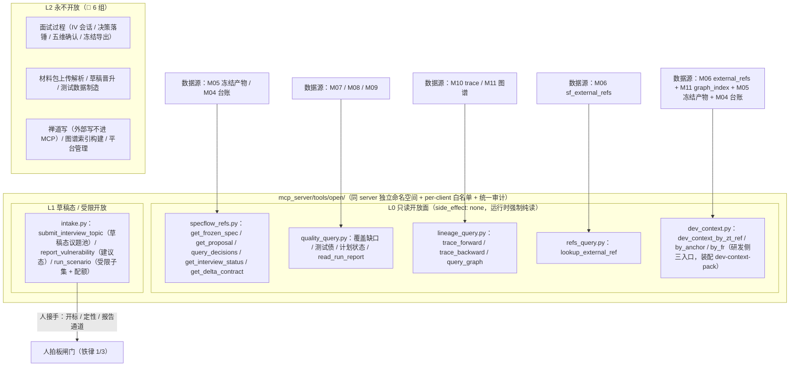
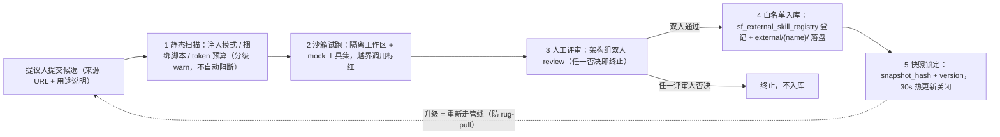
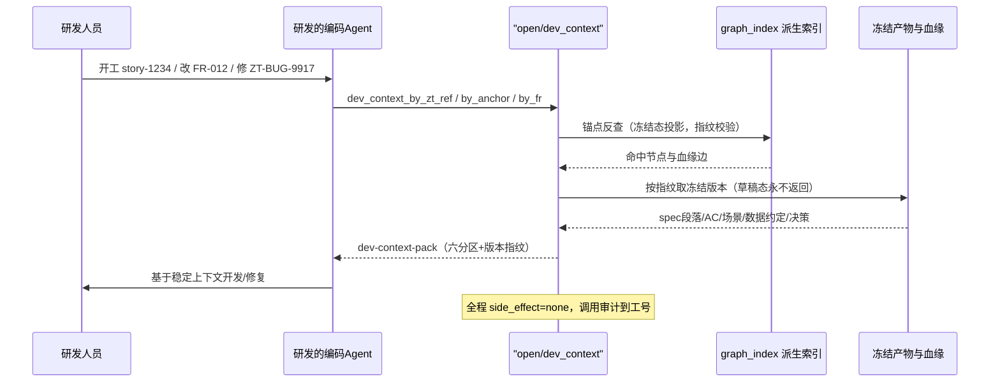

# M13 · Skill 与 MCP 体系及对外开放面 详细设计

> 原型屏：S8「Skill 与 MCP 体系」+ 全局 · 架构层：L3 智能层 + L4 工作台 · 现状定性：增强+新建混合（skill_loader/mcp_server 已有，治理件与开放面新建）
> 事实源：《SpecGuard-Skill与MCP体系建设分析》《SpecGuard-MCP对外开放场景评估》（2026-07 架构决策分析）、M12《多智能体运行时与平台基建》
> 分工口径：M12 定运行时与基建（profile/白名单机制本体）；本文定 skill 体系化、MCP 治理件与对外开放面。机制本体不重复展开，引用 M12。

---

## 0. 模块卡

| 项 | 内容 |
|---|---|
| 模块名 | Skill 与 MCP 体系及对外开放面（Skill Governance & MCP Open Surface） |
| 原型屏 | S8「Skill 与 MCP 体系」三列卡 + 编码 Agent 旗舰场景条；全局（审计/治理横切） |
| 架构层 | L3 智能层（skill_loader、mcp_server 治理件）+ L4 工作台（注册表查询端点、审计追溯页） |
| 现状定性 | **增强：skill_loader + mcp_server 已有，治理件与开放面新建**——加载机制成熟（30s 热加载是资产），治理机制空白（注册表/版本/分级/审计/审查管线皆缺）；`open/` 命名空间全新建 |
| 里程碑映射 | G1：skill 格式对齐四项 + 注册表 + 白名单三层交集 → G2：MCP 治理件（side_effect 运行时校验、info_pack 补票、审计）+ 对外 L0 只读面 8 组 → G3：外部 skill 审查管线 + 对外 L1 受限面 → 生态开放（MCP Registry/对外文档）= 储备项，不排期只挂触发条件 |
| 依赖模块 | M01（purpose 会话模型，白名单消费方）、M05/M04（spec 产物数据源）、M06（refs_query 数据 owner）、M10/M11（lineage/graph 查询数据源）、M12（profile/三层交集白名单/挂载规范机制本体） |

## 1. 模块定位与职责

**三合一基座模块**，回答两个架构决策问题并把结论工程化：

1. **skill 体系化（轻量，现在就做）**：skill 文件格式对齐 Agent Skills 开放规范（四项小改），之上自建注册表、版本字段、入库审查门禁、运行时权限过滤四件治理件；外部成熟 skill 经「适配层 + 五级审查管线」小步开放。
2. **MCP 治理化（不要平台化）**：保持 `mcp_server/server.py` 单 stdio server、单 `TOOL_MODULES` 注册点不动摇，补齐四件治理件——`side_effect` 分级、工具级权限（三层交集白名单，与 M12 §5.3 一致）、统一调用审计、四步挂载规范（含 `info_pack.py` 补票）；「外部写不进 MCP」从 M06 个案升为平台通则。
3. **对外开放面（按远期场景重建，不平移旧 24 工具）**：新建 `mcp_server/tools/open/` 命名空间，L0 只读为主体、L1 草稿态受限开放、L2 永不开放；研发侧 `dev_context.py` 三入口（接需求/开发接口/修BUG）为旗舰场景群，替代「各自 Agent 各自读 spec 仓库」的散装方式（§6.3）；需求面试口径为**「过程不开放、产物全开放、入口半开放」**——面试过程（多轮人机对话 + 人拍板）与 MCP 单次无状态工具调用形态天然不兼容，且被面试者是人，让外部 Agent 代答 = 击穿铁律 1，永不开放。

**消费模式四分（开放判断的尺度）**：① 读产物——查已冻结/已归档事实，MCP 天然匹配（单次调用、无状态、可缓存、可分级），是开放面主体；② 触发流程——提交待办让内部流程接住，可匹配但必须草稿态 + 人接手（议题、归因建议）；③ 参与过程——外部 Agent 进入多轮协作，不匹配（MCP 无状态、specflow 参与者是人）；④ 复用引擎——把面试官/解析器/制造器当 API，不值得（剥离人之后价值与风险倒挂）。逐场景评估结论：🟢 8 组全部只读、🟡 3 组草稿/受限、🔴 6 组不开放（清单见 §4.5）。

**本模块不做**（均给出触发条件，储备项口径）：

| 不做项 | 理由 | 再启动触发条件 |
|---|---|---|
| skill 市场/分发中心 | 内部 git 跟代码走已够用，无跨仓分发需求证据 | 出现第二个部署 SpecGuard 的团队且需要共享 skill |
| skill 自动评分平台 | 无质量基准数据集，评分无锚点 | skill 数 >20 且出现「同场景多 skill 选型」问题（先建人工回归集） |
| 成品 MCP gateway / 多 server 编排 | 24→30+ 工具单 server 远未到 N×M 问题；协议 ToolAnnotations 只是 hint 非安全边界 | 任一：① 禅道生态出现厂商背书的可信 server；② 平台工具数翻倍（>50）或多团队并发贡献；③ 出现第二个外部系统接入需求 |
| 面试过程 MCP 化 | 形态/参与者/上下文/闸门四重错配（见 §7） | 无——永不在路线图上 |

## 2. 原型交互 → 功能拆解

| 原型界面元素（S8 + 全局） | 功能点 | 后端支撑（已有/新建） |
|---|---|---|
| 「规范对齐」列卡：skill 格式对齐开放规范、注册表、版本字段 | skill 格式校验 + 注册表查询 + 版本留痕 | 已有：`skill_loader.py` frontmatter+md 同构基础（对齐成本极低，现有 3 skill 补齐 name/description 即自然合规）；**新建**：name/description 强制校验、`<>` 注入校验、未知字段宽容忽略、渐进披露、`version`/`author`/`depends_tools` 自建字段、skills 清单端点 |
| 「规范对齐」列卡副条：外部 skill 小步开放 | 外部 skill 导入通道 | **新建**：五级审查管线 + `sf_external_skill_registry` 登记表 + `agent/skills/external/{name}/` 快照目录（见 §5.3/§6.1） |
| 「审查管线 · side_effect 分级」列卡：外部 skill 五级管线、工具副作用三级 | 外部 skill 入库治理 + MCP 工具分级运行时校验 | **新建**：五级审查管线（静态扫描/沙箱试跑/人工评审/白名单入库/快照锁定）、`side_effect: none\|draft\|external-write` 声明与纯读强制、外部 skill 入库登记表 |
| 「审计 · L0L1L2 开放面」列卡：调用审计、开放面分层 | 平台级调用审计 + `open/` 命名空间 | **新建**：MCP 调用审计日志表（append-only，区别于业务 audit 模块）、`mcp_server/tools/open/` 六模块（specflow_refs/quality_query/lineage_query/refs_query/dev_context/intake）；分层口径 L0 只读 / L1 草稿受限 / L2 永不开放 |
| 「外部写不进 MCP」通则条 | 外部写隔离的平台级纪律 | **新建**：通则条文进挂载规范与评审 checklist；`external-write` 级默认为空集 + 空集校验进 CI（从 M06 个案升为通则，见 §7） |
| 编码 Agent 旗舰场景条：编码 Agent 写码前读冻结 spec「合同」 | 对外 L0 只读面头号消费者路径，升级为旗舰场景群 | **新建**：`open/specflow_refs.py` 五工具（get_frozen_spec/get_proposal/query_decisions/get_interview_status/get_delta_contract）+ `open/dev_context.py` 研发侧三入口（接需求/开发接口/修BUG，装配 dev-context-pack 六分区，§6.3）；数据源已有（M05 冻结产物、M04 台账、M06 external_refs、M11 graph_index） |
| （全局）闸门追溯页 | 审计消费面 | **新建**：按 emp + session_id + 工具名检索的审计查询页（G3） |

## 3. 现状与差距

**已有能力（真实模块名，增强基础）**：

- `agent/skill_loader.py` + `agent/skills/`（generate-scenario / validate-conformance / debug-failure 三个）：YAML frontmatter（temperature/tools/description/trigger）+ Markdown 正文注入 `<skills>` XML 块，30s TTL 热加载——加载机制成熟，是资产。
- `mcp_server/server.py` stdio 单 server + `tools/` 8 模块 24 工具，`TOOL_MODULES` 唯一注册点，`list_tools` 可回归计数；`info_pack.py` 基础读写已实现但未挂载（补票欠账）。
- 工具白名单三层交集机制设计（M12 §5.3）：`resolve_tools(session) = TOOL_REGISTRY ∩ profile.tools ∩ rbac_visible_tools`。

- 旧 24 工具的处置分类（遗留处置原则）：直接映射（spec_reader / registry_query / read_run_report / check_dag 等只读小撮）、改造后映射（run_scenario 加范围限制与配额）、永不映射（promote_draft / edit_dependency 等内部治理动作）。旧工具保持内部 stdio 面不变，对外只经 `open/` 命名空间暴露裁剪后的子集与新工具。

**差距（治理件与开放面，新建）**：

1. skill 无版本、无权限强制（tools 声明运行时不强制）、无注册表查询面、无格式强校验；skill 与 profile 的绑定（profile frontmatter `skills:` 字段）无注册表则无法校验悬空引用；
2. MCP 纯读纪律是约定非守卫：无 `side_effect` 分级、无运行时纯读强制、无平台级调用审计（audit 模块是业务工具不是平台审计）；闸门体系（铁律 1/3）要求「谁在哪个会话调用哪个工具写了什么」可查，否则人拍板事后无法追溯；
3. 无外部 skill 入库审查通道——「文件落盘即生效」对外部 skill 是敞口（公开 skill 36% 含注入）；skill 升级无变更留痕、无法声明与 MCP 工具的兼容关系（外部规范 version 字段仍是提案，不能等，须自建）；
4. 无对外开放面：现有 24 工具是测试侧早期内部工具面，不含 specflow 需求侧/血缘/图谱能力，与远期规划不适配，`open/` 命名空间需按场景重建。

**一句话现状**：加载机制成熟（热加载是资产），治理机制空白（注册表/版本/权限/审计皆缺）；开放面主体是远期新增能力（specflow 产物、血缘、图谱、禅道反查），不是旧工具平移。

## 4. 数据模型

### 4.1 Skill 注册表元数据（frontmatter 扩展，自建字段落在规范宽容区）

```yaml
---
name: generate-scenario        # 强制：≤64 字符、与目录名一致，缺失拒载
description: 按 covers 缺口生成场景草稿   # 强制：≤1024 字符；禁用 `<>`
version: 1.2.0                 # 自建：SemVer，不等规范提案，规范正式收纳后无缝切换
author: platform-team          # 自建
depends_tools: [read_scenario, validate_spec]   # 自建：声明依赖的 MCP 工具，供兼容性检查
temperature: 0.2
tools: [read_scenario, write_draft]   # 运行时第二重收窄（§7）
---
```

规则：未知字段一律忽略不报错（宽容解析）；目录名=name（多文件 skill 用目录形态）；渐进披露——装配 system prompt 先注入全部 skill 的 name+description，正文按 profile `skills:` 声明按需注入。

### 4.2 side_effect 分级枚举（MCP 工具声明式元数据）

| 级别 | 含义 | 运行时口径 |
|---|---|---|
| `none` | 纯读无副作用 | **强制纯读**：执行前后仓库状态指纹比对（或经只读文件句柄层），产生副作用即报错并记审计 |
| `draft` | 产物一律草稿态 | 闸门口径在声明中注明，与 profile `gate` 字段联动校验（如 draft_writer/audit） |
| `external-write` | 触外部系统的写 | **默认为空集**——「外部写不进 MCP」通则：任何触外部系统的写动作不得经 MCP 工具暴露给 Agent（铁律 1/4） |

声明形态：G1 落 docstring 声明全覆盖，G2-G3 落为结构化元数据 + 运行时校验。外部系统的读（如 refs_query）可进 MCP，归 `none` 级并走白名单。

### 4.3 MCP 调用审计日志表（新建，append-only）

```
sf_mcp_call_audit(id, ts, emp, session_id, purpose, workspace, tool_name,
                  side_effect, args_digest, result_digest, verdict, created_at)
```

- args_digest/result_digest 做长度截断与敏感字段脱敏；verdict ∈ {ok, denied-whitelist, denied-side-effect, warn}；
- 消费场景：闸门追溯（人拍板前的 Agent 行为链）、越权拒绝留痕、数据制造与归因 Agent 合规复核（铁律 3/7 证据面）。

### 4.4 外部 skill 入库登记表（新建）

```
sf_external_skill_registry(name, version, source_url, upstream_author,
                           reviewer1, reviewer2, review_date, snapshot_hash,
                           snapshot_path, pipeline_record, created_at)
```

落盘位置 `agent/skills/external/{name}/`；入库即冻结源码快照 + 记录 version，**外部 skill 不走 30s 热更新通道**——升级 = 重新走管线（防 rug-pull）。

skill 版本升级留痕（G3）：内部 skill 的 version 变更记录入库（变更人/变更摘要/前后版本），与注册表查询面联动可查。

### 4.5 open/ 模块工具清单表（对照逐场景评估 🟢8🟡3🔴6）

| open/ 模块 | 工具（层级） | 数据源 owner | 判断 |
|---|---|---|---|
| `specflow_refs.py` | get_frozen_spec / get_proposal / query_decisions / get_interview_status / get_delta_contract（L0） | M05 / M04 | 🟢 冻结 spec/锚点查询 |
| `quality_query.py` | 覆盖缺口/测试债查询（L0，M07）；报告查询 read_run_report 映射（L0，M09）；计划/批次/DAG 校验状态（L0，M08） | M07/M08/M09 | 🟢 3 组 |
| `lineage_query.py` | Q1/Q2 trace（L0，M10）+ 图谱节点/边/backlink/快照查询（L0，M11） | M10/M11 | 🟢 2 组 |
| `refs_query.py` | ZT-STORY/ZT-BUG 反查 spec 与验证状态（L0） | M06 sf_external_refs | 🟢 |
| `dev_context.py` | dev_context_by_zt_ref / dev_context_by_anchor / dev_context_by_fr（L0，研发侧三入口，装配 dev-context-pack 六分区） | M05/M06/M10/M11/M04 查询面（不拥有产物） | 🟢 旗舰场景群 |
| `intake.py` | submit_interview_topic（L1，G3 评估）/ report_vulnerability 改造映射为「建议态」（L1）/ run_scenario 受限子集（L1，仅限团队内、配额限制） | M02 / M09 / M08 | 🟡 3 组 |
| （不建） | 面试过程、材料包上传解析、决策落锤、五维确认、草稿晋升、测试数据制造、禅道写、图谱索引构建、平台管理 | — | 🔴 6 组，永不开放 |

L0=纯读开放面（运行时强制）；L1=草稿态/受限开放；L2=永不开放清单（§7）。

下图把 §4.5 的开放面分层画成一张图——`open/` 六模块挂 L0/L1，L2 永不开放清单在边界之外：



## 5. 接口设计

### 5.1 对外开放 MCP 工具（`mcp_server/tools/open/`，同 server 独立命名空间、独立白名单）

全部挂在现有 `mcp_server/server.py`，`TOOL_MODULES` 追加 `open.specflow_refs` 等模块名；per-client 白名单三层交集、OBO 身份到工号、统一审计。签名要点：

```
# specflow_refs.py（L0，全部 side_effect: none）
get_frozen_spec(module: str, workspace?: str) -> {spec_md, anchors: [FR-xxx...], frozen_at, delta_marks}
get_proposal(topic: str) -> {why, what, not_doing, acceptance}          # proposal 四段式
query_decisions(biz_ref?: str, level?: "P0|P1|P2", status?: str) -> [D-xxx {title, level, status, amend_chain}]
get_interview_status(iv_id: "IV-xxx") -> {progress, p0_cleared, scores, gate_status}
get_delta_contract(delta_id: str) -> {sections, manifest, contract_expectations: {tool, version}}
# quality_query.py（L0）
get_coverage_gaps(module: str) -> [{anchor: FR-xxx, state: uncovered|partial|covered, priority}]   # M07 三态聚合读面
get_test_debt(module?: str) -> [{item, since, owner_hint}]
get_plan_status(plan_id: "plan#7") -> {batch_layers, dag_check: ok|cycle|drift, delta_ref}          # M08 读面
read_run_report(run_id: "run#23") -> {summary, results: [{scenario_id, status, duration}]}          # 旧工具直接映射
# lineage_query.py（L0）
trace_forward(ref: "FR-012@inventory-session"|"ZT-STORY-4821") -> [链节点]     # M10 Q1：从锚点向下游追
trace_backward(ref: "SPQ-005"|"ZT-BUG-9917") -> [链节点]                       # M10 Q2：从问题向上游追
query_graph(node_id?: str, edge_type?: str, zoom: "L0|L1|L2") -> {nodes, edges} # M11 图谱/快照读面
# refs_query.py（L0）
lookup_external_ref(ref: "ZT-STORY-4821"|"ZT-BUG-9917") -> {spec_anchor, verify_status, lineage_hint}
# dev_context.py（L0，研发侧旗舰场景群三入口；装配 dev-context-pack 六分区，全程 side_effect: none）
dev_context_by_zt_ref(ref_type: "zt_story"|"zt_bug", ref_id: str) -> DevContextPack
   # 场景A 接需求 / 场景C 修BUG：sf_external_refs 反查 → 冻结版本 spec + AC + 场景 + 决策链（BUG 附失败证据摘要与血缘投影）
dev_context_by_anchor(anchor: str) -> DevContextPack
   # 场景B 开发接口：graph_index 锚点反查 → spec 段落/AC/覆盖场景/数据约定/血缘上下游（改前知震感）
dev_context_by_fr(fr_id: "FR-012", delta_id?: str) -> DevContextPack
   # 精准取版：可指定 delta 版本，默认当前冻结版
# DevContextPack 六分区：identity(聚合指纹/冻结版本/delta号/装配时间) / spec_excerpt(SHALL条款) /
#   acceptance(AC锚点) / scenarios(覆盖场景Gherkin) / data_contracts(数据约定+DAG batch位置) / lineage_decisions(血缘上下游+D-xxx/amendment)
# 三红线：只读冻结态（草稿物理不可达）；研发无任何写通道（反馈走禅道/SPQ人工通道）；pack 是带指纹的快照（可校验是否仍是当前版）
# intake.py（L1，G3 评估开放）
submit_interview_topic(title: str, source_url: str, material_refs: [MAT-xxx]) -> {topic_id, state: "draft"}
   # 一律落草稿态议题池，人开标才成 IV-xxx；不允许指定优先级、不允许跳过材料包装配；调用配额限制
report_vulnerability(run_id: str, scenario_id: str, verdict_hint: str, evidence_refs: [...]) -> {ticket, state: "suggested"}
   # 旧归因工具改造映射：对外限定「建议态」，人定性才生效不变（见 M09）
run_scenario(scenario_ids: [...], env: str) -> {run_id}   # 受限子集：仅限团队内 client、配额限制、结果走报告通道
```

G2 落地节奏：L0 只读面 8 组随远程化（Streamable HTTP + SSO）一起上线——这是对外 MCP 的真正起点；需求面试部分 G2 先开产物五件套，G3 评估议题投递口，面试过程永不在路线图上。

### 5.2 Skill 注册表查询端点（L4 工作台）

| 方法 | 路径 | 说明 |
|---|---|---|
| GET | `/api/agent/skills` | skills 清单：name/version/description/author/绑定 profile/depends_tools/来源（internal\|external）；数据源 = 目录扫描 + frontmatter 解析，保持「落盘即生效、30s 可见」 |
| GET | `/api/agent/skills/external` | 外部 skill 入库登记表查询（来源/评审人/快照版本） |

绑定关系：profile frontmatter `skills:` 字段为唯一绑定通道；注册表校验悬空引用（profile 声明了不存在的 skill）为**加载期错误**。

### 5.3 审查管线各阶段产出物

| 阶段 | 产出物 | 形态 |
|---|---|---|
| 1 静态扫描 | 扫描报告（注入模式/`<>`/捆绑脚本/token 预算，分级 warn——误报率约 42%，只分级不自动阻断） | 机器产出 |
| 2 沙箱试跑 | 隔离工作区 mock 工具集试跑记录（工具调用序列是否越界） | 机器产出 |
| 3 人工评审 | 双人 review 记录（重点：description 是否诱导工具误选——tool poisoning 的 skill 形态） | 人拍板 |
| 4 白名单入库 | `sf_external_skill_registry` 登记行 + `agent/skills/external/{name}/` 落盘 | 人拍板 |
| 5 快照锁定 | 源码快照 + snapshot_hash + version 记录；热更新通道对其关闭 | 确定性校验 |

## 6. 关键流程

下图对应 §5.3/§6.1 的外部 skill 五级审查管线——确定性打底、双人评审收口、快照锁定防 rug-pull：



### 6.1 外部 skill 导入五级管线时序

1. 提议人提交候选（来源 URL + 用途说明，首批只考虑厂商官方仓中与现有三 skill 互补的条目）→ 生成管线单；
2. **静态扫描**（确定性）：注入模式、frontmatter `<>`、捆绑可执行脚本、超 token 预算 → 分级报告（warn 不自动阻断）；
3. **沙箱试跑**：隔离工作区 + mock 工具集跑样例输入，记录工具调用序列，越界调用标红；
4. **人工评审**：架构组双人 review 扫描报告 + 试跑记录 + description 诱导性审查 → 任一评审人否决即终止；
5. **白名单入库 + 快照锁定**：登记来源/评审人/快照版本 → 落 `agent/skills/external/{name}/` → 快照冻结，30s 热更新对该 skill 关闭；后续升级 = 重新走管线。

导入节奏：小步开放、宁缺毋滥——生态质量数据（公开 skill 平均 6.2/12，仅 top-quartile 真正提升 agent 表现）说明多数公开 skill 不值得导入；首批只考虑厂商官方仓（anthropics/skills 等）中与现有三 skill 互补的条目。扫描器与质量门思路可参考业界雏形（skillcheck 类 frontmatter 校验 + token 预算检查），但管线自建、市场不建。

### 6.2 编码 Agent 经 open/ 读冻结 spec 的调用时序（旗舰场景）

1. 外部编码 Agent（Codex/Claude Code 等宿主）经远程化通道（Streamable HTTP + SSO，G2 随远程化落地）连接，OBO 身份映射到工号；
2. per-client 白名单三层交集解析可见工具集（仅 `open/` 命名空间 L0 子集）；
3. 调 `get_frozen_spec(module: "inventory-session")` → specflow_refs 读 M05 冻结产物（specstd 侧纯读）→ 返回 FR 锚点 + SHALL + [delta] 标记；
4. 调 `query_decisions` / `get_delta_contract` 查「为什么这么定」与契约期望 → 判断改动落在哪个 delta；
5. 每次调用落 `sf_mcp_call_audit`（who/session/tool/入参摘要/结果摘要）；纯读运行时强制——任何副作用即报错并记审计。

### 6.3 研发侧 dev_context 三入口消费时序（旗舰场景群，详见《研发侧MCP消费场景设计》）

研发人员在链上、在体系外——不进入流程，但经 MCP 消费冻结产物，替代「各自 Agent 各自读 spec 仓库」的散装方式（口径/版本/锚点/入口/审计五不稳）。三个入口同走一条只读通道：

1. **场景 A 接需求**：研发领 ZT-STORY-4821 → 编码 Agent 调 `dev_context_by_zt_ref("zt_story", "4821")` → sf_external_refs 反查 → 按指纹取冻结版 → 返回 pack（spec 段落/SHALL/AC/场景/数据约定/D-xxx 决策链）；
2. **场景 B 开发接口**：调 `dev_context_by_anchor("API-ORDER-CREATE")` 或 `dev_context_by_fr("FR-012")` → graph_index 锚点反查 → pack 附血缘上下游（改前知震感）与 DAG batch 位置；
3. **场景 C 修 BUG**：研发领 ZT-BUG-9917 → pack 出血缘投影（暴露 run → 失败证据摘要 → 关联场景锚点 → spec 版本 → 历史决策）；修完同包内场景即回归验收标准；
4. 每次调用落 `sf_mcp_call_audit`；pack 的 identity 分区带聚合指纹——研发侧 Agent 可随时校验「我读的还是不是当前版」；草稿态产物物理不可达，研发无任何写通道（反馈走禅道/SPQ 人工通道）。



### 6.4 议题提交 → 人开标时序（L1，G3 评估）

1. 外部系统（禅道/PM 工具/研发）调 `submit_interview_topic(title, source_url, material_refs)` → 配额校验 → 落**草稿态议题池**；
2. 工作台议题池出现草稿议题（标记外部来源）；人（产品）开标 → 走 M02 正常议题卡流程成为 IV-xxx；
3. 全程不允许外部指定优先级、不允许跳过材料包装配；材料只传 MAT-xxx 引用编号，不传输原文（材料密级最高，原文上传=绕过密级审查与人选型）；
4. 议题未开标前永不过期清理需人确认；调用全量审计。

## 7. 闸门与确定性校验

呼应全局铁律（本模块是铁律 1/2/3 在 skill/MCP/开放面上的运行时形态）：

- **五级管线人评审收口**（铁律 1/2/3）：静态扫描与沙箱试跑是确定性打底（扫描器误报率约 42%，只分级不自动阻断），人工评审双人收口，入库与快照锁定留痕可查。
- **纯读运行时强制**（铁律 2）：L0 开放面与全部 `side_effect: none` 工具的纯读由自家运行时强制（执行前后指纹比对/只读句柄层），**不信 server 自述的 ToolAnnotations**——hint 非安全边界。
- **dev_context 三红线**（研发侧消费，铁律 2/4）：只读冻结态（草稿/未确认议题/未清零 P0 物理不可达）；研发无任何写通道（不回写 spec、不动台账、不改 BUG 状态，反馈走禅道/SPQ 人工通道）；pack 是带聚合指纹的快照而非订阅（消费端可校验是否仍是当前版）。
- **白名单三层交集**（铁律 2）：与 M12 §5.3 同一机制，不另造：`resolve_tools(session) = TOOL_REGISTRY ∩ profile.tools ∩ rbac_visible_tools`；skill frontmatter `tools` 声明为第二重收窄——超出 profile 白名单的部分不生效并记审计 WARNING；越权调用由 `runtime.py` 分发前确定性拒绝。
- **禁外部 skill 热更新**（铁律 3，防 rug-pull）：入库即快照锁定；修改其源文件 30s 内热加载**不生效**；升级重走管线。
- **L2 永不开放清单**：面试过程（IV 会话、提问生成、决策落锤 resolve/amend、五维确认、冻结导出）、材料包上传解析、草稿晋升、测试数据制造、禅道写、图谱索引构建、平台管理（用户/工作区/配置）——需求面试「过程不开放、产物全开放、入口半开放」中「过程不开放」即此清单的核心，理由是形态/参与者/上下文/闸门四重错配，且被面试者是人（铁律 1 一票否决）。
- **「外部写不进 MCP」通则**（铁律 1/4）：任何触外部系统的写动作不得经 MCP 工具暴露给 Agent，内外部一视同仁；`external-write` 级默认为空集，空集校验进 CI。
- **数据密级与反向 tool poisoning**：材料原文不出工作台（密级最高）；外部 server/外部输入输出一律视为不可信数据（防 tool poisoning/间接注入）；description 诱导性审查为人工评审固定项。
- **四步挂载规范固化为 checklist**（铁律 3）：① 新建 `mcp_server/tools/{module}.py`（每工具一个纯函数，docstring 即工具说明）→ ② `TOOL_MODULES` 追加（唯一注册点）→ ③ `side_effect` 声明与分类纪律 → ④ `list_tools` 计数回归；补票项 `info_pack.py` 挂入。「实现了但没进体系」类欠账由第 4 步回归防止再发。
- **铁律 6 不开旁路**：skill/MCP 体系不为计划生成开任何旁路——数据制造走草稿三闸、计划只能由 delta 导入生成（见 M08）；铁律 7 的诚实语义由审计日志提供证据面。
- **铁律 8 落为注册表评审项**：任何新 profile/skill 的工具白名单不得含代码生成/研发管理类工具；外部 skill 导入评审同查。
- **绕闸红线**：外部 skill 绕过管线落盘生效、`none` 级工具产生副作用、L2 清单能力经任何通道暴露、面试过程被 MCP 化——任一 = **阻断性缺陷**。

## 8. 依赖与边界

**上游 / 横向**：

- **M12**：profile 机制、三层交集白名单机制本体、四步挂载规范、purpose 会话装配——机制归 M12，本文的注册表/分级/审计/审查管线挂在其上；skill 声明收窄是 M12 白名单之上的第二重过滤，不重复展开。
- **M05/M04**：specflow_refs 的数据源——冻结 spec/proposal/delta 契约（M05）、决策台账/评分/进度（M04）；本模块只做查询面，不拥有产物。
- **M06**：refs_query 与 dev_context 场景 A/C 的数据 owner（sf_external_refs，同表同源不另建副本）；禅道写不开放——「外部写不进 MCP」通则从 M06 个案升来，执行口径回指 M06。研发反馈问题走禅道/SPQ 人工通道，不经 MCP。
- **M10/M11（dev_context 场景 B/C）**：graph_index 锚点反查与血缘投影是 dev_context 的算力来源；依赖 T-070/T-056 先行。
- **M10/M11**：lineage_query 的数据源——Q1/Q2 trace（M10）、图谱节点/边/快照（M11）；图谱索引**构建**不开放（内部确定性派生服务）。
- **M02**：面试产物五件套的数据源与议题投递口的接收方——submit_interview_topic 落 M02 议题池草稿态，开标流程归 M02。
- **M01**：purpose 会话模型是白名单与审计 session/purpose 字段的来源。

**储备项预案要点**（触发条件见 §1，满足任一时启动评审）：MCP client 能力挂 `agent/` 侧；迷你 gateway 只做三件事——工具白名单、readOnly 强制（自行校验不信 annotations）、参数与输出审计；外部 server 输出一律视为不可信数据；外部 server 快照锁定、禁自动热更（防 postmark-mcp 式 rug-pull）。禅道方向维持判断：现有社区 zentao-mcp 为 Unvalidated 个人项目、凭证明文，不接入，zentao-cli 子进程通道保持（见 M06）。

**不承担**：

- 不拥有任何业务产物（spec/台账/血缘/图谱/external_refs 各归 owner 模块）；
- 不改单 server 单注册点架构；不引入成品 gateway、不做多 server 编排（储备项，触发条件见 §1）；
- 不做 skill 市场与评分平台（储备项）；
- 不做面试过程 API 化（永不）；不定义各专业化 Agent 业务逻辑（归 M03/M08/M09/M06/M11）。

## 9. 里程碑映射与验收标准

前置说明：**F3（随 purpose 会话模型，与 M01/M12 共建）**落地白名单运行时过滤与审计日志骨架（who/session/tool/结果），profile/skill 绑定关系随 purpose 装配生效——机制排期归 M12 F3/G1，本模块不重复列验收，以下只列本模块自有交付件（G1 起）。

| 阶段 | 内容 | 可检验的验收标准 |
|---|---|---|
| **G1**（格式对齐 + 注册表 + 白名单） | skill 格式对齐四项（name/description 强校验、目录名=name、未知字段宽容忽略、渐进披露 + `<>` 校验进 CI）+ `version`/`author`/`depends_tools` 自建字段 + skills 清单端点 + 悬空引用校验 + 三层交集白名单随 M12 G1 上线 | ① 缺 name/description 或含 `<>` 的 skill 被拒载并告警，含未知字段的合规 skill 正常加载；② `GET /api/agent/skills` 返回 version/depends_tools，profile 声明不存在的 skill 报悬空引用错误；③ profile 白名单外工具调用被运行时拒绝且无副作用；skill 声明超出 profile 白名单部分不生效且审计有 WARNING |
| **G2**（治理件 + 对外 L0） | `info_pack.py` 挂载补票 + `side_effect` 声明全覆盖 + `none` 级纯读运行时校验 + 调用审计日志 + 「外部写不进 MCP」通则写入规范 + 对外 L0 只读面 8 组上线（随远程化 Streamable HTTP + SSO） | ① `info_pack.py` 挂载后 `list_tools` 计数与实际一致；② 对 `none` 级工具注入副作用的用例被运行时拦截并记审计；③ 规范文档可检索到通则条款，新工具模块评审记录含该检查项；④ 任意 MCP 调用可按 emp+session_id+工具名检索到完整审计记录；⑤ 编码 Agent 经 `open/specflow_refs` 读冻结 spec 全流程走通，L0 面零写副作用；⑥ 研发侧旗舰 e2e：从 ZT-STORY 号经 `dev_context_by_zt_ref` 拿到六分区 pack，identity 指纹与冻结版本一致，草稿态内容零泄漏（场景 A 收口） |
| **G3**（审查管线 + 对外 L1） | 外部 skill 五级审查管线上线（首批 ≤3 个厂商官方 skill 试跑）+ skill 版本升级留痕 + 审计消费面（闸门追溯页）+ 对外 L1 两组评估开放（submit_interview_topic / run_scenario 受限子集）+ 归因建议提交改造映射 | ① 一个外部 skill 完整走五级管线入库，来源/评审人/快照可查；修改其源文件 30s 内热加载不生效（快照锁定证据）；② `external-write` 空集校验进 CI 通过；③ submit_interview_topic 落草稿态议题池，人开标才成 IV-xxx，外部无法指定优先级或跳过材料包装配 |
| **储备项**（不排期，触发条件驱动） | skill 市场/评分平台、MCP client + 迷你 gateway、生态开放（注册 MCP Registry、对外文档） | 路线图无排期任务；触发条件写入评审 checklist，任一满足自动生成评审议题；生态开放触发条件：外部接入需求 + 内部跑稳一季度 |

**验收红线（任何阶段）**：L2 清单能力无对外暴露通道；外部 skill 无管线不入库；`none` 级工具零副作用；绕闸 = 阻断性缺陷（§7）。
